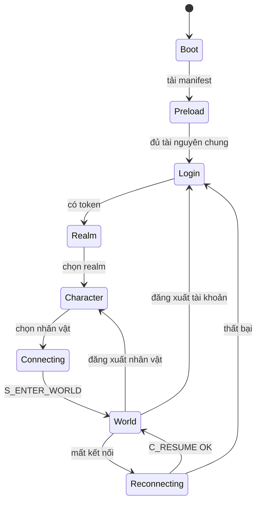
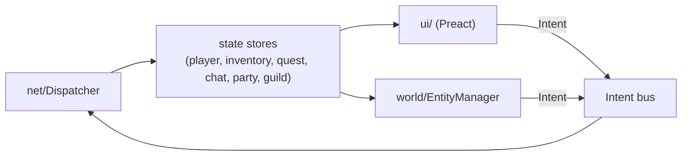

# Thiết kế Client

> **Trạng thái:** Draft v0.1 · **Liên quan:** [ui-ux](../game-design/11-ui-ux-spec.md) · [art-audio](../game-design/12-art-audio-direction.md) · [network-protocol](network-protocol.md)

## 1. Công nghệ

| Hạng mục | Chọn |
|----------|------|
| Ngôn ngữ | TypeScript (strict) |
| Render | **Phaser 3** (WebGL, fallback Canvas) |
| UI overlay | **Preact** + CSS (DOM trên canvas) |
| Trạng thái UI | `@preact/signals` hoặc store nhỏ tự viết |
| Build | **Vite** |
| Mobile | **Capacitor** (Android/iOS) |
| Kiểm thử | **Vitest** (đơn vị), **Playwright** (E2E), ảnh chụp so sánh (visual) |
| Giao thức | MessagePack (`@msgpack/msgpack`) qua WebSocket |
| i18n | JSON theo ngôn ngữ, `t('domain.key')` |

**Lý do chia canvas và DOM:** thế giới game vẽ bằng canvas (hiệu năng), còn menu/danh sách/form bằng DOM (dễ làm, hỗ trợ bàn phím ảo, chọn text, truy cập).

## 2. Cấu trúc thư mục

```text
apps/web-client/src/
├─ main.ts                 # khởi động
├─ app/                    # vòng đời ứng dụng, router scene
├─ scenes/                 # Phaser scenes
│   ├─ BootScene.ts
│   ├─ PreloadScene.ts
│   ├─ LoginScene.ts       # (hoặc DOM)
│   ├─ RealmScene.ts
│   ├─ CharacterScene.ts
│   └─ WorldScene.ts       # gameplay
├─ net/                    # WebSocket client, codec, reconnect, rate limit
├─ world/                  # EntityManager, interpolation, prediction
├─ render/                 # paper-doll, camera, parallax, VFX
├─ input/                  # keyboard, touch, gamepad (sau)
├─ ui/                     # Preact components (HUD, windows)
├─ state/                  # store: player, inventory, quest, chat
├─ audio/                  # BGM/SFX manager
├─ assets/                 # manifest, loader
├─ i18n/                   # vi.json, en.json
├─ telemetry/              # log, metrics client
└─ util/
```

## 3. Vòng đời ứng dụng



## 4. Mạng (net)

| Thành phần | Trách nhiệm |
|------------|-------------|
| `Connection` | Mở WSS, gửi/nhận khung, ping, đo RTT |
| `Codec` | Đóng/mở khung (version, opcode, seq, payload) |
| `Dispatcher` | Gửi gói đến handler theo opcode |
| `Reconnect` | Backoff 1s, 2s, 4s, 8s, 15s; dùng `resume token` |
| `RateLimiter` | Phía client, bảo vệ không gửi dồn dập |
| `Ack/Idem` | Gắn `idemKey` cho lệnh tài sản, hiển thị trạng thái chờ |

Quy tắc: **không tin tưởng client state cho tài sản**; mọi thay đổi túi đồ/tiền chỉ cập nhật khi có `S_INVENTORY_DELTA`/`S_STATS_UPDATE`. (Tối ưu hóa lạc quan chỉ áp dụng cho UI không ảnh hưởng tài sản.)

## 5. Dự đoán & nội suy

### 5.1 Người chơi cục bộ (prediction + reconciliation)

```text
mỗi frame:
  input = đọc phím/chạm
  nếu input thay đổi hoặc 50ms trôi qua: gửi C_MOVE_INPUT(seq++)
  áp dụng input vào mô hình vật lý cục bộ (cùng code với server)
  lưu (seq, input, state) vào pendingInputs

khi nhận snapshot (có lastProcessedSeq):
  bỏ pendingInputs có seq <= lastProcessedSeq
  đặt state = state_server
  áp dụng lại pendingInputs còn lại
  nếu sai lệch nhỏ: nội suy mượt đến state mới (smoothing)
  nếu sai lệch lớn (>6px): giật về (snap)
```

Mô hình vật lý di chuyển **dùng chung** từ `packages/shared/physics`.

Hiện thực (bậc B1, `apps/web-client/src/world/`):
- Vòng bước cố định 50 ms chạy theo **đồng hồ thật** (`performance.now()`), không theo `delta` của Phaser. Lý do: Phaser làm mượt và giới hạn `delta` khi khung hình chậm, khiến game chạy chậm hơn server.
- Khung chậm: bù tối đa 10 bước (0,5 giây), phần dư bỏ đi.
- Hình nhân vật nội suy giữa hai bước gần nhất.
- Người khác: mỗi snapshot ghi một mẫu cho **mọi** thực thể đang thấy, kể cả thực thể không đổi, để người đã đứng yên không bị ngoại suy quá chỗ dừng.

### 5.2 Thực thể khác (interpolation)

- Giữ **bộ đệm snapshot 100 ms** và nội suy giữa hai snapshot.
- **Ngoại suy** tối đa 200 ms khi mất gói rồi đứng yên.
- Quái và NPC dùng cùng cơ chế.

### 5.3 Chiến đấu

- Bấm kỹ năng: phát **hoạt ảnh cast ngay** (tin tưởng), nhưng **số sát thương chỉ hiển thị khi server xác nhận**.
- Nếu server từ chối (`S_ERROR`, vd: COOLDOWN), hủy hoạt ảnh và hiện thông báo nhỏ.

Hiện thực (bậc B2, `apps/web-client/src/scenes/WorldScene.ts`, `src/ui/hud.ts`, `src/state.ts`):

**Đánh**
- J (giữ để đánh liên tục) và 1 gửi `C_USE_SKILL` kèm `seq` của bước input gần nhất. Hoạt ảnh và vệt chém chạy ngay.
- Hồi chiêu đếm ở client chỉ để hiển thị và để không gửi thừa; server vẫn quyết định.
- Lỗi hồi chiêu không hiện thông báo. Thiếu MP, chưa đủ cấp, túi đầy, khu đầy, map chưa mở thì hiện thông báo nhỏ.
- Tab hoặc nhấp chuột vào quái để khóa mục tiêu (mũi tên vàng). Đánh trúng quái khi chưa khóa thì tự khóa nó.

**Hiển thị**
- Số sát thương, "Trượt" và "Né" chỉ hiện khi có `S_DAMAGE`.
- Thanh máu quái hiện 4 s sau khi trúng đòn hoặc khi đang khóa.
- Quái chết thì chạy hoạt ảnh gục rồi mới gỡ.

**Đồ rơi và bình thuốc**
- Đi qua đồ rơi thì client gửi `C_PICKUP`: chỉ khi mình là chủ hoặc đã hết 15 s khóa, mỗi món tối đa một lần mỗi 0,6 s.
- Q, E dùng bình HP, MP. Chọn bình nhỏ nhất đủ bù phần thiếu, nếu không có thì bình lớn nhất.

**Đổi map và nhập phím**
- Khi nhận `S_ENTER_WORLD` hoặc `S_MAP_CHANGE`, `Connection.hold()` giữ các gói đến sau. Cảnh mới tạo xong thì `release()` xử lý chúng theo thứ tự (network §3.1.2).
- Nhấn ↑ ở cổng gửi `C_USE_PORTAL` và tạm ngừng gửi input tới khi đổi map xong.
- Phím nhấn ngắn hơn một bước 50 ms (nhảy, ↑) được giữ lại cho bước kế tiếp, nên chạm nhanh không bị mất.
- Khi gõ chat, phím game tắt và Phaser thôi chặn phím, để gõ được khoảng trắng và mũi tên.

**HUD**
- HUD là DOM nằm trên canvas, dùng đơn vị `cqw` như bản chơi thử: khung nhân vật (HP, MP, EXP, Quan, Lực Chiến), nút tên map và khu (mở danh sách khu), ô chat và nhật ký, 4 ô hành động (J, 1, Q, E) có lớp phủ hồi chiêu, bảng "Bạn đã gục ngã" có nút về làng.
- Phím ảo cho điện thoại (`src/ui/touch.ts`, [ui-ux §3.2](../game-design/11-ui-ux-spec.md)):
  - bật khi màn hình cảm ứng (`pointer: coarse`), khi một ngón tay chạm vào game, hoặc bằng `?touch=1`;
  - cần điều khiển và nút Đánh/Nhảy ghi vào `VirtualInput`, scene đọc cùng bàn phím;
  - nút Nói và ◎ gọi thẳng `interact()` và `cycleTarget()` của scene;
  - khi bật, HUD xếp lại cho ngón tay, khung game không cao quá màn hình, và cầm dọc thì hiện lời nhắc xoay ngang.

Hiện thực (bậc B3, `src/main.ts`, `src/net/api.ts`, `src/ui/charwin.ts`):

**Đăng nhập**
- Màn **Đăng nhập / Đăng ký** (hai thẻ). Tên tài khoản và mật khẩu được kiểm ngay ở client cho nhanh, server vẫn kiểm lại. Lỗi hiện bằng câu tiếng Việt theo mã lỗi của API.
- Mở trang thì client thử `POST /api/auth/refresh` bằng cookie. Còn phiên thì vào thẳng màn **Chọn nhân vật**.

**Nhân vật và vào game**
- Màn **Chọn nhân vật**: danh sách (tên, cấp, xuất thân, map), nút "Vào game", form **Tạo nhân vật** (ẩn khi đủ 3), "Đăng xuất".
- "Vào game" xin vé (`/session/ticket`) rồi mở WebSocket tới `wsUrl` của realm.
  - `?ws=` hoặc `VITE_GAME_WS_URL` ghi đè địa chỉ này.
  - Địa chỉ `localhost` được đổi sang host của trang, để điện thoại trong mạng LAN chơi được.
- Token truy cập chỉ nằm trong bộ nhớ; hết hạn (401) thì client tự làm mới một lần.
- Vite chuyển `/api` sang API khi phát triển (`VITE_API_PROXY`).

**Trong game**
- Cửa sổ **Nhân vật** (phím C hoặc nút "Nhân vật" có huy hiệu số điểm trống): chỉ số, điểm còn, +1 và +5 từng dòng, "Cộng gợi ý", "Hủy", "Xác nhận" (gửi `C_ALLOCATE_POINTS`).
- Ô chat có nút đổi kênh **Khu / Thế giới**.
- "Đổi nhân vật" tải lại trang.

Hiện thực bậc B4 (`src/ui/dialog.ts`, `quests.ts`, `bag.ts`, `rite.ts`, `dom.ts`):
- **NPC:** sprite đứng yên có tên và dấu nhiệm vụ (`!` nhận hoặc nói chuyện, `?` trả; màu xám khi chưa tới lúc). Nhấn **F** gần NPC (hoặc nhấp vào NPC) để nói chuyện; F cũng hái thảo dược, mở rương, chạm Đài Khai Thư.
- **Hộp thoại:** chân dung, tên, lời thoại, tối đa 6 lựa chọn; phím 1–6, F/Enter/Space chọn mục đầu, Esc đóng. Cảnh phát từng câu trong cùng hộp thoại.
- **Nhiệm vụ:** bảng theo dõi dưới các nút menu (nhấp hoặc **L** để mở cửa sổ chi tiết: mục tiêu, nơi tìm, phần thưởng); băng rôn khi nhận, đủ mục tiêu, hoàn thành.
- **Hành trang (B):** 5 ô trang bị, Lực Chiến, túi 30 ô theo thẻ, chi tiết món (chỉ số, dòng phụ, bộ, giá bán). Nhấn đúp để mặc, tháo hoặc dùng. Ở tiệm: danh sách hàng (Mua 1, Mua 5) và bán (món Hiếm trở lên phải bấm hai lần).
- **Lễ Khai Thư:** 7 hệ, 2 hệ mở; chi tiết vai trò, vũ khí, nội tại, 3 kỹ năng.
- **HUD:** ô hành động dựng theo danh sách kỹ năng server gửi (J, 1–4) cộng 2 bình; thanh máu boss; đồng hồ hầm ngục và nút rời.
- **Scene:** vùng báo hiệu của boss tô đỏ dần tới lúc rơi; Hỏa Cầu và Thủy Đạn là đạn bay 400 px; ngoại hình nhân vật đổi theo hệ.
- Trong lúc mở hộp thoại, hành trang hay cửa sổ chọn hệ, phím di chuyển và kỹ năng tạm tắt.
- `S_KICK` hiện lý do (đăng nhập nơi khác, bảo trì).

## 6. Render

### 6.1 Paper-doll (lớp nhân vật)

- Nhân vật là chuỗi **lớp sprite** (xem [art §3.3](../game-design/12-art-audio-direction.md)). Mỗi trang bị là một atlas.
- **Tối ưu:** khi trang bị đổi, ghép các lớp thành **một spritesheet tạm** (`RenderTexture`) lưu trong cache theo `appearanceHash`. Người chơi cùng bộ trang bị dùng chung texture.
- Đồng bộ qua `appearanceHash`: server chỉ gửi danh sách ID trang bị hiển thị.

### 6.2 Camera & parallax

- Camera theo người chơi với **deadzone**, giới hạn theo kích thước map.
- 3–4 tầng nền với hệ số cuộn `0.2, 0.4, 0.7, 1.0`.
- Zoom nguyên (×1/×2) theo kích thước màn hình để giữ pixel sắc nét (`pixelArt: true`).

### 6.3 Số sát thương và hiệu ứng

- Object pool cho text sát thương, hiệu ứng, đạn.
- Giới hạn VFX đồng thời; giảm khi FPS thấp.

### 6.4 Hiệu năng

| Biện pháp | Mô tả |
|-----------|-------|
| Atlas | Mỗi map một atlas; tái dùng texture |
| Culling | Chỉ vẽ trong khung nhìn |
| Pool | Tái dùng đối tượng, tránh GC trong game loop |
| Giảm người hiển thị | Cài đặt: 10/20/40 người |
| Chế độ tiết kiệm | 30 FPS, tắt parallax phụ, giảm VFX |
| Tách DOM và canvas | Cửa sổ không cập nhật khi đóng |

## 7. Input

| Thiết bị | Cách xử lý |
|----------|------------|
| Bàn phím | Bảng gán phím cấu hình được (xem [ui §4](../game-design/11-ui-ux-spec.md)) |
| Chuột | Chọn mục tiêu, tương tác NPC, kéo thả vật phẩm |
| Cảm ứng | Joystick ảo, nút kỹ năng, cử chỉ |
| Bàn phím ảo | DOM `<input>` để dùng bàn phím hệ thống khi chat |

Input được chuyển thành **Intent** (`MoveIntent`, `UseSkillIntent`, `InteractIntent`) rồi gửi qua `net`. Thành phần UI và scene **không** gọi mạng trực tiếp.

## 8. Quản lý trạng thái



- Mỗi store là nguồn dữ liệu duy nhất cho phần của nó.
- Server gửi **delta**, store áp dụng theo thứ tự `seq`.

## 9. Tài nguyên (assets)

| Bước | Mô tả |
|------|-------|
| **Manifest** | `assets/manifest.json` liệt kê gói và hash (build tạo) |
| **Gói** | `core` (UI, nhân vật, SFX), `region/<id>`, `map/<id>`, `boss/<id>`, `audio/<region>` |
| **Tải trước** | Khi vào map, tải map kế tiếp ở nền |
| **Cache** | URL có hash, `Cache-Control: immutable`; Service Worker cho cache offline tài nguyên |
| **Kiểm tra phiên bản** | `protocolVersion` và `contentVersion` khi handshake; nếu lệch → buộc làm mới |

## 10. Âm thanh

- `AudioManager` quản lý BGM (cross-fade 1.5s), SFX (pool, giới hạn 16 kênh), âm lượng theo nhóm.
- Cần thao tác người dùng đầu tiên để mở khóa audio (hiển thị lời nhắc "Chạm để bắt đầu").
- Tự ngắt khi tab ở nền.

## 11. Mobile (Capacitor)

| Mối quan tâm | Giải pháp |
|--------------|-----------|
| Safe area (tai thỏ) | CSS `env(safe-area-inset-*)` |
| Hướng màn hình | Khóa ngang |
| Hiệu năng | Cấu hình đồ họa tự động theo thiết bị |
| Phiên | Lưu token an toàn (Keychain/Keystore qua plugin) |
| Cập nhật | Gói web cập nhật qua CDN, bản ứng dụng chỉ khi đổi native |
| Thanh toán | Theo chính sách store (xem [legal §7](../product/legal-and-compliance.md)) |
| Thông báo đẩy | Tùy chọn: sự kiện, boss thế giới |

## 12. Bảo mật phía client

- Không lưu bí mật trong bundle; token trong bộ nhớ/`httpOnly` cookie hoặc kho an toàn.
- **Không tin client**: mọi quyết định ở server. Client chỉ là lớp hiển thị.
- Chống chỉnh sửa gói: mã hóa không phải biện pháp bảo vệ chính; dựa vào kiểm tra server.
- Tắt `console` thông tin nhạy cảm ở bản production; Sentry không gửi dữ liệu cá nhân.

## 13. Kiểm thử

| Loại | Công cụ | Phạm vi |
|------|---------|---------|
| Unit | Vitest | Công thức, codec, store, input mapping |
| Component | Vitest + Testing Library | UI Preact |
| E2E | Playwright (headless Chromium) | Đăng nhập → vào game → đánh quái → nhận nhiệm vụ |
| Visual | Ảnh chụp so sánh | HUD, cửa sổ chính |
| Hiệu năng | Lighthouse, Phaser profiler | FPS, tải ban đầu |
| Thiết bị | Ma trận thiết bị | Android thấp cấp, iPhone cũ |

## 14. Telemetry client

| Sự kiện | Dữ liệu |
|---------|---------|
| `client_boot` | phiên bản, thiết bị, thời gian tải |
| `login_success/fail` | lỗi, thời gian |
| `fps_sample` | FPS trung bình 10 s |
| `latency_sample` | RTT p50/p95 |
| `ui_funnel` | các bước hướng dẫn, tạo nhân vật |
| `error` | lỗi, stack (ẩn dữ liệu cá nhân) |

Gửi theo lô mỗi 30 s, tắt được bởi người dùng nếu luật yêu cầu.
