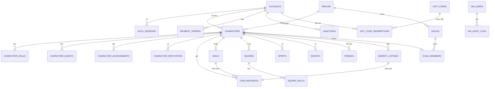

# Thiết kế cơ sở dữ liệu

> **Trạng thái:** Draft v0.1 · **DB:** PostgreSQL 16 · **Liên quan:** [system-architecture](system-architecture.md) · [server-design](server-design.md) · [economy](../game-design/08-economy-and-monetization.md)
> Schema chuẩn lưu trong `packages/db` (Prisma + migration SQL). Bản dưới là **đặc tả tham chiếu**.

## 1. Quy ước

| Hạng mục | Quy ước |
|----------|---------|
| Tên | `snake_case`, bảng số nhiều |
| Khóa chính | `uuid` (`gen_random_uuid()`) cho thực thể nghiệp vụ; `bigint identity` cho log/ledger |
| Thời gian | `timestamptz` (UTC); cột `created_at`, `updated_at` |
| Tiền | `bigint`, đơn vị nhỏ nhất (Quan, Nén Bạc là số nguyên), có `CHECK (>= 0)` |
| Xóa | **Xóa mềm** (`deleted_at`) cho tài khoản, nhân vật; cứng cho dữ liệu tạm |
| Enum | Kiểu `ENUM` PostgreSQL cho tập ổn định; chuỗi (`text`) cho ID nội dung |
| Tham chiếu nội dung | ID nội dung tĩnh (map, item template, quest) là `text`, **không FK** (validator kiểm tra khi tải) |
| JSONB | Chỉ cho dữ liệu cấu trúc phụ (ngoại hình, dòng phụ, tiến độ), có schema ở tầng ứng dụng |
| Phiên bản | Cột `version int` (khóa lạc quan) cho thực thể hay cập nhật đồng thời |

## 2. Sơ đồ quan hệ (ERD rút gọn)



## 3. Kiểu liệt kê (ENUM)

```sql
CREATE TYPE account_status   AS ENUM ('ACTIVE', 'SUSPENDED', 'BANNED', 'DELETED');
CREATE TYPE origin_type      AS ENUM ('VILLAGER', 'NOBLE', 'ANCIENT');
CREATE TYPE class_type       AS ENUM ('NONE', 'FIRE', 'WATER', 'WIND', 'BOLT', 'EARTH', 'PLANT', 'DARK', 'ARCHER');
CREATE TYPE gender_type      AS ENUM ('M', 'F');
CREATE TYPE pk_state_type    AS ENUM ('PEACE', 'FLAGGED');
CREATE TYPE item_location    AS ENUM ('BAG', 'EQUIP', 'BANK', 'MAIL', 'MARKET', 'GUILD_BANK', 'TRADE');
CREATE TYPE quest_status     AS ENUM ('ACCEPTED', 'IN_PROGRESS', 'READY', 'COMPLETED', 'ABANDONED', 'FAILED');
CREATE TYPE currency_type    AS ENUM ('SOFT', 'PREMIUM', 'GUILD_POINT', 'BADGE', 'MERIT');
CREATE TYPE owner_kind       AS ENUM ('CHARACTER', 'ACCOUNT', 'GUILD');
CREATE TYPE friend_status    AS ENUM ('PENDING', 'ACCEPTED', 'BLOCKED');
CREATE TYPE guild_role       AS ENUM ('LEADER', 'VICE', 'ELITE', 'MEMBER');
CREATE TYPE listing_status   AS ENUM ('ACTIVE', 'SOLD', 'EXPIRED', 'CANCELLED');
CREATE TYPE payment_status   AS ENUM ('PENDING', 'PAID', 'FAILED', 'REFUNDED', 'CHARGEBACK');
CREATE TYPE sanction_kind    AS ENUM ('MUTE', 'BAN');
CREATE TYPE gm_role          AS ENUM ('SUPPORT', 'GM', 'ADMIN', 'SUPERADMIN');
CREATE TYPE report_status    AS ENUM ('OPEN', 'REVIEWING', 'ACTIONED', 'DISMISSED');
```

## 4. Bảng

### 4.1 Tài khoản & phiên

```sql
CREATE TABLE accounts (
  id                uuid PRIMARY KEY DEFAULT gen_random_uuid(),
  username          text NOT NULL,
  email             text NOT NULL,
  password_hash     text NOT NULL,                      -- argon2id
  status            account_status NOT NULL DEFAULT 'ACTIVE',
  premium_currency  bigint NOT NULL DEFAULT 0 CHECK (premium_currency >= 0),
  vip_total_vnd     bigint NOT NULL DEFAULT 0 CHECK (vip_total_vnd >= 0),
  birth_date        date,                               -- phục vụ hạn mức theo tuổi
  phone_verified_at timestamptz,
  two_factor_secret text,
  locale            text NOT NULL DEFAULT 'vi',
  created_at        timestamptz NOT NULL DEFAULT now(),
  updated_at        timestamptz NOT NULL DEFAULT now(),
  last_login_at     timestamptz,
  deleted_at        timestamptz
);
CREATE UNIQUE INDEX accounts_username_uq ON accounts (lower(username));
CREATE UNIQUE INDEX accounts_email_uq    ON accounts (lower(email));

CREATE TABLE auth_sessions (
  id                 uuid PRIMARY KEY DEFAULT gen_random_uuid(),
  account_id         uuid NOT NULL REFERENCES accounts(id) ON DELETE CASCADE,
  refresh_token_hash text NOT NULL,
  device             text,
  ip_hash            text,                              -- băm, không lưu IP thô lâu dài
  created_at         timestamptz NOT NULL DEFAULT now(),
  expires_at         timestamptz NOT NULL,
  revoked_at         timestamptz
);
CREATE INDEX auth_sessions_account_idx ON auth_sessions (account_id);

CREATE TABLE realms (
  id          smallint PRIMARY KEY,
  name        text NOT NULL UNIQUE,
  status      text NOT NULL DEFAULT 'OPEN',             -- OPEN, FULL, MAINTENANCE, CLOSED
  ws_url      text NOT NULL,
  created_at  timestamptz NOT NULL DEFAULT now()
);
```

### 4.2 Nhân vật

```sql
CREATE TABLE characters (
  id                 uuid PRIMARY KEY DEFAULT gen_random_uuid(),
  account_id         uuid NOT NULL REFERENCES accounts(id),
  realm_id           smallint NOT NULL REFERENCES realms(id),
  name               text NOT NULL,
  gender             gender_type NOT NULL,
  appearance         jsonb NOT NULL DEFAULT '{}'::jsonb,   -- hair, color, face
  origin             origin_type NOT NULL,
  class              class_type NOT NULL DEFAULT 'NONE',
  level              smallint NOT NULL DEFAULT 1 CHECK (level BETWEEN 1 AND 200),
  exp                bigint NOT NULL DEFAULT 0 CHECK (exp >= 0),
  soft_currency      bigint NOT NULL DEFAULT 0 CHECK (soft_currency >= 0),
  merit              integer NOT NULL DEFAULT 0 CHECK (merit >= 0),

  -- điểm
  stat_points        integer NOT NULL DEFAULT 10 CHECK (stat_points >= 0),
  skill_points       integer NOT NULL DEFAULT 0 CHECK (skill_points >= 0),
  talent_points      integer NOT NULL DEFAULT 0 CHECK (talent_points >= 0),
  pts_hp             integer NOT NULL DEFAULT 0 CHECK (pts_hp >= 0),
  pts_mp             integer NOT NULL DEFAULT 0 CHECK (pts_mp >= 0),
  pts_atk            integer NOT NULL DEFAULT 0 CHECK (pts_atk >= 0),
  pts_def            integer NOT NULL DEFAULT 0 CHECK (pts_def >= 0),
  pts_crit           integer NOT NULL DEFAULT 0 CHECK (pts_crit >= 0),

  -- trạng thái tức thời
  hp                 integer NOT NULL DEFAULT 1,
  mp                 integer NOT NULL DEFAULT 1,
  map_id             text NOT NULL DEFAULT 'M001',
  pos_x              real NOT NULL DEFAULT 0,
  pos_y              real NOT NULL DEFAULT 0,
  home_map_id        text NOT NULL DEFAULT 'M001',

  -- xã hội & PK
  pk_state           pk_state_type NOT NULL DEFAULT 'PEACE',
  sin_points         integer NOT NULL DEFAULT 0 CHECK (sin_points >= 0),
  guild_id           uuid,                               -- FK thêm sau (vòng phụ thuộc)
  chapter            smallint NOT NULL DEFAULT 1,
  tome_edition       smallint NOT NULL DEFAULT 1 CHECK (tome_edition BETWEEN 1 AND 3),
  class_changed_at   timestamptz,
  auto_seconds_today integer NOT NULL DEFAULT 0,
  play_seconds       bigint NOT NULL DEFAULT 0,
  flags              jsonb NOT NULL DEFAULT '{}'::jsonb,   -- tutorial, cutscene đã xem

  version            integer NOT NULL DEFAULT 0,
  created_at         timestamptz NOT NULL DEFAULT now(),
  updated_at         timestamptz NOT NULL DEFAULT now(),
  last_online_at     timestamptz,
  deleted_at         timestamptz
);
CREATE UNIQUE INDEX characters_name_uq ON characters (realm_id, lower(name)) WHERE deleted_at IS NULL;
CREATE INDEX characters_account_idx ON characters (account_id) WHERE deleted_at IS NULL;
CREATE INDEX characters_guild_idx   ON characters (guild_id);
CREATE INDEX characters_level_idx   ON characters (realm_id, level DESC, exp DESC);

CREATE TABLE character_skills (
  character_id uuid NOT NULL REFERENCES characters(id) ON DELETE CASCADE,
  skill_id     text NOT NULL,
  level        smallint NOT NULL DEFAULT 1 CHECK (level BETWEEN 1 AND 7),
  hotbar_slot  smallint,
  PRIMARY KEY (character_id, skill_id)
);

CREATE TABLE character_talents (
  character_id uuid NOT NULL REFERENCES characters(id) ON DELETE CASCADE,
  talent_id    text NOT NULL,
  rank         smallint NOT NULL DEFAULT 1,
  PRIMARY KEY (character_id, talent_id)
);

CREATE TABLE character_quests (
  character_id uuid NOT NULL REFERENCES characters(id) ON DELETE CASCADE,
  quest_id     text NOT NULL,
  status       quest_status NOT NULL,
  progress     jsonb NOT NULL DEFAULT '[]'::jsonb,       -- [{objectiveIdx, count}]
  reset_key    text NOT NULL DEFAULT '',                 -- vd '2026-11-18' cho nhiệm vụ ngày
  accepted_at  timestamptz NOT NULL DEFAULT now(),
  completed_at timestamptz,
  PRIMARY KEY (character_id, quest_id, reset_key)
);
CREATE INDEX character_quests_status_idx ON character_quests (character_id, status);

CREATE TABLE character_achievements (
  character_id   uuid NOT NULL REFERENCES characters(id) ON DELETE CASCADE,
  achievement_id text NOT NULL,
  progress       integer NOT NULL DEFAULT 0,
  completed_at   timestamptz,
  PRIMARY KEY (character_id, achievement_id)
);

CREATE TABLE character_reputation (
  character_id uuid NOT NULL REFERENCES characters(id) ON DELETE CASCADE,
  faction_id   text NOT NULL,
  points       integer NOT NULL DEFAULT 0 CHECK (points >= 0),
  PRIMARY KEY (character_id, faction_id)
);

CREATE TABLE character_lockouts (
  character_id uuid NOT NULL REFERENCES characters(id) ON DELETE CASCADE,
  key          text NOT NULL,                            -- vd 'DG02', 'RAID_DG07'
  used_count   integer NOT NULL DEFAULT 0,
  reset_at     timestamptz NOT NULL,
  PRIMARY KEY (character_id, key)
);
```

### 4.3 Vật phẩm, thư

```sql
CREATE TABLE item_instances (
  id               uuid PRIMARY KEY DEFAULT gen_random_uuid(),
  template_id      text NOT NULL,                       -- ITM01101
  qty              integer NOT NULL DEFAULT 1 CHECK (qty > 0),
  location         item_location NOT NULL,
  holder_id        uuid NOT NULL,                       -- character / account / guild / mail / listing / trade
  slot             integer,
  rarity           smallint NOT NULL DEFAULT 0 CHECK (rarity BETWEEN 0 AND 5),
  enhance_level    smallint NOT NULL DEFAULT 0 CHECK (enhance_level BETWEEN 0 AND 16),
  affixes          jsonb NOT NULL DEFAULT '[]'::jsonb,
  gems             jsonb NOT NULL DEFAULT '[]'::jsonb,
  bound            boolean NOT NULL DEFAULT false,
  expires_at       timestamptz,
  pity_counter     smallint NOT NULL DEFAULT 0,
  version          integer NOT NULL DEFAULT 0,
  created_at       timestamptz NOT NULL DEFAULT now(),
  updated_at       timestamptz NOT NULL DEFAULT now()
);
CREATE INDEX item_instances_holder_idx ON item_instances (holder_id, location);
CREATE UNIQUE INDEX item_instances_slot_uq
  ON item_instances (holder_id, location, slot)
  WHERE slot IS NOT NULL AND location IN ('BAG', 'EQUIP', 'BANK', 'GUILD_BANK');

CREATE TABLE mails (
  id                     uuid PRIMARY KEY DEFAULT gen_random_uuid(),
  recipient_character_id uuid NOT NULL REFERENCES characters(id) ON DELETE CASCADE,
  sender_character_id    uuid REFERENCES characters(id) ON DELETE SET NULL,
  sender_label           text NOT NULL DEFAULT 'SYSTEM',
  subject                text NOT NULL,
  body                   text NOT NULL DEFAULT '',
  soft_currency          bigint NOT NULL DEFAULT 0 CHECK (soft_currency >= 0),
  premium_currency       bigint NOT NULL DEFAULT 0 CHECK (premium_currency >= 0),
  read_at                timestamptz,
  claimed_at             timestamptz,
  expires_at             timestamptz NOT NULL,
  created_at             timestamptz NOT NULL DEFAULT now()
);
CREATE INDEX mails_recipient_idx ON mails (recipient_character_id, created_at DESC);
CREATE INDEX mails_expire_idx    ON mails (expires_at) WHERE claimed_at IS NULL;
```

### 4.4 Xã hội & Đội

```sql
CREATE TABLE friends (
  character_id uuid NOT NULL REFERENCES characters(id) ON DELETE CASCADE,
  other_id     uuid NOT NULL REFERENCES characters(id) ON DELETE CASCADE,
  status       friend_status NOT NULL,
  created_at   timestamptz NOT NULL DEFAULT now(),
  PRIMARY KEY (character_id, other_id),
  CHECK (character_id <> other_id)
);

CREATE TABLE guilds (
  id                  uuid PRIMARY KEY DEFAULT gen_random_uuid(),
  realm_id            smallint NOT NULL REFERENCES realms(id),
  name                text NOT NULL,
  emblem              jsonb NOT NULL DEFAULT '{}'::jsonb,
  level               smallint NOT NULL DEFAULT 1 CHECK (level BETWEEN 1 AND 10),
  funds_soft          bigint NOT NULL DEFAULT 0 CHECK (funds_soft >= 0),
  contribution        bigint NOT NULL DEFAULT 0 CHECK (contribution >= 0),
  merit               integer NOT NULL DEFAULT 0,
  leader_character_id uuid NOT NULL,
  notice              text NOT NULL DEFAULT '',
  buffs               jsonb NOT NULL DEFAULT '{}'::jsonb,   -- {buffId: expiresAt}
  created_at          timestamptz NOT NULL DEFAULT now(),
  disbanded_at        timestamptz
);
CREATE UNIQUE INDEX guilds_name_uq ON guilds (realm_id, lower(name)) WHERE disbanded_at IS NULL;

CREATE TABLE guild_members (
  guild_id     uuid NOT NULL REFERENCES guilds(id) ON DELETE CASCADE,
  character_id uuid NOT NULL REFERENCES characters(id) ON DELETE CASCADE,
  role         guild_role NOT NULL DEFAULT 'MEMBER',
  contribution bigint NOT NULL DEFAULT 0 CHECK (contribution >= 0),
  joined_at    timestamptz NOT NULL DEFAULT now(),
  PRIMARY KEY (guild_id, character_id)
);
CREATE UNIQUE INDEX guild_members_char_uq ON guild_members (character_id);

ALTER TABLE characters
  ADD CONSTRAINT characters_guild_fk FOREIGN KEY (guild_id) REFERENCES guilds(id) ON DELETE SET NULL;

CREATE TABLE guild_applications (
  guild_id     uuid NOT NULL REFERENCES guilds(id) ON DELETE CASCADE,
  character_id uuid NOT NULL REFERENCES characters(id) ON DELETE CASCADE,
  message      text NOT NULL DEFAULT '',
  created_at   timestamptz NOT NULL DEFAULT now(),
  PRIMARY KEY (guild_id, character_id)
);

CREATE TABLE guild_logs (
  id         bigint GENERATED ALWAYS AS IDENTITY PRIMARY KEY,
  guild_id   uuid NOT NULL REFERENCES guilds(id) ON DELETE CASCADE,
  actor_id   uuid,
  action     text NOT NULL,
  payload    jsonb NOT NULL DEFAULT '{}'::jsonb,
  created_at timestamptz NOT NULL DEFAULT now()
);
```

### 4.5 Kinh tế

```sql
CREATE TABLE market_listings (
  id                  uuid PRIMARY KEY DEFAULT gen_random_uuid(),
  realm_id            smallint NOT NULL REFERENCES realms(id),
  seller_character_id uuid NOT NULL REFERENCES characters(id),
  item_instance_id    uuid NOT NULL UNIQUE REFERENCES item_instances(id),
  price_soft          bigint NOT NULL CHECK (price_soft > 0),
  listing_fee_soft    bigint NOT NULL DEFAULT 0,
  status              listing_status NOT NULL DEFAULT 'ACTIVE',
  buyer_character_id  uuid REFERENCES characters(id),
  created_at          timestamptz NOT NULL DEFAULT now(),
  expires_at          timestamptz NOT NULL,
  sold_at             timestamptz
);
CREATE INDEX market_active_idx ON market_listings (realm_id, status, price_soft) WHERE status = 'ACTIVE';
CREATE INDEX market_expire_idx ON market_listings (expires_at) WHERE status = 'ACTIVE';

CREATE TABLE trade_logs (
  id         bigint GENERATED ALWAYS AS IDENTITY PRIMARY KEY,
  realm_id   smallint NOT NULL,
  a_id       uuid NOT NULL,
  b_id       uuid NOT NULL,
  a_items    jsonb NOT NULL DEFAULT '[]'::jsonb,
  b_items    jsonb NOT NULL DEFAULT '[]'::jsonb,
  a_soft     bigint NOT NULL DEFAULT 0,
  b_soft     bigint NOT NULL DEFAULT 0,
  created_at timestamptz NOT NULL DEFAULT now()
);
CREATE INDEX trade_logs_a_idx ON trade_logs (a_id, created_at DESC);
CREATE INDEX trade_logs_b_idx ON trade_logs (b_id, created_at DESC);

-- Sổ cái bất biến: mọi thay đổi tiền tệ đều có một dòng
CREATE TABLE currency_ledger (
  id            bigint GENERATED ALWAYS AS IDENTITY PRIMARY KEY,
  owner_kind    owner_kind NOT NULL,
  owner_id      uuid NOT NULL,
  currency      currency_type NOT NULL,
  delta         bigint NOT NULL,
  balance_after bigint NOT NULL,
  reason        text NOT NULL,                          -- SHOP_BUY, MOB_DROP, TRADE, ENHANCE, TOPUP...
  ref_type      text,
  ref_id        text,
  idem_key      uuid,
  created_at    timestamptz NOT NULL DEFAULT now()
);
CREATE INDEX ledger_owner_idx ON currency_ledger (owner_id, created_at DESC);
CREATE UNIQUE INDEX ledger_idem_uq ON currency_ledger (owner_id, idem_key) WHERE idem_key IS NOT NULL;
```

### 4.6 Đồng hành

```sql
CREATE TABLE squires (
  id            uuid PRIMARY KEY DEFAULT gen_random_uuid(),
  character_id  uuid NOT NULL REFERENCES characters(id) ON DELETE CASCADE,
  name          text NOT NULL,
  class         class_type NOT NULL,
  level         smallint NOT NULL DEFAULT 1,
  exp           bigint NOT NULL DEFAULT 0,
  rank          smallint NOT NULL DEFAULT 1 CHECK (rank BETWEEN 1 AND 5),
  loyalty       smallint NOT NULL DEFAULT 50 CHECK (loyalty BETWEEN 0 AND 100),
  tactic        text NOT NULL DEFAULT 'ATTACK',
  equipment     jsonb NOT NULL DEFAULT '{}'::jsonb,
  active        boolean NOT NULL DEFAULT false,
  created_at    timestamptz NOT NULL DEFAULT now()
);
CREATE INDEX squires_char_idx ON squires (character_id);

CREATE TABLE squire_skills (
  squire_id uuid NOT NULL REFERENCES squires(id) ON DELETE CASCADE,
  slot      smallint NOT NULL CHECK (slot BETWEEN 1 AND 3),
  skill_id  text NOT NULL,
  level     smallint NOT NULL DEFAULT 1,
  PRIMARY KEY (squire_id, slot)
);

CREATE TABLE spirits (
  id            uuid PRIMARY KEY DEFAULT gen_random_uuid(),
  character_id  uuid NOT NULL REFERENCES characters(id) ON DELETE CASCADE,
  template_id   text NOT NULL,
  bond_level    smallint NOT NULL DEFAULT 1 CHECK (bond_level BETWEEN 1 AND 10),
  active        boolean NOT NULL DEFAULT false,
  created_at    timestamptz NOT NULL DEFAULT now()
);

CREATE TABLE mounts (
  character_id uuid NOT NULL REFERENCES characters(id) ON DELETE CASCADE,
  mount_id     text NOT NULL,
  active       boolean NOT NULL DEFAULT false,
  expires_at   timestamptz,
  PRIMARY KEY (character_id, mount_id)
);
```

### 4.7 Thanh toán

```sql
CREATE TABLE payment_products (
  id             text PRIMARY KEY,                      -- 'PK_20K'
  name           text NOT NULL,
  price_vnd      integer NOT NULL CHECK (price_vnd > 0),
  premium_amount integer NOT NULL CHECK (premium_amount > 0),
  first_bonus    boolean NOT NULL DEFAULT true,
  active         boolean NOT NULL DEFAULT true
);

CREATE TABLE payment_orders (
  id             uuid PRIMARY KEY DEFAULT gen_random_uuid(),
  account_id     uuid NOT NULL REFERENCES accounts(id),
  product_id     text NOT NULL REFERENCES payment_products(id),
  amount_vnd     integer NOT NULL CHECK (amount_vnd > 0),
  premium_amount integer NOT NULL CHECK (premium_amount > 0),
  provider       text NOT NULL,
  provider_ref   text,
  status         payment_status NOT NULL DEFAULT 'PENDING',
  raw            jsonb NOT NULL DEFAULT '{}'::jsonb,
  created_at     timestamptz NOT NULL DEFAULT now(),
  paid_at        timestamptz
);
CREATE UNIQUE INDEX payment_orders_provider_uq ON payment_orders (provider, provider_ref) WHERE provider_ref IS NOT NULL;
CREATE INDEX payment_orders_account_idx ON payment_orders (account_id, created_at DESC);

CREATE TABLE payment_events (
  id            bigint GENERATED ALWAYS AS IDENTITY PRIMARY KEY,
  provider      text NOT NULL,
  event_id      text NOT NULL,
  payload       jsonb NOT NULL,
  received_at   timestamptz NOT NULL DEFAULT now(),
  processed_at  timestamptz,
  UNIQUE (provider, event_id)                           -- idempotency webhook
);
```

### 4.8 Quản trị & vận hành

```sql
CREATE TABLE sanctions (
  id           uuid PRIMARY KEY DEFAULT gen_random_uuid(),
  account_id   uuid NOT NULL REFERENCES accounts(id),
  kind         sanction_kind NOT NULL,
  reason       text NOT NULL,
  gm_id        uuid,
  starts_at    timestamptz NOT NULL DEFAULT now(),
  ends_at      timestamptz,                             -- null = vĩnh viễn
  revoked_at   timestamptz,
  created_at   timestamptz NOT NULL DEFAULT now()
);
CREATE INDEX sanctions_account_idx ON sanctions (account_id, kind);

CREATE TABLE reports (
  id                 uuid PRIMARY KEY DEFAULT gen_random_uuid(),
  reporter_id        uuid NOT NULL REFERENCES characters(id),
  target_id          uuid NOT NULL REFERENCES characters(id),
  category           text NOT NULL,                     -- BOT, CHAT, RMT, EXPLOIT...
  message            text NOT NULL DEFAULT '',
  evidence           jsonb NOT NULL DEFAULT '{}'::jsonb,
  status             report_status NOT NULL DEFAULT 'OPEN',
  handled_by         uuid,
  created_at         timestamptz NOT NULL DEFAULT now(),
  handled_at         timestamptz
);

CREATE TABLE gm_users (
  id            uuid PRIMARY KEY DEFAULT gen_random_uuid(),
  username      text NOT NULL UNIQUE,
  password_hash text NOT NULL,
  mfa_secret    text NOT NULL,
  role          gm_role NOT NULL,
  active        boolean NOT NULL DEFAULT true,
  created_at    timestamptz NOT NULL DEFAULT now()
);

CREATE TABLE gm_audit_logs (
  id          bigint GENERATED ALWAYS AS IDENTITY PRIMARY KEY,
  gm_id       uuid NOT NULL REFERENCES gm_users(id),
  action      text NOT NULL,
  target_type text,
  target_id   text,
  payload     jsonb NOT NULL DEFAULT '{}'::jsonb,
  ip_hash     text,
  created_at  timestamptz NOT NULL DEFAULT now()
);
CREATE INDEX gm_audit_gm_idx ON gm_audit_logs (gm_id, created_at DESC);

CREATE TABLE game_config (
  key         text PRIMARY KEY,                         -- 'rate.exp', 'rate.drop', 'flag.market'
  value       jsonb NOT NULL,
  updated_by  uuid,
  updated_at  timestamptz NOT NULL DEFAULT now()
);

CREATE TABLE live_events (
  id          text PRIMARY KEY,
  kind        text NOT NULL,
  config      jsonb NOT NULL DEFAULT '{}'::jsonb,
  starts_at   timestamptz NOT NULL,
  ends_at     timestamptz NOT NULL,
  enabled     boolean NOT NULL DEFAULT true
);

CREATE TABLE gift_codes (
  code             text PRIMARY KEY,
  rewards          jsonb NOT NULL,                      -- {items:[{id,qty}], soft_currency, ngocMana}
  max_total        integer,                             -- null = không giới hạn
  max_per_account  integer NOT NULL DEFAULT 1 CHECK (max_per_account > 0),
  redeemed_count   integer NOT NULL DEFAULT 0,
  starts_at        timestamptz NOT NULL DEFAULT now(),
  expires_at       timestamptz,
  created_by       uuid,
  created_at       timestamptz NOT NULL DEFAULT now()
);

CREATE TABLE gift_code_redemptions (
  id            bigint GENERATED ALWAYS AS IDENTITY PRIMARY KEY,
  code          text NOT NULL REFERENCES gift_codes(code),
  account_id    uuid NOT NULL REFERENCES accounts(id),
  character_id  uuid REFERENCES characters(id),
  redeemed_at   timestamptz NOT NULL DEFAULT now()
);
CREATE INDEX gift_redemptions_idx ON gift_code_redemptions (code, account_id);

CREATE TABLE season_results (
  season_id    text NOT NULL,
  board        text NOT NULL,                           -- POWER, MERIT, ARENA, GUILD
  rank         integer NOT NULL,
  owner_id     uuid NOT NULL,
  score        bigint NOT NULL,
  PRIMARY KEY (season_id, board, rank)
);

CREATE TABLE character_snapshots (
  id            bigint GENERATED ALWAYS AS IDENTITY PRIMARY KEY,
  character_id  uuid NOT NULL REFERENCES characters(id) ON DELETE CASCADE,
  reason        text NOT NULL,                          -- DAILY, PRE_ROLLBACK, PRE_MAINT
  data          jsonb NOT NULL,                         -- character + inventory + quests
  created_at    timestamptz NOT NULL DEFAULT now()
);
CREATE INDEX character_snapshots_idx ON character_snapshots (character_id, created_at DESC);
```

## 5. Chỉ mục & hiệu năng

| Mục tiêu | Giải pháp |
|----------|-----------|
| Tải nhân vật khi vào game | Index `item_instances(holder_id, location)`, tải trong **một** lần (3–4 truy vấn song song) |
| Bảng xếp hạng | **Redis zset** (đọc), PG chỉ lưu snapshot cuối mùa |
| Chợ | Index một phần `status = 'ACTIVE'`; tìm kiếm có phân trang, cache 5 s trên Redis |
| Log lớn (`currency_ledger`, `trade_logs`, `gm_audit_logs`) | Phân vùng theo tháng khi > 50 triệu dòng; lưu trữ lạnh sang object storage sau 12 tháng |
| Ghi lô | `UNNEST` batch UPDATE cho write-behind |
| Kết nối | PgBouncer (transaction pooling) |

## 6. Mẫu giao dịch quan trọng

### 6.1 Mua vật phẩm ở cửa hàng NPC

```sql
BEGIN;
-- 1. Khóa nhân vật, kiểm tra đủ Quan
SELECT soft_currency FROM characters WHERE id = $1 FOR UPDATE;

-- 2. Trừ Quan (CHECK soft_currency >= 0 sẽ chặn nếu thiếu)
UPDATE characters SET soft_currency = soft_currency - $price, version = version + 1, updated_at = now()
WHERE id = $1;

-- 3. Cấp vật phẩm
INSERT INTO item_instances (template_id, qty, location, holder_id, slot, rarity, bound)
VALUES ($tpl, $qty, 'BAG', $1, $slot, $rarity, $bound);

-- 4. Ghi sổ cái (idem_key chống lặp)
INSERT INTO currency_ledger (owner_kind, owner_id, currency, delta, balance_after, reason, ref_type, ref_id, idem_key)
VALUES ('CHARACTER', $1, 'SOFT', -$price, $balance_after, 'SHOP_BUY', 'SHOP', $shopId, $idem);
COMMIT;
```

### 6.2 Giao dịch hai người

```sql
BEGIN;
-- Khóa theo thứ tự id tăng dần để tránh deadlock
SELECT id, soft_currency FROM characters WHERE id IN ($a, $b) ORDER BY id FOR UPDATE;
-- Xác minh quyền sở hữu và chưa bị khóa
SELECT id FROM item_instances WHERE id = ANY($itemsA) AND holder_id = $a AND location = 'TRADE' FOR UPDATE;
SELECT id FROM item_instances WHERE id = ANY($itemsB) AND holder_id = $b AND location = 'TRADE' FOR UPDATE;
-- Chuyển chủ và slot
UPDATE item_instances SET holder_id = $b, location = 'BAG', slot = NULL WHERE id = ANY($itemsA);
UPDATE item_instances SET holder_id = $a, location = 'BAG', slot = NULL WHERE id = ANY($itemsB);
-- Chuyển Quan, ghi sổ cái, ghi trade_logs
COMMIT;
```

### 6.3 Cường hóa trang bị

```sql
BEGIN;
SELECT enhance_level, pity_counter, version FROM item_instances WHERE id = $item AND holder_id = $char FOR UPDATE;
SELECT soft_currency FROM characters WHERE id = $char FOR UPDATE;
-- Trừ Quan + nguyên liệu (ledger), áp dụng kết quả RNG (do server tạo)
UPDATE item_instances
SET enhance_level = $new_level, pity_counter = $new_pity, version = version + 1, updated_at = now()
WHERE id = $item AND version = $expected_version;   -- khóa lạc quan
COMMIT;
```

### 6.4 Cộng Nén Bạc từ webhook (idempotent)

```sql
BEGIN;
INSERT INTO payment_events (provider, event_id, payload) VALUES ($p, $eid, $payload)
ON CONFLICT (provider, event_id) DO NOTHING;
-- Nếu 0 dòng được chèn → đã xử lý, thoát
UPDATE payment_orders SET status = 'PAID', paid_at = now()
WHERE id = $order AND status = 'PENDING' RETURNING account_id, premium_amount;
-- Nếu RETURNING có dòng:
UPDATE accounts SET premium_currency = premium_currency + $amount, vip_total_vnd = vip_total_vnd + $vnd WHERE id = $acc;
INSERT INTO currency_ledger (owner_kind, owner_id, currency, delta, balance_after, reason, ref_type, ref_id)
VALUES ('ACCOUNT', $acc, 'PREMIUM', $amount, $balance_after, 'TOPUP', 'PAYMENT_ORDER', $order);
COMMIT;
```

## 7. Redis

| Khóa | Kiểu | TTL | Mục đích |
|------|------|-----|----------|
| `ticket:{ticket}` | string | 30 s | Vé vào game (tiêu thụ một lần) |
| `sess:{accountId}` | hash | phiên | Phiên đang hoạt động, node đang giữ |
| `resume:{token}` | string | 30 s | Kết nối lại |
| `online:{realm}` | set | — | Nhân vật trực tuyến |
| `zone:{map}:{n}:count` | string | — | Số người trong khu |
| `registry:zone:{map}:{n}` | string | — | Node đang chạy khu |
| `lb:{realm}:power` / `merit` / `level` | zset | — | Bảng xếp hạng |
| `rl:{ip|acc}:{op}` | string | giây | Giới hạn tốc độ |
| `idem:{owner}:{key}` | string | 10 phút | Idempotency lệnh tài sản |
| `lock:char:{id}` | string | 5 s | Khóa thao tác nhân vật xuyên node |
| `job:lock:{name}` | string | tùy | Khóa lịch |
| `boss:{id}` | hash | — | Trạng thái boss thế giới |
| `config:version` | string | — | Phiên bản cấu hình (pub/sub) |
| Kênh `chat:world:{realm}` | pub/sub | — | Chat thế giới |
| Kênh `notify:{characterId}` | pub/sub | — | Thông báo xuyên node (thư, mời) |

## 8. Nội dung tĩnh vs dữ liệu động

| Tĩnh (file `packages/content`) | Động (PostgreSQL) |
|-------------------------------|-------------------|
| Map, quái, boss, NPC, vật phẩm mẫu, nhiệm vụ, kỹ năng, bảng rơi, cửa hàng NPC | Nhân vật, instance vật phẩm, tiến độ nhiệm vụ, Đội, chợ, thanh toán |
| Phiên bản hóa theo Git, kiểm chứng bằng schema | Sao lưu hằng ngày, migration có kiểm soát |

Liên kết bằng ID văn bản (`ITM01101`, `Q_MAIN_02`); khi tải, server kiểm tra **mọi ID động có tồn tại trong nội dung**. ID biến mất → đưa vào danh sách **"mồ côi"** và báo động.

## 9. Kiểm tra toàn vẹn

Chạy hằng đêm (Worker), báo cáo vào dashboard:

| Kiểm tra | Điều kiện lỗi |
|----------|----------------|
| Tổng tiền | `SUM(delta)` ledger của một chủ ≠ số dư hiện tại |
| Vật phẩm mồ côi | `item_instances.holder_id` không tồn tại ở bảng chủ tương ứng |
| Vật phẩm trùng slot | Vi phạm chỉ mục duy nhất (đã chặn) |
| Đội | Thành viên > sức chứa; không có Đội Trưởng |
| Chợ | Listing ACTIVE nhưng vật phẩm không ở `MARKET` |
| Thanh toán | `payment_orders` PAID nhưng không có dòng ledger |

## 10. Sao lưu & di trú

| Hạng mục | Chính sách |
|----------|------------|
| Sao lưu đầy đủ | Hằng ngày + **WAL archiving liên tục** (PITR), giữ 14 ngày |
| Diễn tập khôi phục | Hằng tháng trên môi trường riêng |
| Migration | Prisma migrate; mỗi PR có migration + script rollback hoặc lý do không thể rollback |
| Chiến lược migration lớn | **Expand → Migrate → Contract** (thêm cột/bảng mới, chuyển dữ liệu, rồi xóa cũ) |
| Seed | `packages/db/seed` cho dev; **không** seed dữ liệu sản xuất |
| Mở rộng nhiều realm | Giai đoạn đầu: một DB, cột `realm_id`. Khi cần: tách DB theo realm, `accounts` tách DB dùng chung |
