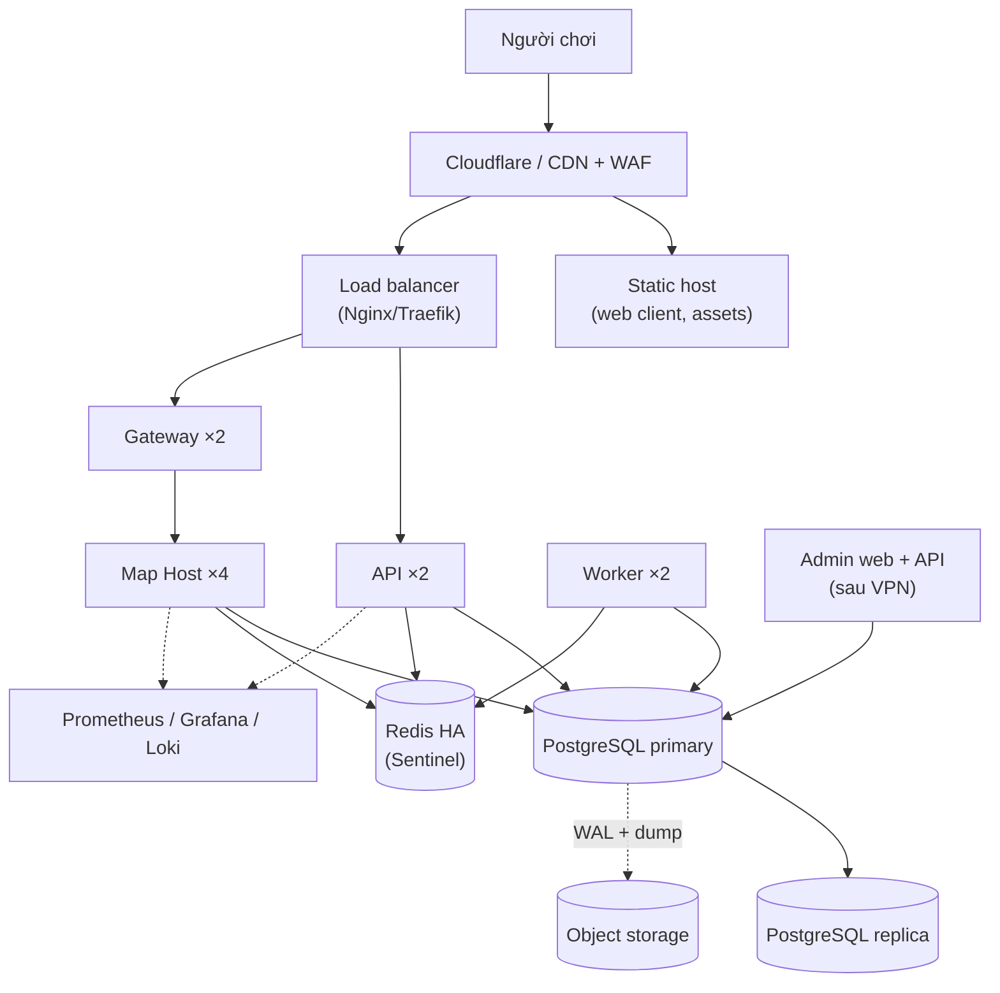

# Hạ tầng & DevOps

> **Trạng thái:** Draft v0.1 · **Liên quan:** [system-architecture](system-architecture.md) · [development-workflow](../workflows/development-workflow.md) · [security](security-and-anticheat.md)

## 1. Môi trường

| Môi trường | Mục đích | Dữ liệu | Triển khai |
|------------|----------|---------|------------|
| **local** | Dev trên máy | Seed giả | `docker compose up` |
| **dev** | Tích hợp liên tục, thử nhanh | Seed giả, reset hằng đêm | Tự động khi merge `main` |
| **staging** | Giống production, QA, load test | Bản sao ẩn danh hóa | Tự động khi có tag `rc-*` |
| **production** | Người chơi thật | Thật | Thủ công có duyệt (tag `v*`) |

Quy tắc: mọi thay đổi phải đi **local → dev → staging → production**. Không sửa tay trên production.

## 2. Topology production (Phase 4)

## 3. Dịch vụ trong Docker Compose (dev)

| Dịch vụ | Image | Cổng | Ghi chú |
|---------|-------|------|---------|
| `postgres` | `postgres:16` | 5432 | Volume lưu dữ liệu |
| `redis` | `redis:7` | 6379 | |
| `api` | build `apps/api` | 3000 | Hot reload |
| `game-server` | build `apps/game-server` | 7001 (WS) | Hot reload nội dung |
| `worker` | build `apps/worker` | — | |
| `admin` | build `apps/admin` | 3100 | |
| `web-client` | Vite dev server | 5173 | |
| `mailhog` | `mailhog/mailhog` | 8025 | Xem email thử |
| `prometheus`, `grafana`, `loki` | Chuẩn | 9090, 3001, 3100 | Tùy chọn (`--profile obs`) |

Biến môi trường: file `.env.example` (không chứa bí mật thật), tên biến có tiền tố theo dịch vụ.

## 4. CI/CD

### 4.1 Pipeline

```mermaid
flowchart LR
    PR["Pull Request"] --> Lint["Lint + Typecheck"]
    Lint --> Unit["Unit test + Coverage"]
    Unit --> Content["Content validate<br/>(schema, ID, i18n)"]
    Content --> Int["Integration test<br/>(PG + Redis)"]
    Int --> Build["Build images"]
    Build --> E2E["E2E Playwright<br/>+ bot smoke"]
    E2E --> Sec["Security scan<br/>(deps, secrets, image)"]
    Sec --> Merge["Merge main"]
    Merge --> DevDeploy["Deploy dev"]
    DevDeploy --> Tag["Tag rc-*"]
    Tag --> Stg["Deploy staging<br/>+ load test"]
    Stg --> Approve{"Duyệt thủ công"}
    Approve --> Prod["Deploy production"]
```

### 4.2 Cổng chất lượng (merge gates)

| Cổng | Tiêu chuẩn |
|------|------------|
| Lint, typecheck | Không lỗi |
| Unit test | 100% pass; coverage công thức/tiền ≥ 90% |
| Content validate | Không lỗi schema, ID tham chiếu hợp lệ, đủ chuỗi i18n |
| Integration | Test giao dịch, migration chạy được, rollback test |
| E2E | Luồng đăng nhập → vào game → đánh quái → nhận nhiệm vụ |
| Bảo mật | Không lỗ hổng nghiêm trọng, không bí mật trong code |
| Bundle size | Gói khởi động ≤ 5 MB |
| Review | Ít nhất 1 người duyệt (2 người với thay đổi tiền/thanh toán) |

### 4.3 Chiến lược triển khai

| Thành phần | Cách | Rollback |
|------------|------|----------|
| Web client | Tải bản mới lên CDN (URL có hash), đổi `index.html` | Trỏ lại bản trước |
| API | **Blue/green** hoặc rolling | Chuyển lại bản trước |
| Game server | **Rolling có drain:** ngừng nhận vào mới, thông báo 5 phút, lưu & đóng, khởi động bản mới | Khởi động lại bản trước (migration tương thích ngược) |
| DB migration | **Expand → Migrate → Contract**, chạy trước khi triển khai mã mới | Có script rollback hoặc giữ tương thích |
| Nội dung | Gói `content` có phiên bản, đẩy cùng bản game server | Hoàn về phiên bản trước |
| Cấu hình | Qua `game_config`/feature flag (không cần deploy) | Đổi lại giá trị |

### 4.4 Lịch phát hành

| Loại | Tần suất | Giờ |
|------|----------|-----|
| Hotfix | Khi cần | Bất kỳ, có thông báo |
| Bản cập nhật thường | **Hằng tuần (Thứ Tư)** | 05:00–07:00 (bảo trì) |
| Cập nhật nội dung lớn | Hằng tháng | Có thông báo trước 3 ngày |
| Mùa | 3 tháng/mùa | Cuối tuần |

## 5. Quan sát (observability)

### 5.1 Số liệu (Prometheus)

| Nhóm | Chỉ số | Cảnh báo |
|------|--------|----------|
| Game server | `tick_duration_ms` (p50/p95/p99), `zones_active`, `players_online`, `entities_total`, `msg_in_rate`, `msg_out_bytes` | p99 > 45 ms trong 5 phút |
| Mạng | `rtt_ms` (p95), `ws_disconnect_rate`, `rate_limit_hits` | p95 > 200 ms, ngắt > 3%/5 phút |
| API | `http_requests`, `http_latency`, `login_fail_rate` | 5xx > 1%, latency p95 > 500 ms |
| DB | `pg_active_connections`, `slow_queries`, `replication_lag`, `deadlocks` | Lag > 30 s, deadlock > 0 |
| Redis | `memory`, `evictions`, `latency` | Eviction > 0 |
| Kinh tế | `soft_faucet`, `soft_sink`, `premium_topup_vnd`, `market_volume` | Sink < 85% faucet |
| Kinh doanh | `dau`, `ccu`, `d1/d7/d30`, `arpu`, `arppu`, `conversion` | Theo KPI |
| Gian lận | `suspicion_events`, `captcha_triggered`, `dupe_detector` | Dupe > 0 → SEV1 |

### 5.2 Log

- JSON có cấu trúc, trường chuẩn: `ts, level, svc, realm, node, zone, charId, reqId, msg`.
- Tập trung bằng **Loki** (hoặc ELK); giữ 30 ngày (nóng), 12 tháng (lạnh, object storage).
- Tách **log kiểm toán** (ledger, GM) không xóa theo chính sách.

### 5.3 Trace & lỗi

- **OpenTelemetry** cho API và đường giao dịch.
- **Sentry** cho client và server (loại bỏ dữ liệu cá nhân).

### 5.4 Bảng điều khiển (Grafana)

| Dashboard | Nội dung |
|-----------|----------|
| Tổng quan realm | CCU, DAU, zone, tick, ping, lỗi |
| Hiệu năng game server | Tick theo node, đồ thị zone nóng |
| Kinh tế | Faucet/sink, giá chợ, tổng Quan |
| Doanh thu | Nạp, ARPU, ARPPU, chuyển đổi |
| Bảo mật | Nghi ngờ, captcha, khóa, báo cáo |
| Chi phí | Tài nguyên theo dịch vụ |

### 5.5 Cảnh báo (on-call)

| Mức | Kênh | Ví dụ |
|-----|------|-------|
| Critical | Gọi điện/SMS + chat | DB down, dupe, tick > 100 ms, thanh toán lỗi |
| Warning | Chat | Tick chậm, lỗi tăng |
| Info | Email | Báo cáo hằng ngày |

## 6. Sao lưu & khôi phục thảm họa

| Hạng mục | Chính sách |
|----------|------------|
| **RPO / RTO** | ≤ 5 phút / ≤ 60 phút |
| PostgreSQL | Full backup hằng ngày + WAL liên tục, PITR 14 ngày, replica đồng bộ/bán đồng bộ |
| Redis | AOF mỗi giây; dữ liệu quan trọng có thể dựng lại từ PG |
| Object storage | Sao chép sang vùng khác |
| Diễn tập | Khôi phục thử hằng tháng, đo thời gian thực tế |
| Runbook DR | Chuyển sang replica, dựng lại realm từ backup, thông báo cộng đồng |

## 7. Bảo trì có kế hoạch

1. T−60 phút: thông báo `S_MAINTENANCE` toàn server và trang trạng thái.
2. T−5 phút: chặn đăng nhập mới.
3. T−0: kick nhẹ người chơi, lưu toàn bộ, tạo **snapshot trước bảo trì**.
4. Triển khai, chạy migration, kiểm tra sức khỏe.
5. Mở lại theo thứ tự: nội bộ → 10% → 100%.
6. Theo dõi 30 phút, ghi nhật ký.

## 8. Kiểm thử tải

| Công cụ | Kịch bản |
|---------|----------|
| `tools/bot-client` | Bot đăng nhập, di chuyển, đánh quái, mua bán, chat |
| **k6** (WebSocket) | Ramp lên 1.000 → 5.000 CCU, giữ 30 phút |
| Chaos | Kill một map host, mất Redis 30 giây, DB chậm |
| Chỉ số đạt | Tick p99 ≤ 45 ms, p95 RTT ≤ 150 ms, 0 mất dữ liệu, 0 dupe |

Chạy ở **mỗi phase gate** và trước sự kiện lớn.

## 9. Ước tính chi phí hạ tầng (rất thô, chỉ để lập kế hoạch)

| Giai đoạn | Cấu hình | Mức (USD/tháng) |
|-----------|----------|------------------|
| Dev/Alpha | 1 VM 4 vCPU/8 GB + backup | 40–80 |
| Closed Beta | 2–3 VM + PG managed nhỏ | 200–400 |
| Launch (5.000 CCU) | 6–10 VM, PG HA, Redis HA, CDN, giám sát | 1.500–3.000 |

Mức thực tế phụ thuộc nhà cung cấp, vùng và băng thông (≈ 10 KB/s/người ⇒ ~ 36 MB/giờ/người).

## 10. Quản lý cấu hình & bí mật

| Loại | Nơi lưu |
|------|---------|
| Cấu hình không nhạy cảm | Repo (`infra/`, `.env.example`) |
| Bí mật (DB, JWT, webhook) | Secret manager / GitHub Secrets, quay vòng 90 ngày |
| Cấu hình động | `game_config` (Admin) |
| Feature flag | `game_config` + cache Redis |

## 11. Runbook (danh mục)

| Tình huống | Tài liệu |
|------------|----------|
| Game server sập | `runbooks/game-server-down.md` |
| Tick chậm | `runbooks/slow-tick.md` |
| DB chuyển đổi dự phòng | `runbooks/pg-failover.md` |
| Lỗi thanh toán | `runbooks/payment-incident.md` |
| Nghi dupe | `runbooks/suspected-dupe.md` |
| Bảo trì khẩn | `runbooks/emergency-maintenance.md` |
| Rollback nhân vật | `runbooks/character-rollback.md` |

(Tạo trong `docs/runbooks/` khi bắt đầu vận hành; xem thêm [admin guide](../guides/admin-gm-guide.md).)
