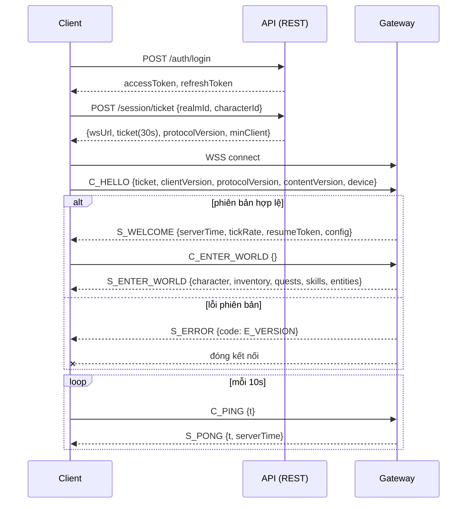

# Giao thức mạng

> **Trạng thái:** Draft v0.1 · **Liên quan:** [system-architecture](system-architecture.md) · [server-design](server-design.md) · [client-design](client-design.md)
> Định nghĩa kiểu chuẩn nằm trong `packages/shared/src/protocol/` (TypeScript + Zod). Tài liệu này mô tả ý nghĩa và quy tắc.

## 1. Tổng quan

| Kênh | Giao thức | Dùng cho |
|------|-----------|----------|
| **REST** | HTTPS, JSON | Đăng ký/đăng nhập, danh sách realm, nhân vật, thanh toán, webhook |
| **Game** | **WSS**, nhị phân **MessagePack** | Mọi thao tác trong game |

Nguyên tắc:

- Client **gửi ý định** (`C_*`), server **trả kết quả** (`S_*`).
- Mỗi thông điệp có `opcode` 16-bit; `seq` 32-bit để chống lặp và đối chiếu.
- Lệnh thay đổi **tài sản** mang `idemKey` (UUID) và được server từ chối nếu lặp trong 10 phút.

## 2. Khung gói (frame)

```text
┌─────────┬──────────┬──────────┬──────────────────────────┐
│ ver u8  │ op  u16  │ seq u32  │ payload (MessagePack)    │
│ 1 byte  │ 2 bytes  │ 4 bytes  │ N bytes                  │
└─────────┴──────────┴──────────┴──────────────────────────┘
```

| Trường | Ý nghĩa |
|--------|---------|
| `ver` | Phiên bản khung (hiện `1`) |
| `op` | Opcode (xem §6) |
| `seq` | Client: số tăng dần mỗi lệnh. Server: số tăng dần mỗi gói gửi cho client đó |
| `payload` | Đối tượng MessagePack, có thể rỗng |

- Kích thước tối đa **16 KB** mỗi gói (snapshot lớn tách thành nhiều gói).
- Gói không hợp lệ (độ dài, opcode, schema): ngắt kết nối sau cảnh báo thứ 3.

## 3. Bắt tay & phiên



### 3.1 Kết nối lại

Mất kết nối < 30s: client mở WSS mới và gửi `C_RESUME {resumeToken, lastServerSeq}`. Server trả `S_ENTER_WORLD` đầy đủ (trạng thái hiện tại) và token mới.

### 3.1.1 Vé khách (chỉ cho test của server)

Từ bậc B3, người chơi vào game bằng tài khoản (§3.1.3); web client không còn đường vào kiểu khách. Vé khách chỉ còn để test của server chạy không cần cơ sở dữ liệu. Game server chạy với `DEV_GUEST=1` thì nhận vé `ticket = "guest:<tên>"`, nhân vật khách không được lưu:
- tên theo luật tên nhân vật ([classes §2.1](../game-design/03-origins-classes-skills.md));
- `C_HELLO` có thêm trường tùy chọn `appearance {origin, gender}` để người khác thấy đúng ngoại hình;
- không có `DEV_GUEST=1` thì mọi vé bị từ chối bằng `E_AUTH`. **Không bật biến này ở môi trường thật.**

`S_ENTER_WORLD` ở bậc B1 gồm:
- `you`: id thực thể của mình;
- `character {name, appearance}`, `map {id, zone}`, `tick`;
- `body {x, y, vy, st}`;
- `entities`: các `S_ENTITY_SPAWN` đang trong vùng nhìn.

`S_ENTITY_SPAWN` của người chơi gồm `id, kind: "player", name, appearance, x, y, st, f`.

### 3.1.2 Bậc B2: vào thế giới, đổi map, đổi khu

`S_ENTER_WORLD` ở bậc B2 có thêm:
- `map {id, zone, name}`: tên map lấy từ i18n;
- `ack`: `seq` của `C_MOVE_INPUT` cuối cùng đã xử lý;
- `stats {lv, exp, expNext, hp, mp, maxHp, maxMp, atk, def, crit, power}`;
- `skills[] {id, name, unlockLevel, mp, cooldownMs}`: kỹ năng tân thủ;
- `bag {soft, items[], size}`;
- `entities[]` (người chơi và quái), `drops[]` (đồ rơi) trong vùng nhìn.

Người chơi vào khu còn chỗ có số nhỏ nhất của map khởi đầu (M001).

**`S_MAP_CHANGE`** dùng chung khi qua cổng, đổi khu và hồi sinh về làng. Payload giống phần vị trí của `S_ENTER_WORLD`: `map, tick, ack, body, entities, drops`.

Từ lúc nhận `S_ENTER_WORLD` hoặc `S_MAP_CHANGE` tới khi cảnh mới tải xong map, client giữ các gói đến sau trong hàng chờ rồi xử lý theo thứ tự. Nhờ vậy không gói spawn hay snapshot nào bị mất.

**`C_USE_PORTAL {portalId, seq}`**, với `seq` là `C_MOVE_INPUT` cuối cùng client đã gửi:
- server chỉ chuyển map sau khi đã mô phỏng tới `seq` đó, hoặc sau 500 ms;
- client ngừng gửi input trong lúc chờ (tối đa 1,5 s);
- vì vậy không input nào của map cũ bị áp lên map mới.

Server kiểm tra:
- thân người chơi phải nằm trong ô cổng (nới 16 px);
- map đích phải đang mở, không thì trả `E_MAP_LOCKED`;
- vào khu cùng số nếu còn chỗ, không thì vào khu khác còn chỗ.

`C_USE_SKILL.seq` theo cùng quy tắc: kỹ năng được tung ở vị trí và hướng sau `C_MOVE_INPUT` có `seq` đó, đúng chỗ người chơi thấy trên màn hình lúc bấm.

### 3.1.3 Bậc B3: đăng nhập bằng tài khoản

1. Client gọi REST (§10): đăng ký hoặc đăng nhập, rồi chọn hoặc tạo nhân vật. `POST /session/ticket` trả `{wsUrl, ticket, protocolVersion}`.
2. API lưu vé trong Redis: `ticket:{vé}` = `{accountId, characterId, realmId, ipHash}`, sống 30 s ([database §7](database-schema.md)).
3. Client mở WebSocket tới `wsUrl` và gửi `C_HELLO {ticket}`.
4. Game server lấy vé ra khỏi Redis bằng `GETDEL`, nên mỗi vé chỉ dùng được một lần. Vé hết hạn, đã dùng, hoặc sai realm thì trả `E_AUTH`.
5. Nếu tài khoản đang có phiên trong thế giới thì xử lý như §3.2.
6. Server nạp nhân vật và túi đồ từ PostgreSQL rồi gửi `S_WELCOME`.

`S_ENTER_WORLD` đặt nhân vật ở map và vị trí đã lưu (khi map còn mở và vị trí hợp lệ), nếu không thì ở điểm xuất hiện của M001. `stats` có thêm:
- `statPoints`: điểm tiềm năng còn trống;
- `pts {hp, mp, atk, def, crit}`: điểm đã cộng.

`ipHash` của vé được lưu nhưng **chưa so khớp** với kết nối WebSocket, vì người chơi điện thoại hay đổi IP giữa hai bước. Mỗi vé chỉ dùng một lần và sống 30 s.

### 3.2 Đá phiên

Đăng nhập mới cùng tài khoản:
1. Phiên cũ nhận `S_KICK {reason: "DUPLICATE_LOGIN", message}` rồi đóng.
2. Phiên mới **chờ lần lưu cuối của phiên cũ** xong rồi mới nạp nhân vật, nên không đọc trạng thái cũ.

Khi máy chủ tắt, mọi phiên nhận `S_KICK {reason: "SHUTDOWN"}` sau khi đã lưu hết.

## 4. Quy tắc chung

| Quy tắc | Giá trị |
|---------|---------|
| Giới hạn tốc độ | Theo opcode (xem §7), vượt → `E_RATE_LIMIT`; lặp lại → ngắt |
| Thứ tự | WebSocket đảm bảo thứ tự; server xử lý lệnh của một người chơi theo `seq` |
| Idempotency | `idemKey` bắt buộc với lệnh `C_SHOP_*`, `C_TRADE_CONFIRM`, `C_MARKET_*`, `C_ENHANCE`, `C_SPIN`, `C_MAIL_CLAIM`, `C_MAIL_SEND` |
| Thời gian | `serverTime` ms từ epoch UTC; client tính offset để hiển thị đồng hồ sự kiện |
| Số nguyên lớn | Tiền (`bigint`) mã hóa dưới dạng số nguyên MessagePack 64-bit |
| Lượng tử hóa | Vị trí gửi dạng `int16` (đơn vị px), HP% dạng `u8`, vận tốc `int8 × 8` |

## 5. Snapshot và đồng bộ thế giới

### 5.1 `S_SNAPSHOT`

```ts
interface Snapshot {
  tick: number;                // tick server
  ack: number;                 // lastProcessedSeq của client này
  ents: EntityDelta[];         // thực thể có thay đổi trong AOI
}

interface EntityDelta {
  id: number;                  // u32 id thực thể trong zone
  x?: number; y?: number;      // int16
  vx?: number; vy?: number;    // int8 × 8
  st?: number;                 // trạng thái (idle, run, jump, attack, dead...)
  f?: 1 | -1;                  // hướng
  hp?: number;                 // u8: tỉ lệ máu, 255 = đầy, 0 = chết (0 < máu → ít nhất 1)
}
```

- Gửi **10 Hz**; thực thể không đổi thì không gửi.
- `S_ENTITY_SPAWN` mô tả đầy đủ khi thực thể vào AOI; `S_ENTITY_DESPAWN` khi rời.

`st` (trạng thái): `0` đứng, `1` chạy, `2` nhảy lên, `3` rơi, `4` leo thang, `5` gục ngã; `st < 2` nghĩa là đang đứng trên nền. Quái dùng `0`, `1`, `5`; đòn đánh của quái đi bằng `S_SKILL_CAST`. Snapshot được gửi khi có thực thể đổi **hoặc** `ack` của client đó đổi.

`S_ENTITY_SPAWN` của quái (bậc B2): `id, kind: "mob", templateId, name, lv, tier (normal|elite|leader), flying, x, y, st, f, hp`. Vị trí của quái và người chơi đều là **chân** (giữa đáy hộp va chạm).

### 5.2 Hiệu chỉnh vị trí

`S_CORRECTION { tick, x, y, vx, vy, ack }` khi server từ chối vị trí client.

## 6. Danh mục opcode

Ký hiệu: `C_` client → server, `S_` server → client. **Hướng** `↔` nghĩa là hai chiều với cùng opcode (hiếm).

### 6.1 Phiên (0x01xx)

| Op | Tên | Hướng | Payload chính |
|----|-----|-------|----------------|
| 0x0101 | `C_HELLO` | C→S | `ticket, clientVersion, protocolVersion, contentVersion, device` |
| 0x0102 | `S_WELCOME` | S→C | `serverTime, tickRate, resumeToken, config` |
| 0x0103 | `C_PING` | C→S | `t` |
| 0x0104 | `S_PONG` | S→C | `t, serverTime` |
| 0x0105 | `S_KICK` | S→C | `reason (DUPLICATE_LOGIN, SHUTDOWN), message` |
| 0x0106 | `C_RESUME` | C→S | `resumeToken, lastServerSeq` |
| 0x01FF | `S_ERROR` | S→C | `code, refSeq, message?` |

### 6.2 Nhân vật (0x02xx)

| Op | Tên | Hướng | Payload chính |
|----|-----|-------|----------------|
| 0x0201 | `C_ENTER_WORLD` | C→S | — |
| 0x0202 | `S_ENTER_WORLD` | S→C | `character, stats, inventory, equipment, skills, quests, buffs, entities, map` |
| 0x0203 | `C_ALLOCATE_POINTS` | C→S | `{hp,mp,atk,def,crit}` (số điểm cộng, tổng ≥ 1). Không đủ điểm: `E_INVALID_PAYLOAD` với `message` `NOT_ENOUGH_POINTS` |
| 0x0204 | `S_STATS_UPDATE` | S→C | chỉ số đầy đủ/thay đổi, có `statPoints` và `pts` |
| 0x0205 | `S_LEVEL_UP` | S→C | `level, statPoints, skillPoints` |
| 0x0206 | `C_UPGRADE_SKILL` | C→S | `skillId` |
| 0x0207 | `S_SKILLS_UPDATE` | S→C | danh sách kỹ năng, hotbar |
| 0x0208 | `C_CHOOSE_CLASS` | C→S | `classId` (chỉ trong instance lễ) |
| 0x0209 | `C_SET_HOTBAR` | C→S | `slots[]` |
| 0x020A | `C_RESET_POINTS` | C→S | `itemId` (Bình Rửa Tiềm Năng) |

### 6.3 Bản đồ & di chuyển (0x03xx)

| Op | Tên | Hướng | Payload chính |
|----|-----|-------|----------------|
| 0x0301 | `C_MOVE_INPUT` | C→S | `seq, dir, jump, down, up, tickClient` (`up`: leo thang, xa thang thì là nhảy; bậc B2) |
| 0x0302 | `S_SNAPSHOT` | S→C | xem §5.1 |
| 0x0303 | `S_ENTITY_SPAWN` | S→C | `id, kind, templateId, x, y, appearance, name, hp, ...` |
| 0x0304 | `S_ENTITY_DESPAWN` | S→C | `ids[]` |
| 0x0305 | `C_USE_PORTAL` | C→S | `portalId, seq` (§3.1.2) |
| 0x0306 | `S_MAP_CHANGE` | S→C | `map {id, zone, name}, tick, ack, body, entities, drops` (§3.1.2) |
| 0x0307 | `C_CHANGE_ZONE` | C→S | `zoneNo` |
| 0x0308 | `S_ZONE_LIST` | S→C | `mapId, zones: [{zoneNo, players, cap}]` |
| 0x0309 | `C_REQUEST_ZONES` | C→S | — |
| 0x030A | `S_CORRECTION` | S→C | xem §5.2 |
| 0x030B | `C_TELEPORT` | C→S | `destId` (Bác Tô) + `idemKey` |

### 6.4 Chiến đấu (0x04xx)

| Op | Tên | Hướng | Payload chính |
|----|-----|-------|----------------|
| 0x0401 | `C_USE_SKILL` | C→S | `skillId, targetId?, x?, y?, seq` (`seq`: §3.1.2) |
| 0x0402 | `S_SKILL_CAST` | S→C | `casterId, skillId, f, targetId?, x?, y?, shot? {vx, range, delayMs}` (`shot`: đạn của quái đánh xa) |
| 0x0403 | `S_DAMAGE` | S→C | `targetId, sourceId, amount, crit, elem(↑↓), miss, hp` (`hp`: máu còn lại 0–255; `sourceId` 0 = bẫy) |
| 0x0404 | `S_HEAL` | S→C | `targetId, sourceId, amount` |
| 0x0405 | `S_STATUS_APPLY` | S→C | `targetId, statusId, duration, stacks` |
| 0x0406 | `S_STATUS_REMOVE` | S→C | `targetId, statusId` |
| 0x0407 | `S_ENTITY_DIED` | S→C | `id, killerId, exp?` (`exp`: EXP người nhận vừa được, hoặc số âm khi chính mình gục ngã) |
| 0x0408 | `C_TARGET` | C→S | `targetId?` |
| 0x0409 | `C_REVIVE` | C→S | `mode: TOWN|INPLACE` + `idemKey` |
| 0x040A | `S_REVIVED` | S→C | `x, y, hp, mp` |
| 0x040B | `C_AUTO_HUNT` | C→S | `on, config` |
| 0x040C | `S_LINK_GAUGE` | S→C | `value` |
| 0x040D | `S_BOSS_STATE` | S→C | `id, phase, hpPct, telegraphs[]` |

### 6.5 Vật phẩm (0x05xx)

| Op | Tên | Hướng | Payload chính |
|----|-----|-------|----------------|
| 0x0501 | `S_INVENTORY_FULL` | S→C | toàn bộ túi, kho, trang bị |
| 0x0502 | `S_INVENTORY_DELTA` | S→C | `add[], update[], remove[], soft` |
| 0x0503 | `C_MOVE_ITEM` | C→S | `from, to` |
| 0x0504 | `C_USE_ITEM` | C→S | `instanceId` |
| 0x0505 | `C_EQUIP` | C→S | `instanceId, slot?` |
| 0x0506 | `C_UNEQUIP` | C→S | `slot` |
| 0x0507 | `C_DROP_ITEM` | C→S | `instanceId, qty` (hủy hoặc vứt) |
| 0x0508 | `C_PICKUP` | C→S | `dropId` |
| 0x0509 | `S_DROP_SPAWN` | S→C | `id, what {kind, item?, name, icon?, qty, level?, rarity?}, x, y, ownerId, lockedMs` |
| 0x050A | `C_SORT_BAG` | C→S | — |
| 0x050B | `C_ENHANCE` | C→S | `instanceId, useCharm` + `idemKey` |
| 0x050C | `S_ENHANCE_RESULT` | S→C | `success, newLevel, pity` |
| 0x050D | `C_SOCKET_GEM` | C→S | `instanceId, gemId, socket` |
| 0x050E | `C_CRAFT` | C→S | `recipeId, qty` + `idemKey` |

### 6.6 NPC & Nhiệm vụ (0x06xx)

| Op | Tên | Hướng | Payload chính |
|----|-----|-------|----------------|
| 0x0601 | `C_NPC_INTERACT` | C→S | `npcId` |
| 0x0602 | `S_NPC_DIALOG` | S→C | `npcId, textKey, options[]` |
| 0x0603 | `C_NPC_CHOICE` | C→S | `npcId, optionId` |
| 0x0604 | `C_QUEST_ACCEPT` | C→S | `questId` |
| 0x0605 | `C_QUEST_TURNIN` | C→S | `questId, choice?` + `idemKey` |
| 0x0606 | `C_QUEST_ABANDON` | C→S | `questId` |
| 0x0607 | `S_QUEST_UPDATE` | S→C | `questId, status, progress[]` |
| 0x0608 | `S_QUEST_LIST` | S→C | toàn bộ nhiệm vụ đang có |

### 6.7 Cửa hàng, giao dịch, chợ (0x07xx)

| Op | Tên | Hướng | Payload chính |
|----|-----|-------|----------------|
| 0x0701 | `C_SHOP_BUY` | C→S | `shopId, itemId, qty` + `idemKey` |
| 0x0702 | `C_SHOP_SELL` | C→S | `instanceId, qty` + `idemKey` |
| 0x0703 | `C_TRADE_REQUEST` | C→S | `targetId` |
| 0x0704 | `S_TRADE_STATE` | S→C | trạng thái cửa sổ giao dịch |
| 0x0705 | `C_TRADE_UPDATE` | C→S | `items[], soft` |
| 0x0706 | `C_TRADE_CONFIRM` | C→S | `stage (1|2)` + `idemKey` |
| 0x0707 | `C_TRADE_CANCEL` | C→S | — |
| 0x0708 | `C_MARKET_QUERY` | C→S | `filter, sort, page` |
| 0x0709 | `S_MARKET_RESULT` | S→C | `listings[], total` |
| 0x070A | `C_MARKET_LIST` | C→S | `instanceId, price` + `idemKey` |
| 0x070B | `C_MARKET_BUY` | C→S | `listingId` + `idemKey` |
| 0x070C | `C_MARKET_CANCEL` | C→S | `listingId` + `idemKey` |
| 0x070D | `C_SPIN` | C→S | `ticketType` + `idemKey` |
| 0x070E | `S_SPIN_RESULT` | S→C | `reward, pity` |
| 0x070F | `C_BUYBACK` | C→S | `instanceId` + `idemKey` |

### 6.8 Xã hội (0x08xx)

| Op | Tên | Hướng | Payload chính |
|----|-----|-------|----------------|
| 0x0801 | `C_CHAT_SEND` | C→S | `channel, text, targetName?`. Kênh `MAP` (cùng map và khu, bậc B2) và `WORLD` (cả realm, bậc B3); chữ 1–120 ký tự sau khi gộp khoảng trắng, không ký tự điều khiển |
| 0x0802 | `S_CHAT_MSG` | S→C | `channel (MAP, WORLD, SYSTEM), fromId, fromName, text, time` |
| 0x0803 | `C_FRIEND_OP` | C→S | `op (ADD, ACCEPT, REMOVE, BLOCK), name` |
| 0x0804 | `S_FRIEND_LIST` | S→C | danh sách bạn, trạng thái |
| 0x0805 | `C_PARTY_OP` | C→S | `op (INVITE, ACCEPT, LEAVE, KICK, LOOT_MODE), target?` |
| 0x0806 | `S_PARTY_STATE` | S→C | thành viên, HP, vị trí |
| 0x0807 | `C_MAIL_LIST` | C→S | `page` |
| 0x0808 | `S_MAIL_LIST` | S→C | `mails[]` |
| 0x0809 | `C_MAIL_CLAIM` | C→S | `mailId` + `idemKey` |
| 0x080A | `C_MAIL_SEND` | C→S | `to, subject, body, items[], soft` + `idemKey` |
| 0x080B | `C_REPORT` | C→S | `targetId, category, message` |

### 6.9 Đội (0x09xx)

| Op | Tên | Hướng | Payload chính |
|----|-----|-------|----------------|
| 0x0901 | `C_GUILD_OP` | C→S | `op (CREATE, INVITE, ACCEPT, LEAVE, KICK, PROMOTE, DISBAND, NOTICE)` + dữ liệu |
| 0x0902 | `S_GUILD_STATE` | S→C | thông tin Đội, thành viên, cấp, buff |
| 0x0903 | `C_GUILD_DONATE` | C→S | `soft` + `idemKey` |
| 0x0904 | `C_GUILD_BUFF` | C→S | `buffId` + `idemKey` |
| 0x0905 | `C_GUILD_BANK` | C→S | `op (PUT, TAKE)`, `instanceId` + `idemKey` |

### 6.10 PvP & Sự kiện (0x0Axx)

| Op | Tên | Hướng | Payload chính |
|----|-----|-------|----------------|
| 0x0A01 | `C_DUEL_REQUEST` | C→S | `targetId` |
| 0x0A02 | `S_DUEL_STATE` | S→C | trạng thái đếm ngược, kết quả |
| 0x0A03 | `C_QUEUE` | C→S | `mode (ARENA, BATTLEFIELD, GUILD_WAR)`, `join` |
| 0x0A04 | `S_MATCH_FOUND` | S→C | `matchId, mode, acceptBy` |
| 0x0A05 | `C_PK_TOGGLE` | C→S | `on` |
| 0x0A06 | `S_PK_STATE` | S→C | `state, sinPoints` |
| 0x0A07 | `S_BOSS_ANNOUNCE` | S→C | `bossId, mapId, zoneNo, at` |
| 0x0A08 | `S_EVENT_STATE` | S→C | `eventId, phase, endsAt` |
| 0x0A09 | `S_BATTLE_STATE` | S→C | điểm, mục tiêu chiến trường |

### 6.11 Đồng hành (0x0Bxx)

| Op | Tên | Hướng | Payload chính |
|----|-----|-------|----------------|
| 0x0B01 | `C_SQUIRE_OP` | C→S | `op (SUMMON, DISMISS, FEED, EQUIP, SKILL, TACTIC)` + dữ liệu |
| 0x0B02 | `S_SQUIRE_STATE` | S→C | chỉ số, kỹ năng, Tín Nhiệm |
| 0x0B03 | `C_MOUNT_TOGGLE` | C→S | `mountId?` |
| 0x0B04 | `C_SPIRIT_OP` | C→S | `op (ACTIVATE, FEED, EVOLVE)`, `id` |

### 6.12 Hệ thống (0x0Fxx)

| Op | Tên | Hướng | Payload chính |
|----|-----|-------|----------------|
| 0x0F01 | `S_ANNOUNCE` | S→C | `type, text, durationMs` |
| 0x0F02 | `S_SERVER_TIME` | S→C | `serverTime` |
| 0x0F03 | `S_MAINTENANCE` | S→C | `startsAt, durationMin, message` |

## 7. Giới hạn tốc độ (mỗi kết nối)

| Nhóm opcode | Giới hạn | Khi vượt |
|-------------|----------|----------|
| `C_MOVE_INPUT` | 25 gói/s | Bỏ gói thừa |
| `C_USE_SKILL` | 10 gói/s | `E_RATE_LIMIT` |
| `C_CHAT_SEND` | 1/s Map, 1/10s Thế giới | `E_RATE_LIMIT` (bậc B3 chưa mute) |
| `C_SHOP_*`, `C_MARKET_*`, `C_TRADE_*` | 5/s | `E_RATE_LIMIT` |
| `C_ENHANCE`, `C_SPIN` | 2/s | `E_RATE_LIMIT` |
| Tổng | 120 gói/s | Ngắt kết nối nếu kéo dài 10s |

## 8. Mã lỗi

| Mã | Tên | Ý nghĩa |
|----|-----|---------|
| 1001 | `E_VERSION` | Phiên bản client/giao thức không tương thích |
| 1002 | `E_AUTH` | Ticket/token không hợp lệ hoặc hết hạn |
| 1003 | `E_DUPLICATE_LOGIN` | Đăng nhập nơi khác |
| 1004 | `E_BANNED` | Tài khoản bị khóa |
| 1005 | `E_MAINTENANCE` | Máy chủ bảo trì |
| 1100 | `E_RATE_LIMIT` | Gửi quá nhanh |
| 1101 | `E_INVALID_PAYLOAD` | Dữ liệu sai schema |
| 1102 | `E_DUPLICATE_REQUEST` | `idemKey` đã dùng |
| 2001 | `E_NOT_ENOUGH_MP` | Không đủ MP |
| 2002 | `E_COOLDOWN` | Kỹ năng đang hồi |
| 2003 | `E_OUT_OF_RANGE` | Ngoài tầm |
| 2004 | `E_INVALID_TARGET` | Mục tiêu không hợp lệ |
| 2005 | `E_DEAD` | Đang chết |
| 2006 | `E_PK_NOT_ALLOWED` | Không được PK ở đây |
| 2007 | `E_ZONE_FULL` | Khu (hoặc mọi khu của map) đã đầy |
| 2008 | `E_IN_COMBAT` | Đang giao tranh (chưa đủ 5 s), chưa đổi khu được |
| 2009 | `E_MAP_LOCKED` | Map đích chưa mở |
| 3001 | `E_INVENTORY_FULL` | Túi đầy |
| 3002 | `E_NOT_ENOUGH_SOFT` | Không đủ Quan |
| 3003 | `E_NOT_ENOUGH_PREMIUM` | Không đủ Nén Bạc |
| 3004 | `E_ITEM_BOUND` | Vật phẩm bị khóa |
| 3005 | `E_ITEM_NOT_FOUND` | Không tìm thấy vật phẩm |
| 3006 | `E_LEVEL_REQUIRED` | Chưa đủ cấp |
| 4001 | `E_QUEST_NOT_AVAILABLE` | Chưa đủ điều kiện nhiệm vụ |
| 4002 | `E_QUEST_INCOMPLETE` | Chưa hoàn thành mục tiêu |
| 5001 | `E_TRADE_FAILED` | Giao dịch thất bại/hủy |
| 5002 | `E_MARKET_LISTING_GONE` | Mục đã bán/hết hạn |
| 6001 | `E_GUILD_NO_PERMISSION` | Không đủ quyền Đội |
| 9000 | `E_INTERNAL` | Lỗi máy chủ |

## 9. Ví dụ thông điệp (dạng JSON để dễ đọc)

```jsonc
// C_USE_SKILL
{ "op": "C_USE_SKILL", "seq": 1204, "payload": { "skillId": "SKL_FIRE_2", "targetId": 8841, "seq": 77 } }

// S_DAMAGE
{ "op": "S_DAMAGE", "payload": { "targetId": 8841, "sourceId": 17, "amount": 1432, "crit": true, "elem": 1, "miss": false } }

// C_ENHANCE
{ "op": "C_ENHANCE", "seq": 3110, "payload": { "instanceId": "e1b7...", "useCharm": true, "idemKey": "9a2b..." } }

// S_ERROR
{ "op": "S_ERROR", "payload": { "code": 2002, "refSeq": 1204, "message": "SKILL_ON_COOLDOWN" } }
```

## 10. REST API (tóm tắt)

| Phương thức | Đường dẫn | Mô tả | Xác thực |
|-------------|-----------|-------|----------|
| POST | `/auth/register` | Đăng ký | Không |
| POST | `/auth/login` | Đăng nhập | Không |
| POST | `/auth/refresh` | Làm mới token | Refresh token |
| POST | `/auth/logout` | Đăng xuất | Refresh token |
| POST | `/auth/forgot` / `/auth/reset` | Quên/đặt lại mật khẩu | Không |
| GET | `/realms` | Danh sách máy chủ, trạng thái | Không |
| GET | `/realms/{id}/characters` | Danh sách nhân vật | Bearer |
| POST | `/realms/{id}/characters` | Tạo nhân vật | Bearer |
| DELETE | `/characters/{id}` | Xóa nhân vật (chờ 7 ngày) | Bearer |
| POST | `/session/ticket` | Lấy ticket vào game | Bearer |
| GET | `/shop/products` | Danh sách gói nạp | Bearer |
| POST | `/payments/orders` | Tạo đơn nạp | Bearer |
| POST | `/payments/webhook/{provider}` | Webhook thanh toán | Chữ ký |
| GET | `/me` | Thông tin tài khoản | Bearer |
| GET | `/status` | Trạng thái dịch vụ, bảo trì | Không |

- Mọi phản hồi lỗi: `{ "error": { "code": "…", "message": "…" } }`.
- Giới hạn: `/auth/login` 5 lần/phút/IP và 10 lần/giờ/tài khoản.

**Bậc B3 (`apps/api`, Fastify):**
- **Đã có:** `register`, `login`, `refresh`, `logout`, `/me`, `/realms`, danh sách và tạo nhân vật, `/session/ticket`, `/status`. Chưa có: quên mật khẩu (chưa có gửi email), xóa nhân vật, thanh toán.
- **Đường dẫn:** mọi route nằm dưới tiền tố `API_PREFIX` (mặc định `/api`), nên web client và reverse proxy cùng một tên miền.
- **Token truy cập:** JWT HS256 sống 15 phút, trả trong body.
- **Token làm mới:** nằm trong cookie `htk_rt` (`HttpOnly`, `SameSite=Lax`, `Secure` khi chạy HTTPS, `path` = `/api/auth`), sống 30 ngày. Mỗi lần dùng thì xoay vòng. Dùng lại một token đã thu hồi thì mọi phiên của tài khoản bị thu hồi.
- **Đăng ký:**
  - tên tài khoản 3–20 ký tự `A–Z a–z 0–9 _` (không phân biệt hoa thường);
  - email hợp lệ;
  - mật khẩu 8–128 ký tự, không nằm trong danh sách mật khẩu phổ biến;
  - tối đa 10 lần mỗi giờ mỗi IP.
- **Đăng nhập** bằng tên tài khoản hoặc email. Sai 5 lần thì khóa 10 phút ([security §3](security-and-anticheat.md)).
- **Tạo nhân vật:** tên theo [classes §2.1](../game-design/03-origins-classes-skills.md), duy nhất trong realm, tối đa **3 nhân vật** mỗi tài khoản mỗi realm. Danh sách nhân vật có `mapName`.
- **Vé vào game:** tối đa 20 lần mỗi phút mỗi tài khoản.
- **Mã lỗi:** `INVALID` (400), `WEAK_PASSWORD`, `UNAUTHORIZED` (401), `BAD_CREDENTIALS` (401), `ACCOUNT_LOCKED` (403), `NO_REALM`, `NO_CHARACTER` (404), `TAKEN`, `NAME_TAKEN`, `TOO_MANY` (409), `RATE_LIMIT`, `LOCKED` (429), `REALM_CLOSED` (503).

## 11. Phiên bản & tương thích

| Khái niệm | Ý nghĩa | Khi đổi |
|-----------|---------|---------|
| `protocolVersion` | Thay đổi phá vỡ khung hoặc payload | Tăng số nguyên; server hỗ trợ **N** và **N−1** trong 2 tuần. Trước khi có người chơi thật (trước bậc B3), server chỉ nhận đúng **N**. Bậc B2 là phiên bản **2** |
| `clientVersion` | SemVer của bản build | `minClient` do server yêu cầu |
| `contentVersion` | Hash nội dung (`packages/content`) | Khác → client tải lại dữ liệu hoặc từ chối |

Thêm trường **tùy chọn** vào payload không phá giao thức. Đổi tên/xóa/sửa nghĩa trường là thay đổi phá vỡ.
