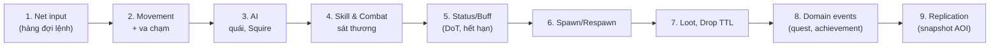
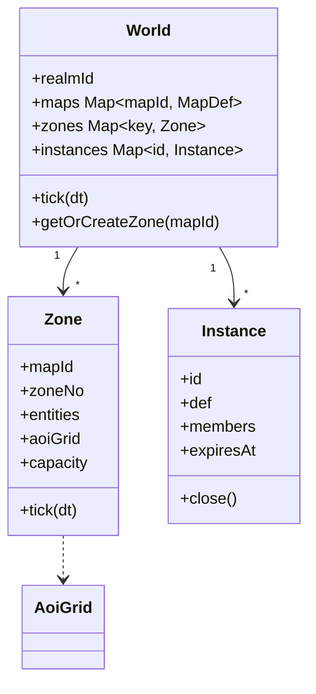
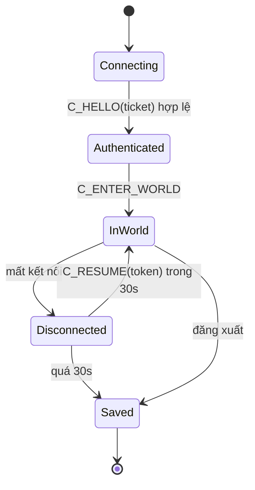

# Thiết kế Game Server

> **Trạng thái:** Draft v0.1 · **Liên quan:** [system-architecture](system-architecture.md) · [network-protocol](network-protocol.md) · [combat](../game-design/04-combat-and-progression.md)

## 1. Mô hình tiến trình

- Một **tiến trình Node.js** (map host) quản lý nhiều **map instance** trong **một luồng chính** cho mỗi tiến trình (single-threaded event loop).
- Mỗi map instance có **vòng lặp tick** độc lập, chạy ở **20 Hz** (50 ms) trên một bộ lập lịch chung.
- Nếu một node cần nhiều lõi: chạy **nhiều tiến trình** (mỗi lõi một tiến trình, chia tập map khác nhau), không dùng bộ nhớ chia sẻ.
- Tác vụ nặng (nén, báo cáo, mô phỏng cân bằng) chạy ở **Worker**, không nằm trong tiến trình map host.

### 1.1 Bộ lập lịch tick

```text
loop:
    now = hrtime()
    while accumulator >= TICK_MS:
        for map in activeMaps (ưu tiên theo số người):
            map.tick(TICK_MS)
        accumulator -= TICK_MS
    sleep until next tick (setTimeout + setImmediate bù)
```

| Tham số | Giá trị |
|---------|---------|
| Tick | 50 ms (20 Hz) |
| Ngân sách mỗi tick | ≤ 30 ms trung bình, p99 ≤ 45 ms |
| Tick bị bỏ | Nếu trễ > 2 tick: bỏ qua cập nhật AI, **không** bỏ xử lý input |
| Snapshot mạng | Mỗi **2 tick** (10 Hz); sự kiện quan trọng gửi ngay |
| Map rỗng | Ngủ sau 30 s không có người; thức khi có người vào |

## 2. Thực thể & thành phần (ECS nhẹ)

| Thực thể | Thành phần chính |
|----------|------------------|
| **Player** | Transform, Velocity, Stats, Skills, Buffs, Inventory ref, Squire ref, Session |
| **Monster** | Transform, Stats, AI, Threat, SpawnPoint, LootTable |
| **Npc** | Transform, Dialog ref |
| **Drop** | Transform, ItemInstance, OwnerLock, TTL |
| **Projectile** | Transform, Velocity, Skill ref, Owner, TTL |
| **Portal** | Transform, Destination |
| **Squire** | Transform, Stats, AI (theo chủ) |

Mỗi tick chạy các **system** theo thứ tự cố định:



## 3. Thế giới, Map, Khu, Instance



| Khái niệm | Mô tả |
|-----------|-------|
| **Zone** | Bản sao công khai của một map (khu 1…n); người chơi vào khu còn chỗ |
| **Instance** | Bản sao riêng (hầm ngục, Sảnh Đội, Raid); ID duy nhất, có hạn dùng |
| **Chuyển khu** | Chuyển người chơi sang Zone khác của cùng map, phải ngoài giao tranh |
| **Chuyển map** | Qua portal: gỡ khỏi zone cũ, thêm vào zone mới, gửi `S_MAP_CHANGE` |
| **Tự cân bằng** | Khi một zone > 80% sức chứa, mở zone mới; khi < 20% và có zone thưa, gộp sau 10 phút |

**Bậc B2:**
- Server dựng sẵn **3 khu** cho mỗi map công khai (TOWN, FIELD) trong `packages/content` (R01: M001–M004).
- Sức chứa mỗi khu lấy từ `zoneCap` trong YAML của map (M001 60, map đồng 30). Chưa tự mở hay gộp khu.
- Map hầm ngục và instance (DG01, I001) chưa mở online. Cổng dẫn tới map chưa mở trả `E_MAP_LOCKED`.
- Đổi khu (`C_CHANGE_ZONE`) giữ nguyên vị trí, chỉ được khi đã 5 s không đánh hay bị đánh.
- Mỗi khu sinh quái theo các điểm `mob_spawn` của map. Mỗi lần sinh có thể ra Tinh anh hoặc Thủ lĩnh ([combat §2.1.1](../game-design/04-combat-and-progression.md)). Thủ lĩnh xuất hiện thì báo kênh hệ thống của khu.

## 4. Di chuyển & va chạm

### 4.1 Mô hình

- **Tile-based AABB**: kích thước hộp nhân vật 24×48 px; tile 32 px.
- Vật lý rời rạc theo tick 50 ms (`packages/shared/src/physics/body.ts`, dùng chung cho client và server):
  - tốc chạy 180 px/s (9 px mỗi tick);
  - trọng lực `g = 1200 px/s²`, tốc nhảy ban đầu `-544 px/s`, rơi tối đa 960 px/s. Nhảy cao **103 px** (hơn 3 ô một chút), khớp luật map V016 (bậc tối đa 3 ô) và bản chơi thử.
  - **Lý do đổi** từ `g = 1800`, `-560 px/s`: bộ số cũ ở bước 50 ms chỉ nhảy được khoảng 2,7 ô, không lên được bậc 3 ô đã kiểm chứng trên map.
- **Xác định (deterministic):** sau mỗi bước, vị trí làm tròn tới px nguyên, `vy` làm tròn tới bội số 8 (khớp lượng tử hóa `int8 × 8` của snapshot). Cùng chuỗi input thì client và server ra cùng kết quả.
- Nhấn xuống khi đứng trên nền một chiều: rơi xuyên qua trong 6 tick.
- **Nền một chiều** và **thang** là tile đặc biệt trong lớp collision của map.
- **Thang (tile 3), từ bậc B2:**
  - Đứng chạm thang theo cột giữa thân rồi nhấn lên (hoặc nhấn xuống khi đứng ngay trên thang) để bám. Thân được kéo vào giữa cột thang.
  - Trên thang đi dọc 6 px/tick (120 px/s, [combat §4.5](../game-design/04-combat-and-progression.md)), đi ngang 4 px/tick. Trong lúc leo bỏ qua nền một chiều, vẫn chặn bởi tường.
  - Leo hết thang thì đứng lên nền phía trên: nền một chiều nối với đầu thang, hoặc chính đỉnh thang nếu đỉnh thang hở. Đỉnh thang hở đứng được như nền một chiều.
  - Xuống tới đất thì đứng lại. Nhấn nhảy thì buông thang và rơi.
  - Xa thang, `up` là nhảy.
- **Bẫy (tile 4), từ bậc B2:** chân chạm bẫy khi đứng thì bị hất lên 384 px/s, trừ khi đang nhấn nhảy (nhảy bình thường để thoát). Mỗi lần chạm, server trừ **8% HP tối đa**, cách nhau ít nhất 0,9 s (giá trị của bản chơi thử). `S_DAMAGE` có `sourceId` = 0.
- Server **mô phỏng lại** chuyển động từ input (không tin vị trí client).

### 4.2 Input & dự đoán

Client gửi **`C_MOVE_INPUT`** gồm `{ seq, dir(-1/0/1), jump, down, up, tickClient }`, tối đa 20 gói/s. Một lần nhấn ngắn hơn 50 ms vẫn được tính cho bước kế tiếp. Server:

1. Đưa vào hàng đợi theo `seq` (tối đa 12, bỏ gói cũ, bỏ gói trùng hoặc đã xử lý). **Mỗi input là một bước vật lý.**
2. **Hạn mức bước:** mỗi tick cộng 1 lượt, để dành tối đa 3 lượt bù trễ mạng; mỗi input tiêu 1 lượt. Vì vậy người chơi không đi nhanh hơn 1 bước/tick về lâu dài, dù gửi dồn input.
3. Không nhận được input trong 10 tick mà đang ở trên không: server tự cho rơi để thân không treo lơ lửng.
4. Gửi lại `lastProcessedSeq` (`ack`) trong mỗi snapshot.
5. Client đối chiếu ở **mọi** snapshot: đặt lại theo trạng thái server rồi phát lại input chưa được xác nhận. Lệch > **6 px** thì giật về ngay, lệch nhỏ thì nội suy. Vì client tự đối chiếu, bậc B1 chưa dùng `S_CORRECTION`.

### 4.3 Kiểm tra chống gian lận chuyển động

| Kiểm tra | Điều kiện vi phạm |
|----------|--------------------|
| Tốc độ | Quãng đường > `maxSpeed × dt × 1.15` trong cửa sổ trượt 1s |
| Bay/xuyên tường | Vị trí nằm trong tile đặc, hoặc ở không trung không do nhảy/bay hợp lệ |
| Nhảy vô hạn | Số lần nhảy trên không vượt giới hạn hệ |
| Teleport | Thay đổi vị trí > 400 px trong 1 tick không do skill dịch chuyển hợp lệ |

Vi phạm đầu tiên: **kéo lại vị trí**. Lặp lại: ghi `suspicion` và tăng điểm nghi ngờ (xem [security](security-and-anticheat.md)).

## 5. AOI (Area of Interest)

- Lưới ô **512 × 512 px** trên mỗi zone.
- Mỗi người chơi **quan sát 3×3 ô** quanh mình (tối đa ~1.536 × 1.536 px), chỉ gửi thực thể trong vùng này: người chơi, quái và đồ rơi (bậc B2).
- Khi thực thể đổi ô: gửi `S_ENTITY_SPAWN`/`S_ENTITY_DESPAWN` cho người quan sát liên quan.
- Giới hạn: tối đa **40 thực thể** người chơi hiển thị (cài đặt người dùng), ưu tiên đồng đội, Đội, bạn bè.

### 5.1 Snapshot delta

- Snapshot chứa các thực thể **có thay đổi** kể từ snapshot trước của client đó.
- Mỗi thực thể gửi: `id, x, y, vx, vy, state, facing, hp%` (lượng tử hóa), tối đa ~16 byte/thực thể.
- Kích thước ước tính: 30 người + 30 quái ≈ 1 KB/snapshot, 10 Hz ≈ 10 KB/s/người (trước nén).

## 6. Chiến đấu

### 6.1 Kiểm tra `C_USE_SKILL`

```text
validate(player, skillId, target, seq):
  - player.alive && !stunned/silenced
  - skill đã học, cấp hợp lệ, GCD đã qua, cooldown skill đã qua
  - đủ MP (hoặc Ý Chí / Thanh Nhập Linh)
  - target hợp lệ (tồn tại, cùng zone, phe phù hợp, PK cho phép)
  - khoảng cách <= tầm + dung sai (50px)
  - góc/hướng hợp lệ nếu kỹ năng định hướng
  - seq chưa xử lý (idempotent)
```

### 6.2 Quy trình xử lý

1. Trừ MP, đặt cooldown, phát `S_SKILL_CAST` cho AOI.
2. Xác định mục tiêu (đơn, diện rộng, đường thẳng) bằng hình học phía server.
3. Với mỗi mục tiêu: tính trúng, khắc hệ, chí mạng, giảm DEF (dùng `packages/shared/formulas`).
4. Áp dụng sát thương/hồi máu/hiệu ứng; phát `S_DAMAGE`, `S_STATUS_APPLY`.
5. Cập nhật **threat** quái, **hit log** (cho chia thưởng).
6. Nếu chết: `S_ENTITY_DIED`, sinh drop, phát domain event `mob.killed`.

### 6.3 Threat & mục tiêu quái

`threat = sát thương × hệ số vai trò`. Hệ số: Thổ ×2, Hồi máu: hồi × 0,5 chia cho quái đang đánh người được hồi.

### 6.4 Bậc B2: những gì đã chạy

**Kỹ năng**
- Kỹ năng tân thủ đọc từ `packages/content/classes/novice.yaml`:
  - **Đòn Thường** (`SKL_BASIC`): vùng 72 px trước mặt; nếu đang khóa mục tiêu trong tầm thì đánh mục tiêu đó. Hồi 1 s, không GCD.
  - **Tụ Mana Chấn** (`SKL_MANA_BURST`): vùng 120 × 90 px, tâm cách 90 px trước mặt; đánh mọi quái trong vùng. Mở ở Lv5, MP 6, hồi 3 s, GCD 0,5 s.
- Lệnh chờ trong hàng đợi tới khi server mô phỏng xong `C_MOVE_INPUT` có `seq` ghi trong lệnh ([network §3.1.2](network-protocol.md)).
- Dung sai tầm 50 px; lệnh tới sớm tối đa 100 ms so với hồi chiêu vẫn được tung.
- Có khóa mục tiêu thì nhân vật quay về phía mục tiêu, cả client lẫn server.
- Tấn công thì mất trạng thái bất khả xâm phạm sau hồi sinh.

**Sát thương và chia EXP**
- Sát thương theo [combat §4.2](../game-design/04-combat-and-progression.md), hệ phép ×1 (chưa có hệ online). Gia Truyền (Thế Gia) +5% cho kỹ năng, không áp cho Đòn Thường.
- Mỗi người chơi gây sát thương được ghi threat. Quái đổi mục tiêu sang người có threat cao nhất.
- Quái chết thì chia EXP theo [combat §2.3](../game-design/04-combat-and-progression.md): ai gây ≥ 10% tổng sát thương thì nhận `EXP × hệ số chênh cấp × tỉ phần sát thương`.
- Đồ rơi khóa cho người gây sát thương nhiều nhất trong 15 s.

**AI quái**
- Chạy trên server, chỉ ở khu đang có người. Trạng thái theo [combat §5.2](../game-design/04-combat-and-progression.md): đứng hoặc đi lang thang trong bán kính điểm sinh, đuổi, đánh, quay về (hồi đầy máu) khi xa điểm sinh quá `leash`, chạy trốn khi máu thấp (Thỏ Đốm).
- Quái mặt đất **không bước khỏi mép nền**; quái bay (Dơi Giếng) bay tự do.
- Số liệu ở YAML quái (`ai.attackRange`, `ai.attackCooldownMs`) và `RULES` trong `packages/shared/src/formulas/combat.ts`:
  - đuổi ×1,3 tốc chạy, lang thang ×0,6, quay về ×1,5, chạy trốn ×1,4;
  - khựng 220 ms khi trúng đòn;
  - đòn cận chiến vung 220 ms và trúng nếu mục tiêu còn trong 56 px;
  - đòn đánh xa (Lùn Ném Đá, Nhện Mực) bắn đạn 260 px/s, xa 260 px.

**Chết và hồi sinh**
- Gục ngã: mất 2% EXP của cấp ([combat §7](../game-design/04-combat-and-progression.md)). Quái bỏ mục tiêu.
- `C_REVIVE {mode: "TOWN"}`: về làng của vùng (R01: M001), đầy HP và MP, bất khả xâm phạm 1 s.

## 7. Domain: Inventory, Shop, Trade, Market

> **Bậc B3:** túi đồ và Quan của tài khoản nằm trong PostgreSQL (`apps/game-server/src/world/store.ts`, `PgStore`).
> - Túi trong bộ nhớ (`bag.ts`) chỉ là bản sao, đổi theo các dòng mà transaction vừa ghi.
> - **Nhặt đồ:** món đồ rời khỏi mặt đất ngay, để người khác không nhặt được nữa, rồi mới ghi vào DB. `idemKey` là khóa riêng của món đồ rơi, nên một món chỉ có một dòng sổ cái. Ghi lỗi thì món đồ trở lại mặt đất và người chơi nhận `E_INTERNAL`; túi đầy thì nhận `E_INVENTORY_FULL`.
> - **Dùng bình:** trừ trong DB rồi mới hồi máu.
> - Mỗi nhân vật có một hàng đợi (`Player.enqueue`), nên các thao tác tài sản chạy lần lượt (§7.1).
> - Nhân vật khách của test (`DEV_GUEST`) dùng `MemoryStore`: không lưu, không phải tài sản.

### 7.1 Hàng đợi tuần tự theo nhân vật

Mọi thao tác thay đổi tài sản của một nhân vật được **tuần tự hóa** qua `CharacterActionQueue` (một queue/nhân vật), chống race condition (dùng cùng lúc 2 lần, mua và bán cùng lúc).

### 7.2 Giao dịch quan trọng

Thao tác **đổi tài sản có giá trị** đi qua **PostgreSQL transaction** (xem [database §6](database-schema.md)):

| Thao tác | Khóa |
|----------|------|
| Mua/bán NPC | `characters.id FOR UPDATE` |
| Giao dịch người chơi | Khóa cả hai nhân vật theo thứ tự `id` tăng dần (tránh deadlock) |
| Cường hóa | `item_instances.id FOR UPDATE` + `characters.id FOR UPDATE` |
| Ký gửi/mua chợ | Dòng `market_listings` + hai nhân vật |
| Nạp Nén Bạc | `accounts.id FOR UPDATE`, khóa idempotent theo `payment_orders` |

Quy tắc: **ghi DB trước, rồi cập nhật bộ nhớ và gửi client**. Nếu transaction lỗi: hoàn tác bộ nhớ, trả mã lỗi.

### 7.3 Idempotency

Mỗi lệnh thay đổi tài sản có `idemKey` (UUID từ client). Server lưu 10 phút (Redis) để từ chối lặp.

## 8. Lưu trữ (persistence)

| Dữ liệu | Chiến lược | Chu kỳ |
|---------|------------|--------|
| Vị trí, HP/MP, EXP | **Write-behind** (dirty flag) | 60 s + khi thoát |
| Điểm tiềm năng, kỹ năng | Ghi ngay | Tức thì |
| Vật phẩm, tiền | **Giao dịch đồng bộ** | Tức thì |
| Nhiệm vụ (tiến độ) | Write-behind, ghi ngay khi hoàn thành | 30 s |
| Chat | Không lưu (chỉ log kiểm duyệt 30 ngày) | — |
| Bảng xếp hạng | Redis zset, snapshot DB cuối mùa | Tức thì / ngày |

- Khi ngắt kết nối: giữ người chơi trong thế giới **30 giây** (nhân vật đứng yên, có thể bị tấn công), rồi lưu và gỡ.
- **Graceful shutdown:** từ chối đăng nhập mới, thông báo, lưu hết trạng thái, đóng kết nối.

**Bậc B3 đã chạy:**
- **Định kỳ 60 s (write-behind):** cấp, EXP, HP, MP, map và vị trí, thời gian chơi (`saveCharacterState`). Quan **không bao giờ** được ghi theo đường này, chỉ qua sổ cái.
- **Ghi ngay:** lên cấp (cấp, EXP và điểm tiềm năng được cộng); cộng điểm tiềm năng; mọi thay đổi túi đồ và Quan (§7).
- **Ngắt kết nối:** gỡ khỏi khu ngay, rồi lưu lần cuối. Chưa giữ lại 30 giây; việc giữ lại để chống thoát khi đang đánh sẽ làm cùng PvP.
- **Gục ngã rồi thoát:** lưu với map là làng của vùng và đầy HP (vì hồi sinh luôn về làng, [combat §7](../game-design/04-combat-and-progression.md)).
- **Tắt máy chủ (SIGTERM):** gửi `S_KICK SHUTDOWN` cho mọi phiên, lưu hết, rồi đóng kết nối DB. Compose cho bản chơi thử chờ 20 s.
- **Sập đột ngột:** tối đa mất 60 s dữ liệu mềm; ledger đảm bảo tiền và vật phẩm không mất.

## 9. Sự kiện miền (domain events)

Event bus nội bộ (đồng bộ trong tick, hoặc queue nhẹ):

| Sự kiện | Người nghe |
|---------|------------|
| `mob.killed` | Quest, Achievement, Loot, EXP, Dungeon |
| `item.acquired` | Quest, Achievement |
| `npc.talked` | Quest |
| `map.entered` | Quest, Event |
| `level.up` | Stats, Skill, Achievement, Squire |
| `pvp.won` | Quest, Ranking |
| `skill.used` | Quest |
| `payment.completed` | Wallet, VIP, thông báo |

Domain code **không** gọi trực tiếp lẫn nhau; chỉ qua bus (giảm phụ thuộc).

## 10. Lập lịch (scheduler)

| Job | Lịch | Xử lý |
|-----|------|-------|
| Reset hằng ngày | 00:00 UTC+7 | Nhiệm vụ ngày, lượt hầm ngục, giờ Auto Hunt |
| Reset hằng tuần | T2 05:00 | Raid, nhiệm vụ tuần |
| Boss theo giờ | Theo lịch / sự kiện | Spawn ở 1 khu ngẫu nhiên (sự kiện: mọi khu), thông báo trước 5 phút, bỏ đi sau 30 phút ([maps §5.2](../game-design/05-world-maps-monsters.md)) |
| Chiến Trường | 19:00, 21:30 | Mở hàng đợi, tạo instance |
| Chiến Đội | T7 20:00 | Ghép cặp, tạo instance |
| Săn Trang Rời | T7 21:00 | Phân phối 7 viên |
| Hết hạn chợ | Mỗi 1 phút | Trả hàng và thư |
| Snapshot dữ liệu | Hằng ngày | Sao lưu logic, mô hình kinh tế |

Scheduler dùng **khóa phân tán** (Redis) để chỉ một node chạy mỗi job.

## 11. Phiên & kết nối lại



- Mỗi tài khoản **một phiên**; đăng nhập mới → **kick** phiên cũ với `S_KICK(reason=DUPLICATE_LOGIN)`. Bậc B3: phiên mới chờ lần lưu cuối của phiên cũ xong rồi mới nạp nhân vật ([network §3.2](network-protocol.md)).
- `resume token` đổi mỗi lần kết nối, TTL 30 s.

## 12. Cấu hình và hot reload

| Loại | Cách |
|------|------|
| Nội dung (`packages/content`) | Tải lúc khởi động; môi trường dev hỗ trợ **hot reload** |
| Rate (EXP, drop) | Lưu `game_config` (DB), cập nhật qua Admin, đẩy xuống node qua Redis pub/sub |
| Feature flag | Bảng `game_config` + cache; áp dụng không cần deploy |
| Lịch sự kiện | Bảng `events` do Admin tạo |

## 13. Ước tính dung lượng (cần xác minh bằng load test)

| Tham số | Giả định |
|---------|----------|
| Người/khu | 30 |
| Quái/khu | 40 |
| Chi phí CPU mô phỏng | ≈ 0,15 ms/khu/tick khi 30 người + 40 quái (đơn giản) |
| Chi phí mạng | ≈ 10 KB/s/người |
| 1 tiến trình (1 lõi) | ≈ 80–100 khu hoạt động → **2.400–3.000 người** |
| 5.000 CCU | ≈ 170 khu → **2–3 tiến trình map host** + dự phòng |

> Số liệu trên là **giả thuyết** để lập kế hoạch. Bắt buộc **load test** từ Phase 1 (`tools/bot-client`, k6).

## 14. Xử lý lỗi & log

- Lỗi trong một tick của một zone: **bắt, ghi log, đánh dấu zone lỗi**, tiếp tục tick các zone khác. Zone lỗi 3 lần liên tiếp → di chuyển người chơi về Town và tạo lại zone.
- Mọi log có `realmId, nodeId, zoneKey, characterId, requestId`.
- Mức log: `error` (Sentry), `warn`, `info` (sự kiện kinh doanh), `debug` (dev).
- Lỗi nghiêm trọng liên quan tài sản → **dừng người chơi đó** (kick) và ghi báo động.
