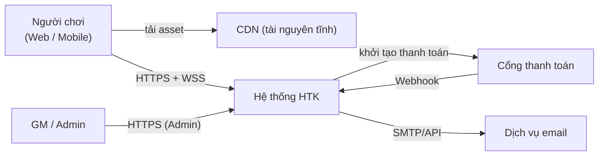
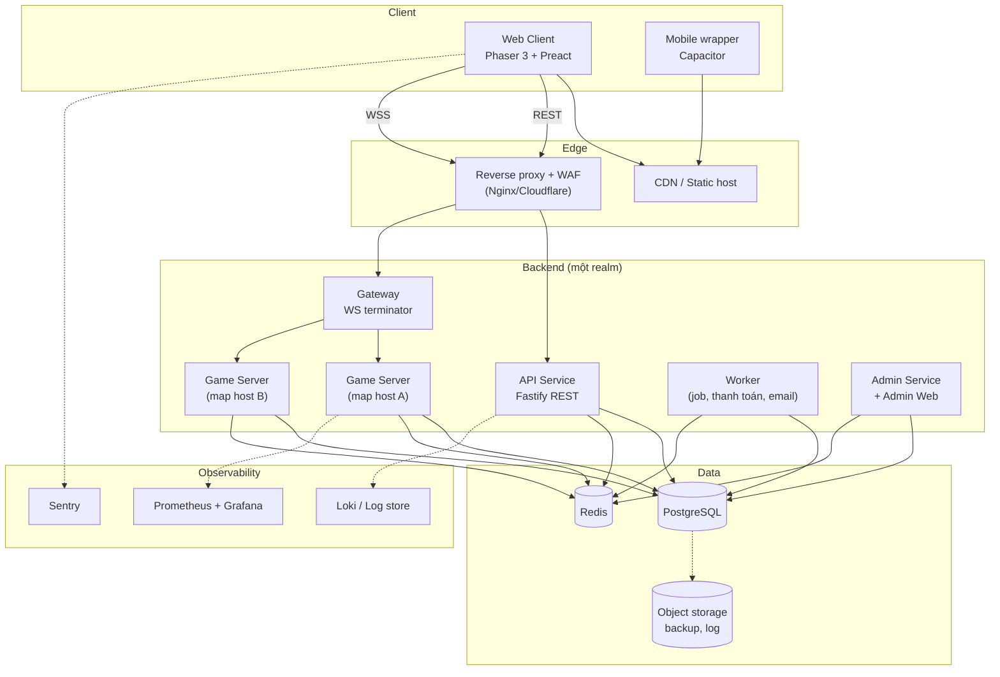
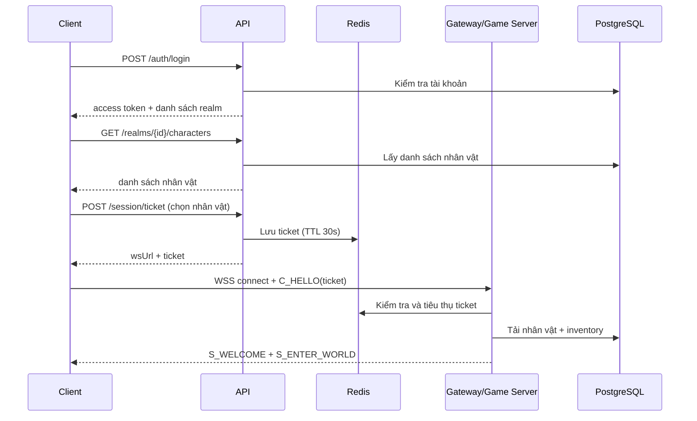
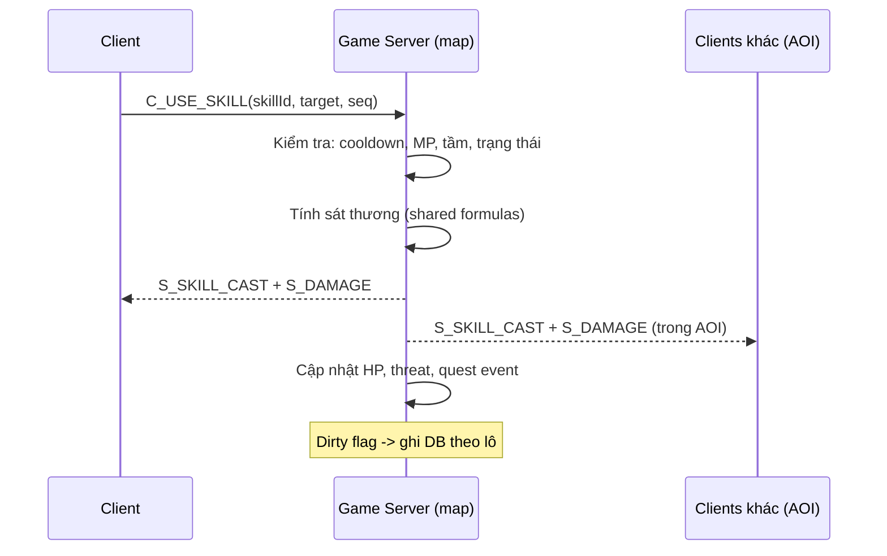
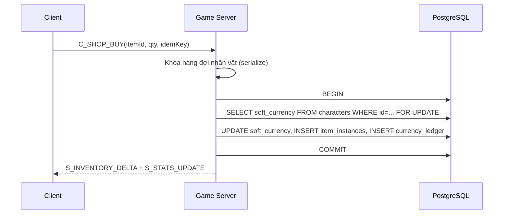

# Kiến trúc hệ thống

> **Trạng thái:** Draft v0.1 · **Liên quan:** [server-design](server-design.md) · [client-design](client-design.md) · [network-protocol](network-protocol.md) · [database-schema](database-schema.md) · [infrastructure](infrastructure-devops.md)

## 1. Mục tiêu kiến trúc

| Mục tiêu | Diễn giải |
|----------|-----------|
| **Server-authoritative** | Server quyết định mọi kết quả; client chỉ gửi ý định |
| **Data-driven** | Nội dung (map, quái, vật phẩm, nhiệm vụ) là file dữ liệu có schema, không hard-code |
| **Một ngôn ngữ** | TypeScript cho client, server, công cụ, giúp dùng chung kiểu dữ liệu và công thức |
| **Mở rộng theo máy chủ (realm)** | Mỗi realm độc lập; trong realm mở rộng theo map/zone |
| **Vận hành được** | Có giám sát, log, backup và công cụ GM từ sớm |
| **Chi phí hợp lý** | MVP chạy được trên 1–2 máy ảo |

## 2. Ngữ cảnh hệ thống (Level 1)



## 3. Container (Level 2)



> **Giai đoạn đầu (Phase 0–2):** `Gateway`, `Game Server`, `Worker` có thể **gộp một tiến trình** (`game-server`) và chạy cùng Redis/PostgreSQL trên một máy. Tách dần khi cần.

## 4. Thành phần & trách nhiệm

| Thành phần | Trách nhiệm | Trạng thái | Công nghệ |
|------------|-------------|------------|-----------|
| **Web Client** | Render, input, UI, dự đoán, tải asset | Ứng dụng tĩnh | TypeScript, Phaser 3, Preact, Vite |
| **API Service** | Đăng ký/đăng nhập, danh sách realm, nhân vật (tạo/xóa), thanh toán, webhook | **Stateless** | Node.js, Fastify, Zod |
| **Gateway** | Kết thúc WebSocket, xác thực ticket, giới hạn tốc độ, định tuyến tới map host | Gần stateless | Node.js, `ws` |
| **Game Server (Map Host)** | Mô phỏng thế giới, AI, chiến đấu, quest event, phát snapshot | **Stateful** (trong bộ nhớ) | Node.js, TypeScript |
| **Worker** | Tác vụ nền: email, thanh toán, báo cáo, dọn dẹp, tạo snapshot | Stateless | Node.js, BullMQ |
| **Admin Service + Web** | Công cụ GM, báo cáo kinh doanh | Stateless | Fastify, React |
| **PostgreSQL** | Nguồn chân lý của dữ liệu bền | Stateful | PostgreSQL 16 |
| **Redis** | Phiên, presence, cache, bảng xếp hạng, pub/sub, khóa phân tán, rate limit | Stateful | Redis 7 |
| **Object storage** | Backup, log lưu trữ, artifact | Stateful | S3 tương thích |

## 5. Công nghệ & lý do chọn

| Lớp | Chọn | Lý do | Phương án thay thế |
|-----|------|-------|--------------------|
| Client engine | **Phaser 3** | Web-first, cộng đồng lớn, tilemap tốt, sprite atlas | PixiJS, Godot 4 (export Web) |
| UI | **Preact** (DOM overlay) | Nhẹ, dễ làm form và danh sách | React, Svelte |
| Ngôn ngữ | **TypeScript** | Dùng chung type, giao thức, công thức | Go/Rust cho server (cần chia sẻ code) |
| Build | **Vite**, **pnpm workspaces** | Nhanh, monorepo gọn | Turborepo |
| Server runtime | **Node.js 20 LTS** | Đồng nhất ngôn ngữ, I/O tốt | Bun |
| WebSocket | **`ws`** (MVP), cân nhắc **uWebSockets.js** khi cần | Đơn giản, đủ cho MVP | Socket.IO (nặng, không cần) |
| Serialization | **MessagePack** nhị phân | Nhỏ, nhanh, hỗ trợ tốt | Protobuf, FlatBuffers |
| REST | **Fastify** + **Zod** | Nhanh, validate schema | Express, NestJS |
| DB | **PostgreSQL 16** + **Prisma** (migration + truy vấn thường), SQL thuần cho đường nóng | ACID, JSONB, mạnh | MySQL |
| Cache/pub-sub | **Redis 7** | Khóa, zset, pub/sub | — |
| Queue | **BullMQ** (Redis) | Job nền, retry | — |
| Observability | Prometheus, Grafana, Loki, Sentry, OpenTelemetry | Chuẩn mở | Datadog |
| Test | **Vitest**, **Playwright**, **k6** | Unit, E2E, load WebSocket | — |
| CI/CD | **GitHub Actions** | Gắn với repo | — |
| Container | **Docker** + Compose (dev), Kubernetes hoặc VM (prod) | | |

## 6. Cấu trúc monorepo (kế hoạch)

```text
game-2d/
├─ apps/
│  ├─ web-client/        # Phaser + Preact (client)
│  ├─ api/               # REST: auth, character, payment
│  ├─ game-server/       # WS + mô phỏng thế giới
│  ├─ worker/            # job nền
│  └─ admin/             # Admin web (React) + API
├─ packages/
│  ├─ shared/            # protocol, types, formulas, constants
│  ├─ content/           # YAML/JSON nội dung + schema (Zod)
│  ├─ db/                # Prisma schema, migrations, seed
│  └─ config/            # eslint, tsconfig, prettier dùng chung
├─ tools/
│  ├─ content-cli/       # validate, build, sync nội dung
│  ├─ balance-sim/       # mô phỏng cân bằng
│  ├─ bot-client/        # bot kiểm thử tải
│  └─ map-pipeline/      # xử lý map Tiled
├─ design/               # nguồn art (.aseprite, .tmx)
├─ docs/                 # tài liệu (thư mục này)
├─ infra/                # docker-compose, k8s, terraform
└─ .github/workflows/
```

## 7. Luồng dữ liệu chính

### 7.1 Đăng nhập và vào game



### 7.2 Hành động chiến đấu



### 7.3 Giao dịch tiền / vật phẩm (đường quan trọng)



## 8. Quyết định kiến trúc quan trọng (ADR)

| ADR | Quyết định | Lý do | Hệ quả |
|-----|-----------|-------|--------|
| **001** | **Server-authoritative** hoàn toàn | Chống gian lận, đồng bộ | Cần dự đoán phía client, tốn băng thông |
| **002** | Game server là **monolith module hóa**, không microservice | Đội nhỏ, độ trễ thấp | Phải giữ ranh giới module rõ |
| **003** | WebSocket + **MessagePack** | Hai chiều, nhỏ, nhanh | Cần quản lý phiên bản giao thức |
| **004** | **PostgreSQL** là nguồn chân lý, Redis chỉ cache/phiên | Toàn vẹn dữ liệu | Cần chiến lược ghi lô |
| **005** | **Write-behind** cho trạng thái nhân vật, **ghi đồng bộ** cho giao dịch tiền/vật phẩm | Hiệu năng + an toàn | Mất tối đa 60s dữ liệu "mềm" khi sập |
| **006** | **Data-driven content** (YAML + Zod) | Thêm nội dung nhanh, kiểm chứng tự động | Cần validator, đồng bộ phiên bản |
| **007** | **Instance** bằng bộ nhớ, trong cùng tiến trình map host | Đơn giản | Chuyển node = mất instance; giới hạn thời gian |
| **008** | **TypeScript shared package** (công thức, protocol) | Một nguồn chân lý | Phụ thuộc chặt client/server |
| **009** | **Web-first**, mobile qua wrapper | Chi phí thấp, phát hành nhanh | Hiệu năng mobile phải kiểm soát |
| **010** | Mỗi realm một **cơ sở dữ liệu logic** riêng (schema/realm_id) | Cô lập, dễ mở thêm server | Tài khoản dùng chung phải tách |

ADR chi tiết lưu ở `docs/architecture/adr/NNN-title.md` khi phát sinh (xem [development-workflow](../workflows/development-workflow.md)).

## 9. Mở rộng (scaling)

| Giai đoạn | CCU | Cấu hình |
|-----------|-----|----------|
| Phase 0–2 | ≤ 300 | 1 VM: API + game-server + PG + Redis (Docker Compose) |
| Phase 3 | ≈ 1.000 | VM game-server riêng, PG/Redis riêng |
| Phase 4 | ≈ 5.000 / realm | Gateway ×2, Map Host ×4–6, PG có replica đọc, Redis HA |
| Sau | Nhiều realm | Mở realm mới độc lập, tài khoản dùng chung |

**Chiến lược mở rộng trong một realm:**

1. **Phân vùng theo map**: mỗi map (và khu) thuộc đúng một map host; registry trong Redis ghi `mapZone → node`.
2. **Phân vùng theo tải:** khu mới của map nóng có thể đặt ở node ít tải.
3. **Instance** (hầm ngục, Hall) đặt ở node ít tải nhất khi tạo.
4. **Giao tiếp xuyên node** (chat, nhóm, thư) qua Redis pub/sub.
5. **Giới hạn cứng:** 30 người/khu; Town 60.

## 10. Chế độ lỗi & phục hồi

| Sự cố | Ảnh hưởng | Phục hồi |
|-------|-----------|----------|
| Game server sập | Người chơi trên node bị ngắt | Tự khởi động lại; client reconnect; mất tối đa 60s trạng thái mềm; giao dịch đã ghi DB an toàn |
| Redis mất | Phiên, bảng xếp hạng, rate limit | Game vẫn chạy (degraded) nhờ trạng thái trong bộ nhớ; Redis HA/Sentinel |
| PostgreSQL mất | Không ghi được | Bật chế độ chỉ đọc, hàng đợi ghi tạm trong bộ nhớ có hạn; failover replica |
| Cổng thanh toán lỗi | Không nạp | Ẩn nút nạp, hàng đợi đối soát |
| Quá tải map host | Tick chậm | Giãn tải: giảm số khu mới, giảm tần số snapshot, từ chối vào khu quá tải |
| Lỗi phát hành | Lỗi nghiêm trọng | Rollback phiên bản; tính năng bật/tắt bằng feature flag |

## 11. Ranh giới module trong game-server

```text
apps/game-server/src/
├─ net/            # kết nối, codec, rate limit
├─ session/        # phiên, resume
├─ world/          # World, Map, Zone, Instance, AOI
├─ entities/       # Player, Monster, Npc, Drop, Projectile
├─ systems/        # movement, ai, combat, status, spawn, loot
├─ domain/         # quest, inventory, shop, trade, market, guild, party, mail
├─ persistence/    # repositories, write-behind, transactions
├─ events/         # event bus nội bộ
├─ scheduler/      # cron job, boss, sự kiện
├─ admin/          # lệnh GM nội bộ
└─ bootstrap/      # cấu hình, khởi động
```

- `domain/*` **không** phụ thuộc `net/*`. Giao tiếp qua DTO và event.
- `systems/*` chỉ đọc/ghi qua component, không chạm DB.
- `persistence/*` là nơi duy nhất ghi PostgreSQL.
