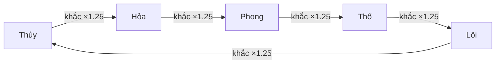

# Xuất thân, Hệ phép & Kỹ năng

> **Trạng thái:** Draft v0.1 · **Phụ thuộc:** [combat-progression](04-combat-and-progression.md) · [items](07-items-and-equipment.md)
> Mọi số liệu là **giá trị khởi điểm**, sẽ cân bằng lại bằng mô phỏng (xem [content-pipeline](../workflows/content-pipeline.md)).

## 1. Hai lớp lựa chọn nhân vật

| Lớp | Chọn khi nào | Đổi được? | Ảnh hưởng |
|-----|--------------|-----------|-----------|
| **Xuất thân** (Origin) | Lúc tạo nhân vật | Không | Chỉ số gốc, tăng trưởng, nội tại |
| **Hệ phép** (Class) | Lv10, **Lễ Khai Thư** | Có (§5) | Kỹ năng, vai trò, vũ khí |

Cách chia này giống NRO (chọn tộc ngay từ đầu) kết hợp NS (chọn trường ở cấp 10).

## 2. Ba Xuất thân

| Xuất thân | Nguồn gốc trong thế giới | HP | MP | ATK | DEF | Tăng/cấp (HP/MP/ATK/DEF) | Nội tại |
|-----------|------------------|----|----|-----|-----|---------------------------|---------|
| **Dân Làng** | Con nhà nông, thợ, lớn lên ở các làng của Lục Nguyên | 220 | 70 | 22 | 9 | +14 / +4 / +1.8 / +0.9 | **Không Lùi Bước**: khi HP < 30%, +15% ATK và DEF trong 8s (hồi 60s) |
| **Thế Gia** | Các dòng họ lâu đời giữ sách phép mạnh qua nhiều đời | 180 | 120 | 24 | 7 | +11 / +7 / +2.0 / +0.7 | **Gia Truyền**: hồi MP +25%, sát thương kỹ năng +5% |
| **Hậu Duệ Tộc Cổ Thư** | Mang dòng máu của tộc đã viết Nguyên Điển | 200 | 100 | 18 | 8 | +13 / +6 / +1.5 / +0.8 | **Ấn Cổ Hộ Thân**: hồi HP 1%/3s ngoài giao tranh, hiệu quả hồi máu nhận +15% và gây ra +10% |

Cả ba bắt đầu ở **Nhà Học Suối Mơ (M001)**. Khác biệt chỉ ở thoại mở đầu của `Q_MAIN_01` và ngoại hình gợi ý (vệt chữ mờ trên da cho Hậu Duệ Tộc Cổ Thư, trang phục lịch sự cho Thế Gia).

### 2.1 Tạo nhân vật

| Mục | Quy tắc |
|-----|---------|
| Tên | 3–12 ký tự: chữ (có dấu tiếng Việt), số, một dấu cách giữa các từ; duy nhất trong máy chủ (bản chơi thử chưa kiểm tra trùng) |
| Giới tính | Nam hoặc Nữ; chỉ đổi ngoại hình |
| Xuất thân | Một trong ba ở §2, **không đổi được** |
| Ngoại hình | Theo xuất thân và giới tính (bản đầu, chưa tự chọn từng phần): Dân Làng tóc nâu, áo vải nông; Thế Gia tóc đen, áo dài xanh cổ vàng; Hậu Duệ Tộc Cổ Thư tóc bạc, áo xám lam. Nữ: Dân Làng tóc tết, Thế Gia và Hậu Duệ tóc dài có nơ |
| Khởi đầu | Lv1 với **10 Điểm Tiềm Năng** chưa cộng ([combat §3.3](04-combat-and-progression.md)), 3 Bình HP Nhỏ, 3 Bình MP Nhỏ |

Sau Lễ Khai Thư nhân vật **giữ mặt và tóc**, chỉ đổi sang đồng phục Pháp Vệ có màu của hệ.

> **Gợi ý lối chơi:** Dân Làng hợp vai trò gánh chịu (Thổ), Thế Gia hợp sát thương phép (Hỏa, Thủy, Ám), Hậu Duệ Tộc Cổ Thư hợp lối bền bỉ (Mộc, Phong).

## 3. Bảy hệ phép + hệ ẩn

Chọn tại Lv10. Mỗi hệ có 1 vũ khí chuyên dụng và 7 kỹ năng (6 thường + 1 Nhập Linh).

| Hệ | Tên hệ phép | Vai trò | Vũ khí | Hiệu chỉnh chỉ số | Nội tại hệ | Huấn luyện viên |
|----|-------------|---------|--------|-------------------|-----------|-----------------|
| **Hỏa** | Hỏa Kiếm Sĩ | Cận chiến bùng nổ | Kiếm | ATK +15%, DEF −5% | **Lửa Bén**: +8% sát thương lên mục tiêu đang cháy | Đan Hồng |
| **Thủy** | Thủy Pháp Sư | Đánh xa diện rộng | Trượng | MP +20% | **Triều Dâng**: mỗi 5 đòn, kỹ năng kế +15% và hồi 3% MP | Lâm Hải |
| **Phong** | Phong Kiếm Khách | Tốc độ, chí mạng | Đoản Kiếm | Tốc chạy +10%, Chí mạng +8% | **Gió Lướt**: sau khi lướt, 10% né 3s. Nhảy đôi | Vân Tước |
| **Lôi** | Lôi Chiến Binh | Liên hoàn tốc đánh | Găng Tay | Tốc đánh +15% | **Chiến Ý**: mỗi đòn trúng +2% sát thương, tối đa 10 lớp | Đổng Tráng |
| **Thổ** | Thổ Hộ Vệ | Bền bỉ, đỡ đòn, đánh chắc | Búa & Khiên | HP +25%, DEF +20%, ATK −5% | **Da Đá**: giảm 8% sát thương nhận | Viện Chủ Thạch Bàn |
| **Mộc** | Mộc Thuật Sư | Bền bỉ: độc và tự hồi phục; hỗ trợ nhóm là phần cộng thêm | Trượng Hoa | HP +10%, MP +10%, hồi phục +20% (bản thân và đồng đội) | **Sinh Lực Hoa**: mỗi lần kỹ năng gây sát thương trúng, hồi 1% HP tối đa cho bản thân (tối đa 1 lần/giây); kỹ năng hồi máu thêm hồi liên tục 3s | Thảo Nhiên |
| **Ám** | Ám Pháp Sư | Bất lợi hóa, hút máu | Đao | Sát thương chí mạng +20% | **Bóng Tối Nuốt Chửng**: hút 5% sát thương thành HP | Mạc Uyên |
| **Phong Ấn** *(ẩn)* | Phong Ấn Xạ Thủ | Tầm xa, đơn mục tiêu, xuyên giáp | Cung Ấn Tiễn | Không dùng MP; dùng **Ý Chí** | **Mắt Ưng**: bỏ qua 35% DEF mục tiêu. **Phong Ấn**: đòn chí mạng gỡ 1 hiệu ứng có lợi của mục tiêu | Cụ Tiễn |

> **Nguyên tắc Solo-first.** Giống Ninja School và Ngọc Rồng, người chơi chủ yếu săn quái và làm nhiệm vụ **một mình**. Vì vậy **mọi hệ phải tự chơi trọn vẹn được**: không có kỹ năng nào vô dụng khi đi một mình, và kỹ năng hỗ trợ luôn có phần tác dụng lên **bản thân**. Đồng đội chỉ làm lối chơi **tốt hơn**, không phải điều kiện cần. Xem [combat §11](04-combat-and-progression.md).

### Vòng khắc hệ

- Kỹ năng khắc → **×1.25**; bị khắc → **×0.8**; còn lại **×1.0**.
- **Mộc** và **Ám** nằm ngoài vòng (trung tính). **Ám** gây ×1.25 lên quái hệ **Quang** và ngược lại.
- **Phong Ấn Xạ Thủ** bỏ qua mọi bất lợi hệ.

## 4. Kỹ năng

### 4.1 Quy tắc chung

| Quy tắc | Giá trị |
|---------|---------|
| Mở kỹ năng | Lv10, 20, 30, 40, 55, 70, 85 (kỹ năng 1 → 7) |
| Ô kỹ năng (hotbar) | 6 kỹ năng chủ động + 1 ô vật phẩm |
| Kỹ năng tối đa mỗi hệ | 7 (kỹ năng 7 = **Nhập Linh**) |
| Cấp kỹ năng | 1–7 |
| Điểm Kỹ Năng (SP) | +1 mỗi cấp, từ Lv10 (tổng 91 ở Lv100) |
| Chi phí nâng lên cấp *n* | ⌈n/2⌉ SP + Quan (xem §4.4) |
| Tăng theo cấp | Hệ số sát thương ×(1 + 0,08 × (n−1)), MP ×(1 + 0,05 × (n−1)), hồi chiêu −2%/cấp |
| Thời gian hồi toàn cục (GCD) | 0,5 giây |
| Kỹ năng tân thủ (Lv1–9) | **Đòn Cơ Bản** (Lv1), **Tụ Mana Chấn** (Lv5, 120% ATK, MP 6, hồi 3s) |

Mỗi hệ có **Đòn Thường** (đánh thường vô hạn, 100% ATK, tốc đánh 1,0 đòn/giây).

### 4.2 Hồi chiêu và MP chuẩn (theo vị trí kỹ năng)

| # | Mở | MP gốc | Hồi chiêu gốc |
|---|----|--------|----------------|
| 1 | Lv10 | 10 | 3s |
| 2 | Lv20 | 18 | 5s |
| 3 | Lv30 | 28 | 8s |
| 4 | Lv40 | 40 | 12s |
| 5 | Lv55 | 55 | 18s |
| 6 | Lv70 | 75 | 30s |
| 7 | Lv85 | Thanh Nhập Linh 100 | 180s |

Tầm đánh: **Cận** 64 px, **Ngắn** 160 px, **Xa** 400 px.

### 4.3 Bảng kỹ năng theo hệ

Hệ số là **% ATK** ở cấp kỹ năng 1.

#### Hỏa — Hỏa Kiếm Sĩ

| ID | Tên | Loại | Tầm | Hiệu ứng (cấp 1) |
|----|-----|------|-----|------------------|
| SKL_FIRE_1 | Hỏa Cầu | Đơn, đạn | Xa | 120% ATK, **Cháy** 3s (20% ATK tổng) |
| SKL_FIRE_2 | Trảm Liệt Diễm | Đơn, vòng cung | Cận | 160% ATK |
| SKL_FIRE_3 | Hỏa Thương Xuyên Thiên | Đường thẳng, xuyên | Ngắn | 190% ATK, xuyên mọi mục tiêu |
| SKL_FIRE_4 | Vòng Lửa Thiêu Đốt | Diện rộng quanh mình | Ngắn | 210% ATK, **Cháy** |
| SKL_FIRE_5 | Khải Thể: Lửa | Buff 20s | — | +25% ATK, +10% DEF |
| SKL_FIRE_6 | Cuồng Hỏa Long | Diện rộng lớn | Ngắn | 320% ATK |
| SKL_FIRE_7 | **Nhập Linh: Salamander** | Biến thân 30s | — | +50% ATK, hồi chiêu −30%, kỹ năng gây thêm nổ lan 40% |

#### Thủy — Thủy Pháp Sư

| ID | Tên | Loại | Tầm | Hiệu ứng (cấp 1) |
|----|-----|------|-----|------------------|
| SKL_WATER_1 | Thủy Đạn | Đơn, đạn | Xa | 115% ATK |
| SKL_WATER_2 | Sóng Triều | Đường thẳng | Ngắn | 150% ATK, **Làm chậm** 30% 3s |
| SKL_WATER_3 | Thủy Tiễn Xuyên Sóng | Đơn, tia | Xa | 230% ATK |
| SKL_WATER_4 | Xoáy Nước Giam Cầm | Vùng 5s | Ngắn | 80% ATK/giây, **Làm chậm** |
| SKL_WATER_5 | Giáp Sóng Bạc | Buff 20s | — | +30% DEF, +15% ATK |
| SKL_WATER_6 | Đại Hồng Thủy | Diện rộng lớn | Xa | 340% ATK |
| SKL_WATER_7 | **Nhập Linh: Undine** | Biến thân 30s | — | MP = 0, kỹ năng +40% sát thương, hồi 2% HP/s |

#### Phong — Phong Kiếm Khách

| ID | Tên | Loại | Tầm | Hiệu ứng (cấp 1) |
|----|-----|------|-----|------------------|
| SKL_WIND_1 | Phong Nhận | Đơn, đạn | Ngắn | 110% ATK |
| SKL_WIND_2 | Gió Xoáy Trảm | Diện nhỏ | Cận | 140% ATK |
| SKL_WIND_3 | Lướt Gió | Dash | Ngắn | 160% ATK, bất khả xâm phạm 0,3s |
| SKL_WIND_4 | Bão Kiếm Liên Hoàn | Đơn, 5 đòn | Cận | 5 × 60% ATK |
| SKL_WIND_5 | Phong Thần Hộ Thể | Buff 20s | — | +20% tốc chạy, +20% chí mạng |
| SKL_WIND_6 | Cuồng Phong Diệt | Diện rộng | Ngắn | 330% ATK, **Đẩy lùi** |
| SKL_WIND_7 | **Nhập Linh: Sylph** | Biến thân 30s | — | +35% chí mạng, +30% ATK, lướt không tốn hồi chiêu |

#### Lôi — Lôi Chiến Binh

| ID | Tên | Loại | Tầm | Hiệu ứng (cấp 1) |
|----|-----|------|-----|------------------|
| SKL_BOLT_1 | Lôi Quyền | Đơn | Cận | 130% ATK |
| SKL_BOLT_2 | Tia Chớp Liên Hoàn | Chuỗi 3 mục tiêu | Ngắn | 140% ATK mỗi mục tiêu |
| SKL_BOLT_3 | Bộ Pháp Tia Chớp | Buff 15s | — | +30% tốc đánh, +15% tốc chạy |
| SKL_BOLT_4 | Sấm Giáng | Đơn | Ngắn | 240% ATK, **Choáng** 1s |
| SKL_BOLT_5 | Bão Điện | Diện rộng | Ngắn | 260% ATK, **Tê liệt** 2s |
| SKL_BOLT_6 | Lôi Long Ngâm | Diện rộng lớn | Xa | 350% ATK |
| SKL_BOLT_7 | **Nhập Linh: Lôi Điểu** | Biến thân 30s | — | +50% tốc đánh, đòn thường lan sét 3 mục tiêu |

#### Thổ — Thổ Hộ Vệ

| ID | Tên | Loại | Tầm | Hiệu ứng (cấp 1) |
|----|-----|------|-----|------------------|
| SKL_EARTH_1 | Đá Phóng | Đơn, đạn | Xa | 110% ATK |
| SKL_EARTH_2 | Địa Chấn | Diện nhỏ | Cận | 140% ATK, **Choáng** 0,5s |
| SKL_EARTH_3 | Khiên Đất | Lá chắn 10s + nổ | Cận | Hấp thụ 300% ATK sát thương; khi vỡ hoặc hết hạn nổ gây 200% ATK diện nhỏ |
| SKL_EARTH_4 | Khiêu Khích | Aggro 6s + diện rộng | Ngắn | 120% ATK diện rộng; quái xung quanh nhắm vào mình, +30% DEF |
| SKL_EARTH_5 | Giáp Gnome | Buff 20s | — | +40% DEF, +15% ATK, phản 10% sát thương |
| SKL_EARTH_6 | Động Đất Cuồng Nộ | Diện rộng | Ngắn | 300% ATK, **Choáng** 1,5s |
| SKL_EARTH_7 | **Nhập Linh: Gnome** | Biến thân 30s | — | Lá chắn 20% HP tối đa, aura khiêu khích, phản 25% sát thương |

#### Mộc — Mộc Thuật Sư

Mộc là hệ **bền bỉ**: gây sát thương bằng **Độc** và tự hồi phục, nên săn quái một mình rất ổn. Khi vào nhóm, các kỹ năng hồi và khiên **lan thêm sang đồng đội**. **Không có kỹ năng hồi sinh người khác.**

| ID | Tên | Loại | Tầm | Hiệu ứng (cấp 1) |
|----|-----|------|-----|------------------|
| SKL_PLANT_1 | Gai Xanh | Đơn, đạn | Xa | 120% ATK, **Độc** 3s (30% ATK tổng) |
| SKL_PLANT_2 | Hồi Xuân | Hồi bản thân + 1 đồng đội gần nhất | Ngắn | Hồi 150% ATK + 5% HP tối đa, hồi liên tục 3s |
| SKL_PLANT_3 | Dây Leo Trói | Đơn | Ngắn | 160% ATK, **Trói** 3s |
| SKL_PLANT_4 | Vườn Sinh Tử | Vùng 8s | Ngắn | Gây 60% ATK/giây và **Độc** lên kẻ địch trong vùng; bản thân và đồng đội trong vùng hồi 40% ATK/giây |
| SKL_PLANT_5 | Hoa Bảo Hộ | Lá chắn 15s | Ngắn | Hấp thụ 200% ATK cho bản thân; trong nhóm lan thêm tới 2 đồng đội gần nhất |
| SKL_PLANT_6 | Rừng Sinh Mệnh | Diện rộng | Ngắn | 340% ATK, sau đó hồi 200% ATK và **giải hiệu ứng xấu** cho bản thân và đồng đội trong vùng |
| SKL_PLANT_7 | **Nhập Linh: Dryad** | Biến thân 30s | — | Sát thương Độc +40%, hồi 3% HP/giây cho bản thân và đồng đội gần; **Tái Sinh**: nếu HP về 0 trong lúc biến thân, tự hồi sinh 1 lần với 40% HP |

#### Ám — Ám Pháp Sư

| ID | Tên | Loại | Tầm | Hiệu ứng (cấp 1) |
|----|-----|------|-----|------------------|
| SKL_DARK_1 | Ám Trảm | Đơn | Ngắn | 125% ATK |
| SKL_DARK_2 | Màn Đêm | Đơn | Ngắn | 100% ATK, **Mù** (−30% chính xác) 6s |
| SKL_DARK_3 | Hắc Vụ Hộ Thân | Buff 20s | — | +25% ATK, +5% hút máu |
| SKL_DARK_4 | Xiềng Xích Bóng | Đơn | Ngắn | **Trói** 2s, −20% DEF 6s |
| SKL_DARK_5 | Nhát Cắt Cuối | Đơn | Cận | 280% ATK, +50% nếu mục tiêu < 30% HP |
| SKL_DARK_6 | Hắc Ám Bùng Nổ | Diện rộng | Ngắn | 340% ATK, **Sợ hãi** 2s |
| SKL_DARK_7 | **Nhập Linh: Shade** | Biến thân 30s | — | +40% sát thương, hút máu 15% |

#### Phong Ấn Xạ Thủ *(hệ ẩn, dùng Ý Chí thay MP)*

Xạ thủ **tầm xa**, bắn **Ấn Tiễn** (mũi tên khắc chữ phong ấn của Tộc Cổ Thư). Có **Ý Chí** tối đa 100, hồi 5/giây, mỗi kỹ năng tốn Ý Chí thay vì MP. **Không thể dùng kỹ năng hệ khác.** Chỉ có 6 kỹ năng. **Không dùng kiếm, không liên quan tới quỷ.**

| ID | Tên | Loại | Tầm | Hiệu ứng (cấp 1) |
|----|-----|------|-----|------------------|
| SKL_ARCH_1 | Ấn Tiễn | Đơn, đạn | Xa | 140% ATK, **phong ấn** (gỡ) 1 hiệu ứng có lợi của mục tiêu |
| SKL_ARCH_2 | Tiễn Xuyên Giáp | Đơn, đạn | Xa | 250% ATK, bỏ qua thêm 35% DEF |
| SKL_ARCH_3 | Ngưng Thần | Buff 15s | — | +30% ATK, miễn nhiễm **Làm chậm**; mỗi đòn chí mạng hồi 3% HP |
| SKL_ARCH_4 | Mưa Ấn Tiễn | Diện rộng | Xa | 300% ATK |
| SKL_ARCH_5 | Tiễn Xuyên Tâm | Đường thẳng, dài | Xa | 350% ATK, xuyên mọi mục tiêu |
| SKL_ARCH_6 | **Nhất Ấn** | Tập trung 40s | — | +60% ATK, miễn nhiễm hiệu ứng khống chế, mọi đòn xuyên 50% DEF |

> **Thay đổi so với thiết kế trước:** hệ ẩn chuyển từ **cận chiến** sang **tầm xa**; bỏ nội tại giảm 50% sát thương phép nhận, thay bằng **Mắt Ưng** và **Phong Ấn**. Số liệu sát thương giữ cùng mức, cần mô phỏng lại vì đổi tầm đánh ([combat §11](04-combat-and-progression.md)).

### 4.4 Chi phí nâng kỹ năng

| Lên cấp | SP | Quan |
|---------|----|-----|
| 2 | 1 | 500 |
| 3 | 2 | 1.500 |
| 4 | 2 | 4.000 |
| 5 | 3 | 10.000 |
| 6 | 3 | 25.000 |
| 7 | 4 | 60.000 |

Nâng đủ 7 kỹ năng lên cấp 7 tốn **105 SP**, trong khi chỉ có **91 SP** đến Lv100. Người chơi cần chọn kỹ năng cần ưu tiên hoặc dùng **Sách Kỹ Năng** (rơi từ boss, thưởng sự kiện) để bù. Đây là cơ chế chọn build có chủ đích.

### 4.5 Nhập Linh

- Mở ở **Lv85** thông qua chuỗi nhiệm vụ **Cộng Hưởng Nguyên Linh** (NPC052, Trưởng Lão Thư Ngữ).
- Cần **Thanh Nhập Linh** đầy 100. Gauge tăng **+1 mỗi 1% HP tối đa sát thương gây/nhận**, giảm 2/giây khi ngoài giao tranh.
- Khi kích hoạt: nhân vật hiện hào quang Nguyên Linh, giữ **30s**, hồi chiêu **180s**.
- Không thể dùng trong khu vực Safe.

### 4.6 Khải Thể

**Khải Thể** là buff phổ quát học từ Mạc Uyên hoặc Thiết Lan ở Chương 3. Tốn 25 MP, 30s, +10% DEF và +5% HP tối đa; cộng dồn với buff hệ. Kỹ năng này dùng chung mọi hệ trừ Phong Ấn Xạ Thủ (không dùng Mana).

## 5. Đổi hệ phép & Khe Huyền Thư

| Quy tắc | Giá trị |
|---------|---------|
| Đổi hệ lần đầu | **Miễn phí** trong 24 giờ đầu sau Lễ Khai Thư. Ở Chương 1 làm tại **Bà Mơ** (NPC002) vì Thầy Bạch Vân đã rời làng |
| Đổi hệ sau đó | **100 Nén Bạc**, bắt buộc chờ 30 ngày giữa hai lần |
| Hậu quả | Thu hồi SP, hoàn lại 100% SP nhưng mất Quan đã trả. **Vũ khí** hệ cũ tự tháo vào túi (không mặc được vũ khí hệ khác, [items §3](07-items-and-equipment.md)) và nhận vũ khí tập sự của hệ mới nếu chưa có; giáp, phụ kiện hệ khác vẫn mặc được nhưng mất **bonus set** |
| **Khe Huyền Thư (Lv80+)** | Có 2 khe build. Khe A hệ chính, khe B (Phong Ấn Xạ Thủ hoặc hệ phụ) |
| Đổi khe | Chỉ khi không giao tranh, tại Đài Huyền Thư, hồi chiêu 5 phút |

## 6. Huyền Thư (sách phép)

Huyền Thư là một ô trang bị đặc biệt, đi kèm người chơi suốt game. Phẩm cấp là **ấn bản**, không đếm số và không dùng biểu tượng cây cỏ.

| Phẩm | Ấn bản | Cách có | Hiệu ứng |
|------|--------|---------|----------|
| Thường | **Sơ Bản** | Lễ Khai Thư (Lv10) | Chỉ số cơ bản, 1 khe ngọc |
| Hiếm | **Tu Bản** | Chuỗi **Tu Chỉnh** (Lv50, sau Chương 4, cần **Mực Cổ**) | Chỉ số ×1,5, 2 khe ngọc, thêm 1 kỹ năng nội tại |
| Huyền thoại | **Định Bản** | Chỉ qua **Chuỗi Năm Ấn Tiễn** (Phong Ấn Xạ Thủ) | Mở hệ Phong Ấn Xạ Thủ, 3 khe ngọc |

Việc nâng ấn bản **không có yếu tố may rủi**. Mọi người chơi đều đi cùng một lộ trình nhiệm vụ để lên Tu Bản. Định danh kỹ thuật: `characters.tome_edition` (1–3).

## 7. Cây kỹ năng phụ: Thiên Phú

Từ Lv30, mỗi hệ có **Thiên Phú** (talent): 3 nhánh × 5 bậc, dùng **Điểm Thiên Phú** (1 điểm mỗi 5 cấp từ Lv30; tổng 15 điểm). Ví dụ nhánh cho Hỏa:

| Nhánh | Hiệu ứng |
|-------|----------|
| Bùng Nổ | +% sát thương lên mục tiêu cháy, Hỏa Cầu nổ lan |
| Thiêu Đốt | Cháy gây thêm sát thương, thời gian cháy dài hơn |
| Giáp Lửa | Khải Thể Lửa mạnh hơn và phản sát thương |

Danh sách đầy đủ lưu tại `packages/content/talents/*.yaml`.
