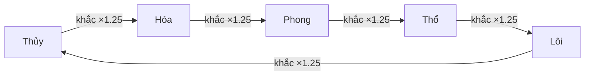

# Xuất thân, Hệ phép & Kỹ năng

> **Trạng thái:** Draft v0.1 · **Phụ thuộc:** [combat-progression](04-combat-and-progression.md) · [items](07-items-and-equipment.md)
> Mọi số liệu là **giá trị khởi điểm**, sẽ cân bằng lại bằng mô phỏng (xem [content-pipeline](../workflows/content-pipeline.md)).

## 1. Hai lớp lựa chọn nhân vật

| Lớp | Chọn khi nào | Đổi được? | Ảnh hưởng |
|-----|--------------|-----------|-----------|
| **Xuất thân** (Origin) | Lúc tạo nhân vật | Không | Chỉ số gốc, tăng trưởng, nội tại |
| **Hệ phép** (Class) | Lv10, **Lễ Nhận Ma Đạo Thư** | Có (§5) | Kỹ năng, vai trò, vũ khí |

Cách chia này giống NRO (chọn tộc ngay từ đầu) kết hợp NS (chọn trường ở cấp 10).

## 2. Ba Xuất thân

| Xuất thân | Gợi ý nguyên tác | HP | MP | ATK | DEF | Tăng/cấp (HP/MP/ATK/DEF) | Nội tại |
|-----------|------------------|----|----|-----|-----|---------------------------|---------|
| **Dân Làng Hage** | Asta, Yuno lớn lên trong nhà thờ | 220 | 70 | 22 | 9 | +14 / +4 / +1.8 / +0.9 | **Ý Chí Bất Khuất**: khi HP < 30%, +15% ATK và DEF trong 8s (hồi 60s) |
| **Quý Tộc** | Gia tộc Vermillion, Silva, Roselei | 180 | 120 | 24 | 7 | +11 / +7 / +2.0 / +0.7 | **Ma Lực Dồi Dào**: hồi MP +25%, sát thương kỹ năng +5% |
| **Hậu Duệ Tinh Linh** | Tộc Tinh Linh tái sinh | 200 | 100 | 18 | 8 | +13 / +6 / +1.5 / +0.8 | **Tinh Linh Chúc Phúc**: hồi HP 1%/3s ngoài giao tranh, hiệu quả hồi máu nhận +15% và gây ra +10% |

Cả ba bắt đầu ở **Nhà Thờ Hage (M001)**. Khác biệt chỉ ở thoại mở đầu của `Q_MAIN_01` và ngoại hình gợi ý (tai nhọn cho Tinh Linh, trang phục lịch sự cho Quý Tộc).

> **Gợi ý lối chơi:** Dân Làng hợp vai trò gánh chịu (Thổ), Quý Tộc hợp sát thương phép (Hỏa, Thủy, Ám), Tinh Linh hợp hỗ trợ (Mộc, Phong).

## 3. Bảy hệ phép + hệ ẩn

Chọn tại Lv10. Mỗi hệ có 1 vũ khí chuyên dụng và 7 kỹ năng (6 thường + 1 Spirit Dive).

| Hệ | Tên hệ phép | Vai trò | Vũ khí | Hiệu chỉnh chỉ số | Nội tại hệ | Huấn luyện viên |
|----|-------------|---------|--------|-------------------|-----------|-----------------|
| **Hỏa** | Hỏa Kiếm Sĩ | Cận chiến bùng nổ | Kiếm | ATK +15%, DEF −5% | **Bản Năng Sư Tử**: +8% sát thương lên mục tiêu đang cháy | Fuegoleon |
| **Thủy** | Thủy Pháp Sư | Đánh xa diện rộng | Trượng | MP +20% | **Triều Dâng**: mỗi 5 đòn, kỹ năng kế +15% và hồi 3% MP | Noelle |
| **Phong** | Phong Kiếm Khách | Tốc độ, chí mạng | Đoản Kiếm | Tốc chạy +10%, Chí mạng +8% | **Gió Lướt**: sau khi lướt, 10% né 3s. Nhảy đôi | Yuno |
| **Lôi** | Lôi Chiến Binh | Liên hoàn tốc đánh | Găng Tay | Tốc đánh +15% | **Chiến Ý**: mỗi đòn trúng +2% sát thương, tối đa 10 lớp | Luck |
| **Thổ** | Thổ Hộ Vệ | Đỡ đòn | Búa & Khiên | HP +25%, DEF +20%, ATK −10% | **Da Đá**: giảm 8% sát thương nhận | Trưởng Lão Terra |
| **Mộc** | Mộc Y Sư | Hồi máu, hỗ trợ | Trượng Hoa | Hồi máu +20%, MP +15%, ATK −15% | **Sinh Lực Hoa**: kỹ năng hồi máu thêm hồi liên tục 3s | Mimosa |
| **Ám** | Ám Pháp Sư | Bất lợi hóa, hút máu | Đao | Sát thương chí mạng +20% | **Bóng Tối Nuốt Chửng**: hút 5% sát thương thành HP | Yami |
| **Phản Ma** *(ẩn)* | Phản Ma Kiếm Sĩ | Sát thương đơn mục tiêu, khắc phép | Kiếm Phản Ma | Không dùng MP; dùng **Ý Chí** | **Phản Ma**: giảm 50% sát thương phép nhận, bỏ qua 35% DEF mục tiêu | Liebe |

### Vòng khắc hệ

- Kỹ năng khắc → **×1.25**; bị khắc → **×0.8**; còn lại **×1.0**.
- **Mộc** và **Ám** nằm ngoài vòng (trung tính). **Ám** gây ×1.25 lên quái hệ **Quang** và ngược lại.
- **Phản Ma** bỏ qua mọi bất lợi hệ.

## 4. Kỹ năng

### 4.1 Quy tắc chung

| Quy tắc | Giá trị |
|---------|---------|
| Mở kỹ năng | Lv10, 20, 30, 40, 55, 70, 85 (kỹ năng 1 → 7) |
| Ô kỹ năng (hotbar) | 6 kỹ năng chủ động + 1 ô vật phẩm |
| Kỹ năng tối đa mỗi hệ | 7 (kỹ năng 7 = **Spirit Dive**) |
| Cấp kỹ năng | 1–7 |
| Điểm Kỹ Năng (SP) | +1 mỗi cấp, từ Lv10 (tổng 91 ở Lv100) |
| Chi phí nâng lên cấp *n* | ⌈n/2⌉ SP + Yul (xem §4.4) |
| Tăng theo cấp | Hệ số sát thương ×(1 + 0,08 × (n−1)), MP ×(1 + 0,05 × (n−1)), hồi chiêu −2%/cấp |
| Thời gian hồi toàn cục (GCD) | 0,5 giây |
| Kỹ năng tân thủ (Lv1–9) | **Đòn Cơ Bản** (Lv1), **Tụ Mana Chấn** (Lv5, 120% ATK, MP 6, hồi 3s) |

Mỗi hệ có **Đòn Thường** (đánh thường vô hạn, 100% ATK, tốc đánh 1,0 đòn/giây).

### 4.2 Hồi chiêu và MP chuẩn (theo vị trí kỹ năng)

| # | Mở | MP gốc | Hồi chiêu gốc |
|---|----|--------|----------------|
| 1 | Lv10 | 10 | 3s |
| 2 | Lv20 | 18 | 5s |
| 3 | Lv30 | 28 | 8s |
| 4 | Lv40 | 40 | 12s |
| 5 | Lv55 | 55 | 18s |
| 6 | Lv70 | 75 | 30s |
| 7 | Lv85 | Spirit Gauge 100 | 180s |

Tầm đánh: **Cận** 64 px, **Ngắn** 160 px, **Xa** 400 px.

### 4.3 Bảng kỹ năng theo hệ

Hệ số là **% ATK** ở cấp kỹ năng 1.

#### Hỏa — Hỏa Kiếm Sĩ

| ID | Tên | Loại | Tầm | Hiệu ứng (cấp 1) |
|----|-----|------|-----|------------------|
| SKL_FIRE_1 | Hỏa Cầu | Đơn, đạn | Xa | 120% ATK, **Cháy** 3s (20% ATK tổng) |
| SKL_FIRE_2 | Trảm Liệt Diễm | Đơn, vòng cung | Cận | 160% ATK |
| SKL_FIRE_3 | Hỏa Thương Xuyên Thiên | Đường thẳng, xuyên | Ngắn | 190% ATK, xuyên mọi mục tiêu |
| SKL_FIRE_4 | Vòng Lửa Thiêu Đốt | Diện rộng quanh mình | Ngắn | 210% ATK, **Cháy** |
| SKL_FIRE_5 | Mana Skin: Lửa | Buff 20s | — | +25% ATK, +10% DEF |
| SKL_FIRE_6 | Cuồng Hỏa Long | Diện rộng lớn | Ngắn | 320% ATK |
| SKL_FIRE_7 | **Spirit Dive: Salamander** | Biến thân 30s | — | +50% ATK, hồi chiêu −30%, kỹ năng gây thêm nổ lan 40% |

#### Thủy — Thủy Pháp Sư

| ID | Tên | Loại | Tầm | Hiệu ứng (cấp 1) |
|----|-----|------|-----|------------------|
| SKL_WATER_1 | Thủy Đạn | Đơn, đạn | Xa | 115% ATK |
| SKL_WATER_2 | Sóng Triều | Đường thẳng | Ngắn | 150% ATK, **Làm chậm** 30% 3s |
| SKL_WATER_3 | Long Tức Biển | Đơn, tia | Xa | 230% ATK |
| SKL_WATER_4 | Tổ Rồng Biển | Vùng 5s | Ngắn | 80% ATK/giây, **Làm chậm** |
| SKL_WATER_5 | Giáp Valkyrie | Buff 20s | — | +30% DEF, +15% ATK |
| SKL_WATER_6 | Đại Hồng Thủy | Diện rộng lớn | Xa | 340% ATK |
| SKL_WATER_7 | **Spirit Dive: Undine** | Biến thân 30s | — | MP = 0, kỹ năng +40% sát thương, hồi 2% HP/s |

#### Phong — Phong Kiếm Khách

| ID | Tên | Loại | Tầm | Hiệu ứng (cấp 1) |
|----|-----|------|-----|------------------|
| SKL_WIND_1 | Phong Nhận | Đơn, đạn | Ngắn | 110% ATK |
| SKL_WIND_2 | Gió Xoáy Trảm | Diện nhỏ | Cận | 140% ATK |
| SKL_WIND_3 | Lướt Gió | Dash | Ngắn | 160% ATK, bất khả xâm phạm 0,3s |
| SKL_WIND_4 | Bão Kiếm Liên Hoàn | Đơn, 5 đòn | Cận | 5 × 60% ATK |
| SKL_WIND_5 | Phong Thần Hộ Thể | Buff 20s | — | +20% tốc chạy, +20% chí mạng |
| SKL_WIND_6 | Cuồng Phong Diệt | Diện rộng | Ngắn | 330% ATK, **Đẩy lùi** |
| SKL_WIND_7 | **Spirit Dive: Sylph** | Biến thân 30s | — | +35% chí mạng, +30% ATK, lướt không tốn hồi chiêu |

#### Lôi — Lôi Chiến Binh

| ID | Tên | Loại | Tầm | Hiệu ứng (cấp 1) |
|----|-----|------|-----|------------------|
| SKL_BOLT_1 | Lôi Quyền | Đơn | Cận | 130% ATK |
| SKL_BOLT_2 | Tia Chớp Liên Hoàn | Chuỗi 3 mục tiêu | Ngắn | 140% ATK mỗi mục tiêu |
| SKL_BOLT_3 | Lôi Thần Chi Hài | Buff 15s | — | +30% tốc đánh, +15% tốc chạy |
| SKL_BOLT_4 | Sấm Giáng | Đơn | Ngắn | 240% ATK, **Choáng** 1s |
| SKL_BOLT_5 | Bão Điện | Diện rộng | Ngắn | 260% ATK, **Tê liệt** 2s |
| SKL_BOLT_6 | Lôi Long Ngâm | Diện rộng lớn | Xa | 350% ATK |
| SKL_BOLT_7 | **Spirit Dive: Volt** | Biến thân 30s | — | +50% tốc đánh, đòn thường lan sét 3 mục tiêu |

#### Thổ — Thổ Hộ Vệ

| ID | Tên | Loại | Tầm | Hiệu ứng (cấp 1) |
|----|-----|------|-----|------------------|
| SKL_EARTH_1 | Đá Phóng | Đơn, đạn | Xa | 110% ATK |
| SKL_EARTH_2 | Địa Chấn | Diện nhỏ | Cận | 140% ATK, **Choáng** 0,5s |
| SKL_EARTH_3 | Khiên Đất | Lá chắn 10s | — | Hấp thụ 300% ATK sát thương |
| SKL_EARTH_4 | Khiêu Khích | Aggro 6s | Ngắn | Quái xung quanh nhắm vào mình, +30% DEF |
| SKL_EARTH_5 | Giáp Gnome | Buff 20s | — | +40% DEF, phản 10% sát thương |
| SKL_EARTH_6 | Động Đất Cuồng Nộ | Diện rộng | Ngắn | 300% ATK, **Choáng** 1,5s |
| SKL_EARTH_7 | **Spirit Dive: Gnome** | Biến thân 30s | — | Lá chắn 20% HP tối đa, aura khiêu khích, phản 25% sát thương |

#### Mộc — Mộc Y Sư

| ID | Tên | Loại | Tầm | Hiệu ứng (cấp 1) |
|----|-----|------|-----|------------------|
| SKL_PLANT_1 | Gai Xanh | Đơn, đạn | Xa | 100% ATK |
| SKL_PLANT_2 | Hồi Xuân | Hồi đơn | Ngắn | Hồi 150% ATK + hồi liên tục 3s |
| SKL_PLANT_3 | Dây Leo Trói | Đơn | Ngắn | 120% ATK, **Trói** 3s |
| SKL_PLANT_4 | Vườn Chữa Lành | Vùng hồi 8s | Ngắn | Hồi 60% ATK/giây cho đồng đội trong vùng |
| SKL_PLANT_5 | Hoa Bảo Hộ | Lá chắn 15s | Ngắn | Hấp thụ 200% ATK cho 1 đồng đội |
| SKL_PLANT_6 | Rừng Sinh Mệnh | Hồi diện rộng | Ngắn | Hồi 300% ATK cho cả nhóm, **giải hiệu ứng xấu** |
| SKL_PLANT_7 | **Spirit Dive: Dryad** | Biến thân 30s | — | Hồi ×1,5; hồi sinh 1 đồng đội với 40% HP (1 lần) |

#### Ám — Ám Pháp Sư

| ID | Tên | Loại | Tầm | Hiệu ứng (cấp 1) |
|----|-----|------|-----|------------------|
| SKL_DARK_1 | Ám Trảm | Đơn | Ngắn | 125% ATK |
| SKL_DARK_2 | Màn Đêm | Đơn | Ngắn | 100% ATK, **Mù** (−30% chính xác) 6s |
| SKL_DARK_3 | Giáp Bóng Tối | Buff 20s | — | +25% ATK, +5% hút máu |
| SKL_DARK_4 | Xiềng Xích Bóng | Đơn | Ngắn | **Trói** 2s, −20% DEF 6s |
| SKL_DARK_5 | Tử Thần Trảm | Đơn | Cận | 280% ATK, +50% nếu mục tiêu < 30% HP |
| SKL_DARK_6 | Hắc Ám Bùng Nổ | Diện rộng | Ngắn | 340% ATK, **Sợ hãi** 2s |
| SKL_DARK_7 | **Spirit Dive: Shade** | Biến thân 30s | — | +40% sát thương, hút máu 15% |

#### Phản Ma *(hệ ẩn, dùng Ý Chí thay MP)*

Hệ này có **Ý Chí** tối đa 100, hồi 5/giây, mỗi kỹ năng tốn Ý Chí thay vì MP. **Không thể dùng kỹ năng hệ khác.** Chỉ có 6 kỹ năng.

| ID | Tên | Loại | Hiệu ứng (cấp 1) |
|----|-----|------|------------------|
| SKL_ANTI_1 | Chém Phản Ma | Đơn, cận | 140% ATK, giải 1 buff của mục tiêu |
| SKL_ANTI_2 | Lưỡi Kiếm Phá Hủy | Đơn, cận | 250% ATK, bỏ qua 35% DEF |
| SKL_ANTI_3 | Kiếm Cư Ngụ Ma Quỷ | Buff 15s | Hút sát thương phép: hồi 5% HP mỗi đòn phép trúng; +30% ATK |
| SKL_ANTI_4 | Hắc Cầu Thiên Thạch | Diện rộng | 300% ATK |
| SKL_ANTI_5 | Hắc Phân Chia | Đường thẳng, dài | 350% ATK |
| SKL_ANTI_6 | **Demon Union** | Biến thân 40s | +60% ATK, miễn nhiễm hiệu ứng khống chế, mọi đòn xuyên 50% DEF |

### 4.4 Chi phí nâng kỹ năng

| Lên cấp | SP | Yul |
|---------|----|-----|
| 2 | 1 | 500 |
| 3 | 2 | 1.500 |
| 4 | 2 | 4.000 |
| 5 | 3 | 10.000 |
| 6 | 3 | 25.000 |
| 7 | 4 | 60.000 |

Nâng đủ 7 kỹ năng lên cấp 7 tốn **105 SP**, trong khi chỉ có **91 SP** đến Lv100. Người chơi cần chọn kỹ năng cần ưu tiên hoặc dùng **Sách Kỹ Năng** (rơi từ boss, thưởng sự kiện) để bù. Đây là cơ chế chọn build có chủ đích.

### 4.5 Spirit Dive

- Mở ở **Lv85** thông qua chuỗi nhiệm vụ **Cộng Hưởng Tinh Linh** (NPC052).
- Cần **Spirit Gauge** đầy 100. Gauge tăng **+1 mỗi 1% HP tối đa sát thương gây/nhận**, giảm 2/giây khi ngoài giao tranh.
- Khi kích hoạt: nhân vật hiện hào quang Tinh Linh, giữ **30s**, hồi chiêu **180s**.
- Không thể dùng trong khu vực Safe.

### 4.6 Mana Skin

**Mana Skin** là buff phổ quát học từ Yami hoặc Mereoleona ở Chương 3. Tốn 25 MP, 30s, +10% DEF và +5% HP tối đa; cộng dồn với buff hệ. Kỹ năng này dùng chung mọi hệ trừ Phản Ma.

## 5. Đổi hệ phép & Khe Ma Đạo Thư

| Quy tắc | Giá trị |
|---------|---------|
| Đổi hệ lần đầu | **Miễn phí** trong 24 giờ đầu sau Lễ Nhận Ma Đạo Thư |
| Đổi hệ sau đó | **100 Ngọc Mana**, bắt buộc chờ 30 ngày giữa hai lần |
| Hậu quả | Thu hồi SP, hoàn lại 100% SP nhưng mất Yul đã trả; trang bị khác hệ vẫn mặc được nhưng mất **bonus set** |
| **Khe Ma Đạo Thư (Lv80+)** | Có 2 khe build. Khe A hệ chính, khe B (Phản Ma hoặc hệ phụ) |
| Đổi khe | Chỉ khi không giao tranh, tại Bàn Thờ Ma Đạo Thư, hồi chiêu 5 phút |

## 6. Ma Đạo Thư (Grimoire)

Ma Đạo Thư là một ô trang bị đặc biệt, đi kèm người chơi suốt game.

| Phẩm | Lá | Cách có | Hiệu ứng |
|------|----|---------|----------|
| Thường | 3 lá | Lễ Nhận Ma Đạo Thư (Lv10) | Chỉ số cơ bản, 1 khe ngọc |
| Hiếm | 4 lá | Nhiệm vụ **Lá Thứ Tư** (Lv50, Chương 4) | Chỉ số ×1,5, 2 khe ngọc, thêm 1 kỹ năng nội tại |
| Huyền thoại | 5 lá | Chỉ qua chuỗi **Chuỗi Năm Lá** (Phản Ma) | Mở hệ Phản Ma, 3 khe ngọc |

Việc tiến hóa lá **không có yếu tố may rủi**. Mọi người chơi đều đi cùng một lộ trình nhiệm vụ để lên 4 lá.

## 7. Cây kỹ năng phụ: Thiên Phú

Từ Lv30, mỗi hệ có **Thiên Phú** (talent): 3 nhánh × 5 bậc, dùng **Điểm Thiên Phú** (1 điểm mỗi 5 cấp từ Lv30; tổng 15 điểm). Ví dụ nhánh cho Hỏa:

| Nhánh | Hiệu ứng |
|-------|----------|
| Bùng Nổ | +% sát thương lên mục tiêu cháy, Hỏa Cầu nổ lan |
| Thiêu Đốt | Cháy gây thêm sát thương, thời gian cháy dài hơn |
| Giáp Lửa | Mana Skin Lửa mạnh hơn và phản sát thương |

Danh sách đầy đủ lưu tại `packages/content/talents/*.yaml`.
