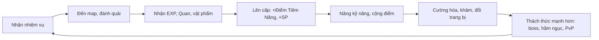
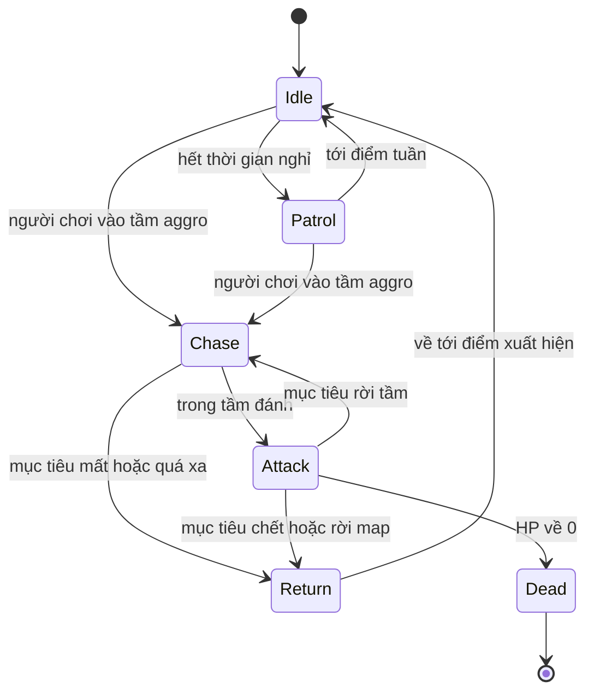

# Chiến đấu & Thăng tiến

> **Trạng thái:** Draft v0.1 · **Phụ thuộc:** [classes](03-origins-classes-skills.md) · [items](07-items-and-equipment.md)
> Công thức dưới đây là nguồn chuẩn. Server cài đặt trong `packages/shared/src/formulas/`, client chỉ dùng để hiển thị.

## 1. Vòng lặp cốt lõi (core loop)



Vòng ngắn (phút): đánh quái, nhặt đồ. Vòng trung (ngày): nhiệm vụ ngày, hầm ngục, boss. Vòng dài (tuần/mùa): Chiến Đội, Chiến Trường, Mùa Giải.

## 2. Cấp độ & kinh nghiệm

- **Cấp tối đa ban đầu: 100** (Mùa 1).
- EXP cần để lên cấp từ *L* → *L+1*: **`expToNext(L) = 50·L² + 100·L`**.

| Cấp | EXP lên cấp kế | EXP tích lũy để đạt cấp đó |
|-----|----------------|-----------------------------|
| 1 | 150 | 0 |
| 5 | 1.750 | 2.500 |
| 10 | 6.000 | 18.750 |
| 20 | 22.000 | 142.500 |
| 30 | 48.000 | 471.250 |
| 40 | 84.000 | 1.105.000 |
| 50 | 130.000 | 2.143.750 |
| 60 | 186.000 | 3.687.500 |
| 70 | 252.000 | 5.836.250 |
| 80 | 328.000 | 8.690.000 |
| 90 | 414.000 | 12.348.750 |
| 99 | 499.950 | 16.412.550 |
| 100 | (tối đa) | **16.912.500** |

### 2.1 EXP từ quái

`EXP_quái(L) = 8·L + 10` (quái thường cùng cấp). Hệ số nhân theo loại:

| Loại | Hệ số EXP | Hệ số HP |
|------|-----------|----------|
| Thường | ×1 | ×1 |
| Tinh anh (elite) | ×3 | ×3 |
| Mini-boss | ×10 | ×10 |
| Boss | ×40 | ×40 |
| Boss thế giới | ×200 | ×200 |

### 2.2 Chênh lệch cấp

Với `d = cấp người chơi − cấp quái`:

| d | Hệ số EXP |
|---|-----------|
| ≤ −5 | ×1,5 (thưởng thử thách; quái mạnh hơn rất nhiều) |
| −4 đến −1 | ×1,0 + 0,1 × |d| |
| 0 đến 5 | ×1,0 |
| > 5 | ×max(0,1; 1 − 0,15 × (d − 5)) |

### 2.3 Chia EXP trong nhóm

- Nhóm tối đa **5 người**, cách quái ≤ 800 px mới được chia.
- Tổng EXP = EXP gốc × (1 + 0,1 × (số người − 1)). Chia theo cấp: người cấp cao nhận ít hơn.
- Người gây ≥ 10% tổng sát thương mới nhận EXP và quyền nhặt đồ.

### 2.4 Cột mốc thời gian dự kiến

Số quái cần giết mỗi cấp (cùng cấp): `≈ 6,3 × L`. Ở Lv50 khoảng 317 quái/cấp, Lv100 khoảng 630 quái/cấp. Nhiệm vụ ngày và sự kiện bù khoảng 40–60% nhu cầu.

## 3. Chỉ số

### 3.1 Chỉ số chính

| Chỉ số | Ý nghĩa |
|--------|---------|
| **HP** | Máu |
| **MP** | Mana (Phong Ấn Xạ Thủ dùng Ý Chí) |
| **ATK** | Sức đánh |
| **DEF** | Phòng thủ |
| **CRIT%** | Tỉ lệ chí mạng (gốc 5%, tối đa 50%) |
| **CRIT DMG** | Hệ số sát thương chí mạng (gốc 150%) |

### 3.2 Chỉ số phụ

| Chỉ số | Gốc | Ghi chú |
|--------|-----|---------|
| ACC (Chính xác) | 0 | Từ trang bị |
| EVA (Né tránh) | 0 | Từ trang bị |
| Tốc đánh | 1,0 đòn/s | Lôi +15%, tối đa 2,0 |
| Tốc chạy | 180 px/s | Chổi Bay +30% |
| Hồi HP | 0 | Ngoài giao tranh: 1% HP/5s |
| Hồi MP | 2% MP/s ngoài giao tranh, 0,5%/s trong giao tranh | Thế Gia +25% |
| Giảm hồi chiêu | 0 | Tối đa 40% |
| Kháng hiệu ứng | 0 | Tối đa 75% |

### 3.3 Điểm Tiềm Năng

- **+5 điểm mỗi cấp** (Lv2–100), cộng 10 điểm khởi đầu: tổng **505** điểm.
- Cộng điểm tại menu *Nhân vật*; không hoàn tác miễn phí, **Bình Rửa Tiềm Năng** (cửa hàng, 50 Nén Bạc hoặc sự kiện) để reset.

| Chỉ số | Mỗi điểm | Giới hạn |
|--------|----------|----------|
| HP | +30 | — |
| MP | +20 | — |
| ATK | +3 | — |
| DEF | +2 | — |
| CRIT% | +0,05% | Tối đa 50% tổng (gồm gốc và trang bị) |

### 3.4 Công thức chỉ số cuối

```
stat = (base_origin + growth_origin × (level − 1) + pts × perPoint)
       × classMultiplier
       + gear + gems + set + buffs
```

Buff nhân (%) tính sau cùng và **cộng dồn** với nhau (không nhân chồng), trừ khi ghi chú khác.

### 3.5 Lực Chiến

Hiển thị trong hồ sơ và xếp hạng:

```
LucChien = HP×0.10 + MP×0.05 + ATK×4 + DEF×3 + CRIT%×10 + (CRITDMG−150)×0.5 + ΣSkillLevel×20
```

## 4. Quy tắc chiến đấu

### 4.1 Cơ bản

- Thời gian thực, server tính toàn bộ.
- **Nhắm mục tiêu:** nhấn vào quái hoặc dùng *Nhắm gần nhất*. Kỹ năng đạn bay thẳng theo hướng, kỹ năng diện rộng ở vị trí chỉ định.
- Mỗi lần đánh qua **GCD 0,5s** nhưng không có GCD với Đòn Thường.
- **Bất khả xâm phạm** sau hồi sinh: 1s khi về thành, 3s khi hồi sinh tại chỗ (xóa khi tự tấn công).

### 4.2 Công thức sát thương

```
raw      = ATK_total × skill.mult + skill.flat
elem     = 1.25 | 1.0 | 0.8              // vòng khắc hệ
crit     = rand() < CRIT% ? CRITDMG : 1.0
defRed   = DEF_t / (DEF_t + 15 × Lv_a + 100)
variance = rand(0.95, 1.05)
damage   = max(1, round(raw × elem × crit × (1 − defRed) × variance × buffMult))
```

- **Trúng đích:** `hit = clamp(0.95 − 0.02 × max(0, Lv_t − Lv_a) + (ACC_a − EVA_t)/1000, 0.30, 1.0)`.
- Boss miễn nhiễm một số hiệu ứng khống chế (xem §6).
- **Sát thương lên người chơi (PvP):** nhân thêm **×0,6** để TTK (time-to-kill) hợp lý.

### 4.3 Vòng khắc hệ (tóm tắt)

Thủy → Hỏa → Phong → Thổ → Lôi → Thủy (khắc ×1,25; bị khắc ×0,8). Chi tiết ở [classes §3](03-origins-classes-skills.md).

### 4.4 Hiệu ứng trạng thái

| Hiệu ứng | Mô tả | Giải bằng |
|----------|-------|-----------|
| **Cháy** | Sát thương liên tục theo %ATK | Thủy, bình giải |
| **Độc** | Sát thương liên tục, giảm hồi HP | Thảo dược, Mộc |
| **Làm chậm** | −30% tốc chạy | Hết thời gian |
| **Trói** | Không di chuyển, vẫn đánh được | Giải hiệu ứng |
| **Choáng** | Không hành động | Hết thời gian |
| **Tê liệt** | −50% tốc đánh và chạy | Hết thời gian |
| **Mù** | −30% chính xác | Hết thời gian |
| **Sợ hãi** | Chạy ngẫu nhiên | Giải hiệu ứng |
| **Đẩy lùi** | Dịch chuyển ngắn | — |
| **Câm lặng** | Không dùng kỹ năng | Giải hiệu ứng |

- Mỗi hiệu ứng khống chế (trói, choáng, tê liệt, sợ hãi) có **kháng lũy tiến**: lần 2 trong 10s chỉ còn 50%, lần 3 miễn nhiễm 5s.
- Boss miễn nhiễm **Choáng, Trói, Sợ hãi** nhưng chịu **Làm chậm 50%** hiệu lực.

### 4.5 Di chuyển & vật lý

| Tham số | Giá trị |
|---------|---------|
| Ô tile | 32 × 32 px |
| Tốc chạy | 180 px/s |
| Nhảy | Cao 3 ô (96 px), thời gian trên không ≈ 0,7s |
| Nhảy đôi | Chỉ hệ Phong |
| Leo thang/dây | 120 px/s |
| Nền xuyên một chiều | Có (nhảy lên, nhấn Xuống để rơi) |
| Dung sai chống gian lận tốc độ | +15% so với tốc chạy tối đa |

## 5. Quái vật & AI

### 5.1 Công thức quái thường

| Cấp | HP | ATK | DEF | EXP | Quan |
|-----|----|-----|-----|-----|-----|
| 1 | 52 | 11 | 2 | 18 | 4 |
| 10 | 726 | 40 | 25 | 90 | 40 |
| 20 | 1.998 | 72 | 50 | 170 | 80 |
| 30 | 3.645 | 104 | 75 | 250 | 120 |
| 40 | 5.596 | 136 | 100 | 330 | 160 |
| 50 | 7.808 | 168 | 125 | 410 | 200 |
| 60 | 10.255 | 200 | 150 | 490 | 240 |
| 70 | 12.915 | 232 | 175 | 570 | 280 |
| 80 | 15.772 | 264 | 200 | 650 | 320 |
| 90 | 18.814 | 296 | 225 | 730 | 360 |
| 100 | 22.030 | 328 | 250 | 810 | 400 |

Công thức: `HP = round(30 + 22·L^1.5)`, `ATK = round(8 + 3.2·L)`, `DEF = round(2.5·L)`, `EXP = 8L + 10`, `Quan = 4L (±20%)`. Nhân theo loại ở §2.1.

### 5.2 Máy trạng thái AI



- **Aggro:** tầm 160–320 px tùy loại. Quái bị đánh sẽ nhắm người gây **sát thương nhiều nhất** (threat); người đỡ (Thổ) có hệ số threat ×2.
- **Leash:** rời điểm xuất hiện > 600 px thì quay về và hồi đầy máu.
- **Hồi sinh quái:** 8–20s tùy khu vực.

### 5.3 Boss

| Cơ chế | Mô tả |
|--------|-------|
| **Báo hiệu (telegraph)** | Vùng đỏ trên mặt đất 1–1,5s trước khi gây sát thương |
| **Pha (phase)** | Pha mới ở 70%, 40%, 15% HP, đổi chiêu |
| **Cuồng nộ (enrage)** | Boss thế giới sau 10 phút: +100% ATK |
| **Triệu hồi** | Gọi quái phụ, người chơi phải xử lý |
| **Reset** | Nếu mọi người chơi chết, boss reset và hồi đầy |
| **Phần thưởng** | Ai gây ≥ 3% sát thương nhận 1 lượt chia đồ; top 3 sát thương nhận lượt thêm |

## 6. Rơi đồ & nhặt đồ

- Quái chết thả đồ **gần xác** tồn tại **60 giây**. Trong 15 giây đầu chỉ người/nhóm gây sát thương nhiều nhất nhặt được.
- Bảng rơi (cơ bản, quái thường):

| Loại | Xác suất |
|------|----------|
| Quan | 90% (số lượng ở §5.1) |
| Nguyên liệu | 25% |
| Vật phẩm tiêu hao | 8% |
| Trang bị **Tốt** (xanh lá) | 2% |
| Trang bị **Hiếm** (xanh dương) | 0,3% |
| Trang bị **Sử Thi** (tím) | 0,03% |

- Boss có bảng riêng, đảm bảo **tối thiểu 1 vật phẩm** và có cơ chế **bảo đảm (pity)**: sau 20 lần hạ boss mà chưa có Sử Thi thì lượt thứ 21 chắc chắn rơi.
- Trong nhóm: chế độ **Nhặt tự do** hoặc **Luân phiên**.

## 7. Chết & Hồi sinh

| Tình huống | Hậu quả |
|-----------|---------|
| Chết do quái | Mất **2% EXP** của cấp hiện tại (không tụt cấp), hồi sinh miễn phí tại **thành gần nhất** |
| Hồi sinh tại chỗ | Dùng **Lá Hồi Sinh** hoặc **5 Nén Bạc** (hồi 50% HP, bất khả xâm phạm 3s) |
| Chết do người chơi (Cờ PK) | Không mất EXP; người giết nhận Điểm Tội Lỗi nếu mục tiêu không bật cờ (xem [social](09-social-squad-pvp-events.md)) |
| Chết trong hầm ngục | Hồi sinh theo **điểm lưu** hầm ngục, tối đa 3 lần/lượt (thêm bằng Lá Hồi Sinh). Không phụ thuộc hệ phép nào |
| Chết ở boss thế giới | Phải chờ **15s** mới hồi sinh |

## 8. Auto Hunt (treo máy)

| Quy tắc | Giá trị |
|---------|---------|
| Mở khóa | Lv20 |
| Hoạt động | Do **server** điều khiển, người chơi phải **trực tuyến** trong map |
| Hành vi | Đánh quái gần nhất cùng khu, dùng kỹ năng theo thứ tự đã chọn, tự dùng bình khi HP < 40% |
| Thời lượng | **3 giờ/ngày**, mua thêm bằng **Thẻ Auto** (sự kiện, Nén Bạc) |
| Hiệu quả | **70%** EXP và Quan so với đánh thủ công; không rơi trang bị Sử Thi |
| Dừng | Khi HP < 20% mà hết bình, khi bị PK, khi lên tới cấp mới phải cộng điểm, khi captcha bắt buộc |
| Không dùng được | Trong hầm ngục, boss, PvP, Chiến Đội |

## 9. Hệ thống Công Trạng & Hạng

- **Công Trạng** là điểm danh vọng, nhận từ thành tích: hạ boss lần đầu, hoàn thành chương, thắng PvP, xếp hạng Đội.
- Công Trạng quyết định **hạng thành tích** và thứ tự bảng xếp hạng cuối mùa **Lễ Tuyên Công**.
- Có 4 bảng xếp hạng: **Lực Chiến**, **Công Trạng**, **Cấp độ**, **Đội**.

## 10. Cân bằng & Kiểm chứng

- Mục tiêu **TTK**: quái thường cùng cấp **6–10 giây** với một người chơi **một mình**, đúng hệ, đủ đồ chuẩn cấp. Mức này áp dụng cho **mọi hệ** (xem §11).
- Boss thường: **60–120 giây** nhóm 5 người.
- Chạy mô phỏng (simulation) trong `tools/balance-sim`, dữ liệu lưu `packages/content`. Mọi chỉnh sửa số liệu phải kèm **báo cáo mô phỏng** trong PR.

## 11. Nguyên tắc Solo-first

Ninja School và Ngọc Rồng chủ yếu là game **chơi một mình**: săn quái, làm nhiệm vụ, nâng cấp đều tự làm được; nhóm chỉ để nhanh hơn, vui hơn hoặc đánh nội dung khó. HTK giữ nguyên tinh thần đó.

### 11.1 Quy tắc

1. **Mọi hệ phải solo được** toàn bộ việc cày quái Field và toàn bộ chính tuyến. Không hệ nào được thiết kế để *cần* người khác.
2. **Kỹ năng hỗ trợ luôn có tác dụng lên bản thân** (hồi máu, khiên, buff). Phần lan sang đồng đội là **phần thưởng thêm**.
3. **Không có kỹ năng hồi sinh người khác.** Hồi sinh do bản thân (Lá Hồi Sinh, Nén Bạc, Tái Sinh của Dryad) hoặc do hệ thống.
4. **Hầm Ngục co giãn theo số người (1–5)**, vào một mình được; **Raid** có *Chế độ Cốt Truyện* một người để hoàn thành chính tuyến. Chi tiết ở [maps §6](05-world-maps-monsters.md).
5. **Nhóm vẫn có lợi**: +10% EXP mỗi người thêm, hạ boss nhanh hơn, nội dung Raid và boss thế giới khó chỉ dành cho nhóm lớn.
6. **Hệ nặng về phòng thủ/hỗ trợ** (Thổ, Mộc) được **bù bằng khả năng sống sót** (ít tốn bình, ít phải nghỉ), không bị bắt chịu hạ quái chậm gấp nhiều lần.

### 11.2 Ngưỡng chấp nhận

| Chỉ số | Ngưỡng |
|--------|--------|
| TTK solo quái thường cùng cấp | 6–10 s với hệ sát thương; **không quá 12 s** với Thổ và Mộc |
| Sát thương bền vững của hệ bền bỉ (Thổ, Mộc) | **≥ 80% trung vị** của 5 hệ sát thương (Hỏa, Thủy, Phong, Lôi, Ám) |
| Số bình tiêu hao/giờ của hệ bền bỉ | **Thấp hơn** hệ sát thương cùng cấp |
| Mọi kỹ năng ở cấp 1 | Có tác dụng khi chơi một mình |

### 11.3 Số đo thiết kế hiện tại (mô hình thô)

Ước lượng sát thương bền vững khi một mình, tính từ bảng kỹ năng cấp 1 ở [classes](03-origins-classes-skills.md), đơn vị "ATK mỗi giây". Mô hình bỏ qua GCD, MP, diện rộng và overkill nên **chỉ dùng để phát hiện hệ lệch quá lớn**, không dùng để cân bằng chi tiết.

| Hệ | ATK/giây | % so với Hỏa | % so với trung vị |
|----|----------|--------------|--------------------|
| Hỏa | 2,72 | 100% | 130% |
| Thủy | 2,27 | 83% | 109% |
| Lôi | 2,09 | 77% | 100% |
| Phong | 1,94 | 71% | 93% |
| Ám | 1,73 | 64% | 83% |
| Thổ (sau chỉnh) | 1,74 | 64% | 83% |
| Mộc (sau chỉnh) | 1,71 | 63% | 82% |
| *Thổ (thiết kế cũ)* | *1,12* | *41%* | *54%* |
| *Mộc (thiết kế cũ)* | *0,84* | *31%* | *40%* |

Thiết kế cũ của Mộc (chỉ 2 kỹ năng gây sát thương, ATK −15%) khiến hạ quái chậm khoảng **3,3 lần** so với Hỏa; Thổ chậm khoảng **2,4 lần**. Cả hai đã được chỉnh để đạt ≥ 80% trung vị.

> **Việc cần làm:** Hỏa đang ở 130% trung vị, có thể cần giảm nhẹ. Quyết định sau khi có `balance-sim` thật, không sửa theo mô hình thô này.
