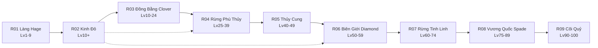

# Thế giới, Bản đồ & Quái vật

> **Trạng thái:** Draft v0.1 · **Phụ thuộc:** [lore](01-lore-and-story.md) · [combat](04-combat-and-progression.md)
> Dữ liệu chuẩn nằm ở `packages/content/maps|monsters|bosses/*.yaml`. Tài liệu này là bản mô tả cho thiết kế.

## 1. Cấu trúc bản đồ

Giống Ngọc Rồng/Ninja School, thế giới chia thành **vùng (region)** gồm nhiều **map** nối với nhau qua **cổng dịch chuyển (portal)** ở hai đầu map.

Đường nét đứt: có thể dịch chuyển nhanh qua **Finral (NPC020)** sau khi đã mở khóa vùng đó.

### 1.1 Quy tắc chung

| Quy tắc | Giá trị |
|---------|---------|
| Kích thước map | Rộng 60–120 ô (1.920–3.840 px), cao 17–34 ô |
| Loại map | **Town** (an toàn), **Field** (săn), **Dungeon** (instance), **Raid**, **PvP**, **Hall** |
| Khu (zone) | Mỗi map nhiều **Khu**, tối đa **30 người/khu** (Town 60). Tối đa 25 khu/map; khu mới mở khi các khu đầy |
| Chuyển khu | Menu *Đổi khu* hiển thị số người; không đổi khi giao tranh |
| Vùng an toàn | Town: không bị đánh, không PK |
| PK | Cho phép ở **Field Lv≥30** khi bật **Cờ PK**; cưỡng chế ở **Chiến Trường** |
| Thời tiết/ngày đêm | Hiệu ứng thị giác, đêm tăng 10% tốc xuất hiện quái hệ Ám |

## 2. Danh sách map (31)

| ID | Tên | Vùng | Loại | Cấp | Quái chính | Nối tới |
|----|-----|------|------|-----|-----------|---------|
| M001 | Nhà Thờ Hage | R01 | Town | 1+ | — | M002 |
| M002 | Đồng Cỏ Hage | R01 | Field | 1–4 | Slime Cỏ, Thỏ Mana | M001, M003 |
| M003 | Rừng Nhỏ Hage | R01 | Field | 4–7 | Sói Con, Goblin Bé, Nhện Rừng | M002, M004 |
| M004 | Hang Dơi Hage | R01 | Field + Dungeon | 7–9 | Dơi Mana, Slime Đá, **Slime Vua** | M003, M005 |
| M005 | Kinh Đô Hoàng Gia | R02 | Town (hub) | 10+ | — | M004, M006, M008, M009 |
| M006 | Khu Chợ Kinh Đô | R02 | Town | 10+ | — | M005, M007 |
| M007 | Đấu Trường Hiệp Sĩ | R02 | PvP | 10+ | — | M006 |
| M008 | Trụ Sở Hiệp Sĩ Phép Thuật | R02 | Town | 10+ | — | M005 |
| M009 | Đồng Bằng Clover Tây | R03 | Field | 10–14 | Heo Rừng, Goblin Chiến | M005, M010 |
| M010 | Cánh Đồng Gió | R03 | Field | 14–18 | Chim Gió, Sói Gió, Hươu Điện | M009, M011 |
| M011 | Mỏ Đá Bỏ Hoang | R03 | Field + Dungeon | 18–22 | Golem Đá Nhỏ, Dơi Hầm Mỏ, Rắn Lửa | M010, M012 |
| M012 | Thị Trấn Biên Giới | R03 | Town | 20+ | — | M011, M013 |
| M013 | Rìa Rừng Phù Thủy | R04 | Field | 25–29 | Nấm Độc, Ma Sương | M012, M014 |
| M014 | Rừng Sương Mù | R04 | Field | 29–34 | Nhện Phù Thủy, Sói Rừng Đen | M013, M015, M016 |
| M015 | Pháo Đài Bò Đen | R04 | Town (phe) | 25+ | — | M014 |
| M016 | Hang Rễ Cổ | R04 | Field + Dungeon | 34–39 | Rễ Cây Sống, Yêu Tinh Lửa, Cú Phù Thủy | M014, M017 |
| M017 | Bờ Biển Pha Lê | R05 | Field | 40–43 | Cua Pha Lê, Cá Điện | M016, M018 |
| M018 | Thủy Cung Tầng Ngoài | R05 | Field | 43–46 | Sứa Độc, Chiến Binh Cá | M017, M019 |
| M019 | Thủy Cung Tầng Sâu | R05 | Dungeon | 46–49 | Tượng Hộ Điện, Bạch Tuộc Bóng | M018, M020 |
| M020 | Cao Nguyên Biên Giới | R06 | Field | 50–54 | Lính Diamond, Pháp Sư Diamond | M019, M021 |
| M021 | Doanh Trại Diamond | R06 | Field + Dungeon | 54–58 | Cung Thủ, Kỵ Binh, Golem Pha Lê | M020, M022 |
| M022 | Chiến Trường Vương Quốc | R06 | PvP (instance) | 50+ | — | từ M020/M012 |
| M023 | Cổng Rừng Tinh Linh | R07 | Field | 60–64 | Tinh Linh Lá, Hồn Cây | M021, M024 |
| M024 | Thung Lũng Tinh Linh | R07 | Town (hub) | 60+ | — | M023, M025 |
| M025 | Đền Tinh Linh Cổ | R07 | Dungeon | 69–74 | Linh Hồn Giận Dữ, Hộ Vệ Tinh Linh | M024, M026 |
| M026 | Tàn Tích Biên Giới Spade | R08 | Field | 75–79 | Xác Ma Pháp, Quái Cấm Thuật | M025, M027 |
| M027 | Thành Phố Hoang Tàn | R08 | Field | 79–84 | Hiệp Sĩ Rỗng, Pháp Sư Spade | M026, M028 |
| M028 | Cung Điện Spade | R08 | Raid | 84–89 | Golem Hắc Thạch, Bộ Ba Hắc Ám | M027, M029 |
| M029 | Cổng Địa Ngục | R09 | Field | 90–94 | Quỷ Nhỏ, Chó Địa Ngục | M028, M030 |
| M030 | Vực Sâu Ma Quỷ | R09 | Field | 94–98 | Hồn Quỷ, Quỷ Binh | M029, M031 |
| M031 | Điện Ma Vương | R09 | Raid | 98–100 | Quỷ Vực Sâu, Lucifero | M030 |

### 2.1 Map đặc biệt (instance)

| Loại | Tên | Mô tả |
|------|-----|-------|
| Instance cốt truyện | Lễ Nhận Ma Đạo Thư (`I001`) | Cutscene + chọn hệ, 1 người |
| Instance cốt truyện | Ký Ức Tinh Linh (`I002`) | Flashback Chương 6 |
| Hall | **Squad Hall** (`I010`) | Nhà của Đội Hiệp Sĩ, có kho Đội, bảng nhiệm vụ Đội |
| Hall | Bàn Thờ Ma Đạo Thư (`I011`) | Đổi khe, tiến hóa lá |

## 3. Cổng & di chuyển

| Phương thức | Mô tả | Chi phí |
|------------|-------|---------|
| **Cổng bản đồ** | Đi sang đầu map kề | Miễn phí |
| **Finral Dịch Chuyển** | Từ town sang town/điểm đã mở | `Yul = 50 × (Lv_đích)` |
| **Cuộn Dịch Chuyển** | Vật phẩm, về thành gần nhất | Rơi/bán 200 Yul |
| **Chổi Bay** | Tăng tốc, đi nhanh trong map | Xem [companions](10-companions-and-mounts.md) |
| **Điểm Lưu** | Nhân vật lưu tại town gần nhất sau khi vào | Tự động |

## 4. Quái vật (49 loại) và Boss (26 cốt truyện + 4 boss thế giới)

Cấp quái và hệ xác định công thức chỉ số ở [combat §5](04-combat-and-progression.md). Hệ quái: Hỏa, Thủy, Phong, Lôi, Thổ, Mộc, Ám, **Quang**, **Vô**.

### R01 – Làng Hage

| ID | Tên | Cấp | Hệ | Hành vi |
|----|-----|-----|----|---------|
| MOB001 | Slime Cỏ | 1–2 | Mộc | Nhảy chậm, không chủ động đánh |
| MOB002 | Thỏ Mana | 2–4 | Vô | Chạy trốn khi HP < 30% |
| MOB003 | Sói Con | 4–5 | Vô | Chủ động đánh |
| MOB004 | Goblin Bé | 5–7 | Thổ | Ném đá tầm ngắn |
| MOB005 | Nhện Rừng | 6–7 | Ám | Gây Độc nhẹ |
| MOB006 | Dơi Mana | 7–8 | Ám | Bay, lao xuống |
| MOB007 | Slime Đá | 8–9 | Thổ | DEF cao |

### R03 – Đồng Bằng Clover

| ID | Tên | Cấp | Hệ | Hành vi |
|----|-----|-----|----|---------|
| MOB008 | Heo Rừng | 10–12 | Thổ | Húc đẩy lùi |
| MOB009 | Goblin Chiến | 11–14 | Thổ | Có thể gọi đồng đội |
| MOB010 | Chim Gió | 14–16 | Phong | Bay, đánh từ xa |
| MOB011 | Sói Gió | 15–18 | Phong | Tốc độ cao |
| MOB012 | Hươu Điện | 16–18 | Lôi | Gây Tê liệt |
| MOB013 | Golem Đá Nhỏ | 18–20 | Thổ | Chậm, HP cao |
| MOB014 | Dơi Hầm Mỏ | 19–21 | Ám | Bay theo bầy |
| MOB015 | Rắn Lửa | 20–22 | Hỏa | Gây Cháy |

### R04 – Rừng Phù Thủy

| ID | Tên | Cấp | Hệ | Hành vi |
|----|-----|-----|----|---------|
| MOB016 | Nấm Độc | 25–27 | Mộc | Phun bào tử gây Độc |
| MOB017 | Ma Sương | 27–30 | Ám | Xuyên tường, gây Mù |
| MOB018 | Nhện Phù Thủy | 29–32 | Ám | Giăng tơ Trói |
| MOB019 | Sói Rừng Đen | 30–33 | Ám | Tụ bầy |
| MOB020 | Rễ Cây Sống | 33–36 | Mộc | Bất động, đánh tầm xa bằng rễ |
| MOB021 | Yêu Tinh Lửa | 35–37 | Hỏa | Ném cầu lửa |
| MOB022 | Cú Phù Thủy | 36–39 | Phong | Bay, tấn công cánh |

### R05 – Thủy Cung

| ID | Tên | Cấp | Hệ | Hành vi |
|----|-----|-----|----|---------|
| MOB023 | Cua Pha Lê | 40–42 | Thủy | Giáp dày, kẹp |
| MOB024 | Cá Điện | 42–44 | Lôi | Phóng điện, Tê liệt |
| MOB025 | Sứa Độc | 43–45 | Thủy | Trôi, gây Độc |
| MOB026 | Chiến Binh Cá | 45–47 | Thủy | Dùng giáo |
| MOB027 | Tượng Hộ Điện | 46–48 | Thổ | Miễn nhiễm Choáng |
| MOB028 | Bạch Tuộc Bóng | 47–49 | Ám | Phun mực gây Mù |

### R06 – Biên Giới Diamond

| ID | Tên | Cấp | Hệ | Hành vi |
|----|-----|-----|----|---------|
| MOB029 | Lính Diamond | 50–53 | Vô | Đội hình theo nhóm |
| MOB030 | Pháp Sư Diamond | 52–55 | Quang | Phép kết tinh tầm xa |
| MOB031 | Cung Thủ Diamond | 53–56 | Phong | Tầm xa 500 px |
| MOB032 | Kỵ Binh Diamond | 55–58 | Thổ | Lao tới, đẩy lùi |
| MOB033 | Golem Pha Lê | 56–59 | Quang | Phản 5% sát thương |

### R07 – Rừng Tinh Linh

| ID | Tên | Cấp | Hệ | Hành vi |
|----|-----|-----|----|---------|
| MOB034 | Tinh Linh Lá | 60–63 | Mộc | Hồi máu cho quái khác |
| MOB035 | Hồn Cây | 62–66 | Mộc | Trói rễ |
| MOB036 | Linh Hồn Giận Dữ | 64–68 | Ám | Xuyên tường, Sợ hãi |
| MOB037 | Thú Thần Thoại | 66–70 | Quang | Đánh nhanh, tốc cao |
| MOB038 | Hộ Vệ Tinh Linh | 68–72 | Phong | Lá chắn gió |
| MOB039 | Tinh Linh Hắc Hóa Nhỏ | 70–74 | Ám | Hút MP |

### R08 – Vương Quốc Spade

| ID | Tên | Cấp | Hệ | Hành vi |
|----|-----|-----|----|---------|
| MOB040 | Xác Ma Pháp | 75–78 | Ám | Nổ khi chết |
| MOB041 | Quái Cấm Thuật | 78–82 | Ám | Biến dị, hồi máu |
| MOB042 | Hiệp Sĩ Rỗng | 80–84 | Vô | Giáp nặng |
| MOB043 | Pháp Sư Spade | 82–86 | Lôi | Tầm xa, Câm lặng |
| MOB044 | Golem Hắc Thạch | 85–89 | Thổ | HP rất cao |

### R09 – Cõi Quỷ

| ID | Tên | Cấp | Hệ | Hành vi |
|----|-----|-----|----|---------|
| MOB045 | Quỷ Nhỏ | 90–93 | Hỏa | Bầy, nổ khi chết |
| MOB046 | Chó Địa Ngục | 92–95 | Hỏa | Thở lửa |
| MOB047 | Hồn Quỷ | 94–97 | Ám | Xuyên tường |
| MOB048 | Quỷ Binh | 96–98 | Ám | Kháng khống chế 50% |
| MOB049 | Quỷ Vực Sâu | 98–100 | Ám | Gọi quỷ nhỏ |

## 5. Boss

| ID | Tên | Cấp | Loại | Map | Cơ chế chính |
|----|-----|-----|------|-----|--------------|
| BOSS001 | **Slime Vua** | 9 | Mini | M004 | Chia nhỏ thành 4 slime ở 50% HP |
| BOSS002 | Heo Rừng Chúa | 12 | Mini | M009 | Húc theo đường thẳng, vùng báo hiệu |
| BOSS003 | Golem Mỏ | 22 | Mini | M011 | Đập đất, đá rơi |
| BOSS004 | Thủ Lĩnh Trộm Mana | 24 | Boss | M011 | Hút MP, dịch chuyển |
| BOSS005 | Giám Khảo Bóng | 24 | Boss (instance) | Instance kỳ thi | Sao chép kỹ năng người chơi |
| BOSS006 | Nhện Mẹ | 32 | Boss | M014 | Giăng tơ, triệu hồi nhện con |
| BOSS007 | Phù Thủy Hắc Ám Rừng | 36 | Boss | M016 | Lời nguyền giảm hồi chiêu |
| BOSS008 | Cổ Thụ Hắc Ám | 39 | Boss | M016 | 3 pha, rễ đâm từ dưới |
| BOSS009 | Kẻ Cầm Đầu Mắt Mặt Trời Nửa Đêm | 40 | Boss sự kiện | M005 | Đợt, triệu hồi lính |
| BOSS010 | Cua Hoàng | 44 | Mini | M018 | Giáp kẹp, phản sát thương |
| BOSS011 | **Hải Long Hộ Điện** | 49 | Boss | M019 | Sóng thần, nước dâng |
| BOSS012 | Bạch Tuộc Vương | 48 | Mini | M019 | 8 xúc tu phải đánh riêng |
| BOSS013 | **Tướng Quân Diamond** | 59 | Boss | M021 | Triệu hồi đội hình, tha/bắt |
| BOSS014 | Chỉ Huy Pháp Sư Diamond | 55 | Mini | M021 | Lá chắn tinh thể |
| BOSS015 | Hộ Vệ Cổ Thụ | 66 | Boss | M023 | Phản đòn khi bị tấn công lưng |
| BOSS016 | **Tinh Linh Hắc Hóa** | 74 | Boss | M025 | Hai kết thúc: hóa giải hoặc đánh bại |
| BOSS017 | Quái Vật Cấm Thuật | 82 | Boss | M027 | Biến dị liên tục |
| BOSS018 | Hiệp Sĩ Spade | 86 | Boss | M027 | Giáp, phản phép |
| BOSS019 | Dante Zogratis | 89 | Raid | M028 | Raid 10 người, Pha 1 |
| BOSS020 | Vanica Zogratis | 89 | Raid | M028 | Pha 2 |
| BOSS021 | Zenon Zogratis | 89 | Raid | M028 | Pha 3, hợp thể 3 boss |
| BOSS022 | Lucius Zogratis | 89 | Raid | M028 | Boss cuối chương |
| BOSS023 | Tướng Quỷ | 94 | Boss | M030 | Triệu hồi quỷ binh |
| BOSS024 | Zagred | 97 | Boss | M030 | Cướp Spirit Gauge |
| BOSS025 | Megicula | 99 | Boss | M030 | Lời nguyền, hồi máu theo sát thương gây ra |
| BOSS026 | **Lucifero** | 100 | Raid 15 | M031 | 4 pha, cơ chế cuối mùa |

### 5.1 Boss thế giới (lịch cố định)

| ID | Tên | Cấp | Map xuất hiện | Lịch | Ghi chú |
|----|-----|-----|---------------|------|---------|
| BOSS030 | Cự Thú Đồng Bằng | 20 | M009–M011 | 12:00, 20:00 hàng ngày | Xuất hiện ngẫu nhiên 1 khu |
| BOSS031 | Long Vương Phù Thủy | 35 | M013–M016 | 13:00, 21:00 | |
| BOSS032 | Quỷ Biển | 45 | M017–M018 | 19:00 | |
| BOSS033 | Ma Thần Lang Thang | 70 | M023–M025 | 20:30, T7–CN | Cần ≥ 20 người để hạ trong 10 phút |

Thông báo toàn máy chủ trước **5 phút**. Phần thưởng gửi **qua thư** theo sát thương xếp hạng (xem [social](09-social-squad-pvp-events.md)).

## 6. Hầm Ngục & Raid

| ID | Tên | Nhóm | Cấp | Giới hạn vào | Boss cuối | Thưởng đặc trưng |
|----|-----|------|-----|--------------|-----------|------------------|
| DG01 | Hang Dơi Tập Sự | 1–5 (co giãn) | 9–12 | Không giới hạn (tutorial) | Slime Vua | Rương tân thủ |
| DG02 | Mỏ Bỏ Hoang | 1–5 (co giãn) | 18–22 | 3 lượt/ngày | Golem Mỏ | Đá Mana, trang bị Tốt |
| DG03 | Hang Rễ Cổ | 1–5 (co giãn) | 34–39 | 3 lượt/ngày | Cổ Thụ Hắc Ám | Nguyên liệu Mộc, Sách Kỹ Năng |
| DG04 | Thủy Cung Tầng Sâu | 1–5 (co giãn) | 46–49 | 2 lượt/ngày | Hải Long Hộ Điện | Mảnh Ma Lực Cổ Đại |
| DG05 | Doanh Trại Diamond | 1–5 (co giãn) | 56–59 | 2 lượt/ngày | Tướng Quân | Huy hiệu Diamond |
| DG06 | Đền Tinh Linh Cổ | 1–5 (co giãn) | 70–74 | 2 lượt/ngày | Tinh Linh Hắc Hóa | Linh Thạch Ngọc |
| DG07 | **Cung Điện Spade (Raid)** | 10 (Cốt Truyện: 1) | 85–89 | 1 lượt/tuần | Dark Triad / Lucius | Set Spade, Mảnh Phản Ma |
| DG08 | **Điện Ma Vương (Raid)** | 15 (Cốt Truyện: 1) | 98–100 | 1 lượt/tuần | Lucifero | Vũ khí Thần Thoại |

### 6.1 Quy tắc hầm ngục

- Khởi tạo **instance riêng** cho người chơi hoặc nhóm, đóng khi tất cả chết hoặc hết giờ (30–60 phút).
- **Solo-first:** vào một mình được. Chỉ số quái/boss **co giãn theo số người *n* (1–5)**; thưởng mỗi người thay đổi theo *n*:

| Số người *n* | HP quái/boss | ATK quái/boss | Thưởng mỗi người |
|--------------|--------------|---------------|-------------------|
| 1 | ×0,300 | ×0,70 | ×0,8 |
| 2 | ×0,475 | ×0,775 | ×0,9 |
| 3 | ×0,650 | ×0,85 | ×1,0 |
| 4 | ×0,825 | ×0,925 | ×1,0 |
| 5 | ×1,000 | ×1,00 | ×1,0 |

  Công thức: HP ×(0,30 + 0,175·(*n*−1)), ATK ×(0,70 + 0,075·(*n*−1)). Đây là giá trị khởi điểm cần tinh chỉnh bằng mô phỏng.
- **Raid** (DG07, DG08) có hai chế độ: **Raid** (10/15 người, có thưởng Raid) và **Cốt Truyện** (1 người, đủ để hoàn thành chính tuyến, không có thưởng Raid; **Mảnh Phản Ma** vẫn rơi với tỉ lệ thấp hơn). Nhờ vậy không ai bị chặn chính tuyến vì không có nhóm.
- **Boss thế giới** BOSS033 (cần đông người) là nội dung tùy chọn, không nằm trên chính tuyến.
- Khóa nhóm khi bắt đầu. Có thể vào lại trong 5 phút khi mất kết nối.
- Chia thưởng theo cơ chế trong [combat §6](04-combat-and-progression.md).
- Độ khó **Thường / Khó / Ác Mộng** (khóa theo Lực Chiến), quái +40% / +100% chỉ số, thưởng +50% / +150%.

## 7. Sinh quái (spawn)

| Tham số | Giá trị |
|---------|---------|
| Điểm xuất hiện | Định nghĩa trong file map (`spawns[]`) |
| Mật độ | 6–12 quái/khu cho map Field, tối đa 40 |
| Thời gian hồi | 8–20s (tăng 20% ở khu đông) |
| Elite | 1 tinh anh mỗi 15 quái thường, xuất hiện ngẫu nhiên |
| Chuyển khu động | Khi khu chứa > 80% sức chứa, khu mới được mở |

## 8. Quy tắc tạo nội dung

- Mỗi map phải có: tên, ID, loại, cấp, kích thước, danh sách spawn, danh sách portal, NPC, nhạc nền.
- Mọi map Field có **ít nhất 2 loại quái** và **1 NPC nhiệm vụ gần cổng**.
- Mới tạo map phải qua **validator** và **playtest** (xem [content-pipeline](../workflows/content-pipeline.md)).
