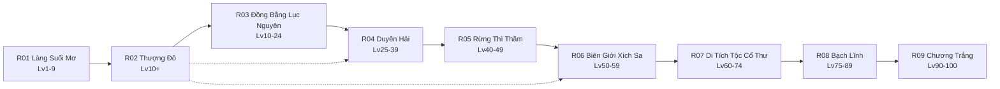

# Thế giới, Bản đồ & Quái vật

> **Trạng thái:** Draft v0.2 (bản reskin) · **Phụ thuộc:** [lore](01-lore-and-story.md) · [combat](04-combat-and-progression.md)
> Dữ liệu chuẩn nằm ở `packages/content/maps|monsters|bosses/*.yaml`. Tài liệu này là bản mô tả cho thiết kế.

## 1. Cấu trúc bản đồ

Thế giới chia thành **vùng (region)** gồm nhiều **map** nối với nhau qua **cổng dịch chuyển (portal)** ở hai đầu map.

Đường nét đứt: có thể dịch chuyển nhanh bằng **Thẻ Kẹp Trang** của **Bác Tô (NPC020)** sau khi đã mở khóa vùng đó.

Bản thử bố cục và đồ họa vùng R01 (M001–M004, file Tiled kèm ảnh xem trước): [art/prototype §1.5](../../art/prototype/README.md#15-bản-đồ-vùng-r01--làng-suối-mơ-chương-1).

### 1.1 Quy tắc chung

| Quy tắc | Giá trị |
|---------|---------|
| Kích thước map | Rộng 60–120 ô (1.920–3.840 px), cao 17–34 ô |
| Loại map | **Town** (an toàn), **Field** (săn), **Dungeon** (instance), **Raid**, **PvP**, **Hall** |
| Khu (zone) | Mỗi map nhiều **Khu**, tối đa **30 người/khu** (Town 60). Tối đa 25 khu/map; khu mới mở khi các khu đầy |
| Chuyển khu | Menu *Đổi khu* hiển thị số người; không đổi khi giao tranh |
| Vùng an toàn | Town: không bị đánh, không PK |
| PK | Cho phép ở **Field Lv≥30** khi bật **Cờ PK**; cưỡng chế ở **Chiến Trường** |
| Thời tiết/ngày đêm | Hiệu ứng thị giác, đêm tăng 10% tốc xuất hiện quái hệ Ám |

## 2. Danh sách map (31)

| ID | Tên | Vùng | Loại | Cấp | Quái chính | Nối tới |
|----|-----|------|------|-----|-----------|---------|
| M001 | Nhà Học Suối Mơ | R01 | Town | 1+ | — | M002 |
| M002 | Đồng Hoa Suối Mơ | R01 | Field | 1–4 | Nấm Lùn, Thỏ Đốm | M001, M003 |
| M003 | Rừng Mơ Non | R01 | Field | 4–7 | Chó Rừng Non, Lùn Ném Đá, Nhện Mực | M002, M004 |
| M004 | Hang Giếng Cạn | R01 | Field + Dungeon | 7–9 | Dơi Giếng, Rùa Đá Giếng, **Trang Lạc** | M003, M005 |
| M005 | Thượng Đô | R02 | Town (hub) | 10+ | — | M004, M006, M008, M009 |
| M006 | Chợ Thượng Đô | R02 | Town | 10+ | — | M005, M007 |
| M007 | Đấu Trường Thượng Đô | R02 | PvP | 10+ | — | M006 |
| M008 | Tổng Đường Pháp Vệ | R02 | Town | 10+ | — | M005 |
| M009 | Đồng Lúa Lục Nguyên | R03 | Field | 10–14 | Lợn Rừng Đồng, Lùn Cướp Đồng | M005, M010 |
| M010 | Đồi Cối Xay Gió | R03 | Field | 14–18 | Chim Cắt Gió, Sói Đồi, Hươu Sấm | M009, M011 |
| M011 | Mỏ Đá Nghiên | R03 | Field + Dungeon | 18–22 | Người Đá Nghiên, Dơi Mỏ, Rắn Than | M010, M012 |
| M012 | Thị Trấn Cửa Biển | R03 | Town | 20+ | — | M011, M013 |
| M013 | Bãi Đá Ngầm | R04 | Field | 25–29 | Rong Độc, Bóng Sương Biển | M012, M014 |
| M014 | Rạn San Hô Mờ | R04 | Field | 29–34 | Cua Giăng Lưới, Cá Mập Đen | M013, M015, M016 |
| M015 | Cảng Thư Khố | R04 | Town (hub) | 25+ | — | M014 |
| M016 | Thủy Điện Chìm | R04 | Field + Dungeon | 34–39 | San Hô Sống, Sứa Lửa, Hải Âu Bão | M014, M017 |
| M017 | Bìa Rừng Thì Thầm | R05 | Field | 40–43 | Ếch Giáp, Đom Đóm Điện | M016, M018 |
| M018 | Rừng Thì Thầm | R05 | Field | 43–46 | Đỉa Độc, Lính Rêu | M017, M019 |
| M019 | Lõi Rừng Cổ Thụ | R05 | Dungeon | 46–49 | Tượng Gỗ Hộ Rừng, Quạ Mực | M018, M020 |
| M020 | Cao Nguyên Xích Sa | R06 | Field | 50–54 | Lính Xích Sa, Pháp Sư Xích Sa | M019, M021 |
| M021 | Đồn Lũy Xích Sa | R06 | Field + Dungeon | 54–58 | Cung Thủ, Kỵ Binh, Người Cát Pha Lê | M020, M022 |
| M022 | Chiến Trường Lục–Xích | R06 | PvP (instance) | 50+ | — | từ M020/M012 |
| M023 | Cổng Di Tích | R07 | Field | 60–64 | Cuộn Thư Sống, Dây Mực | M021, M024 |
| M024 | Làng Tộc Cổ Thư | R07 | Town (hub) | 60+ | — | M023, M025 |
| M025 | Điện Nguyên Điển | R07 | Dungeon | 69–74 | Bóng Chữ Giận, Hộ Vệ Cổ Thư | M024, M026 |
| M026 | Biên Ải Bạch Lĩnh | R08 | Field | 75–79 | Hình Nhân Giấy, Quái Bản Nháp | M025, M027 |
| M027 | Phố Trắng | R08 | Field | 79–84 | Giáp Rỗng, Hiệu Đính Sinh | M026, M028 |
| M028 | Thành Bạch Lĩnh | R08 | Raid | 84–89 | Tượng Nghiên Đen, Ba Hiệu Đính Viên | M027, M029 |
| M029 | Mép Trang | R09 | Field | 90–94 | Đốm Mực Cháy, Chó Giấy Lửa | M028, M030 |
| M030 | Biển Chữ Trôi | R09 | Field | 94–98 | Bóng Gạch Xóa, Lính Trang Trắng | M029, M031 |
| M031 | Lòng Chương Trắng | R09 | Raid | 98–100 | Hố Trắng, Đại Trang Trắng | M030 |

### 2.1 Map đặc biệt (instance)

| Loại | Tên | Mô tả |
|------|-----|-------|
| Instance cốt truyện | Lễ Khai Thư (`I001`) | Cutscene + chọn hệ, 1 người |
| Instance cốt truyện | Ký Ức Tộc Cổ Thư (`I002`) | Flashback Chương 6 |
| Hall | **Sảnh Đội** (`I010`) | Nhà của Đội, có kho Đội, bảng nhiệm vụ Đội |
| Hall | Đài Huyền Thư (`I011`) | Đổi khe, nâng ấn bản Huyền Thư |

## 3. Cổng & di chuyển

| Phương thức | Mô tả | Chi phí |
|------------|-------|---------|
| **Cổng bản đồ** | Đi sang đầu map kề | Miễn phí |
| **Thẻ Kẹp Trang** (Bác Tô) | Từ town sang town/điểm đã mở | `Quan = 50 × (Lv_đích)` |
| **Cuộn Dịch Chuyển** | Vật phẩm, về thành gần nhất | Rơi/bán 200 Quan |
| **Chổi Bay** | Tăng tốc, đi nhanh trong map | Xem [companions](10-companions-and-mounts.md) |
| **Điểm Lưu** | Nhân vật lưu tại town gần nhất sau khi vào | Tự động |

## 4. Quái vật (49 loại) và Boss (26 cốt truyện + 4 boss thế giới)

Cấp quái và hệ xác định công thức chỉ số ở [combat §5](04-combat-and-progression.md). Hệ quái: Hỏa, Thủy, Phong, Lôi, Thổ, Mộc, Ám, **Quang**, **Vô**.

### R01 – Làng Suối Mơ

| ID | Tên | Cấp | Hệ | Hành vi |
|----|-----|-----|----|---------|
| MOB001 | Nấm Lùn | 1–2 | Mộc | Nhảy chậm, không chủ động đánh |
| MOB002 | Thỏ Đốm | 2–4 | Vô | Chạy trốn khi HP < 30% |
| MOB003 | Chó Rừng Non | 4–5 | Vô | Chủ động đánh |
| MOB004 | Lùn Ném Đá | 5–7 | Thổ | Ném đá tầm ngắn |
| MOB005 | Nhện Mực | 6–7 | Ám | Gây Độc nhẹ |
| MOB006 | Dơi Giếng | 7–8 | Ám | Bay, lao xuống |
| MOB007 | Rùa Đá Giếng | 8–9 | Thổ | DEF cao |

### R03 – Đồng Bằng Lục Nguyên

| ID | Tên | Cấp | Hệ | Hành vi |
|----|-----|-----|----|---------|
| MOB008 | Lợn Rừng Đồng | 10–12 | Thổ | Húc đẩy lùi |
| MOB009 | Lùn Cướp Đồng | 11–14 | Thổ | Có thể gọi đồng bọn |
| MOB010 | Chim Cắt Gió | 14–16 | Phong | Bay, đánh từ xa |
| MOB011 | Sói Đồi | 15–18 | Phong | Tốc độ cao |
| MOB012 | Hươu Sấm | 16–18 | Lôi | Gây Tê liệt |
| MOB013 | Người Đá Nghiên | 18–20 | Thổ | Chậm, HP cao |
| MOB014 | Dơi Mỏ | 19–21 | Ám | Bay theo bầy |
| MOB015 | Rắn Than | 20–22 | Hỏa | Gây Cháy |

### R04 – Duyên Hải

| ID | Tên | Cấp | Hệ | Hành vi |
|----|-----|-----|----|---------|
| MOB016 | Rong Độc | 25–27 | Mộc | Phun bào tử gây Độc |
| MOB017 | Bóng Sương Biển | 27–30 | Ám | Xuyên tường, gây Mù |
| MOB018 | Cua Giăng Lưới | 29–32 | Ám | Giăng lưới Trói |
| MOB019 | Cá Mập Đen | 30–33 | Ám | Săn theo bầy |
| MOB020 | San Hô Sống | 33–36 | Mộc | Bất động, đánh tầm xa bằng gai |
| MOB021 | Sứa Lửa | 35–37 | Hỏa | Bắn cầu lửa |
| MOB022 | Hải Âu Bão | 36–39 | Phong | Bay, lao bổ |

### R05 – Rừng Thì Thầm

| ID | Tên | Cấp | Hệ | Hành vi |
|----|-----|-----|----|---------|
| MOB023 | Ếch Giáp | 40–42 | Thủy | Giáp dày, lưỡi quất |
| MOB024 | Đom Đóm Điện | 42–44 | Lôi | Phóng điện, Tê liệt |
| MOB025 | Đỉa Độc | 43–45 | Thủy | Bám người, gây Độc |
| MOB026 | Lính Rêu | 45–47 | Thủy | Dùng giáo |
| MOB027 | Tượng Gỗ Hộ Rừng | 46–48 | Thổ | Miễn nhiễm Choáng |
| MOB028 | Quạ Mực | 47–49 | Ám | Phun mực gây Mù |

### R06 – Biên Giới Xích Sa

| ID | Tên | Cấp | Hệ | Hành vi |
|----|-----|-----|----|---------|
| MOB029 | Lính Xích Sa | 50–53 | Vô | Đội hình theo nhóm |
| MOB030 | Pháp Sư Xích Sa | 52–55 | Quang | Phép cát nóng tầm xa |
| MOB031 | Cung Thủ Xích Sa | 53–56 | Phong | Tầm xa 500 px |
| MOB032 | Kỵ Binh Xích Sa | 55–58 | Thổ | Lao tới, đẩy lùi |
| MOB033 | Người Cát Pha Lê | 56–59 | Quang | Phản 5% sát thương |

### R07 – Di Tích Tộc Cổ Thư

| ID | Tên | Cấp | Hệ | Hành vi |
|----|-----|-----|----|---------|
| MOB034 | Cuộn Thư Sống | 60–63 | Mộc | Hồi máu cho quái khác |
| MOB035 | Dây Mực | 62–66 | Mộc | Trói |
| MOB036 | Bóng Chữ Giận | 64–68 | Ám | Xuyên tường, Sợ hãi |
| MOB037 | Thú Ấn Vàng | 66–70 | Quang | Đánh nhanh, tốc cao |
| MOB038 | Hộ Vệ Cổ Thư | 68–72 | Phong | Lá chắn gió |
| MOB039 | Trang Nhiễm Trắng | 70–74 | Ám | Hút MP |

### R08 – Bạch Lĩnh

| ID | Tên | Cấp | Hệ | Hành vi |
|----|-----|-----|----|---------|
| MOB040 | Hình Nhân Giấy | 75–78 | Ám | Nổ khi chết |
| MOB041 | Quái Bản Nháp | 78–82 | Ám | Biến dị, hồi máu |
| MOB042 | Giáp Rỗng | 80–84 | Vô | Giáp nặng |
| MOB043 | Hiệu Đính Sinh | 82–86 | Lôi | Tầm xa, Câm lặng |
| MOB044 | Tượng Nghiên Đen | 85–89 | Thổ | HP rất cao |

### R09 – Chương Trắng

| ID | Tên | Cấp | Hệ | Hành vi |
|----|-----|-----|----|---------|
| MOB045 | Đốm Mực Cháy | 90–93 | Hỏa | Bầy, nổ khi chết |
| MOB046 | Chó Giấy Lửa | 92–95 | Hỏa | Thở lửa |
| MOB047 | Bóng Gạch Xóa | 94–97 | Ám | Xuyên tường |
| MOB048 | Lính Trang Trắng | 96–98 | Ám | Kháng khống chế 50% |
| MOB049 | Hố Trắng | 98–100 | Ám | Gọi Đốm Mực |

## 5. Boss

| ID | Tên | Cấp | Loại | Map | Cơ chế chính |
|----|-----|-----|------|-----|--------------|
| BOSS001 | **Trang Lạc** | 9 | Mini | M004 | Rách thành 4 Mảnh Trang ở 50% HP |
| BOSS002 | Lợn Rừng Chúa | 12 | Mini | M009 | Húc theo đường thẳng, vùng báo hiệu |
| BOSS003 | Người Đá Nghiên Chúa | 22 | Mini | M011 | Đập đất, đá rơi |
| BOSS004 | Kẻ Trộm Quyển | 24 | Boss | M011 | Hút MP, dịch chuyển |
| BOSS005 | Bóng Giám Khảo | 24 | Boss (instance) | Instance Mùa Tuyển Thư | Sao chép kỹ năng người chơi |
| BOSS006 | Cua Mẹ Giăng Lưới | 32 | Boss | M014 | Giăng lưới, triệu hồi cua con |
| BOSS007 | Thư Linh Chìm | 36 | Boss | M016 | Lời nguyền giảm hồi chiêu |
| BOSS008 | Bạch Tuộc Thư Khố | 39 | Boss | M016 | 3 pha, xúc tu đâm từ dưới |
| BOSS009 | Kẻ Đốt Sách | 40 | Boss sự kiện | M005 | Đợt, triệu hồi tay sai (sự kiện Đêm Thư Cháy) |
| BOSS010 | Bọ Hung Chúa | 44 | Mini | M018 | Giáp cứng, phản sát thương |
| BOSS011 | **Cổ Thụ Chép Chữ** | 49 | Boss | M019 | Rễ chữ trói, lá chữ rơi |
| BOSS012 | Cây Leo Tám Ngọn | 48 | Mini | M019 | 8 ngọn leo phải đánh riêng |
| BOSS013 | **Tướng Quân Hồng Tiêu** | 59 | Boss | M021 | Triệu hồi đội hình, tha/bắt |
| BOSS014 | Quân Sư Xích Sa | 55 | Mini | M021 | Lá chắn cát |
| BOSS015 | Người Gác Cổng Chữ | 66 | Boss | M023 | Phản đòn khi bị tấn công lưng |
| BOSS016 | **Trưởng Lão Bị Xóa** | 74 | Boss | M025 | Hai kết thúc: gọi lại tên hoặc đánh bại |
| BOSS017 | Bản Nháp Hỏng | 82 | Boss | M027 | Biến dị liên tục |
| BOSS018 | Vệ Binh Bạch Lĩnh | 86 | Boss | M027 | Giáp, phản phép |
| BOSS019 | Mặc Ảnh | 89 | Raid | M028 | Raid 10 người, Pha 1 |
| BOSS020 | Chỉ Hạc | 89 | Raid | M028 | Pha 2 |
| BOSS021 | Nghiên Sương | 89 | Raid | M028 | Pha 3, hợp lực 3 boss |
| BOSS022 | Chủ Biên Văn Khải | 89 | Raid | M028 | Boss cuối chương; đánh bại hoặc thuyết phục |
| BOSS023 | Thống Lĩnh Lề Trắng | 94 | Boss | M030 | Triệu hồi Lính Trang Trắng |
| BOSS024 | Kẻ Xóa Tên | 97 | Boss | M030 | Cướp Thanh Nhập Linh |
| BOSS025 | Mực Nguyền | 99 | Boss | M030 | Lời nguyền, hồi máu theo sát thương gây ra |
| BOSS026 | **Đại Trang Trắng** | 100 | Raid 15 | M031 | 4 pha, cơ chế cuối mùa |

### 5.1 Boss thế giới (lịch cố định)

| ID | Tên | Cấp | Map xuất hiện | Lịch | Ghi chú |
|----|-----|-----|---------------|------|---------|
| BOSS030 | Bò Rừng Khổng Lồ | 20 | M009–M011 | 12:00, 20:00 hàng ngày | Xuất hiện ngẫu nhiên 1 khu |
| BOSS031 | Rắn Biển Khổng Lồ | 35 | M013–M016 | 13:00, 21:00 | |
| BOSS032 | Gấu Rừng Cổ | 45 | M017–M018 | 19:00 | |
| BOSS033 | Cự Nhân Chữ Cổ | 70 | M023–M025 | 20:30, T7–CN | Cần ≥ 20 người để hạ trong 10 phút |

Thông báo toàn máy chủ trước **5 phút**. Phần thưởng gửi **qua thư** theo sát thương xếp hạng (xem [social](09-social-squad-pvp-events.md)).

## 6. Hầm Ngục & Raid

| ID | Tên | Nhóm | Cấp | Giới hạn vào | Boss cuối | Thưởng đặc trưng |
|----|-----|------|-----|--------------|-----------|------------------|
| DG01 | Hang Giếng Cạn | 1–5 (co giãn) | 9–12 | Không giới hạn (tutorial) | Trang Lạc | Rương tân thủ |
| DG02 | Mỏ Đá Nghiên | 1–5 (co giãn) | 18–22 | 3 lượt/ngày | Người Đá Nghiên Chúa | Đồng Luyện, trang bị Tốt |
| DG03 | Thủy Điện Chìm | 1–5 (co giãn) | 34–39 | 3 lượt/ngày | Bạch Tuộc Thư Khố | Nguyên liệu biển, Sách Kỹ Năng |
| DG04 | Lõi Rừng Cổ Thụ | 1–5 (co giãn) | 46–49 | 2 lượt/ngày | Cổ Thụ Chép Chữ | **Mực Cổ** |
| DG05 | Đồn Lũy Xích Sa | 1–5 (co giãn) | 56–59 | 2 lượt/ngày | Tướng Quân Hồng Tiêu | Huy hiệu Xích Sa |
| DG06 | Điện Nguyên Điển | 1–5 (co giãn) | 70–74 | 2 lượt/ngày | Trưởng Lão Bị Xóa | Hạt Nguyên |
| DG07 | **Thành Bạch Lĩnh (Raid)** | 10 (Cốt Truyện: 1) | 85–89 | 1 lượt/tuần | Ba Hiệu Đính Viên / Chủ Biên Văn Khải | Bộ Viện Càn, Mảnh Ấn Tiễn |
| DG08 | **Lòng Chương Trắng (Raid)** | 15 (Cốt Truyện: 1) | 98–100 | 1 lượt/tuần | Đại Trang Trắng | Vũ khí Thần Thoại |

### 6.1 Quy tắc hầm ngục

- Khởi tạo **instance riêng** cho người chơi hoặc nhóm, đóng khi tất cả chết hoặc hết giờ (30–60 phút).
- **Solo-first:** vào một mình được. Chỉ số quái/boss **co giãn theo số người *n* (1–5)**; thưởng mỗi người thay đổi theo *n*:

| Số người *n* | HP quái/boss | ATK quái/boss | Thưởng mỗi người |
|--------------|--------------|---------------|-------------------|
| 1 | ×0,300 | ×0,70 | ×0,8 |
| 2 | ×0,475 | ×0,775 | ×0,9 |
| 3 | ×0,650 | ×0,85 | ×1,0 |
| 4 | ×0,825 | ×0,925 | ×1,0 |
| 5 | ×1,000 | ×1,00 | ×1,0 |

  Công thức: HP ×(0,30 + 0,175·(*n*−1)), ATK ×(0,70 + 0,075·(*n*−1)). Đây là giá trị khởi điểm cần tinh chỉnh bằng mô phỏng.
- **Raid** (DG07, DG08) có hai chế độ: **Raid** (10/15 người, có thưởng Raid) và **Cốt Truyện** (1 người, đủ để hoàn thành chính tuyến, không có thưởng Raid; **Mảnh Ấn Tiễn** vẫn rơi với tỉ lệ thấp hơn). Nhờ vậy không ai bị chặn chính tuyến vì không có nhóm.
- **Boss thế giới** BOSS033 (cần đông người) là nội dung tùy chọn, không nằm trên chính tuyến.
- Khóa nhóm khi bắt đầu. Có thể vào lại trong 5 phút khi mất kết nối.
- Chia thưởng theo cơ chế trong [combat §6](04-combat-and-progression.md).
- Độ khó **Thường / Khó / Ác Mộng** (khóa theo Lực Chiến), quái +40% / +100% chỉ số, thưởng +50% / +150%.

## 7. Sinh quái (spawn)

| Tham số | Giá trị |
|---------|---------|
| Điểm xuất hiện | Định nghĩa trong file map (`spawns[]`) |
| Mật độ | 6–12 quái/khu cho map Field, tối đa 40 |
| Thời gian hồi | 8–20s (tăng 20% ở khu đông) |
| Elite | 1 tinh anh mỗi 15 quái thường, xuất hiện ngẫu nhiên |
| Chuyển khu động | Khi khu chứa > 80% sức chứa, khu mới được mở |

## 8. Quy tắc tạo nội dung

- Mỗi map phải có: tên, ID, loại, cấp, kích thước, danh sách spawn, danh sách portal, NPC, nhạc nền.
- Mọi map Field có **ít nhất 2 loại quái** và **1 NPC nhiệm vụ gần cổng**.
- Mới tạo map phải qua **validator** và **playtest** (xem [content-pipeline](../workflows/content-pipeline.md)).
- Tên mới phải qua **kiểm tra rò rỉ tên IP** (xem [reskin-spec §10](../product/reskin-spec.md)).
