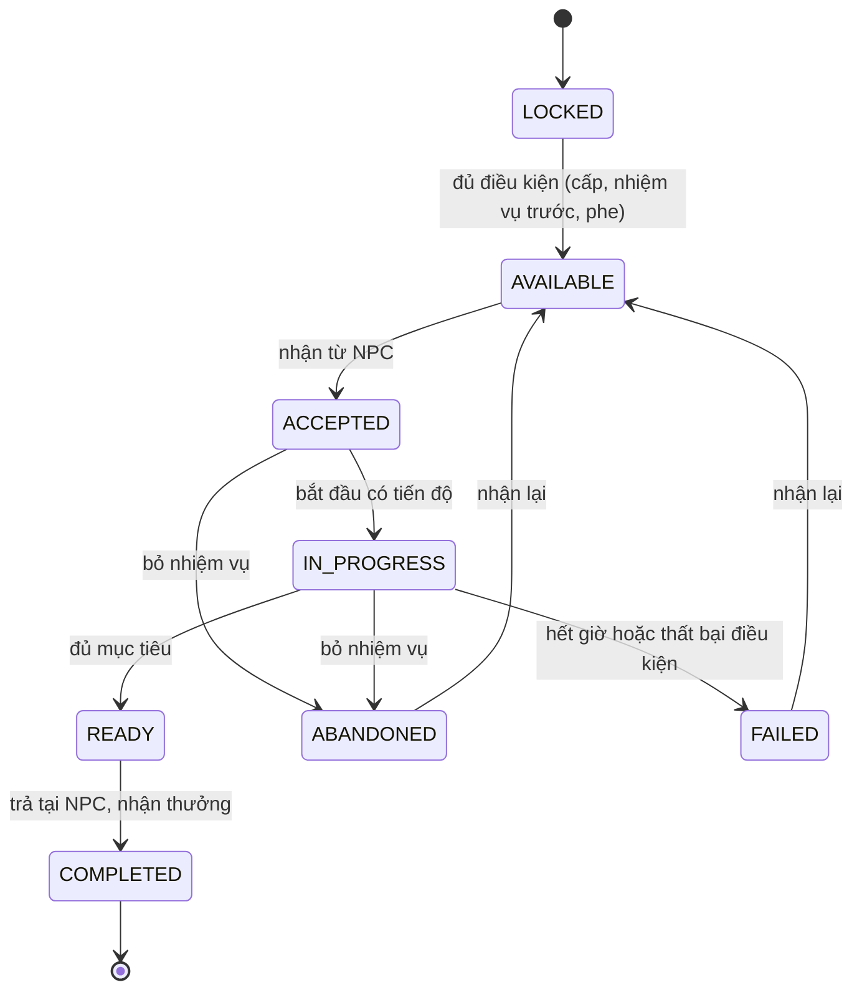

# Nhiệm vụ & Hoạt động hằng ngày

> **Trạng thái:** Draft v0.2 (bản reskin) · **Phụ thuộc:** [lore](01-lore-and-story.md) · [characters](02-characters-and-npcs.md) · [maps](05-world-maps-monsters.md)

## 1. Các loại nhiệm vụ

| Loại | Mã | Số lượng | Lặp lại | Mô tả |
|------|----|----------|---------|-------|
| **Chính tuyến** | `Q_MAIN` | 90 | Không | Cốt truyện 8 chương, mở khóa vùng và tính năng |
| **Phụ tuyến** | `Q_SIDE` | ≈ 150 | Không | Dân làng, phe, thu thập |
| **Hằng ngày** | `Q_DAILY` | 10/ngày | Hằng ngày | Bảng Nhiệm Vụ Pháp Vệ |
| **Hằng tuần** | `Q_WEEK` | 5/tuần | Hằng tuần | Thử thách lớn, thưởng lớn |
| **Phe** | `Q_FACTION` | 3/phe | Một lần | Gia nhập và tăng Danh Vọng Phe |
| **Đội** | `Q_GUILD` | 5/ngày | Hằng ngày | Làm chung để lấy Điểm Cống Hiến |
| **Sự kiện** | `Q_EVENT` | Theo sự kiện | Theo lịch | Gắn với [sự kiện](09-social-squad-pvp-events.md) |
| **Thành tích** | `ACH` | ≈ 200 | Không | Hoàn thành mục tiêu dài hạn (nhận Công Trạng) |

## 2. Trạng thái nhiệm vụ



- Trạng thái lưu trong `character_quests` (xem [database](../architecture/database-schema.md)).
- Tiến độ cập nhật qua **sự kiện game** (event bus) như `mob.killed`, `item.acquired`, `npc.talked`, `map.entered`.
- Tối đa **20 nhiệm vụ** đang nhận. Chính tuyến luôn có chỗ riêng.

## 3. Loại mục tiêu

| Mục tiêu | Sự kiện | Ví dụ |
|----------|---------|-------|
| `KILL` | `mob.killed` | Hạ 8 Chó Rừng Non |
| `COLLECT` | `item.acquired` | Thu thập 5 Thảo Dược |
| `DELIVER` | `npc.talked` + có item | Giao thư cho Thầy Bạch Vân |
| `TALK` | `npc.talked` | Nói chuyện với Khôi |
| `REACH` | `map.entered` / vùng | Đến Hang Dơi |
| `ESCORT` | NPC theo sau còn sống | Hộ tống dân làng |
| `BOSS` | `boss.killed` | Hạ Trang Lạc |
| `DUNGEON` | `dungeon.cleared` | Hoàn thành DG02 |
| `USE_SKILL` | `skill.used` | Dùng Hỏa Cầu 20 lần |
| `CRAFT` | `item.crafted` | Chế 3 Bình Hồi Phục |
| `ENHANCE` | `item.enhanced` | Cường hóa trang bị lên +3 |
| `PVP` | `pvp.won` | Thắng 3 trận đấu tập |

## 4. Chính tuyến — Chương 1 (Lv 1–10) chi tiết

| ID | Tên | Cấp | NPC | Mục tiêu | Thưởng |
|----|-----|-----|-----|----------|--------|
| Q_MAIN_01 | Buổi Sáng Ở Nhà Học | 1 | Thầy Bạch Vân | Nói chuyện Thầy Bạch Vân và Bà Mơ | 50 EXP, 100 Quan, 5 Bình HP Nhỏ |
| Q_MAIN_02 | Dọn Vườn Thuốc | 1 | Thầy Bạch Vân | Hạ 5 Nấm Lùn (M002) | 120 EXP, 80 Quan, Kiếm Gỗ Tập |
| Q_MAIN_03 | Thỏ Phá Ruộng | 2 | Cụ Trương | Hạ 6 Thỏ Đốm, nhặt 4 Củ Cải Non | 350 EXP, 120 Quan |
| Q_MAIN_04 | Hái Thảo Dược | 3 | Lam Nhi | Thu thập 5 Thảo Dược Suối Mơ, giao Lam Nhi | 600 EXP, 150 Quan, 3 Bình HP Nhỏ |
| Q_MAIN_05 | Bài Học Của Khôi | 5 | Khôi | Gặp Khôi ở M002; đấu tập học **Tụ Mana Chấn** | 400 EXP, 200 Quan, Tụ Mana Chấn |
| Q_MAIN_06 | Chó Rừng Lạc Bầy | 5 | Cụ Trương | Hạ 8 Chó Rừng Non (M003) | 600 EXP, 250 Quan |
| Q_MAIN_07 | Bao Tải Bị Lấy | 6 | Cụ Trương (thay bác Tư bên suối) | Hạ 6 Lùn Ném Đá, nhặt Bao Tải Bị Lấy | 800 EXP, 300 Quan |
| Q_MAIN_08 | Giếng Làng Cạn | 7 | Bà Mơ | Vào M004, hạ 8 Dơi Giếng | 1.000 EXP, 350 Quan |
| Q_MAIN_09 | Tờ Giấy Trắng | 8 | Lam Nhi | Hạ 6 Rùa Đá Giếng, nhặt Mảnh Trang | 1.400 EXP, 400 Quan |
| Q_MAIN_10 | **Trang Lạc** | 9 | Thầy Bạch Vân | Hạ BOSS001 trong hầm ngục DG01 (một mình hoặc nhóm) | 2.000 EXP, 600 Quan, Áo Suối Mơ |
| Q_MAIN_11 | Đêm Trước Ngày Lễ | 9 | Thầy Bạch Vân | Cutscene với Thầy, Lam Nhi, Khôi | 1.200 EXP, mở khóa Lv10 |
| Q_MAIN_12 | **Lễ Khai Thư** | 10 | Thầy Bạch Vân | Vào `I001`, chọn hệ phép | Huyền Thư Sơ Bản, Vũ khí hệ, 1 SP |

**Cuối Chương 1 (bậc A3):**
- **Q_MAIN_10:** hạ Trang Lạc trong DG01 ([maps §5.3, §6.2](05-world-maps-monsters.md)).
- **Q_MAIN_11:**
  - Nhận nhiệm vụ là chạy ngay cảnh đêm ở nhà học: 6 lời thoại của Thầy, Lam Nhi, Khôi và người chơi, nói về nỗi lo trước lễ và tờ giấy trắng dưới giếng.
  - Xong cảnh thì nhiệm vụ tự hoàn thành.
  - **Giới hạn Lv9:** trước khi xong Q_MAIN_11, nhân vật không lên quá Lv9; EXP dư dừng ở sát mốc và được dùng ngay khi mở giới hạn.
- **Q_MAIN_12:**
  - Nhận nhiệm vụ là Thầy đưa người chơi vào lễ đường `I001`.
  - Đặt tay lên **Đài Khai Thư** (nhấn F hoặc nói với Thầy) để mở cửa sổ Lễ Khai Thư ([classes §3](03-origins-classes-skills.md)).
  - Chọn hệ xong, Thầy nói lời chia tay, nhiệm vụ tự hoàn thành, rồi hiện thẻ **"Hết Chương 1"**: lá thư *"Đừng tìm thầy. Hãy tìm Mười Hai Quyển."*, thời gian chơi, cấp, Lực Chiến, hệ phép.
  - Về làng thì Thầy Bạch Vân không còn ở nhà học ([characters](02-characters-and-npcs.md)).
- Điểm Kỹ Năng (1 SP) của Q_MAIN_12 chờ hệ nâng kỹ năng.

**Cân bằng:** EXP của Q_MAIN_03 (200 → 350) và Q_MAIN_04 (300 → 600) đã nâng để bỏ bức tường cày ở phút thứ 6, theo [báo cáo nhịp chơi Chương 1](../reports/chapter1-pacing.md). Ước tính trọn chương khoảng 47 phút.

**Mẫu thoại mở đầu `Q_MAIN_01` theo xuất thân:**

- *Dân Làng:* "Hôm nay bạn là người tới nhà học sớm nhất. Thầy Bạch Vân đã ngồi đọc sách bên hiên."
- *Thế Gia:* "Gia đình gửi bạn về làng này để học thuốc và học chữ. Thầy Bạch Vân gật đầu chào, không hỏi thêm gì."
- *Hậu Duệ Tộc Cổ Thư:* "Những vệt chữ mờ trên cổ tay khiến lũ trẻ trong làng tò mò. Thầy Bạch Vân luôn bảo chúng: chữ nào cũng có câu chuyện của nó."

### 4.1 Vật phẩm nhiệm vụ

Vật phẩm nhiệm vụ **chỉ rơi khi người chơi đang nhận nhiệm vụ và còn thiếu**. Chúng nằm ở tab *Nhiệm vụ* của túi, không bán, không giao dịch, mất khi trả nhiệm vụ.

| Vật phẩm | Nhiệm vụ | Nguồn |
|----------|----------|-------|
| Củ Cải Non | Q_MAIN_03 | Thỏ Đốm, 50% mỗi con |
| Thảo Dược Suối Mơ | Q_MAIN_04 | 8 bụi thảo dược phát sáng trên Đồng Hoa (M002). Chỉ người đang nhận nhiệm vụ thấy; hái bằng F hoặc chạm; mọc lại sau 20 giây |
| Bao Tải Bị Lấy | Q_MAIN_07 | Lùn Ném Đá, 25% |
| Mảnh Trang | Q_MAIN_09 | Rùa Đá Giếng, 30% |

Dữ liệu thử của chuỗi Chương 1 (định dạng §11) nằm ở `packages/content/quests` ([content-pipeline §2.1](../workflows/content-pipeline.md)); chữ hiển thị ở `packages/content/i18n/vi.yaml`.

## 5. Chính tuyến — Chương 2 (Lv 10–24) tóm lược

| ID | Tên | Cấp | Nội dung |
|----|-----|-----|----------|
| Q_MAIN_13 | Lá Thư Để Lại | 10 | Đọc thư của thầy cùng **Bà Mơ**, Lam Nhi, Khôi; quyết định lên Thượng Đô |
| Q_MAIN_14 | Lên Thượng Đô | 10 | Đến M005, gặp **Viện Chủ Vân Tước**; ghi danh **Mùa Tuyển Thư** tại **Giám Khảo Tuyển Thư** (M008) |
| Q_MAIN_15 | Vòng 1: Tìm Sách | 12 | Hạ 15 Lợn Rừng Đồng, thu 10 trang sách thất lạc (M009) |
| Q_MAIN_16 | Vòng 1: Lợn Rừng Chúa | 12 | Hạ BOSS002 |
| Q_MAIN_17 | Vòng 2: Bóng Giám Khảo | 15 | Hạ **Bóng Giám Khảo** (instance) |
| Q_MAIN_18 | Đồi Cối Xay Gió | 16 | Hộ tống 3 thủ thư qua đồi |
| Q_MAIN_19 | Vòng 3: Hộ Tống Quyển | 20 | Hoàn thành DG02 Mỏ Đá Nghiên |
| Q_MAIN_20 | Lời Mời Của Các Viện | 20 | Nhận thư mời các Viện, chọn Viện ban đầu |
| Q_MAIN_21 | Lập Đội | 20 | Tham gia hoặc lập **Đội** |
| Q_MAIN_22 | Kẻ Trộm Quyển | 24 | Hạ BOSS004; thấy **Mặc Ảnh** lấy Quyển Gốc |
| Q_MAIN_23 | Cuộc Gặp Chấp Bút | 24 | **Chấp Bút Hạc Minh** kể về Mười Hai Quyển Gốc |
| Q_MAIN_24 | Tới Cảng Thư Khố | 25 | Mở khóa Chương 3 |

## 6. Số lượng chính tuyến theo chương

| Chương | Cấp | Số NV | NV đáng chú ý | Mở khóa |
|--------|-----|-------|----------------|---------|
| 1 | 1–10 | 12 | Trang Lạc, Lễ Khai Thư | Hệ phép, kỹ năng |
| 2 | 10–24 | 12 | Mùa Tuyển Thư, Kẻ Trộm Quyển | Đội (Lv20), Auto Hunt |
| 3 | 25–39 | 12 | Khải Thể, Thủy Điện Chìm | Khải Thể, Thẻ Kẹp Trang |
| 4 | 40–49 | 10 | Đêm Thư Cháy, Cổ Thụ Chép Chữ | Mực Cổ, Huyền Thư Tu Bản (Lv50) |
| 5 | 50–59 | 10 | Chiến tranh Xích Sa, Hòa Ước Cát Đỏ | Chiến Trường, Chiến Đội |
| 6 | 60–74 | 12 | Ký Ức Tộc Cổ Thư | Bảy Trang Rời, Thiên Phú cao cấp |
| 7 | 75–89 | 12 | Ba Hiệu Đính Viên, Văn Khải | Raid, mở chuỗi Phong Ấn Xạ Thủ |
| 8 | 90–100 | 10 | Đại Trang Trắng, Định Bản | Nhập Linh hoàn chỉnh, Mùa Giải |

## 7. Bảng Nhiệm Vụ Pháp Vệ (hằng ngày)

NPC045 **Thầy Ký Bảng** (M008) phát **10 nhiệm vụ mỗi ngày**, làm mới lúc **00:00 (UTC+7)**. Mỗi nhiệm vụ là một mẫu dưới đây, thay thế số lượng và map theo cấp người chơi.

| Mã | Tên | Nội dung | Số lượng | Thưởng chính |
|----|-----|----------|----------|--------------|
| D01 | Dọn Dẹp Quái | Hạ N quái ở map cấp tương ứng | 60–100 | EXP, Quan |
| D02 | Thu Thập Nguyên Liệu | Thu thập N nguyên liệu | 15–30 | EXP, Đồng Luyện |
| D03 | Đấu Tập | Thắng N trận PvP (đấu tập hoặc Đấu Trường) | 2–3 | EXP, Huy hiệu |
| D04 | Hầm Ngục Hằng Ngày | Hoàn thành 1 hầm ngục | 1 | EXP, Điểm Cống Hiến |
| D05 | Săn Tinh Anh | Hạ N quái tinh anh | 3–5 | EXP, trang bị Tốt |
| D06 | Ủng Hộ Đội | Góp Quan vào quỹ Đội | 1 lần | Điểm Cống Hiến |
| D07 | Giao Thư | Giao thư giữa các NPC | 3 NPC | EXP |
| D08 | Cường Hóa | Cường hóa trang bị 1 lần | 1 | Quan |
| D09 | Nấu Ăn Cho Bà Hai Bánh | Nộp N Thức ăn | 5 | Bình tăng buff |
| D10 | Điểm Danh Pháp Vệ | Đăng nhập, nhận quà | 1 | Nén Bạc nhỏ, Thẻ Auto |

**Thưởng EXP mỗi nhiệm vụ** = `0,06 × expToNext(L)`. Hoàn thành cả 10 ≈ 60% một cấp. Hoàn thành đủ 10 nhận rương **Nén Bạc nhỏ** (10–20 Nén Bạc).

### 7.1 Xếp hạng Bảng Nhiệm Vụ

| Hạng | Cấp | Hệ số thưởng |
|------|-----|--------------|
| D | 10–29 | ×1,0 |
| C | 30–49 | ×1,1 |
| B | 50–69 | ×1,2 |
| A | 70–89 | ×1,3 |
| S | 90–100 | ×1,5 |

## 8. Nhiệm vụ tuần

| Mã | Tên | Nội dung | Thưởng |
|----|-----|----------|--------|
| W01 | Boss Thế Giới | Tham gia 3 lần hạ boss thế giới | Sách Kỹ Năng |
| W02 | Raid Tuần | Hoàn thành 1 Raid | Rương Raid |
| W03 | Chiến Đội | Tham gia 1 trận Chiến Đội | Điểm Cống Hiến lớn |
| W04 | Chiến Trường | Tham gia 2 trận Chiến Trường Lục–Xích | Huy hiệu Quân Công |
| W05 | Thử Thách Tuần | Đánh bại boss hầm ngục độ khó Khó | Đồng Luyện cao cấp |

## 9. Nhiệm vụ Viện (Danh Vọng)

Mỗi Viện có 3 nhiệm vụ gia nhập ở Lv20 và nhiệm vụ lặp hằng ngày cho **Danh Vọng Viện** (8 Viện, xem [characters §6](02-characters-and-npcs.md)).

| Mốc | Điểm | Mở khóa |
|-----|------|---------|
| Quen biết | 0 | Nhận nhiệm vụ Viện |
| Thân thiện | 1.000 | Cửa hàng Viện cấp 1 |
| Tin cậy | 5.000 | Cửa hàng Viện cấp 2, trang phục |
| Kính trọng | 15.000 | Vật phẩm đặc trưng |
| Chiến hữu | 40.000 | Danh hiệu Viện |

## 10. Thành tích (Achievements) và Công Trạng

Thành tích nhận **Công Trạng**, ví dụ:

| Thành tích | Điều kiện | Công Trạng |
|-----------|-----------|-----|
| Bước Chân Đầu Tiên | Hoàn thành Chương 1 | 1 |
| Pháp Vệ | Đạt Lv30 | 2 |
| Người Đọc Cây | Hạ Cổ Thụ Chép Chữ | 3 |
| Chiến Hữu | Có 30 ngày đăng nhập liên tiếp | 3 |
| Học Trò Của Thầy | Thu thập mọi Trang Nhật Ký của Thầy Bạch Vân | 5 |
| Ứng Viên Chấp Bút | Đạt Lv100 và hoàn thành Chương 8 | 10 |

## 11. Định dạng khai báo nhiệm vụ (content)

```yaml
# packages/content/quests/main/q_main_02.yaml
id: Q_MAIN_02
type: MAIN
nameKey: quest.main.02.title
descKey: quest.main.02.desc
chapter: 1
levelMin: 1
prerequisites: [Q_MAIN_01]
giver: NPC001
turnIn: NPC001
objectives:
  - { type: KILL, target: MOB001, count: 5, map: M002 }
rewards:
  exp: 120
  soft: 80
  items:
    - { id: ITM01001, count: 1 }   # Kiếm Gỗ Tập
dialogue:
  accept: dlg.q_main_02.accept
  progress: dlg.q_main_02.progress
  complete: dlg.q_main_02.complete
```

Nhiệm vụ nhiều bước dùng `steps[]`, mỗi bước có `objectives[]` riêng. Xem [content-pipeline](../workflows/content-pipeline.md).
