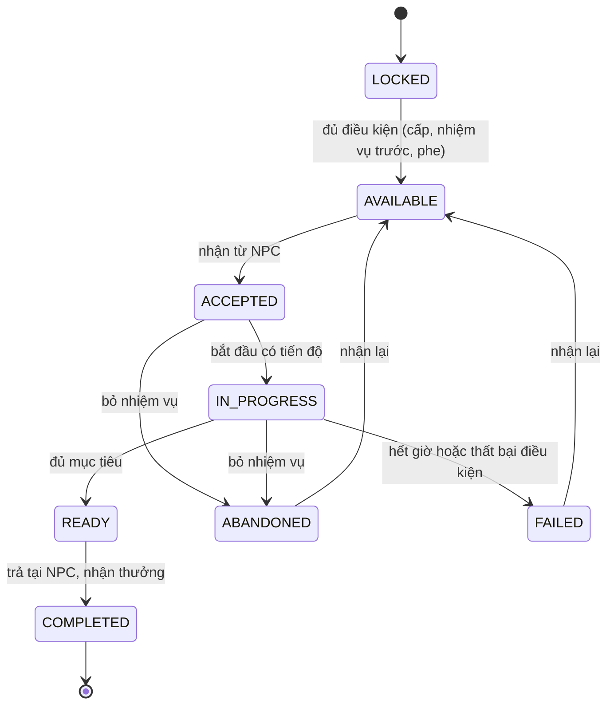

# Nhiệm vụ & Hoạt động hằng ngày

> **Trạng thái:** Draft v0.1 · **Phụ thuộc:** [lore](01-lore-and-story.md) · [characters](02-characters-and-npcs.md) · [maps](05-world-maps-monsters.md)

## 1. Các loại nhiệm vụ

| Loại | Mã | Số lượng | Lặp lại | Mô tả |
|------|----|----------|---------|-------|
| **Chính tuyến** | `Q_MAIN` | 90 | Không | Cốt truyện 8 chương, mở khóa vùng và tính năng |
| **Phụ tuyến** | `Q_SIDE` | ≈ 150 | Không | Dân làng, phe, thu thập |
| **Hằng ngày** | `Q_DAILY` | 10/ngày | Hằng ngày | Bảng Nhiệm Vụ Hiệp Sĩ |
| **Hằng tuần** | `Q_WEEK` | 5/tuần | Hằng tuần | Thử thách lớn, thưởng lớn |
| **Phe** | `Q_FACTION` | 3/phe | Một lần | Gia nhập và tăng Danh Vọng Phe |
| **Đội (Squad)** | `Q_SQUAD` | 5/ngày | Hằng ngày | Làm chung để lấy Điểm Cống Hiến |
| **Sự kiện** | `Q_EVENT` | Theo sự kiện | Theo lịch | Gắn với [sự kiện](09-social-squad-pvp-events.md) |
| **Thành tích** | `ACH` | ≈ 200 | Không | Hoàn thành mục tiêu dài hạn (nhận Sao) |

## 2. Trạng thái nhiệm vụ



- Trạng thái lưu trong `character_quests` (xem [database](../architecture/database-schema.md)).
- Tiến độ cập nhật qua **sự kiện game** (event bus) như `mob.killed`, `item.acquired`, `npc.talked`, `map.entered`.
- Tối đa **20 nhiệm vụ** đang nhận. Chính tuyến luôn có chỗ riêng.

## 3. Loại mục tiêu

| Mục tiêu | Sự kiện | Ví dụ |
|----------|---------|-------|
| `KILL` | `mob.killed` | Hạ 8 Sói Con |
| `COLLECT` | `item.acquired` | Thu thập 5 Thảo Dược |
| `DELIVER` | `npc.talked` + có item | Giao thư cho Cha Orsi |
| `TALK` | `npc.talked` | Nói chuyện với Yuno |
| `REACH` | `map.entered` / vùng | Đến Hang Dơi |
| `ESCORT` | NPC theo sau còn sống | Hộ tống dân làng |
| `BOSS` | `boss.killed` | Hạ Slime Vua |
| `DUNGEON` | `dungeon.cleared` | Hoàn thành DG02 |
| `USE_SKILL` | `skill.used` | Dùng Hỏa Cầu 20 lần |
| `CRAFT` | `item.crafted` | Chế 3 Bình Hồi Phục |
| `ENHANCE` | `item.enhanced` | Cường hóa trang bị lên +3 |
| `PVP` | `pvp.won` | Thắng 3 trận đấu tập |

## 4. Chính tuyến — Chương 1 (Lv 1–10) chi tiết

| ID | Tên | Cấp | NPC | Mục tiêu | Thưởng |
|----|-----|-----|-----|----------|--------|
| Q_MAIN_01 | Buổi Sáng Ở Nhà Thờ | 1 | Sơ Lily | Nói chuyện Sơ Lily và Cha Orsi | 50 EXP, 100 Yul, 5 Bình HP Nhỏ |
| Q_MAIN_02 | Dọn Cỏ Dại | 1 | Sơ Lily | Hạ 5 Slime Cỏ (M002) | 120 EXP, 80 Yul, Kiếm Gỗ Tập |
| Q_MAIN_03 | Thỏ Mana Ăn Rau | 2 | Trưởng Làng | Hạ 6 Thỏ Mana, nhặt 4 Cà Rốt Mana | 200 EXP, 120 Yul |
| Q_MAIN_04 | Hái Thảo Dược | 3 | Cha Orsi | Thu thập 5 Thảo Dược Hage, giao Cha Orsi | 300 EXP, 150 Yul, 3 Bình HP Nhỏ |
| Q_MAIN_05 | Lời Hứa Của Asta | 5 | Asta | Gặp Asta ở M002; đấu tập dạy **Tụ Mana Chấn** | 400 EXP, 200 Yul, Tụ Mana Chấn |
| Q_MAIN_06 | Sói Con Lạc Đàn | 5 | Trưởng Làng | Hạ 8 Sói Con (M003) | 600 EXP, 250 Yul |
| Q_MAIN_07 | Dân Làng Cần Giúp | 6 | Dân làng | Hạ 6 Goblin Bé, nhặt Bao Tải Bị Cướp | 800 EXP, 300 Yul |
| Q_MAIN_08 | Hang Dơi Bí Ẩn | 7 | Cha Orsi | Vào M004, hạ 8 Dơi Mana | 1.000 EXP, 350 Yul |
| Q_MAIN_09 | Tiếng Gọi Từ Hang | 8 | Yuno | Hạ 6 Slime Đá, nhặt Mảnh Ma Lực | 1.400 EXP, 400 Yul |
| Q_MAIN_10 | **Slime Vua** | 9 | Asta | Hạ BOSS001 (nhóm cho phép) | 2.000 EXP, 600 Yul, Áo Dân Làng Hage |
| Q_MAIN_11 | Đêm Trước Ngày Lễ | 9 | Cha Orsi | Cutscene với Asta, Yuno, Cha Orsi | 1.200 EXP, mở khóa Lv10 |
| Q_MAIN_12 | **Lễ Nhận Ma Đạo Thư** | 10 | Cha Orsi | Vào `I001`, chọn hệ phép | Ma Đạo Thư 3 lá, Vũ khí hệ, 1 SP |

**Mẫu thoại mở đầu `Q_MAIN_01` theo xuất thân:**

- *Dân Làng:* "Hôm nay bạn là người dậy sớm nhất nhà thờ. Sơ Lily đã đứng ở cửa."
- *Quý Tộc:* "Gia đình gửi bạn đến nhà thờ này để rèn luyện. Sơ Lily nhìn bạn với ánh mắt dịu dàng."
- *Tinh Linh:* "Đôi tai nhọn của bạn khiến lũ trẻ trong làng tò mò. Sơ Lily luôn bảo vệ bạn khỏi những lời trêu chọc."

## 5. Chính tuyến — Chương 2 (Lv 10–24) tóm lược

| ID | Tên | Cấp | Nội dung |
|----|-----|-----|----------|
| Q_MAIN_13 | Lên Kinh Đô | 10 | Đến M005, gặp **Mimosa**/**Yuno** |
| Q_MAIN_14 | Giấy Phép Hiệp Sĩ | 10 | Đăng ký kỳ thi tại **Giám Khảo** (M008) |
| Q_MAIN_15 | Vòng 1: Dọn Quái | 12 | Hạ 15 Heo Rừng (M009) |
| Q_MAIN_16 | Vòng 1: Thợ Săn Heo Chúa | 12 | Hạ BOSS002 |
| Q_MAIN_17 | Vòng 2: Đấu Giám Khảo | 15 | Hạ **Giám Khảo Bóng** (instance) |
| Q_MAIN_18 | Cánh Đồng Gió | 16 | Giải cứu 3 dân thường (hộ tống) |
| Q_MAIN_19 | Vòng 3: Mỏ Bỏ Hoang | 20 | Hoàn thành DG02 |
| Q_MAIN_20 | Lễ Chọn Đội | 20 | Nhận thư mời các Đội, chọn Đội ban đầu |
| Q_MAIN_21 | Mở Khóa Squad | 20 | Tham gia hoặc lập **Squad** |
| Q_MAIN_22 | Thủ Lĩnh Trộm Mana | 24 | Hạ BOSS004 |
| Q_MAIN_23 | Thư Tay Julius | 24 | Nhận thư từ Vua Phép Thuật |
| Q_MAIN_24 | Tới Pháo Đài Bò Đen | 25 | Mở khóa Chương 3 |

## 6. Số lượng chính tuyến theo chương

| Chương | Cấp | Số NV | NV đáng chú ý | Mở khóa |
|--------|-----|-------|----------------|---------|
| 1 | 1–10 | 12 | Slime Vua, Lễ Nhận Ma Đạo Thư | Hệ phép, kỹ năng |
| 2 | 10–24 | 12 | Kỳ thi, Lễ chọn Đội | Squad (Lv20), Auto Hunt |
| 3 | 25–39 | 12 | Mana Skin, Mắt Mặt Trời Nửa Đêm | Mana Skin, Dịch chuyển |
| 4 | 40–49 | 10 | Thủy Cung, Lá Thứ Tư | Ma Đạo Thư 4 lá |
| 5 | 50–59 | 10 | Chiến tranh Diamond | Chiến Trường, Squad War |
| 6 | 60–74 | 12 | Ký Ức Tinh Linh | Linh Thạch Sao, Thiên Phú cao cấp |
| 7 | 75–89 | 12 | Bộ Ba Hắc Ám | Raid, mở chuỗi Phản Ma |
| 8 | 90–100 | 10 | Lucifero, Lễ Phong | Spirit Dive hoàn chỉnh, Mùa Giải |

## 7. Bảng Nhiệm Vụ Hiệp Sĩ (hằng ngày)

NPC045 (M008) phát **10 nhiệm vụ mỗi ngày**, làm mới lúc **00:00 (UTC+7)**. Mỗi nhiệm vụ là một mẫu dưới đây, thay thế số lượng và map theo cấp người chơi.

| Mã | Tên | Nội dung | Số lượng | Thưởng chính |
|----|-----|----------|----------|--------------|
| D01 | Dọn Dẹp Quái | Hạ N quái ở map cấp tương ứng | 60–100 | EXP, Yul |
| D02 | Thu Thập Nguyên Liệu | Thu thập N nguyên liệu | 15–30 | EXP, Đá Mana |
| D03 | Đấu Tập | Thắng N trận PvP (đấu tập hoặc Đấu Trường) | 2–3 | EXP, Huy hiệu |
| D04 | Hầm Ngục Hằng Ngày | Hoàn thành 1 hầm ngục | 1 | EXP, Điểm Cống Hiến |
| D05 | Săn Tinh Anh | Hạ N quái tinh anh | 3–5 | EXP, trang bị Tốt |
| D06 | Ủng Hộ Đội | Góp Yul vào quỹ Đội | 1 lần | Điểm Cống Hiến |
| D07 | Giao Thư | Giao thư giữa các NPC | 3 NPC | EXP |
| D08 | Cường Hóa | Cường hóa trang bị 1 lần | 1 | Yul |
| D09 | Nấu Ăn Cho Charmy | Nộp N Thức ăn | 5 | Bình tăng buff |
| D10 | Điểm Danh Hiệp Sĩ | Đăng nhập, nhận quà | 1 | Ngọc Mana nhỏ, Thẻ Auto |

**Thưởng EXP mỗi nhiệm vụ** = `0,06 × expToNext(L)`. Hoàn thành cả 10 ≈ 60% một cấp. Hoàn thành đủ 10 nhận rương **Ngọc Mana nhỏ** (10–20 Ngọc).

### 7.1 Xếp hạng Bảng Nhiệm Vụ

| Hạng | Cấp | Hệ số thưởng |
|------|-----|--------------|
| D | 10–29 | ×1,0 |
| C | 30–49 | ×1,1 |
| B | 50–69 | ×1,2 |
| A | 70–89 | ×1,3 |
| S | 90–100 | ×1,5 |

## 8. Nhiệm vụ tuần

| Mã | Tên | Nội dung | Thưởng |
|----|-----|----------|--------|
| W01 | Boss Thế Giới | Tham gia 3 lần hạ boss thế giới | Sách Kỹ Năng |
| W02 | Raid Tuần | Hoàn thành 1 Raid | Rương Raid |
| W03 | Squad Chiến | Tham gia 1 trận Squad War | Điểm Cống Hiến lớn |
| W04 | Chiến Trường | Tham gia 2 trận Chiến Trường Vương Quốc | Huy hiệu Quân Công |
| W05 | Thử Thách Tuần | Đánh bại boss hầm ngục độ khó Khó | Đá Mana cao cấp |

## 9. Nhiệm vụ phe (Danh Vọng)

Mỗi phe có 3 nhiệm vụ gia nhập ở Lv20 và nhiệm vụ lặp hằng ngày cho **Danh Vọng Phe**.

| Mốc | Điểm | Mở khóa |
|-----|------|---------|
| Quen biết | 0 | Nhận nhiệm vụ phe |
| Thân thiện | 1.000 | Cửa hàng phe cấp 1 |
| Tin cậy | 5.000 | Cửa hàng phe cấp 2, trang phục |
| Kính trọng | 15.000 | Vật phẩm đặc trưng |
| Chiến hữu | 40.000 | Danh hiệu phe |

## 10. Thành tích (Achievements) và Sao

Thành tích nhận **Sao**, ví dụ:

| Thành tích | Điều kiện | Sao |
|-----------|-----------|-----|
| Bước Chân Đầu Tiên | Hoàn thành Chương 1 | 1 |
| Hiệp Sĩ Phép Thuật | Đạt Lv30 | 2 |
| Kẻ Hạ Rồng | Hạ Hải Long Hộ Điện | 3 |
| Chiến Hữu | Có 30 ngày đăng nhập liên tiếp | 3 |
| Người Giữ Lời Hứa | Hoàn thành mọi nhiệm vụ lời hứa Asta & Yuno | 5 |
| Ứng Viên Vua | Đạt Lv100 và hoàn thành Chương 8 | 10 |

## 11. Định dạng khai báo nhiệm vụ (content)

```yaml
# packages/content/quests/main/q_main_02.yaml
id: Q_MAIN_02
type: MAIN
nameKey: quest.main.02.title
descKey: quest.main.02.desc
chapter: 1
levelMin: 1
prerequisites: [Q_MAIN_01]
giver: NPC001
turnIn: NPC001
objectives:
  - { type: KILL, target: MOB001, count: 5, map: M002 }
rewards:
  exp: 120
  yul: 80
  items:
    - { id: ITM01001, count: 1 }   # Kiếm Gỗ Tập
dialogue:
  accept: dlg.q_main_02.accept
  progress: dlg.q_main_02.progress
  complete: dlg.q_main_02.complete
```

Nhiệm vụ nhiều bước dùng `steps[]`, mỗi bước có `objectives[]` riêng. Xem [content-pipeline](../workflows/content-pipeline.md).
