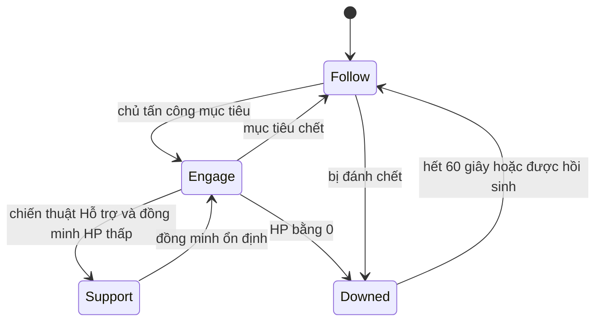

# Đồng hành & Thú cưỡi

> **Trạng thái:** Draft v0.1 · **Phụ thuộc:** [combat](04-combat-and-progression.md) · [items](07-items-and-equipment.md)

Có ba loại đồng hành, mỗi loại tương ứng một hệ thống của Ninja School/NRO:

| Loại | Gốc | Tên BCO | Chức năng |
|------|-----|---------|-----------|
| Đệ tử | NRO | **Hiệp Sĩ Tập Sự (Squire)** | Chiến đấu cùng người chơi |
| Pet | NS | **Tinh Linh Hộ Mệnh** | Cộng chỉ số, thẩm mỹ |
| Thú cưỡi | NS/NRO | **Chổi Bay** | Di chuyển nhanh |

## 1. Hiệp Sĩ Tập Sự (Squire)

### 1.1 Mở khóa

- **Lv25**, hoàn thành `Q_MAIN_24` (Tới Pháo Đài Bò Đen).
- Nhận **Khế Ước Thạch** từ NPC048 (M005). Chọn **hệ** (7 hệ phép) cho Squire.
- Mỗi nhân vật sở hữu tối đa **3 Squire** (slot 2–3 mở bằng Ngọc Mana), mang theo **1 Squire** cùng lúc.

### 1.2 Hạng và chỉ số

| Hạng | Tên | Điều kiện thăng | Hệ số chỉ số (so với chủ) |
|------|-----|-----------------|----------------------------|
| 1 | Tập Sự | Mặc định | ×0,40 |
| 2 | Hiệp Sĩ | Squire Lv30 + nhiệm vụ | ×0,50 |
| 3 | Tinh Anh | Squire Lv50 + nhiệm vụ | ×0,60 |
| 4 | Đội Phó | Squire Lv70 + nhiệm vụ | ×0,70 |
| 5 | Đội Trưởng | Squire Lv90 + nhiệm vụ | ×0,80 |

- Chỉ số Squire = `chỉ số gốc của chủ × hệ số hạng` (HP, MP, ATK, DEF), cộng trang bị Squire.
- **Cấp Squire** tối đa = cấp chủ − 5.

### 1.3 Nuôi dưỡng (giống đệ tử NRO)

| Cơ chế | Mô tả |
|--------|-------|
| **Nhận EXP** | Squire nhận **30%** EXP chủ nhận khi cùng đánh (không trừ EXP chủ) |
| **Tín Nhiệm** | Thanh 0–100. Tăng khi chiến đấu cùng, cho ăn; giảm khi chết. Tín Nhiệm cao tăng hiệu quả kỹ năng tới +20% |
| **Cho ăn** | Thức ăn của Charmy tăng Tín Nhiệm và buff Squire |
| **Trang bị** | 4 ô: Vũ khí, Áo, Giày, Bùa (chỉ trang bị cấp thấp hơn chủ) |
| **Kỹ năng** | 3 ô, học bằng **Trang Sách** (rơi từ boss, mua bằng Điểm Cống Hiến) |
| **Chiến thuật** | Chủ chọn: **Tấn công** (đánh mục tiêu của chủ), **Phòng thủ** (đứng bên chủ, đỡ đòn), **Hỗ trợ** (hồi máu/buff) |
| **Bất tỉnh** | HP về 0 → nằm 60 giây rồi tự hồi 30% HP; có thể hồi sinh nhanh bằng Lá Hồi Sinh |

### 1.4 Hành vi AI



- Squire **không** tham gia Raid, Đấu Trường, Chiến Trường.
- Squire vào Hầm Ngục được; **tính 0,5 người** khi chia thưởng nhóm.

## 2. Tinh Linh Hộ Mệnh

### 2.1 Nguồn

| Nguồn | Mô tả |
|-------|-------|
| **Linh Hồn Thú** | Rơi từ quái hệ Mộc, Quang (0,5%) hoặc mua cửa hàng phe |
| **Tứ Đại Tinh Linh** | Phần thưởng tối cao: Salamander, Undine, Sylph, Gnome (Raid/Mùa Giải) |
| **Sự kiện** | Tinh linh giới hạn |

### 2.2 Cơ chế

| Cơ chế | Mô tả |
|--------|-------|
| Số lượng | Sở hữu tối đa **20**, **1** đi cùng |
| Cấp **Liên Kết** | 1–10, nâng bằng **Bụi Mana** (nguyên liệu) |
| Hiệu ứng | +% HP, ATK, DEF, hoặc nhặt Yul tự động (theo loại) |
| Đẹp mắt | Bay quanh nhân vật, đổi màu theo hệ, hiệu ứng theo Liên Kết |
| Tiến hóa | Cấp Liên Kết 10 + 5 Linh Hồn Thú cùng loại → phẩm kế (Thường → Hiếm → Sử Thi) |

### 2.3 Tứ Đại Tinh Linh (Huyền Thoại)

| Tinh Linh | Hệ | Hiệu ứng đặc trưng |
|-----------|----|--------------------|
| Salamander | Hỏa | +5% ATK, +10% sát thương Hỏa |
| Undine | Thủy | +10% MP, hồi MP +10% |
| Sylph | Phong | +5% tốc chạy, +5% CRIT |
| Gnome | Thổ | +8% DEF, +5% HP |

Mỗi Tinh Linh cũng **kích hoạt thẩm mỹ cho Spirit Dive** tương ứng.

## 3. Chổi Bay

### 3.1 Danh sách

| Chổi | Mở | Tốc chạy | Tính năng | Nguồn |
|------|----|----------|-----------|-------|
| Chổi Gỗ | Lv10 | +15% | Lướt nhẹ khi rơi | Cửa hàng NPC049 (20.000 Y) |
| Chổi Bạc | Lv30 | +25% | Nhảy ba | Chế tạo (Henry) |
| Chổi Vàng | Lv60 | +30% | **Bay tự do** ở Vùng Trời | Phần thưởng Chương 6 |
| Chổi Tinh Linh | Sự kiện | +30% | Hiệu ứng riêng | Sự kiện |
| Chổi Thẩm Mỹ | — | +15% | Chỉ thẩm mỹ | Ngọc Mana |

### 3.2 Quy tắc

- Gọi/cất Chổi bằng nút **Cưỡi** (hồi 3s). Tự cất khi vào Town hẹp hoặc khi giao tranh.
- **Không tấn công** khi cưỡi; cưỡi tăng tốc nhưng **giảm EVA 50%**.
- **Vùng Trời:** vùng trong map cho phép bay tự do, gắn cờ `skyZone` trong dữ liệu map. Có **Thanh Bay** 10 giây rồi phải hạ cánh.
- Quái cấp cao **hút người cưỡi xuống** (cơ chế một số boss).

## 4. Dữ liệu

```yaml
# packages/content/companions/squire_templates.yaml
- id: SQ_FIRE_01
  class: FIRE
  baseRatio: 0.40
  nameKey: squire.fire.01.name
  sprite: squire/fire_01
  skillSlots: 3
```

Bảng DB: `squires`, `squire_skills`, `mounts`, `spirits` (xem [database](../architecture/database-schema.md)).
