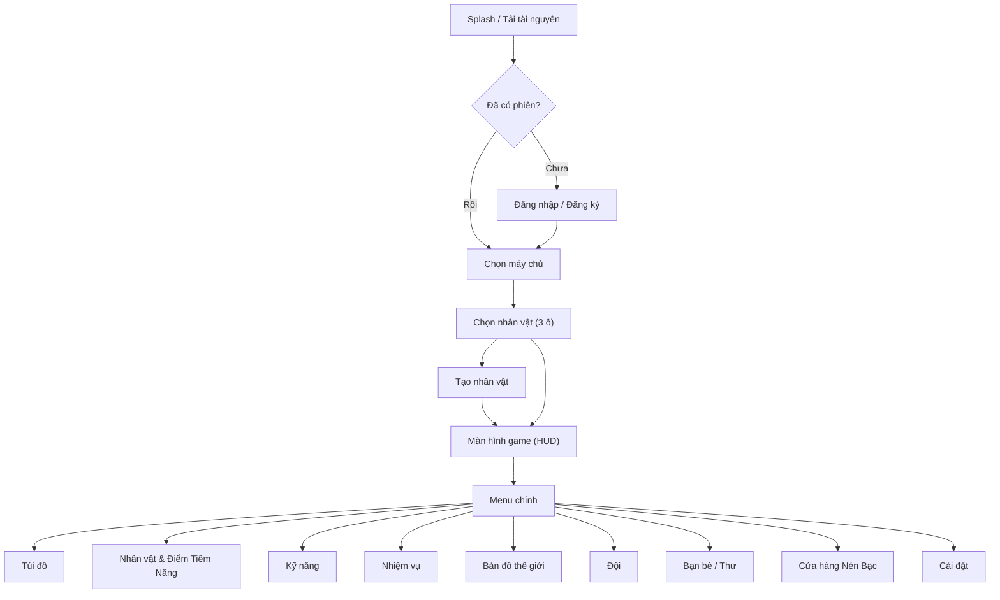

# Đặc tả UI/UX

> **Trạng thái:** Draft v0.1 · **Phụ thuộc:** [art-audio](12-art-audio-direction.md) · [client-design](../architecture/client-design.md)

## 1. Nguyên tắc

1. **Chơi được bằng một tay trên điện thoại** (ngón cái phải: kỹ năng, ngón cái trái: di chuyển).
2. **Quen thuộc với người chơi NS/NRO**: NPC mở menu dọc, nút kỹ năng nhỏ ở góc phải, bản đồ nhỏ ở góc trên.
3. **Mọi thao tác ≤ 3 lần chạm** để đạt hành động thường gặp (dùng bình, đổi khu, nhận nhiệm vụ).
4. **Phản hồi tức thì**: client hiển thị dự đoán, server sửa sau (xem [client-design](../architecture/client-design.md)).
5. **Đọc rõ ở màn hình nhỏ**: chữ ≥ 14 px logic, vùng chạm ≥ 44 px.

## 2. Luồng màn hình



## 3. HUD trong game

### 3.1 Bố cục PC (960×540 logic)

```text
┌────────────────────────────────────────────────────────────────┐
│ [Avatar][Lv][Tên]  HP ███████░░░  MP ████░░░░      [Mini-map]  │
│ [Hạng/Lực Chiến]   EXP ▓▓▓▓░░░░░░░                  [Khu 3 ▼]  │
│ [Nhiệm vụ đang làm]                                  [Menu ≡]  │
│                                                                │
│                    (VÙNG CHƠI - MAP 2D)                        │
│                                                                │
│ [Chat log, 4 dòng]                                             │
│ [Chat input]            [Hotbar 1-6][Bình][Chổi]  [Đòn Thường] │
└────────────────────────────────────────────────────────────────┘
```

### 3.1.1 Thông tin chiến đấu trên màn hình

| Thành phần | Quy ước |
|-----------|---------|
| **Thanh máu quái** | Trên đầu quái: tên + cấp, thanh HP. Quái thường chỉ hiện thanh khi bị đánh hoặc đang được chọn; Tinh anh, Thủ lĩnh, boss luôn hiện. Thanh giảm mượt, phần vừa mất hiện màu trắng rồi rút dần |
| **Tên theo loại** | Thường: trắng. **[Tinh anh]**: tím. **[Thủ lĩnh]**: cam đỏ. Boss: vàng, thanh HP lớn ở đỉnh màn hình |
| **Số sát thương** | Bay lên rồi mờ dần. Người chơi đánh quái: **trắng**; chí mạng: **vàng, to hơn**, kèm chữ "Chí mạng"; sát thương theo thời gian (Cháy, Độc): **cam**; trượt: "Trượt" màu xám. Quái đánh người chơi: **đỏ** trên đầu nhân vật |
| **Phần thưởng** | Khi hạ quái: "+N EXP" màu xanh nhạt trên nhân vật; nhặt đồ hiện tên theo màu độ hiếm ([art §2.1](12-art-audio-direction.md)); "+N Quan" màu vàng |
| **Nhật ký** | Khung chat (kênh Hệ thống) ghi: hạ quái, EXP, đồ nhặt, lên cấp, thủ lĩnh xuất hiện, thông báo boss |
| **Vùng báo hiệu boss** | Vùng đỏ bán trong suốt có viền, tô đầy dần trong 1–1,5s rồi mới gây sát thương ([combat §5.3](04-combat-and-progression.md)) |

### 3.1.2 Lịch Boss

Mở bằng nút **Lịch Boss** cạnh mini-map, hoặc tại bảng tin của Cụ Trương (NPC040).

| Cột | Nội dung |
|-----|----------|
| Boss | Tên, cấp, ảnh nhỏ |
| Nơi xuất hiện | Tên map (khu ngẫu nhiên) |
| Giờ xuất hiện | Danh sách giờ trong ngày; giờ kế tiếp tô đậm |
| Trạng thái | **Còn hh:mm:ss**, **Đang xuất hiện – khu n (còn mm:ss)**, **Đã bị hạ bởi *tên***, hoặc **Đã bỏ đi** |
| Nút | **Đi tới** (dịch chuyển bằng Thẻ Kẹp Trang nếu đã mở map), **Nhắc tôi** (thông báo trước 5 phút) |

Boss chưa đủ cấp để nhận thưởng (bảo vệ tân thủ, [maps §5.2](05-world-maps-monsters.md#52-quy-tắc-boss-theo-giờ)) hiện ghi chú màu xám.

### 3.2 Bố cục Mobile (ngang)

```text
┌────────────────────────────────────────────────────────────────┐
│ [Avatar HP/MP]  [Nhiệm vụ]                      [Mini-map][≡]  │
│                                                                │
│  (Joystick ảo - trái dưới)                                     │
│                                                                │
│ [Chat nút]                      [S1][S2][S3]    ⚔ Đánh (to)    │
│                                  [S4][S5][S6]   [Nhảy][Bình]   │
└────────────────────────────────────────────────────────────────┘
```

- Nút **Đánh** to ở góc phải dưới; 6 nút kỹ năng bao quanh theo vòng cung, kèm nút **Nhảy** và 2 ô bình thuốc. Trên cụm nút: **Tự đánh**, **Treo máy**, **Đổi mục tiêu** ([combat §8](04-combat-and-progression.md)).
- **Cần điều khiển ảo** bên trái: kéo ngang để đi, kéo lên để nhảy, leo thang hoặc qua cổng, kéo xuống để xuống nền.
- Chạm quái để **khóa mục tiêu**; chạm lại để bỏ khóa. Bản PC dùng cùng cụm nút này (bấm chuột được), phím tắt ghi trên nút.

### 3.3 Mục tiêu (như Ninja School)

| Thành phần | Quy ước |
|-----------|---------|
| **Mũi tên mục tiêu** | Mũi tên vàng nhấp nháy trên đầu quái, boss hoặc người đang được chọn |
| **Khung mục tiêu** | Dưới khung nhân vật: tên, cấp, loại (Tinh anh, Thủ lĩnh, Boss), thanh HP |
| **Chọn** | Tab hoặc nút **Đổi mục tiêu**: lần lượt từ gần tới xa trong 700 px; chạm hoặc nhấp chuột vào quái để chọn; chạm lại để bỏ |
| **Đánh** | Đòn thường và kỹ năng ưu tiên mục tiêu đang chọn, tự quay mặt về phía mục tiêu |
| **Khi mục tiêu chết** | Bỏ chọn; nếu đang Tự đánh thì tự chọn con kế tiếp |
- Tùy chỉnh vị trí nút trong Cài đặt (chế độ kéo thả).

## 4. Điều khiển

### 4.1 PC

| Phím | Hành động |
|------|-----------|
| A / D hoặc ←/→ | Di chuyển |
| W / Space / ↑ | Nhảy |
| S / ↓ | Xuống nền một chiều / leo xuống |
| J / Chuột trái | Đòn thường |
| 1–6 | Kỹ năng |
| Q | Bình HP nhanh |
| E | Bình MP nhanh |
| R | Lá Thuốc Cổ |
| Tab | Đổi mục tiêu (từ gần tới xa) |
| G | Bật/tắt Tự đánh |
| H | Bật/tắt Treo máy (Lv20) |
| N | Lịch Boss |
| F | Tương tác (NPC, nhặt, cổng) |
| B / I | Túi đồ |
| C | Nhân vật |
| K | Kỹ năng |
| L | Nhiệm vụ |
| M | Bản đồ |
| P | Đội |
| O | Bạn bè |
| Enter | Chat |
| Esc | Menu/đóng cửa sổ |

### 4.2 Mobile

| Cử chỉ | Hành động |
|--------|-----------|
| Joystick ảo | Di chuyển, kéo lên để nhảy |
| Chạm nút | Dùng kỹ năng |
| Vuốt xuống trên joystick | Xuống nền |
| Chạm kép NPC | Mở thoại |
| Giữ vật phẩm | Xem chi tiết/khóa |
| Chụm hai ngón | Phóng/thu bản đồ |

## 5. Tương tác NPC (kiểu NRO)

NPC hiện **hộp thoại + menu dọc tối đa 5 mục**:

```text
┌──────────────────────────────────────────┐
│ [Chân dung]  Thầy Bạch Vân               │
│ "Con đã sẵn sàng cho ngày lễ chưa?"      │
│ ───────────────────────────────────────  │
│  ▸ Nhận nhiệm vụ                         │
│  ▸ Trả nhiệm vụ                          │
│  ▸ Giải thích về Huyền Thư               │
│  ▸ Đóng                                  │
└──────────────────────────────────────────┘
```

- Biểu tượng trên đầu NPC: **!** vàng (có nhiệm vụ mới), **?** vàng (nhiệm vụ sẵn sàng trả), **?** xám (đang làm), **🛒** cửa hàng.
- Gõ **F** hoặc chạm hai lần để nói chuyện, tự dừng chạy khi ở tầm.

## 6. Cửa sổ chính

### 6.1 Nhân vật
- Hình ảnh nhân vật với 10 ô trang bị quanh.
- Tab: **Chỉ số**, **Điểm Tiềm Năng**, **Thành tích**, **Danh vọng phe**.
- Cộng điểm: nút **+/−** cạnh từng chỉ số, nút Xác nhận; hiển thị trước giá trị mới.
- **Lực Chiến** nổi bật, so sánh khi di chuột vào trang bị khác.

### 6.2 Túi đồ
- Lưới 6×5 (30 ô), cuộn cho 90 ô, tab: Tất cả, Trang bị, Tiêu hao, Nguyên liệu, Nhiệm vụ.
- Kéo thả sử dụng; chạm giữ để xem; nút *Sắp xếp*, *Bán nhanh*.
- Màu viền theo độ hiếm; biểu tượng khóa/khóa tài khoản/hết hạn.

### 6.3 Kỹ năng
- Danh sách 7 kỹ năng của hệ; chi tiết cấp hiện tại và cấp kế tiếp; nút *Nâng cấp* hiển thị SP/Quan cần.
- Kéo kỹ năng lên **hotbar**.

### 6.4 Nhiệm vụ
- Tab: **Chính**, **Phụ**, **Ngày/Tuần**, **Sự kiện**.
- Nhiệm vụ chính ghim; bấm **Đi tới** để tự chạy tới NPC/map (auto-path).

### 6.5 Bản đồ
- Bản đồ thế giới (R01–R09), điểm đã mở khóa sáng, nút **Dịch chuyển (Bác Tô)** khi ở Town.
- Bản đồ nhỏ góc phải: vị trí người chơi, NPC (vàng), quái (đỏ), đồng đội (xanh), cổng.

### 6.6 Đội, Bạn bè, Thư, Cửa hàng Nén Bạc
- Mỗi cửa sổ có tiêu đề, tab và thanh đóng thống nhất; cửa sổ chồng tối đa 2.

## 7. Phản hồi chiến đấu

| Yếu tố | Màu / Hiệu ứng |
|--------|-----------------|
| Sát thương thường | Trắng |
| Chí mạng | Vàng + phóng to, rung nhẹ màn hình |
| Sát thương nhận | Đỏ |
| Hồi máu | Xanh lá |
| Miss | Xám "MISS" |
| Hiệu ứng khắc hệ | Biểu tượng mũi tên nhỏ cạnh số (↑ khắc, ↓ bị khắc) |
| Hit-stop | 40 ms khi chí mạng |
| Cảnh báo boss | Vùng đỏ trên đất + âm thanh cảnh báo |

## 8. Thông báo & trạng thái

- **Toast** góc trên: lên cấp, nhận vật phẩm, nhận nhiệm vụ.
- **Banner** giữa màn hình: boss xuất hiện, sự kiện.
- **Hệ thống** chat: tin nhắn hệ thống màu vàng.
- Chấm đỏ trên menu: có thư, nhiệm vụ mới, quà.
- **Mất kết nối:** overlay "Đang kết nối lại…" tự thử 5 lần (1s, 2s, 4s, 8s, 15s). Sau đó hiện nút *Đăng nhập lại*.

## 9. Màn hình hướng dẫn người mới

- Gợi ý dạng **bong bóng chỉ dẫn** ở Chương 1: di chuyển → nhảy → đánh → nhặt đồ → dùng bình → nhận/trả nhiệm vụ.
- Mũi tên chỉ đường tới mục tiêu nhiệm vụ.
- Có thể bỏ qua toàn bộ hướng dẫn từ lần đăng nhập thứ hai.

## 10. Khả năng tiếp cận & địa phương hóa

| Hạng mục | Quy định |
|----------|----------|
| Cỡ chữ | 3 mức (S/M/L) trong Cài đặt |
| Màu | Không phụ thuộc màu: độ hiếm có thêm viền/biểu tượng; chế độ **mù màu** |
| Ngôn ngữ | `vi` (mặc định), `en`. Mọi chuỗi nằm trong file i18n |
| Phông chữ | Hỗ trợ đầy đủ dấu tiếng Việt (kiểm tra U+1EA0–U+1EF9) |
| Âm thanh | Thanh trượt riêng BGM/SFX/UI; **Tắt tiếng khi ở nền** |
| Giảm chuyển động | Tùy chọn tắt rung màn hình, hiệu ứng nhấp nháy |
| Tiết kiệm pin | Chế độ 30 FPS, giảm hiệu ứng |

## 11. Cài đặt

| Nhóm | Tùy chọn |
|------|----------|
| Âm thanh | BGM, SFX, UI, tắt tiếng |
| Đồ họa | Chất lượng (Thấp/Vừa/Cao), FPS (30/60), hiển thị người chơi khác (tối đa 10/20/40) |
| Giao diện | Cỡ chữ, vị trí nút, ngôn ngữ, hiển thị số sát thương |
| Điều khiển | Gán lại phím (PC), nhạy joystick |
| Tài khoản | Đổi mật khẩu, bảo mật 2 lớp, đăng xuất, xóa tài khoản |
| Tự động | Cấu hình Auto Hunt (kỹ năng, ngưỡng dùng bình) |

## 12. Chỉ số UX cần đo

| Chỉ số | Mục tiêu |
|--------|----------|
| Thời gian từ mở game đến thao tác đầu tiên | ≤ 20 s |
| Tỉ lệ hoàn thành hướng dẫn | ≥ 85% |
| Tỉ lệ bỏ giữa chừng khi tạo nhân vật | ≤ 10% |
| Lỗi nhấn nhầm (tap miss) trên nút kỹ năng | ≤ 3% |
