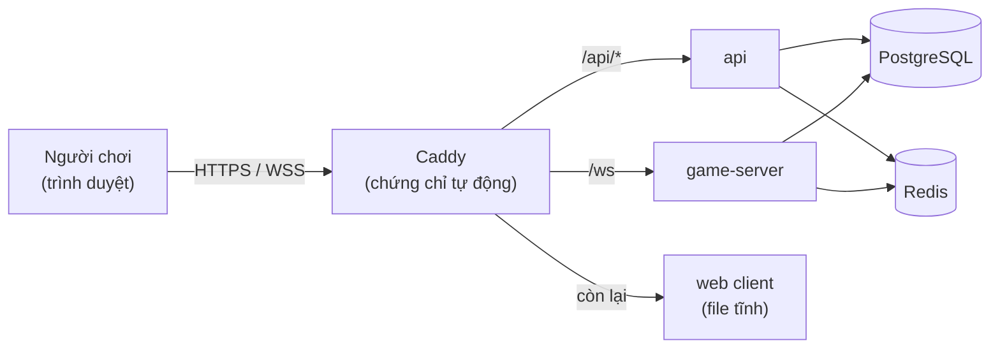

# Hướng dẫn: dựng bản chơi thử công khai (bậc B3–B4)

> **Trạng thái:** Draft v0.1 · **Dành cho:** người vận hành đợt chơi thử 10–20 người ([roadmap §8](../product/roadmap.md)) · **Liên quan:** [developer-setup-guide](developer-setup-guide.md) · [security](../architecture/security-and-anticheat.md) · [infrastructure](../architecture/infrastructure-devops.md)

Mục tiêu: một máy chủ duy nhất chạy toàn bộ game. Người chơi mở `https://<tên miền của bạn>` trên trình duyệt, đăng ký và chơi. Các file nằm ở [`infra/playtest`](../../infra/playtest/docker-compose.yml).



## 1. Cần chuẩn bị

| Thứ cần | Gợi ý |
|---------|-------|
| Máy chủ Linux (VPS) | 2 vCPU, 4 GB RAM, 40 GB đĩa, Ubuntu 24.04. Đủ cho khoảng 20–50 người cùng lúc ở bậc này |
| Tên miền | Một tên miền phụ, ví dụ `choi.tenmien.vn`, có bản ghi **A** trỏ về IP của máy chủ |
| Cổng mở | **80** và **443** (Caddy dùng để lấy chứng chỉ HTTPS và phục vụ game). Không mở 5432 (PostgreSQL) hay 6379 (Redis) ra ngoài |
| Phần mềm | Docker Engine và Docker Compose plugin ([docs.docker.com/engine/install](https://docs.docker.com/engine/install/)), Git |

## 2. Dựng lần đầu

```bash
git clone https://github.com/thehuygnouhk/game-2d.git
```

```bash
cd game-2d && git checkout claude/beautiful-albattani-cyipbu
```

```bash
cp infra/playtest/.env.example infra/playtest/.env
```

Mở `infra/playtest/.env` và điền:
- `DOMAIN`: tên miền đã trỏ về máy;
- `POSTGRES_PASSWORD` và `JWT_SECRET`: hai chuỗi ngẫu nhiên dài, tạo bằng `openssl rand -hex 24`.

Giữ file này riêng, không gửi cho ai và không commit.

```bash
docker compose -f infra/playtest/docker-compose.yml --env-file infra/playtest/.env up -d --build
```

Lần đầu mất vài phút. Compose sẽ:
1. dựng ảnh;
2. tạo bảng trong PostgreSQL (`migrate`);
3. ghi realm "Suối Mơ" với địa chỉ `wss://<DOMAIN>/ws`;
4. bật `api`, `game-server`, và `web` (Caddy). Caddy tự xin chứng chỉ HTTPS.

**Kiểm tra:** mở `https://<DOMAIN>`, đăng ký một tài khoản, tạo nhân vật, vào game. Vào được Nhà Học Suối Mơ là xong.

## 3. Mời người chơi

- Gửi đường link `https://<DOMAIN>`. Mỗi người tự đăng ký (tên tài khoản, email, mật khẩu từ 8 ký tự).
- **Chơi được trên máy tính và trình duyệt điện thoại.** Điện thoại cầm ngang, có phím ảo:
  - cần điều khiển bên trái;
  - nút Đánh, Nhảy, Nói, ◎ bên phải;
  - kỹ năng và bình thuốc ở thanh dưới.
  
  Nút ⛶ bật toàn màn hình (Android). Trên iPhone, Safari không cho trang web toàn màn hình; nên dùng "Thêm vào Màn hình chính" để có chỗ rộng hơn.
- Nên gửi kèm phím điều khiển: A/D hoặc ← → đi, Space nhảy, W hoặc ↑ leo thang và qua cổng, J đánh, 1 Tụ Mana Chấn (Lv5), 2 kỹ năng hệ (sau Lễ Khai Thư), Q/E bình HP/MP, F nói chuyện với NPC (hái thảo dược, mở rương), B hành trang, L nhiệm vụ, C cộng điểm tiềm năng, Enter chat (nút "Khu/Thế giới" để đổi kênh).
- Nội dung hiện có (bậc B4): trọn **Chương 1** (khoảng 50 phút): 4 map của Làng Suối Mơ, NPC và 12 nhiệm vụ chính tuyến, mặc trang bị, tiệm của Lam Nhi, hầm ngục DG01 với Trang Lạc, Lễ Khai Thư chọn Hỏa hoặc Thủy. Ba boss theo giờ Việt Nam (Vua Nấm Lùn mỗi 2 giờ chẵn 08:00–22:00, Chó Rừng Đầu Đàn 11:00/17:00/21:00, Dơi Chúa Giếng 12:30/19:30); xem lịch ở Cụ Trương. Nên hẹn người chơi thử vào gần giờ boss để đánh cùng nhau.
- Nói rõ với người chơi thử:
  - game lưu tên tài khoản, email, mật khẩu đã băm (Argon2id) và tiến độ nhân vật;
  - dữ liệu có thể bị xóa khi kết thúc đợt thử.
- Gom phản hồi bằng một biểu mẫu (ví dụ Google Form): chỗ nào khó, lỗi gặp phải, thời gian chơi, có muốn chơi tiếp không.

## 4. Vận hành hằng ngày

| Việc | Lệnh (chạy trong thư mục `game-2d`) |
|------|-------------------------------------|
| Xem ai đang vào, lỗi | `docker compose -f infra/playtest/docker-compose.yml logs -f game-server api` |
| Cập nhật bản mới | `git pull` rồi chạy lại lệnh `up -d --build` ở §2. Game server lưu mọi nhân vật trước khi tắt (chờ tối đa 20 s) |
| Tạm dừng | `docker compose -f infra/playtest/docker-compose.yml stop` (dữ liệu giữ nguyên) |
| Sao lưu | `docker compose -f infra/playtest/docker-compose.yml exec -T postgres pg_dump -U htk htk > backup-$(date +%F).sql`. Nên chạy hằng ngày bằng `cron` và chép bản sao ra máy khác |
| Khôi phục | Dừng `api` và `game-server`, rồi `cat backup.sql \| docker compose -f infra/playtest/docker-compose.yml exec -T postgres psql -U htk htk` vào một cơ sở dữ liệu trống |
| Kiểm tra sổ cái | Tổng `currency_ledger` của mỗi nhân vật phải bằng `soft_currency` ([database §9](../architecture/database-schema.md)) |

## 5. An toàn

- PostgreSQL và Redis chỉ nằm trong mạng nội bộ của Compose, không mở cổng ra ngoài.
- `api` chạy với `COOKIE_SECURE=1` (cookie chỉ gửi qua HTTPS) và `TRUST_PROXY=1` (lấy IP thật qua Caddy, để giới hạn tốc độ đúng người).
- `game-server` chỉ nhận WebSocket từ trang `https://<DOMAIN>` (`ALLOWED_ORIGINS`).
- Đổi `JWT_SECRET` thì mọi người phải đăng nhập lại; không ảnh hưởng dữ liệu.
- Chưa có "quên mật khẩu" (cần dịch vụ gửi email). Người chơi quên mật khẩu thì tạo tài khoản mới.

## 6. Giới hạn đã biết (bậc B3–B4)

- Một tiến trình game server cho cả realm.
- Thoát game khi đang đánh thì nhân vật biến mất ngay (chưa giữ lại 30 giây).
- Chưa có bảng xếp hạng, nhóm, giao dịch hay chợ. Hầm ngục DG01 vào một mình; phần làm gọn khác ở [roadmap §8.3](../product/roadmap.md).
- Docker Compose của bộ này chưa được dựng thử trên máy thật trong quá trình phát triển (môi trường làm việc không có Docker). Các thành phần đã được chạy riêng lẻ: bản build của `api`, `game-server`, web client, migration trên PostgreSQL 16, Redis 7. Lần dựng đầu nên làm theo §2 và kiểm tra kỹ.
