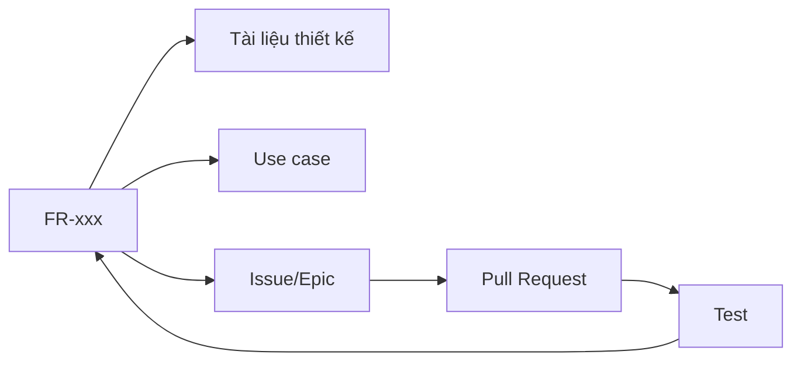

# Yêu cầu hệ thống (Requirements)

> **Trạng thái:** Draft v0.1 · **Liên quan:** [vision](vision-and-scope.md) · [roadmap](roadmap.md) · [use cases](../usecases/use-cases-player.md)
> **Ưu tiên:** P0 = bắt buộc cho phase đó, P1 = nên có, P2 = có thể hoãn. **Phase:** 1 = Vertical Slice, 2 = Alpha, 3 = Beta, 4 = Launch.

## 1. Yêu cầu chức năng (FR)

### 1.1 Tài khoản & Xác thực (AUTH)

| ID | Yêu cầu | Ưu tiên | Phase |
|----|---------|---------|-------|
| FR-AUTH-01 | Đăng ký bằng tên đăng nhập + email + mật khẩu | P0 | 1 |
| FR-AUTH-02 | Đăng nhập, phiên làm việc có thời hạn, làm mới token | P0 | 1 |
| FR-AUTH-03 | Quên/đổi mật khẩu qua email | P0 | 2 |
| FR-AUTH-04 | Xác thực số điện thoại hoặc định danh theo quy định | P0 | 4 |
| FR-AUTH-05 | Bảo mật 2 lớp tùy chọn | P1 | 4 |
| FR-AUTH-06 | Khóa tài khoản và giới hạn đăng nhập sai | P0 | 1 |
| FR-AUTH-07 | Chống đăng nhập đa thiết bị cùng lúc (đá phiên cũ) | P0 | 1 |

### 1.2 Nhân vật (CHAR)

| ID | Yêu cầu | Ưu tiên | Phase |
|----|---------|---------|-------|
| FR-CHAR-01 | Tạo tối đa 3 nhân vật/máy chủ; chọn tên, giới tính, ngoại hình, xuất thân | P0 | 1 |
| FR-CHAR-02 | Tên duy nhất theo máy chủ, kiểm tra từ cấm | P0 | 1 |
| FR-CHAR-03 | Xóa nhân vật có thời gian chờ 7 ngày | P1 | 2 |
| FR-CHAR-04 | Chọn hệ phép ở Lv10 qua Lễ Nhận Ma Đạo Thư | P0 | 1 |
| FR-CHAR-05 | Hệ thống EXP, lên cấp, cấp tối đa 100 | P0 | 1 |
| FR-CHAR-06 | Cộng Điểm Tiềm Năng, reset bằng vật phẩm | P0 | 1 |
| FR-CHAR-07 | Tính Lực Chiến và hiển thị | P1 | 2 |
| FR-CHAR-08 | Đổi hệ phép, Khe Ma Đạo Thư | P1 | 4 |
| FR-CHAR-09 | Hạng/danh hiệu theo cấp | P2 | 3 |

### 1.3 Thế giới & Di chuyển (WORLD)

| ID | Yêu cầu | Ưu tiên | Phase |
|----|---------|---------|-------|
| FR-WORLD-01 | Hiển thị map tilemap cuộn ngang, nhiều lớp parallax | P0 | 1 |
| FR-WORLD-02 | Di chuyển, nhảy, nền một chiều, leo thang | P0 | 1 |
| FR-WORLD-03 | Cổng chuyển map, chuyển Khu, tự cân bằng số người | P0 | 1 |
| FR-WORLD-04 | Thấy người chơi khác trong tầm (AOI) | P0 | 1 |
| FR-WORLD-05 | Dịch chuyển (Finral), Cuộn Dịch Chuyển | P1 | 3 |
| FR-WORLD-06 | Ngày/đêm, thời tiết hiển thị | P2 | 4 |
| FR-WORLD-07 | Vùng Trời cho Chổi Bay | P2 | 4 |
| FR-WORLD-08 | Instance cho hầm ngục, Squad Hall | P0 | 3 |

### 1.4 Chiến đấu & Kỹ năng (CMB)

| ID | Yêu cầu | Ưu tiên | Phase |
|----|---------|---------|-------|
| FR-CMB-01 | Đòn thường, kỹ năng với MP và hồi chiêu | P0 | 1 |
| FR-CMB-02 | Công thức sát thương, chí mạng, khắc hệ | P0 | 1 |
| FR-CMB-03 | Hiệu ứng trạng thái (Cháy, Độc, Choáng, …) | P0 | 2 |
| FR-CMB-04 | AI quái: aggro, đuổi, quay về | P0 | 1 |
| FR-CMB-05 | Boss có pha, báo hiệu, cuồng nộ | P0 | 3 |
| FR-CMB-06 | Rơi đồ, nhặt đồ, quyền nhặt | P0 | 1 |
| FR-CMB-07 | Chết và hồi sinh, mất EXP | P0 | 1 |
| FR-CMB-08 | Spirit Dive và Spirit Gauge | P1 | 4 |
| FR-CMB-09 | Auto Hunt do server điều khiển | P1 | 3 |
| FR-CMB-10 | Hệ ẩn Phản Ma | P1 | 4 |

### 1.5 Vật phẩm & Trang bị (ITM)

| ID | Yêu cầu | Ưu tiên | Phase |
|----|---------|---------|-------|
| FR-ITM-01 | Túi đồ, kho, sắp xếp, khóa vật phẩm | P0 | 1 |
| FR-ITM-02 | Trang bị 10 ô, hiển thị lên nhân vật (paper-doll) | P0 | 1 |
| FR-ITM-03 | Độ hiếm và dòng phụ ngẫu nhiên | P0 | 2 |
| FR-ITM-04 | Cường hóa +1…+16, bảo hộ, pity | P0 | 2 |
| FR-ITM-05 | Khảm và ghép Linh Thạch Ngọc | P1 | 3 |
| FR-ITM-06 | Chế tạo | P1 | 3 |
| FR-ITM-07 | Set bonus | P1 | 3 |
| FR-ITM-08 | Vật phẩm hết hạn | P1 | 3 |
| FR-ITM-09 | Tiến hóa Ma Đạo Thư 3/4/5 lá | P1 | 3 |

### 1.6 Nhiệm vụ (QST)

| ID | Yêu cầu | Ưu tiên | Phase |
|----|---------|---------|-------|
| FR-QST-01 | Nhận, theo dõi và trả nhiệm vụ tại NPC | P0 | 1 |
| FR-QST-02 | Chuỗi nhiệm vụ chính 8 chương | P0 | 1→4 |
| FR-QST-03 | Nhiệm vụ ngày/tuần, làm mới 00:00 | P0 | 2 |
| FR-QST-04 | Nhiệm vụ phe, Danh Vọng | P1 | 3 |
| FR-QST-05 | Thành tích và Sao | P1 | 3 |
| FR-QST-06 | Auto-path đến mục tiêu | P1 | 2 |
| FR-QST-07 | Cutscene bằng thoại/hình nền | P0 | 1 |

### 1.7 Xã hội (SOC)

| ID | Yêu cầu | Ưu tiên | Phase |
|----|---------|---------|-------|
| FR-SOC-01 | Chat Map, Thế giới, Thì thầm, Hệ thống | P0 | 1 |
| FR-SOC-02 | Chat Nhóm, Squad | P0 | 2 |
| FR-SOC-03 | Bạn bè, chặn | P1 | 2 |
| FR-SOC-04 | Thư, đính kèm | P1 | 2 |
| FR-SOC-05 | Nhóm 5 người, chia EXP, nhặt đồ | P0 | 2 |
| FR-SOC-06 | Báo cáo người chơi | P1 | 3 |

### 1.8 Squad (SQD)

| ID | Yêu cầu | Ưu tiên | Phase |
|----|---------|---------|-------|
| FR-SQD-01 | Lập, mời, rời, đuổi, chức vụ | P0 | 3 |
| FR-SQD-02 | Cấp Squad, Điểm Cống Hiến, buff | P0 | 3 |
| FR-SQD-03 | Squad Hall, kho Đội | P1 | 3 |
| FR-SQD-04 | Squad War | P1 | 4 |

### 1.9 PvP & Sự kiện (PVP / EVT)

| ID | Yêu cầu | Ưu tiên | Phase |
|----|---------|---------|-------|
| FR-PVP-01 | Thách đấu 1v1 | P1 | 3 |
| FR-PVP-02 | Đấu Trường xếp hạng | P1 | 4 |
| FR-PVP-03 | Chiến Trường Vương Quốc | P1 | 4 |
| FR-PVP-04 | Cờ PK và Điểm Tội Lỗi | P1 | 3 |
| FR-EVT-01 | Boss thế giới theo lịch | P0 | 3 |
| FR-EVT-02 | Sự kiện thế giới (Mắt Mặt Trời Nửa Đêm) | P1 | 4 |
| FR-EVT-03 | Săn 7 Linh Thạch Sao | P2 | 4 |
| FR-EVT-04 | Sự kiện mùa cấu hình được | P1 | 4 |

### 1.10 Kinh tế & Thanh toán (ECO / PAY)

| ID | Yêu cầu | Ưu tiên | Phase |
|----|---------|---------|-------|
| FR-ECO-01 | Cửa hàng NPC mua/bán | P0 | 1 |
| FR-ECO-02 | Giao dịch trực tiếp an toàn | P0 | 2 |
| FR-ECO-03 | Chợ Ký Gửi bằng Yul | P1 | 3 |
| FR-ECO-04 | Vòng Quay với tỉ lệ công khai | P1 | 4 |
| FR-ECO-05 | Sổ cái tiền tệ (ledger) | P0 | 2 |
| FR-PAY-01 | Nạp Ngọc Mana qua cổng thanh toán | P0 | 3 |
| FR-PAY-02 | Webhook idempotent, đối soát | P0 | 3 |
| FR-PAY-03 | Thẻ Tháng, Battle Pass | P1 | 4 |
| FR-PAY-04 | Giới hạn nạp theo độ tuổi | P0 | 4 |

### 1.11 Đồng hành (COMP)

| ID | Yêu cầu | Ưu tiên | Phase |
|----|---------|---------|-------|
| FR-COMP-01 | Hiệp Sĩ Tập Sự chiến đấu cùng | P1 | 3 |
| FR-COMP-02 | Tinh Linh Hộ Mệnh | P2 | 4 |
| FR-COMP-03 | Chổi Bay | P2 | 4 |

### 1.12 Quản trị & Vận hành (ADM)

| ID | Yêu cầu | Ưu tiên | Phase |
|----|---------|---------|-------|
| FR-ADM-01 | Đăng nhập admin có phân quyền (RBAC) | P0 | 3 |
| FR-ADM-02 | Tra cứu tài khoản, nhân vật, vật phẩm, log | P0 | 3 |
| FR-ADM-03 | Khóa/mở khóa, mute | P0 | 3 |
| FR-ADM-04 | Gửi thư hệ thống, tặng vật phẩm | P0 | 3 |
| FR-ADM-05 | Cấu hình sự kiện, rate EXP/drop không cần deploy | P1 | 4 |
| FR-ADM-06 | Rollback nhân vật theo snapshot | P1 | 4 |
| FR-ADM-07 | Dashboard chỉ số kinh doanh và kỹ thuật | P1 | 4 |
| FR-ADM-08 | Bảo trì có thông báo và drain | P0 | 3 |

## 2. Yêu cầu phi chức năng (NFR)

| ID | Hạng mục | Yêu cầu | Cách đo |
|----|----------|---------|---------|
| NFR-PERF-01 | Độ trễ mạng | p95 round-trip ≤ 150 ms (VN) | APM, ping client |
| NFR-PERF-02 | Tick server | 20 Hz, mỗi tick ≤ 30 ms (p99 ≤ 45 ms) | Metrics tick |
| NFR-PERF-03 | FPS client | ≥ 50 FPS trên PC tầm trung, ≥ 30 FPS trên mobile 2 GB RAM | Test thiết bị |
| NFR-PERF-04 | Tải ban đầu | ≤ 5 MB đến màn hình đăng nhập, ≤ 20 s trên 4G | Lighthouse, thử nghiệm |
| NFR-CAP-01 | Sức chứa | 5.000 CCU/máy chủ ở Launch | Load test |
| NFR-CAP-02 | Khu | 30 người/khu, 25 khu/map | Cấu hình |
| NFR-AVAIL-01 | Sẵn sàng | ≥ 99,5% (không tính bảo trì có báo trước) | Uptime monitor |
| NFR-DATA-01 | Mất dữ liệu | RPO ≤ 5 phút, RTO ≤ 60 phút | Diễn tập khôi phục |
| NFR-SEC-01 | Server là nguồn chân lý | Mọi sát thương, vị trí, vật phẩm do server quyết định | Review + test |
| NFR-SEC-02 | Mật khẩu | Băm argon2id | Review |
| NFR-SEC-03 | Truyền tải | HTTPS/WSS bắt buộc | Quét cấu hình |
| NFR-SEC-04 | Giao dịch | Mọi chuyển tài sản trong 1 transaction, có idempotency | Test |
| NFR-COMPAT-01 | Trình duyệt | Chrome ≥ 100, Safari ≥ 15, Firefox ≥ 100, Edge ≥ 100 | Ma trận test |
| NFR-COMPAT-02 | Thiết bị | Android 8+, iOS 14+, RAM ≥ 2 GB | Ma trận test |
| NFR-OBS-01 | Giám sát | Metrics, log, trace, alert cho các chỉ số chính | Dashboard |
| NFR-I18N-01 | Ngôn ngữ | Chuỗi nằm trong file i18n, hỗ trợ `vi`, `en` | Lint |
| NFR-A11Y-01 | Tiếp cận | Chế độ mù màu, cỡ chữ, giảm chuyển động | Kiểm thử |
| NFR-MAINT-01 | Dữ liệu nội dung | Nội dung nằm trong file dữ liệu, có schema và validator | CI |
| NFR-TEST-01 | Kiểm thử | Công thức chiến đấu và tiền tệ phủ ≥ 90% | Coverage |
| NFR-LEGAL-01 | Tuân thủ | Theo [legal](legal-and-compliance.md) | Checklist |

## 3. Truy vết (Traceability)

Mỗi FR phải ánh xạ tới:

- Tài liệu thiết kế game (`docs/game-design/*`)
- Use case (`docs/usecases/*`)
- Epic/issue trong backlog (tiền tố `FR-…`)
- Test case (nhãn `FR-…` trong tên test)

