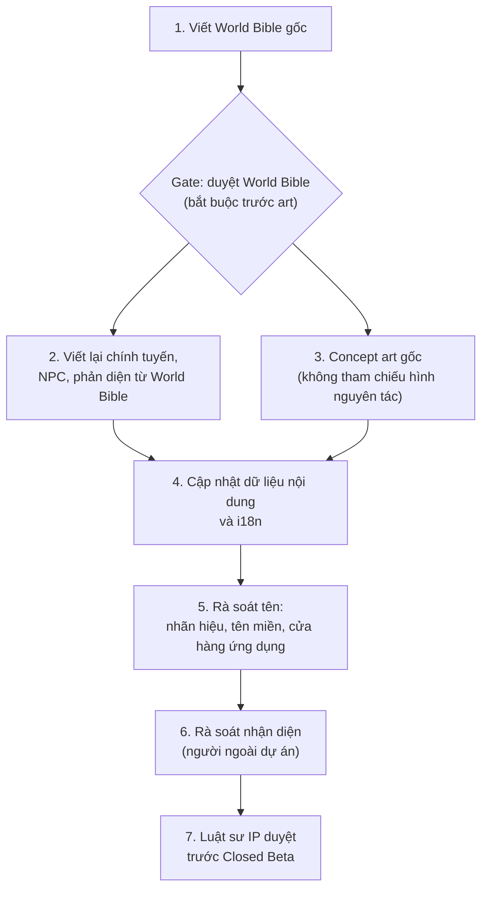

# Kế hoạch Reskin: thương mại với IP gốc thay thế

> **Trạng thái:** Draft v0.1 · **Quyết định:** đã chọn hướng **thương mại với IP gốc thay thế** · **Liên quan:** [legal-and-compliance](legal-and-compliance.md) · [vision §9](vision-and-scope.md) · [roadmap](roadmap.md)
>
> **Quan trọng:** Đây là kế hoạch làm việc, **không phải tư vấn pháp lý**. Trước Closed Beta, hãy để **luật sư sở hữu trí tuệ** xem xét sản phẩm cuối cùng, không chỉ tài liệu này.

## 1. Kết luận ngắn

**Đổi tên nhân vật và NPC là chưa đủ.** Thương mại hóa an toàn nghĩa là làm ra một **tác phẩm khác về thực chất**: thế giới, nhân vật, cốt truyện, tổ chức, hình ảnh và thuật ngữ đặc trưng đều phải do bạn sáng tạo. Cái giữ lại được là **cơ chế game** và **các ý tưởng chung**.

### 1.1 Ba lớp bảo hộ

| Lớp | Bảo hộ cái gì | Hệ quả cho dự án |
|-----|---------------|------------------|
| **Ý tưởng, cơ chế, quy tắc** | Thường **không** được bảo hộ bản quyền | Dùng tự do: chọn hệ, cường hóa, bang hội, hầm ngục, vòng khắc nguyên tố, công thức, kinh tế |
| **Cách thể hiện cụ thể** (bản quyền) | Nhân vật, cốt truyện chi tiết, thiết kế hình ảnh, văn bản, nhạc, mã nguồn | **Phải làm mới**, kể cả khi đã đổi tên |
| **Tên, logo, nhận diện** (nhãn hiệu) | Tên tác phẩm, tên nhân vật, biểu tượng, cách trình bày | Không dùng, không dùng gần giống, không dùng làm từ khóa quảng cáo |

### 1.2 Vì sao "tìm và thay tên" không đủ

Nếu một người hâm mộ nhìn vào game và nhận ra *"nhân vật này là X, cốt truyện này là arc Y, đội này là đội Z"* thì sản phẩm vẫn là bản phái sinh, dù tên đã đổi. Cụ thể, bản thiết kế hiện tại của chúng ta **bám sát** nguyên tác ở các điểm sau, và đây là phần **phải thiết kế lại, không phải đổi tên**:

| Điểm bám sát | Vì sao là rủi ro |
|--------------|------------------|
| 8 chương theo **đúng thứ tự các arc** của nguyên tác | Trình tự sự kiện là một phần của cách thể hiện cốt truyện |
| Nhân vật gốc làm NPC với **đúng tính cách và vai trò** (kể cả "Sơ Lily", "Cha Orsi" cũng là nhân vật gốc) | Nhân vật được bảo hộ độc lập với tên gọi |
| Mô-típ "hai đứa trẻ cùng hứa thành người mạnh nhất; một đứa không có phép" | Là hạt nhân của câu chuyện gốc |
| Hệ ẩn "không dùng mana, cầm kiếm chém tan phép, gắn với quỷ" | Là dấu ấn nhận diện của nhân vật chính |
| 9 Đội theo mẫu "con vật + màu", đội "bị coi là thất bại nhưng đoàn kết" | Danh sách cụ thể là cách thể hiện; bản sao thì bị coi là sao chép |
| Tên kỹ năng và hệ thống dịch sát (Long Tức Biển, Giáp Valkyrie, Lôi Thần Chi Hài, Mana Skin, Spirit Dive…) | Là thuật ngữ và tên chiêu thức đặc trưng |

## 2. Phép thử nhận diện

Trước khi chốt bất kỳ nhân vật, tổ chức, địa danh hay cốt truyện nào, hỏi:

1. Một fan Black Clover có **nhận ra ngay** đó là nhân vật/địa danh/sự kiện nào không?
2. Nếu bỏ hết tên gọi, **tính cách, quan hệ, vai trò, ngoại hình** có còn trùng không?
3. Nếu kể tóm tắt cốt truyện bằng ba câu, đó có phải là ba câu tóm tắt của nguyên tác không?

Chỉ cần một câu trả lời "có" là **chưa đạt**.

## 3. Những thứ cần đổi

Quy mô hiện tại: tôi đếm được **hơn 700 chỗ** nhắc tên hoặc chi tiết gắn với IP gốc, nằm ở **31/35 file** tài liệu, dồn nhiều nhất ở cốt truyện, NPC, bản đồ, kỹ năng và nhiệm vụ.

| # | Nhóm | Hiện trạng trong tài liệu | Yêu cầu | Mức |
|---|------|---------------------------|---------|-----|
| 1 | **Tên game và nhận diện** | "Black Clover", "Clover", biểu tượng cỏ bốn lá, ma đạo thư gắn số lá | Tên gốc, logo gốc, biểu tượng gốc; **không** chứa "Clover" hay gần giống | Thiết kế lại |
| 2 | **Nhân vật và NPC** | ~45 NPC, phần lớn là nhân vật gốc | Nhân vật mới hoàn toàn: ngoại hình, tính cách, quá khứ, quan hệ riêng | Thiết kế lại |
| 3 | **Phản diện và boss cốt truyện** | Bộ Ba Hắc Ám, các họ phản diện, ba quỷ, tổ chức khủng bố | Phản diện mới gắn với xung đột trung tâm của thế giới mới | Thiết kế lại |
| 4 | **Địa danh và quốc gia** | Làng Hage, bốn vương quốc, Rừng Phù Thủy, Thủy Cung, Rừng Tinh Linh, Cõi Quỷ | Bản đồ thế giới mới với bản sắc riêng; không giữ bộ khung bốn vương quốc theo chất bài | Đổi và thiết kế |
| 5 | **Tổ chức** | 9 Đội Hiệp Sĩ, Hiệp Sĩ Phép Thuật, Vua Phép Thuật | Tổ chức mới, cấu trúc cấp bậc và biểu tượng riêng | Thiết kế lại |
| 6 | **Cốt truyện** | 8 chương theo trình tự arc gốc | Viết từ World Bible mới, **không** dựa dàn ý arc gốc | Viết lại |
| 7 | **Thuật ngữ và hệ thống đặc trưng** | Ma Đạo Thư (lá), Mana Skin, Mana Zone, Spirit Dive, Phản Ma và bộ kiếm, Yul, Sao và Lễ Trao Sao | Thuật ngữ mới; nếu là điểm nhận diện (như hệ Phản Ma) thì **đổi cả cơ chế**, không chỉ tên | Đổi tên + đổi cơ chế |
| 8 | **Tên kỹ năng, trang bị, set** | Chiêu thức theo tên gốc; set trang bị đặt theo 8 Đội | Tên chiêu và set mới theo thế giới mới | Đổi tên |
| 9 | **Nghệ thuật, âm nhạc, giao diện** | Chưa sản xuất. Quy tắc "không dùng tài sản gốc" đã có | Thêm: **không vẽ theo dáng nhân vật gốc** (tóc, áo, vũ khí đặc trưng); nhạc và âm thanh gốc | Làm mới |
| 10 | **Marketing, SEO, cộng đồng** | — | Không dùng tên tác phẩm/nhân vật làm từ khóa, tag, hashtag, tên kênh; **không** quảng cáo "giống Ngọc Rồng/Ninja School" | Quy tắc |

## 4. Những thứ giữ được

| Giữ | Ghi chú |
|-----|---------|
| **Toàn bộ cơ chế Ninja School/NRO** | Chọn hệ, điểm tiềm năng, cường hóa, khảm ngọc, bang hội, hầm ngục, boss thế giới, PvP, Auto Hunt, nhóm, chợ, vòng quay |
| 7 hệ nguyên tố và vòng khắc | Hỏa, Thủy, Phong, Lôi, Thổ, Mộc, Ám là khái niệm chung |
| Vai trò, công thức, số liệu cân bằng | Do chúng ta tự thiết kế |
| Kinh tế, giao thức, cơ sở dữ liệu, kiến trúc | Không phụ thuộc IP |
| **Tứ Linh nguyên tố** (Salamander, Undine, Sylph, Gnome) và Dryad | Hình tượng thần thoại dân gian, dùng tự do |
| Mô-típ chung | Trẻ mồ côi, hội kỵ sĩ ma thuật, kỳ thi tuyển, tinh linh, quỷ, phù thủy, chổi bay |

**Lưu ý với cơ chế gốc Ninja School/NRO:** cơ chế thì dùng được, nhưng **tên riêng, giao diện, hình ảnh, dữ liệu cụ thể** của hai game đó thì không. Ngọc Rồng còn bắt nguồn từ một IP khác, nên tuyệt đối không dùng các yếu tố đặc trưng của nó.

## 5. Quy trình thực hiện

| Bước | Nội dung | Đầu ra |
|------|----------|--------|
| **1. World Bible** | Bối cảnh, **xung đột trung tâm**, 3–4 thế lực, khoảng 10 nhân vật chủ chốt (ngoại hình, tính cách, mục tiêu, quan hệ), hệ thống phép riêng, tên game | Tài liệu 10–20 trang, được duyệt |
| **2. Viết lại nội dung** | Chính tuyến, NPC, phản diện, tên map/boss/kỹ năng, từ World Bible. Giữ **chức năng** NPC (dịch chuyển, kho, chế tạo…), đổi **danh tính** | Bản mới của các file nội dung |
| **3. Concept art** | Nhân vật, trang phục, biểu tượng thế lực, UI. Lưu **hồ sơ phát triển** (phác thảo, ngày, người làm) | Bộ concept, hồ sơ |
| **4. Dữ liệu** | Sửa `packages/content` và `i18n`. ID kỹ thuật (`M001`, `NPC001`, `SKL_FIRE_1`…) **đã trung tính**, giữ nguyên | Bản dữ liệu mới, validator xanh |
| **5. Tên** | Tra cứu nhãn hiệu (Cục Sở hữu trí tuệ Việt Nam và thị trường mục tiêu), tên miền, tên trên cửa hàng ứng dụng; tránh "Clover", "Bull", "Grimoire" kèm lá | Báo cáo tra cứu |
| **6. Rà soát nhận diện** | Cho người **ngoài dự án**, biết Black Clover, xem nhân vật/cốt truyện/tên. Áp dụng [phép thử](#2-phép-thử-nhận-diện) | Danh sách điểm giống cần sửa |
| **7. Pháp lý** | Luật sư IP duyệt sản phẩm; kiểm tra hợp đồng chuyển giao quyền (họa sĩ, nhạc sĩ, biên kịch, freelancer), giấy phép phông và thư viện | Xác nhận bằng văn bản |

### 5.1 Thời điểm: làm ngay ở Phase 0, trước khi sản xuất art

Mỗi sprite, chân dung, logo và đoạn thoại làm cho phiên bản cũ đều phải bỏ đi khi reskin. Vì vậy:

- **World Bible và tên game được chốt trước khi vẽ bất cứ thứ gì.** Đã thêm vào [roadmap Phase 0](roadmap.md).
- Phần **kỹ thuật** (client, server, DB, giao thức) **không phụ thuộc IP**, nên chạy song song, **không làm chậm lộ trình**.
- Chỉ phần **nội dung và art** chờ World Bible.

## 6. Cách tổ chức tài liệu và repo

| Quyết định | Lý do |
|------------|-------|
| Coi bộ tài liệu hiện tại là **bản tham khảo nội bộ** (fan edition), **không** phát hành | Nó ghi rõ nguồn cảm hứng và bám nguyên tác |
| **Viết lại** các file nội dung từ World Bible thay vì sửa từng chỗ | Sửa chữa không xóa được sự tương đồng về cấu trúc và tính cách |
| Khi bắt đầu viết bản thương mại, tách thành thư mục/nhánh riêng (ví dụ `archive/fan-edition/`) hoặc repo riêng; bản thương mại **không chứa** tên và chi tiết IP gốc | Giữ ranh giới rõ ràng giữa hai bản |
| Giữ ID kỹ thuật trung tính, đưa mọi tên hiển thị vào i18n | Đã làm; giúp thay tên không đụng mã nguồn |
| Không thêm nội dung mới mang tên/tình tiết IP gốc vào bản thương mại | Đã ghi trong [CLAUDE.md](../../CLAUDE.md) |

### 6.1 Tác động lên từng tài liệu

| Tài liệu | Hành động |
|----------|-----------|
| [01 lore](../game-design/01-lore-and-story.md) | **Viết lại hoàn toàn** từ World Bible |
| [02 characters](../game-design/02-characters-and-npcs.md) | **Viết lại hoàn toàn**; giữ bảng *chức năng NPC* (dịch chuyển, kho, chế tạo, đấu trường…) và gán nhân vật mới |
| [03 classes](../game-design/03-origins-classes-skills.md) | Giữ cấu trúc và số liệu; đổi tên kỹ năng, Spirit Dive, Mana Skin, Ma Đạo Thư; **thiết kế lại hệ ẩn** |
| [05 maps](../game-design/05-world-maps-monsters.md) | Giữ cấu trúc, cấp, số liệu; đổi tên map/quái/boss cốt truyện |
| [06 quests](../game-design/06-quests-and-missions.md) | **Viết lại chính tuyến**; nhiệm vụ ngày/tuần giữ nguyên |
| [07 items](../game-design/07-items-and-equipment.md) | Đổi tên set (đang đặt theo các Đội) và vật phẩm đặc trưng |
| [08 economy](../game-design/08-economy-and-monetization.md) | Đổi tên tiền tệ (Yul), hệ Sao; cơ chế giữ nguyên |
| [09 social](../game-design/09-social-squad-pvp-events.md) | Đổi tên sự kiện/phe; cơ chế giữ nguyên |
| [10 companions](../game-design/10-companions-and-mounts.md) | Gần như giữ; đổi liên kết Spirit Dive |
| [11 UI](../game-design/11-ui-ux-spec.md), [12 art](../game-design/12-art-audio-direction.md) | Đổi chuỗi hiển thị; thêm quy tắc "không tham chiếu hình gốc" |
| [vision](vision-and-scope.md), [README](../../README.md), [glossary](../glossary.md) | Cập nhật tên và tuyên bố |
| [architecture/](../architecture/system-architecture.md), [workflows/](../workflows/development-workflow.md) | **Gần như không đổi** |

## 7. Điều cần quyết định khi viết World Bible

| Câu hỏi | Gợi ý |
|---------|-------|
| **Tông và bối cảnh** | Giữ "pháp thuật + kỵ sĩ + tinh linh + quỷ" thì gần nguyên tác. Cân nhắc **một bối cảnh khác biệt rõ** (ví dụ lấy cảm hứng văn hóa Việt hoặc Đông Nam Á) để dễ tạo bản sắc riêng |
| **Xung đột trung tâm** | Phải khác nguyên tác. Tránh lặp lại mô-típ "kẻ bị coi thường đứng đầu hội hiệp sĩ" |
| **Nhân vật người chơi** | Là người chơi tự tạo, không đặt họ cạnh cặp bạn thân "hứa thành người mạnh nhất" |
| **Hệ ẩn endgame** | Thay hệ "chém tan phép/quỷ" bằng một ý tưởng khác (ví dụ một hệ dựa trên lời thề, hoặc kết hợp hai nguyên tố) |
| **Tên game** | Ngắn, gốc, tra cứu nhãn hiệu sạch, đăng ký được tên miền |
| **Hệ thống tiền tệ, danh vọng** | Tên và biểu tượng mới, giữ cơ chế |

## 8. Danh sách kiểm tra trước Closed Beta

- [ ] World Bible được duyệt trước khi sản xuất art
- [ ] Không còn tên, nhân vật, địa danh, tổ chức, thuật ngữ của IP gốc trong **dữ liệu, i18n, art, âm thanh, marketing**
- [ ] Cốt truyện không theo trình tự và tình tiết của nguyên tác
- [ ] Hệ ẩn endgame đã được thiết kế lại về cơ chế và chủ đề
- [ ] Phép thử nhận diện được thực hiện bởi người ngoài dự án
- [ ] Tra cứu nhãn hiệu, tên miền, tên cửa hàng ứng dụng sạch
- [ ] Hợp đồng chuyển giao quyền với toàn bộ người sáng tạo; hồ sơ phát triển độc lập đầy đủ
- [ ] Rà soát giấy phép phông, thư viện, âm nhạc
- [ ] Luật sư IP duyệt và xác nhận

## 9. Rủi ro còn lại

| Rủi ro | Giảm thiểu |
|--------|-----------|
| Vẫn quá giống về "cảm giác tổng thể" dù đã đổi chi tiết | Phép thử nhận diện, bối cảnh khác biệt rõ ngay từ World Bible |
| Chủ sở hữu IP phản đối | Làm khác về thực chất; luật sư duyệt; sẵn sàng sửa nhanh |
| Mất công vì làm art trước khi chốt thế giới | **Gate World Bible trước art** |
| Cơ chế bị coi là sao chép game khác | Không dùng tên riêng, giao diện, dữ liệu, tài sản của Ninja School/NRO; không quảng cáo "giống" |
