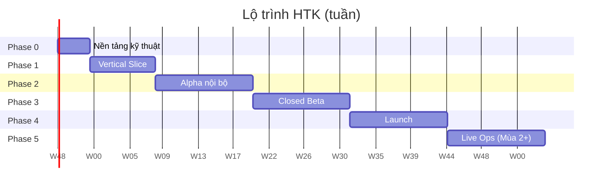

# Lộ trình (Roadmap)

> **Trạng thái:** Draft v0.1 · **Giả định:** đội 6–8 người, bắt đầu **Tuần 1 = bắt đầu Phase 0**. Các mốc là **ước lượng** để lập kế hoạch, điều chỉnh sau mỗi phase.

## 1. Đội ngũ giả định

| Vai trò | Số người | Ghi chú |
|---------|----------|---------|
| Producer / PM | 1 | Kiêm QA điều phối |
| Game Designer / Narrative | 1 | Cân bằng, nội dung, kịch bản |
| Backend / Server | 2 | Game server, DB, thanh toán |
| Client | 2 | Phaser, UI |
| Artist (pixel, animation) | 2 | 1 nhân vật/quái, 1 map/UI/VFX |
| DevOps / QA (bán thời gian) | 1 | CI/CD, giám sát, kiểm thử |

## 2. Dòng thời gian

## 3. Các Phase

### Phase 0 — Nền tảng (4 tuần)

| Hạng mục | Chi tiết |
|----------|----------|
| Kỹ thuật | Monorepo, CI, lint/test, Docker Compose, schema DB v0 |
| Mạng | WebSocket skeleton, giao thức binary, tick loop 20 Hz |
| Client | Phaser boot, tải map Tiled, di chuyển có dự đoán |
| Đặc tả reskin | **[reskin-spec](reskin-spec.md)** (giữ concept, đổi tên + 6 điểm nhận diện). **Đã xong:** đặt tên 40 NPC, 31 bản đồ, 30 boss, đổi định danh kỹ thuật (Bước 2). **Còn lại:** duyệt các mục ở §9, đối chiếu độc lập, tra cứu nhãn hiệu. Chạy **song song** với phần kỹ thuật. **Art chỉ bắt đầu sau khi §9 được duyệt** |
| Nội dung | Style guide, nhân vật mẫu, bảng màu (sau khi đặc tả được duyệt) |
| **Tiêu chí hoàn thành** | 2 client cùng thấy nhau di chuyển trên M001, ping < 100 ms cục bộ, CI xanh; **đặc tả reskin được duyệt** |

### Phase 1 — Vertical Slice (8 tuần)

| Hạng mục | Chi tiết |
|----------|----------|
| Gameplay | Chiến đấu cơ bản, AI quái, rơi đồ, Hỏa & Thủy 3 kỹ năng đầu |
| Hệ thống | Túi đồ, trang bị 4 ô, nhiệm vụ Chương 1, Lễ Khai Thư |
| Nội dung | M001–M005, 7 quái R01, Trang Lạc, 3 boss theo giờ R01, 12 nhiệm vụ |
| Hạ tầng | Đăng ký/đăng nhập, lưu nhân vật, 1 realm dev |
| **Tiêu chí hoàn thành** | Playtest 30 phút liền mạch với 20 người, không crash, load test 50 CCU, retention test nội bộ ≥ 60% hoàn thành Chương 1 |

### Phase 2 — Alpha nội bộ (12 tuần)

| Hạng mục | Chi tiết |
|----------|----------|
| Gameplay | 7 hệ phép, cấp 1–60, hiệu ứng trạng thái |
| Hệ thống | Nhóm, bạn bè, thư, giao dịch, cường hóa, chat đầy đủ |
| Nội dung | R01–R05, Chương 1–4, nhiệm vụ ngày |
| Hạ tầng | Staging, giám sát cơ bản, backup tự động |
| **Tiêu chí** | 200 CCU, 0 lỗi mất dữ liệu trong 2 tuần, bộ test công thức pass, kinh tế mô phỏng ổn định |

### Phase 3 — Closed Beta (12 tuần)

| Hạng mục | Chi tiết |
|----------|----------|
| Gameplay | Đội, Hầm Ngục, Boss thế giới, PK, Auto Hunt, Khảm ngọc, Chợ |
| Thương mại | Nạp **sandbox → production**, Thẻ Tháng |
| Công cụ | Admin panel, GM tool, ledger, dashboard |
| Bảo mật | Anti-cheat v1, rate limit, captcha |
| **Tiêu chí** | 1.000 CCU load test, D1 ≥ 35%, crash < 2%, thanh toán đối soát đúng 100% |

### Phase 4 — Launch (12 tuần)

| Hạng mục | Chi tiết |
|----------|----------|
| Gameplay | Cấp 100, Chương 5–8, Raid, Chiến Trường, Chiến Đội, Phong Ấn Xạ Thủ, Nhập Linh |
| Nền tảng | Android/iOS wrapper, tối ưu hiệu năng |
| Vận hành | Sự kiện mùa, Battle Pass, hạn mức nạp theo độ tuổi |
| Tuân thủ | Giấy phép, xác thực tài khoản, chính sách (xem [legal](legal-and-compliance.md)) |
| **Tiêu chí** | 5.000 CCU load test, p95 ≤ 150 ms, uptime thử ≥ 99,5%, bảo mật được đánh giá độc lập |

### Phase 5 — Live Ops (liên tục)

- **Mùa 2:** nâng cấp tối đa lên 120, khu vực mới, hệ phép mới.
- Sự kiện hàng tuần/tháng, cân bằng định kỳ, mở máy chủ mới theo CCU.
- Nội dung theo **mùa 3 tháng**.

## 4. Cột mốc nội dung

| Phase | Map | Quái | Boss | Nhiệm vụ chính | Hệ phép đầy đủ |
|-------|-----|------|------|----------------|----------------|
| 1 | 5 | 7 | 1 | 12 | 2 (3 kỹ năng) |
| 2 | 19 | 28 | 12 | 48 | 7 |
| 3 | 22 | 33 | 20 | 58 | 7 |
| 4 | 31 | 49 | 26 + 7 boss theo giờ | 90 | 7 + Phong Ấn Xạ Thủ |

## 5. Rủi ro & cách xử lý

| Rủi ro | Xác suất | Ảnh hưởng | Xử lý |
|--------|----------|-----------|-------|
| Phạm vi phình | Cao | Cao | Cắt P2 trước, mỗi phase đóng băng tính năng |
| Nghệ thuật nghẽn | Trung bình | Cao | Paper-doll tái dùng, nhờ ngoài làm VFX, palette swap |
| Hiệu năng WebSocket | Trung bình | Cao | Load test từ Phase 1, giới hạn AOI |
| Bản quyền IP | Cao | Rất cao | **Đã chọn reskin mức "đổi tên + 6 điểm nhận diện"** (rủi ro còn lại trung bình). Chốt đặc tả ở Phase 0, trước khi sản xuất art; luật sư IP duyệt trước Closed Beta. Xem [reskin-spec](reskin-spec.md) |
| Gian lận/bot | Cao | Cao | Anti-cheat từ Phase 2, log đầy đủ |
| Lạm phát kinh tế | Trung bình | Cao | Mô phỏng + giám sát + công cụ điều chỉnh |
| Mất nhân sự chủ chốt | Thấp | Cao | Tài liệu, review chéo, ADR |

## 6. Definition of Done theo hạng mục

| Loại | Điều kiện hoàn thành |
|------|----------------------|
| Tính năng | Code review, test tự động, tài liệu cập nhật, có metric, QA pass, không lỗi P0/P1 |
| Nội dung | Qua validator, playtest, i18n đầy đủ, asset đúng giới hạn dung lượng |
| Cân bằng | Có báo cáo mô phỏng và dữ liệu playtest |
| Release | Đã chạy trên staging ≥ 48h, có kế hoạch rollback |

## 7. Chỉ số theo dõi dự án

| Chỉ số | Mục tiêu |
|--------|----------|
| Velocity | Ổn định ±20% sau Phase 1 |
| Lỗi mở P0/P1 | 0 trước mỗi phase gate |
| Tỉ lệ build CI pass | ≥ 95% |
| Thời gian từ PR đến merge | ≤ 2 ngày làm việc |
| Độ phủ test (core formulas) | ≥ 90% |

## 8. Lộ trình bậc thang (làm nhỏ, chơi được, mở rộng dần)

Các Phase ở §3 tính cho đội 6–8 người. Khi làm ít người, đi theo **bậc**: mỗi bậc nhỏ, xong là **chơi được** và có thứ mới để thử, rồi mới sang bậc sau.

- **Bậc A** làm trên [bản chơi thử](../../prototype/playable/README.md) để thử cảm giác và cân bằng nhanh, rẻ.
- **Từ bậc B** chuyển sang khung dự án thật: server quyết định mọi kết quả ([CLAUDE.md](../../CLAUDE.md), quy tắc 4). Bản chơi thử dừng lại, chỉ làm mẫu tham chiếu, để không đổ thêm công vào mã sẽ bỏ.

### 8.1 Hiện có (bản chơi thử trình duyệt, 1 người)

| Đã chơi được | Chưa có |
|--------------|---------|
| Di chuyển, nhảy, leo thang, qua cổng; 4 map R01 | **Lưu game**: tải lại trang là mất hết |
| Đánh thường và 3 chiêu Hỏa, chọn mục tiêu, Tự đánh, Treo máy, phím ảo điện thoại | **Túi đồ, trang bị**: đồ rơi chỉ là con số "Túi: N món", không mặc được |
| 7 quái, Tinh anh, Thủ lĩnh, 3 boss theo giờ, Lịch Boss | **Cửa hàng**: Quan chưa tiêu được |
| EXP, lên cấp, chết mất EXP | Tạo nhân vật, chọn Xuất thân, Lễ Khai Thư chọn hệ (đang dùng nút thử), Điểm Tiềm Năng, Lực Chiến |
| Nhiệm vụ chính tuyến 1–9, bảng Nhiệm vụ, nút Đi tới | Hầm ngục DG01, Thượng Đô |
| | **Chơi cùng người khác** (thấy nhau, chat, khu, nhóm), tài khoản, server |

So với Ninja School, thiếu lớn nhất là hai thứ: **vòng lặp đồ** (rơi đồ → mặc → mạnh hơn → cường hóa) và **chơi online**.

### 8.2 Các bậc

| Bậc | Chơi được gì khi xong | Việc chính | Tài liệu |
|-----|------------------------|-----------|----------|
| **A1 Vòng lặp đồ** ✔ xong | Quái rơi vũ khí, mũ, áo, giày. Mở Túi (B), mặc vào thấy chỉ số và Lực Chiến tăng. Bán đồ thừa, mua bình. Tắt trình duyệt mở lại vẫn còn | Lưu trên máy; túi 30 ô; 4 ô trang bị (Vũ khí, Mũ, Áo, Giày); chỉ số theo công thức; Lam Nhi (chế thuốc) bán bình, mua lại đồ; Lực Chiến | [items §2–4, §10](../game-design/07-items-and-equipment.md), [ui-ux §6.1–6.2](../game-design/11-ui-ux-spec.md) |
| **A2 Nhân vật** ✔ xong | Tạo nhân vật (tên, 3 Xuất thân). Lv10 vào Lễ Khai Thư chọn Hỏa hoặc Thủy. Mỗi cấp tự cộng 5 Điểm Tiềm Năng | Màn tạo nhân vật; hệ Thủy 3 chiêu; cửa sổ Nhân vật; bỏ nút "Thử hệ Hỏa" | [classes](../game-design/03-origins-classes-skills.md), [combat §3](../game-design/04-combat-and-progression.md) |
| **A3 Hết Chương 1** ✔ xong ([báo cáo nhịp chơi](../reports/chapter1-pacing.md)) | Chơi một mình trọn Chương 1 (khoảng 1 giờ), đánh Trang Lạc trong DG01 | Hầm ngục DG01; Q_MAIN_10–12; chỉnh cân bằng theo số phút chơi thật | [maps](../game-design/05-world-maps-monsters.md), [quests §4](../game-design/06-quests-and-missions.md) |
| **B1 Lên mạng** ✔ xong | 2 trình duyệt thấy nhau đi lại trên M001 | Monorepo pnpm; client Phaser + Vite + TS dùng lại asset; server Node + `ws`, tick 20 Hz; Docker Compose; CI | Phase 0 (§3), [architecture](../architecture/system-architecture.md), [developer-setup §5](../guides/developer-setup-guide.md) |
| **B2 Đánh quái online** ✔ xong | Nhiều người cùng đánh quái trong 1 khu của 4 map R01 (M001–M004), qua cổng, leo thang, tránh bẫy gai. Quái, sát thương, EXP, cấp, chết và hồi sinh, đồ rơi, nhặt đồ, bình thuốc do server tính. Chọn khu 1–3, chat map | Công thức vào `packages/shared` có test; `packages/content` (YAML, schema, `pnpm content:validate`); AI quái trên server; AOI; khu 1–3. Túi đồ chỉ sống trong phiên, chưa lưu (lưu ở B3) | [combat](../game-design/04-combat-and-progression.md), [network](../architecture/network-protocol.md), [server](../architecture/server-design.md) |
| **B3 Tài khoản** ✔ xong | Đăng ký, đăng nhập, tối đa 3 nhân vật. Nhân vật, điểm tiềm năng (cửa sổ Nhân vật), vị trí, túi đồ và Quan lưu ở PostgreSQL; nhặt Quan có sổ cái. Chat thế giới. Có bộ chạy thử công khai có HTTPS để **mời 10–20 người chơi thử** ([hướng dẫn](../guides/playtest-hosting.md)) | `apps/api` (Fastify, Argon2id, JWT 15 phút, refresh token xoay vòng, vé 30 s qua Redis); `packages/db` (migration SQL từ tài liệu, sổ cái, idemKey); lưu định kỳ và khi thoát; đá phiên trùng. Nhiệm vụ chưa online nên chưa có gì để lưu: chuyển sang B4 | [database](../architecture/database-schema.md), [security](../architecture/security-and-anticheat.md) |
| **B4 Chương 1 online** ✔ xong | Chơi trọn Chương 1 trên bản online như bản chơi thử: NPC và hộp thoại, chuỗi Q_MAIN_01–12 lưu tiến độ, mặc trang bị, tiệm của Lam Nhi, hầm ngục DG01 và Trang Lạc, Lễ Khai Thư chọn Hỏa hoặc Thủy với 3 kỹ năng hệ, 3 boss theo giờ | Nhiệm vụ và hộp thoại ở server (`character_quests`); kho đồ có 5 ô trang bị (`item_instances` vị trí `EQUIP`); mua bán qua sổ cái; instance DG01 và lễ đường I001; boss theo giờ Việt Nam có báo trước, vùng báo hiệu, cuồng nộ. Phần làm gọn ở §8.3 | [quests](../game-design/06-quests-and-missions.md), [items](../game-design/07-items-and-equipment.md), [maps §5–6](../game-design/05-world-maps-monsters.md) |
| **B5 Chương 2: Thượng Đô** | Nội dung Chương 2 (Lv10–24): Thượng Đô và các map mới, Mùa Tuyển Thư, Q_MAIN_13–24, boss Chương 2, hầm ngục DG02. Chia thành 4 bậc nhỏ B5.1–B5.4 (§8.4), mỗi bậc xong là chơi được | Map, quái, nhiệm vụ mới trong `packages/content`; Đội (Lv20) ở B5.4 | [lore ch.2](../game-design/01-lore-and-story.md), [quests §5](../game-design/06-quests-and-missions.md) |
| **C Mở rộng kiểu NSO** | Mỗi mục là một bản phát hành nhỏ: nhóm và chia EXP; giao dịch; cường hóa +1…+16 và khảm; Thượng Đô và chợ; Đội; Cờ PK; nhiệm vụ ngày; boss thế giới; Chổi Bay; bản điện thoại (phím ảo cho trình duyệt điện thoại đã có từ sau bậc B4; còn lại: ứng dụng cài đặt, Tự đánh, Treo máy, mini-map) | Theo Phase 2–4 (§3) | |

### 8.3 Bậc B4: phần làm gọn so với tài liệu thiết kế

Những chỗ dưới đây chạy được và an toàn (server quyết định, tiền và đồ qua sổ cái), nhưng gọn hơn thiết kế đầy đủ; mỗi chỗ ghi bậc sẽ làm tiếp.

| Thiết kế | Bậc B4 | Làm tiếp |
|----------|--------|----------|
| Vật phẩm nhiệm vụ nằm ở tab *Nhiệm vụ* của túi ([quests §4.1](../game-design/06-quests-and-missions.md)) | Đếm thẳng vào tiến độ nhiệm vụ, không chiếm ô túi, nên không bao giờ kẹt vì túi đầy | Khi có nhiệm vụ giao đồ (`DELIVER`) |
| Thưởng boss theo giờ gửi qua thư theo hạng sát thương ([maps §5.2](../game-design/05-world-maps-monsters.md)) | EXP chia theo sát thương; đồ rơi xuống đất, khóa cho người gây nhiều sát thương nhất; quá 10 cấp chỉ nhận Quan | Bậc C (thư) |
| Hầm ngục co giãn theo nhóm 1–5 người ([maps §6.1](../game-design/05-world-maps-monsters.md)) | Mỗi lần vào là instance của một người, hệ số *n* = 1 | Bậc C (nhóm) |
| Mua lại đồ đã bán trong 30 phút ([economy §3](../game-design/08-economy-and-monetization.md)) | Chưa có | Cùng chợ (bậc C) |
| Đổi hệ sau 24 giờ tốn 100 Nén Bạc ([classes §5](../game-design/03-origins-classes-skills.md)) | Chỉ đổi miễn phí trong 24 giờ đầu | Khi có Nén Bạc |
| Giày +2% tốc chạy | Chỉ hiển thị; tốc chạy vẫn theo vật lý chung của client và server | Khi vật lý nhận hệ số tốc độ |
| Điểm Kỹ Năng của Q_MAIN_12 | Chưa cộng | Hệ nâng kỹ năng |

### 8.4 Bậc B5: Chương 2 chia nhỏ

Chương 2 lớn gấp đôi Chương 1, nên chia theo nhịp truyện ([lore ch.2](../game-design/01-lore-and-story.md)). Mỗi bậc nối tiếp chuỗi chính tuyến; nhiệm vụ cuối của bậc trước dẫn sang bậc sau.

| Bậc | Chơi được gì khi xong | Nội dung |
|-----|------------------------|----------|
| **B5.1 Lên Thượng Đô** ✔ xong ([báo cáo nhịp chơi](../reports/chapter2-pacing.md)) | Đọc lá thư của thầy cùng Bà Mơ, Lam Nhi, Khôi; đi hết Hang Giếng Cạn lên **Thượng Đô**; gặp Viện Chủ Vân Tước, ghi danh **Mùa Tuyển Thư** ở Tổng Đường Pháp Vệ; Vòng 1 ở Đồng Lúa Lục Nguyên: săn Lợn Rừng Đồng, đòi lại trang sách từ Lùn Cướp Đồng, hạ **Lợn Rừng Chúa** (Lv10–13) | Q_MAIN_13–16; M005 Thượng Đô, M008 Tổng Đường Pháp Vệ, M009 Đồng Lúa Lục Nguyên; MOB008–009, BOSS002 (boss khu vực, hồi sinh theo phút); bộ S2 Thư Lại; NPC đổi chỗ theo tiến độ nhiệm vụ; hồi sinh ở Thượng Đô khi gục ở R03 |
| **B5.2 Vòng 2 và Đồi Cối Xay Gió** | Vòng 2 đấu **Bóng Giám Khảo** (instance, sao chép kỹ năng người chơi); hộ tống thủ thư qua Đồi Cối Xay Gió; Chợ Thượng Đô (Lv14–18) | Q_MAIN_17–18; M006, M010; MOB010–012, BOSS005; mục tiêu `ESCORT` |
| **B5.3 Mỏ Đá Nghiên** | Vòng 3 Hộ Tống Quyển qua hầm ngục **DG02**; Kẻ Trộm Quyển cướp Quyển Gốc, Mặc Ảnh xuất hiện; Thị Trấn Cửa Biển (Lv18–24) | Q_MAIN_19, 22–24; M011, M012, DG02; MOB013–015, BOSS003, BOSS004; boss thế giới BOSS030 |
| **B5.4 Viện và Đội** | Nhận thư mời của các Viện, chọn Viện ban đầu; lập hoặc gia nhập **Đội** ở Lv20 | Q_MAIN_20–21; Cô Ký Đội (NPC047), Danh Vọng Viện mức đầu |

**Bậc B5.1: phần làm gọn so với tài liệu thiết kế**

| Thiết kế | Bậc B5.1 | Làm tiếp |
|----------|----------|----------|
| Lợn Rừng Đồng "húc đẩy lùi" ([maps §4](../game-design/05-world-maps-monsters.md)) | Lao tới rồi húc; người chơi chưa bị đẩy lùi (vật lý chung của client và server chưa nhận lực đẩy) | Khi vật lý có lực đẩy |
| Cửa hàng cơ bản của Bác Theo ở Chợ Thượng Đô (M006) | Lam Nhi bày tiệm thuốc ở Thượng Đô (cùng hàng như ở làng); chưa có M006 | B5.2 (Chợ Thượng Đô) |
| Thượng Đô nối M004, M006, M008, M009 | Có cổng M004, M008, M009; cổng M006 chưa đặt. Cổng phải Đồng Lúa sang M010 báo "chưa mở" | B5.2 |
| Bộ set 6 món ([items §5](../game-design/07-items-and-equipment.md)) | S2 Thư Lại 4 món theo 4 ô đang mở, như S1 | Khi mở ô Quần, Găng |
| Q_MAIN_15 cần Lv12 ([quests §5](../game-design/06-quests-and-missions.md)) | Cần Lv11, theo [báo cáo nhịp chơi Chương 2](../reports/chapter2-pacing.md) | Đối chiếu với playtest |
| Art Thượng Đô và Đồng Bằng | Art thử vẽ bằng code (tileset R01 thêm đá lát, nhà mái xanh/vàng, Tổng Đường, lúa, bù nhìn; nền "kinh đô" và "đồng lúa") | Art chính thức sau duyệt ([reskin-spec §9](reskin-spec.md)) |

**Quy tắc chung mỗi bậc:**
- Không dùng nút "thử" thay cho tính năng chính.
- Số liệu mới ghi vào tài liệu chuẩn trước.
- Chạy kiểm tra rò rỉ tên IP.
- Chơi thử tự động trên trình duyệt (Playwright).

**Việc cần người thật**, làm song song và không chặn bậc A:
- duyệt mục 2–9 ở [reskin-spec §9](reskin-spec.md);
- đối chiếu độc lập;
- tra cứu nhãn hiệu tên game.

Art chính thức chỉ bắt đầu sau khi duyệt.
