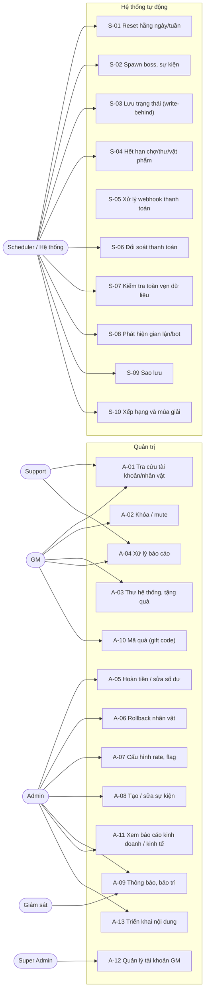
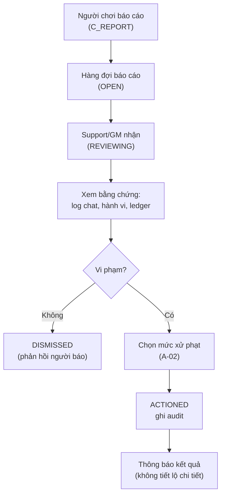

# Use Case: Quản trị & Hệ thống

> **Trạng thái:** Draft v0.1 · **Liên quan:** [use-cases-player](use-cases-player.md) · [admin-gm-guide](../guides/admin-gm-guide.md) · [security](../architecture/security-and-anticheat.md)

## 1. Tác nhân

| Tác nhân | Mô tả | Vai trò hệ thống |
|----------|-------|------------------|
| **Support** | Nhân viên hỗ trợ | `SUPPORT` |
| **GM** | Game Master | `GM` |
| **Admin** | Quản trị vận hành | `ADMIN` |
| **Super Admin** | Quản trị tối cao | `SUPERADMIN` |
| **Hệ thống (Scheduler)** | Tác vụ tự động | Dịch vụ nội bộ |
| **Cổng thanh toán** | Bên ngoài | Webhook |
| **Giám sát** | Prometheus, Sentry | Cảnh báo |

## 2. Sơ đồ

## 3. Ma trận quyền

| Hành động | Support | GM | Admin | Super Admin |
|-----------|:------:|:--:|:-----:|:-----------:|
| Xem tài khoản/nhân vật/log | ✔ | ✔ | ✔ | ✔ |
| Mute / kick | ✔ | ✔ | ✔ | ✔ |
| Khóa tạm (≤ 7 ngày) | — | ✔ | ✔ | ✔ |
| Khóa dài/vĩnh viễn | — | — | ✔ | ✔ |
| Gửi thư không đính kèm | ✔ | ✔ | ✔ | ✔ |
| Tặng vật phẩm/Yul (≤ ngưỡng) | — | ✔ | ✔ | ✔ |
| Tặng Ngọc Mana | — | — | ✔ (duyệt đôi) | ✔ |
| Rollback nhân vật | — | — | ✔ (duyệt đôi) | ✔ |
| Cấu hình rate/flag | — | — | ✔ | ✔ |
| Tạo sự kiện | — | — | ✔ | ✔ |
| Bảo trì, thông báo toàn server | — | — | ✔ | ✔ |
| Quản lý tài khoản GM | — | — | — | ✔ |

## 4. Đặc tả chi tiết

### A-01 — Tra cứu tài khoản / nhân vật

| Mục | Nội dung |
|-----|----------|
| Tác nhân | Support, GM, Admin |
| Tiền điều kiện | Đã đăng nhập Admin có MFA |
| Luồng chính | 1. Nhập tên nhân vật/tài khoản/ID. 2. Hệ thống hiển thị hồ sơ (cấp, hệ, vị trí, Squad, trạng thái). 3. Mở các tab: **Túi đồ**, **Sổ cái**, **Giao dịch**, **Nhiệm vụ**, **Đăng nhập**, **Báo cáo**. |
| Luồng thay thế | Không tìm thấy → gợi ý tìm gần đúng |
| Hậu điều kiện | Mỗi lượt xem dữ liệu nhạy cảm ghi vào `gm_audit_logs` |
| Quy tắc | Che email/IP với vai trò thấp |

### A-02 — Khóa tài khoản / Mute

| Mục | Nội dung |
|-----|----------|
| Tác nhân | GM, Admin |
| Luồng chính | 1. Mở hồ sơ → *Xử phạt*. 2. Chọn loại (Mute/Khóa), thời hạn, lý do, bằng chứng. 3. Xác nhận. 4. Hệ thống ghi `sanctions`, đá người chơi ra (nếu khóa), thông báo lý do. |
| Luồng thay thế | Khóa vĩnh viễn cần Admin; ngoài thẩm quyền → từ chối |
| Hậu điều kiện | Người chơi không đăng nhập được (Ban) hoặc không chat được (Mute); có thể **kháng cáo** |
| Quy tắc | Bậc xử phạt ở [security §13](../architecture/security-and-anticheat.md) |

### A-03 — Gửi thư hệ thống / Tặng quà

| Mục | Nội dung |
|-----|----------|
| Tác nhân | GM, Admin |
| Luồng chính | 1. Chọn đối tượng (một người, danh sách, toàn máy chủ, theo điều kiện). 2. Soạn tiêu đề, nội dung, đính kèm (vật phẩm, Yul, Ngọc Mana). 3. Xem trước. 4. Gửi. 5. Worker phân phối thư. |
| Luồng thay thế | Vượt ngưỡng → yêu cầu duyệt thứ hai |
| Hậu điều kiện | Thư tạo; ledger ghi lý do `GM_GRANT`; audit |

### A-05 — Hoàn tiền / Sửa số dư

| Mục | Nội dung |
|-----|----------|
| Tác nhân | Admin (duyệt đôi) |
| Luồng chính | 1. Mở đơn thanh toán/khiếu nại. 2. Đối chiếu với cổng thanh toán và ledger. 3. Chọn hành động (hoàn tiền cổng, thu hồi Ngọc, cộng bù). 4. Người thứ hai duyệt. 5. Hệ thống thực hiện trong transaction. |
| Luồng thay thế | Đã tiêu Ngọc → số dư âm → khóa nhận Ngọc cho tới khi bù |
| Hậu điều kiện | `payment_orders`=`REFUNDED`/`CHARGEBACK`; ledger; audit |

### A-06 — Rollback nhân vật

| Mục | Nội dung |
|-----|----------|
| Tác nhân | Admin (duyệt đôi) |
| Tiền điều kiện | Có snapshot hợp lệ trong `character_snapshots` |
| Luồng chính | 1. Chọn nhân vật, lý do (lỗi/dupe). 2. Chọn snapshot (tự động hằng ngày, trước bảo trì). 3. Xem **so sánh trước/sau** (vật phẩm, tiền, nhiệm vụ). 4. Duyệt thứ hai. 5. Kick nhân vật, tạo snapshot "pre-rollback", áp dụng. 6. Gửi thư giải thích. |
| Luồng thay thế | Cần thu hồi một phần → chọn từng mục (vật phẩm, Yul) |
| Hậu điều kiện | Dữ liệu nhân vật khôi phục; audit; bồi thường nếu do lỗi hệ thống |

### A-07 — Cấu hình rate và feature flag

| Mục | Nội dung |
|-----|----------|
| Tác nhân | Admin |
| Luồng chính | 1. Mở **Cấu hình**. 2. Sửa giá trị (EXP ×, Drop ×, phí Chợ, bật/tắt tính năng). 3. Xem hiệu ứng ước tính. 4. Lưu (có lý do). 5. Hệ thống ghi `game_config`, phát qua Redis, node áp dụng trong vài giây. |
| Hậu điều kiện | Áp dụng không cần deploy; có thể hoàn tác một bước |
| Quy tắc | Vượt dải an toàn (vd EXP × > 5) cần Super Admin |

### A-08 — Tạo / sửa sự kiện

| Mục | Nội dung |
|-----|----------|
| Tác nhân | Admin |
| Luồng chính | 1. Chọn mẫu sự kiện (boss, EXP ×2, shop giới hạn, Linh Thạch Sao…). 2. Đặt thời gian, phạm vi, thưởng. 3. Xem trước thông báo. 4. Lưu vào `live_events`. 5. Scheduler kích hoạt đúng giờ. |
| Hậu điều kiện | Sự kiện chạy tự động; có nút **dừng khẩn cấp** |

### A-09 — Thông báo & Bảo trì

| Mục | Nội dung |
|-----|----------|
| Tác nhân | Admin |
| Luồng chính | 1. Lên lịch bảo trì (giờ, thời lượng, lý do). 2. Hệ thống gửi `S_MAINTENANCE` ở T−60, T−30, T−10, T−5. 3. T−5 chặn đăng nhập mới. 4. T−0 lưu và kick, snapshot. 5. Cập nhật. 6. Mở lại. |
| Luồng thay thế | Bảo trì khẩn: rút ngắn mốc thông báo, ghi chú lý do |
| Hậu điều kiện | Có bản ghi bảo trì và bồi thường (nếu theo chính sách) |

### A-10 — Mã quà (gift code)

| Mục | Nội dung |
|-----|----------|
| Tác nhân | GM, Admin |
| Luồng chính | 1. Tạo mã (ngẫu nhiên hoặc đặt tên), phần thưởng, giới hạn lượt/người, hạn dùng. 2. Phát hành. 3. Người chơi nhập mã trong game. 4. Hệ thống kiểm tra, ghi nhận, gửi thưởng qua thư. |
| Hậu điều kiện | `gift_code_redemptions` ghi lại, `gift_codes.redeemed_count` tăng; mã hết hạn tự vô hiệu |
| Quy tắc | Kiểm tra `max_per_account` và `max_total` trong **một transaction** (khóa dòng `gift_codes`) để không vượt lượt |

### A-11 — Báo cáo kinh doanh và kinh tế

| Mục | Nội dung |
|-----|----------|
| Tác nhân | Admin |
| Nội dung | CCU, DAU/MAU, retention, doanh thu, ARPU/ARPPU, phễu, kinh tế (faucet/sink, Yul lưu hành, giá chợ), top người nạp, cảnh báo bất thường |
| Quy tắc | Dữ liệu cá nhân được che hoặc băm |

### A-13 — Triển khai nội dung

| Mục | Nội dung |
|-----|----------|
| Tác nhân | Admin (thông qua CI/CD) |
| Luồng chính | 1. Merge PR nội dung. 2. CI validate, build gói + `contentVersion`. 3. Deploy staging, kiểm tra. 4. Duyệt, deploy production cùng game server. 5. Server tải nội dung mới; client tải lại gói khi `contentVersion` đổi. |

## 5. Use case hệ thống tự động

| ID | Tên | Kích hoạt | Hành động | Xử lý lỗi |
|----|-----|-----------|-----------|-----------|
| S-01 | Reset hằng ngày/tuần | 00:00 UTC+7 hằng ngày; T2 05:00 | Reset nhiệm vụ ngày, lượt hầm ngục, giờ Auto, điểm danh | Khóa phân tán; chạy bù nếu lỡ |
| S-02 | Spawn boss/sự kiện | Theo lịch `live_events` | Thông báo trước 5 phút, spawn, theo dõi, phát thưởng | Boss kẹt → hủy và hoàn lượt |
| S-03 | Lưu trạng thái | Mỗi 60 s / khi thoát | Ghi các nhân vật `dirty` (batch) | Ghi lỗi → thử lại, báo động nếu 3 lần |
| S-04 | Hết hạn | Mỗi phút | Chợ → trả hàng qua thư; thư hết hạn; vật phẩm hạn dùng; ban hết hạn | Nhật ký lỗi |
| S-05 | Xử lý webhook thanh toán | Webhook đến | Xác minh chữ ký, idempotent, cộng Ngọc | Báo động nếu sai chữ ký |
| S-06 | Đối soát thanh toán | Hằng ngày 02:00 | So khớp báo cáo cổng với `payment_orders` | Chênh lệch → ticket cho Admin |
| S-07 | Kiểm tra toàn vẹn | Hằng đêm | Chạy các truy vấn ở [database §9](../architecture/database-schema.md) | Phát hiện bất thường → SEV theo mức |
| S-08 | Phát hiện gian lận/bot | Liên tục + hằng giờ | Tính điểm nghi ngờ, gửi danh sách GM | Cảnh báo |
| S-09 | Sao lưu | Hằng ngày + WAL | Backup, snapshot nhân vật (hằng ngày), kiểm tra | Backup lỗi → SEV2 |
| S-10 | Xếp hạng và mùa giải | Hằng giờ; cuối mùa | Cập nhật zset; chốt mùa, phát thưởng, tạo `season_results` | Khóa phân tán |

## 6. Luồng xử lý báo cáo người chơi (A-04)

SLA: báo cáo gian lận/RMT xử lý ≤ 24 giờ; chat xấu ≤ 48 giờ.
