# Use Case: Người chơi

> **Trạng thái:** Draft v0.1 · **Liên quan:** [requirements](../product/requirements.md) · [player-journey](../workflows/player-journey.md) · [admin/system use cases](use-cases-admin-system.md)

## 1. Tác nhân (Actors)

| Tác nhân | Mô tả |
|----------|-------|
| **Khách** | Chưa đăng nhập |
| **Người chơi** | Đã đăng nhập, điều khiển nhân vật |
| **Thành viên Đội** | Người chơi thuộc một Đội |
| **Đội Trưởng / Đội Phó** | Quản trị Đội |
| **Thành viên nhóm** | Người chơi trong nhóm (party) |
| **NPC** | Nhân vật hệ thống (kích hoạt hội thoại, cửa hàng) |
| **Cổng thanh toán** | Hệ thống bên ngoài xác nhận nạp tiền |

## 2. Sơ đồ tổng quan

```mermaid
flowchart LR
    Guest(["Khách"])
    Player(["Người chơi"])
    Member(["Thành viên Đội"])
    Leader(["Đội Trưởng/Phó"])
    PayGW(["Cổng thanh toán"])

    subgraph ACC["Tài khoản & Nhân vật"]
      UC01["UC-01 Đăng ký"]
      UC02["UC-02 Đăng nhập"]
      UC03["UC-03 Chọn máy chủ"]
      UC04["UC-04 Tạo nhân vật"]
      UC05["UC-05 Đổi mật khẩu"]
    end
    subgraph PLAY["Chơi game"]
      UC06["UC-06 Di chuyển & chuyển map"]
      UC07["UC-07 Dùng kỹ năng"]
      UC08["UC-08 Đánh quái & nhận thưởng"]
      UC09["UC-09 Nhặt vật phẩm"]
      UC10["UC-10 Cộng Điểm Tiềm Năng"]
      UC11["UC-11 Nâng cấp kỹ năng"]
      UC12["UC-12 Lễ Khai Thư"]
      UC13["UC-13 Làm nhiệm vụ"]
      UC14["UC-14 Hồi sinh"]
      UC15["UC-15 Auto Hunt"]
    end
    subgraph ITEMS["Vật phẩm & Kinh tế"]
      UC16["UC-16 Trang bị / Túi đồ"]
      UC17["UC-17 Cường hóa"]
      UC18["UC-18 Khảm ngọc / Chế tạo"]
      UC19["UC-19 Mua bán NPC"]
      UC20["UC-20 Giao dịch"]
      UC21["UC-21 Chợ Ký Gửi"]
      UC22["UC-22 Vòng Quay"]
      UC23["UC-23 Nạp Nén Bạc"]
    end
    subgraph SOC["Xã hội & Sự kiện"]
      UC24["UC-24 Chat"]
      UC25["UC-25 Bạn bè & Thư"]
      UC26["UC-26 Nhóm"]
      UC27["UC-27 Lập/Gia nhập Đội"]
      UC28["UC-28 Quản lý Đội"]
      UC29["UC-29 Hầm Ngục / Raid"]
      UC30["UC-30 Boss thế giới"]
      UC31["UC-31 PvP: Thách đấu/Đấu Trường/Chiến Trường"]
      UC32["UC-32 Chiến Đội"]
      UC33["UC-33 Săn Trang Rời"]
      UC34["UC-34 Nuôi Squire / Pet / Chổi"]
      UC35["UC-35 Chuyển hệ Phong Ấn Xạ Thủ"]
    end

    Guest --> UC01
    Guest --> UC02
    Player --> UC03 & UC04 & UC05
    Player --> UC06 & UC07 & UC08 & UC09 & UC10 & UC11 & UC12 & UC13 & UC14 & UC15
    Player --> UC16 & UC17 & UC18 & UC19 & UC20 & UC21 & UC22 & UC23
    Player --> UC24 & UC25 & UC26 & UC27 & UC29 & UC30 & UC31 & UC33 & UC34 & UC35
    Member --> UC32
    Leader --> UC28
    PayGW --> UC23
```

## 3. Danh mục use case

| ID | Tên | Tác nhân | Ưu tiên | FR liên quan |
|----|-----|----------|---------|--------------|
| UC-01 | Đăng ký tài khoản | Khách | P0 | FR-AUTH-01 |
| UC-02 | Đăng nhập | Khách | P0 | FR-AUTH-02, 06, 07 |
| UC-03 | Chọn máy chủ | Người chơi | P0 | FR-CHAR-01 |
| UC-04 | Tạo nhân vật | Người chơi | P0 | FR-CHAR-01, 02 |
| UC-05 | Đổi / quên mật khẩu | Người chơi | P0 | FR-AUTH-03 |
| UC-06 | Di chuyển, chuyển map, chuyển khu | Người chơi | P0 | FR-WORLD-01…04 |
| UC-07 | Dùng kỹ năng | Người chơi | P0 | FR-CMB-01, 02 |
| UC-08 | Đánh quái, nhận EXP/Quan | Người chơi | P0 | FR-CMB-04, 06 |
| UC-09 | Nhặt vật phẩm | Người chơi | P0 | FR-CMB-06 |
| UC-10 | Cộng Điểm Tiềm Năng | Người chơi | P0 | FR-CHAR-06 |
| UC-11 | Nâng cấp kỹ năng | Người chơi | P0 | FR-CHAR-04 |
| UC-12 | Lễ Khai Thư (Lv10) | Người chơi | P0 | FR-CHAR-04 |
| UC-13 | Làm nhiệm vụ | Người chơi | P0 | FR-QST-01, 02, 03 |
| UC-14 | Hồi sinh | Người chơi | P0 | FR-CMB-07 |
| UC-15 | Auto Hunt | Người chơi | P1 | FR-CMB-09 |
| UC-16 | Trang bị / quản lý túi đồ | Người chơi | P0 | FR-ITM-01, 02 |
| UC-17 | Cường hóa trang bị | Người chơi | P0 | FR-ITM-04 |
| UC-18 | Khảm ngọc, chế tạo | Người chơi | P1 | FR-ITM-05, 06 |
| UC-19 | Mua/bán với NPC | Người chơi | P0 | FR-ECO-01 |
| UC-20 | Giao dịch trực tiếp | Người chơi | P0 | FR-ECO-02 |
| UC-21 | Chợ Ký Gửi | Người chơi | P1 | FR-ECO-03 |
| UC-22 | Vòng Quay Chữ Vàng | Người chơi | P1 | FR-ECO-04 |
| UC-23 | Nạp Nén Bạc | Người chơi, Cổng TT | P0 | FR-PAY-01, 02, 04 |
| UC-24 | Chat | Người chơi | P0 | FR-SOC-01, 02 |
| UC-25 | Bạn bè và thư | Người chơi | P1 | FR-SOC-03, 04 |
| UC-26 | Lập nhóm | Người chơi | P0 | FR-SOC-05 |
| UC-27 | Lập / Gia nhập Đội | Người chơi | P0 | FR-SQD-01 |
| UC-28 | Quản lý Đội | Đội Trưởng/Phó | P0 | FR-SQD-01, 02 |
| UC-29 | Hầm Ngục / Raid | Người chơi | P0 | FR-WORLD-08, FR-CMB-05 |
| UC-30 | Tham gia Boss thế giới | Người chơi | P0 | FR-EVT-01 |
| UC-31 | PvP (Thách đấu, Đấu Trường, Chiến Trường) | Người chơi | P1 | FR-PVP-01…04 |
| UC-32 | Chiến Đội | Thành viên Đội | P1 | FR-SQD-04 |
| UC-33 | Săn 7 Trang Rời | Người chơi | P2 | FR-EVT-03 |
| UC-34 | Đệ Tử, Linh Thú, Chổi Bay | Người chơi | P1 | FR-COMP-01…03 |
| UC-35 | Chuyển sang hệ Phong Ấn Xạ Thủ | Người chơi | P1 | FR-CMB-10, FR-CHAR-08 |

## 4. Đặc tả chi tiết (use case then chốt)

### UC-01 — Đăng ký tài khoản

| Mục | Nội dung |
|-----|----------|
| Tác nhân | Khách |
| Tiền điều kiện | Chưa đăng nhập; có kết nối mạng |
| Luồng chính | 1. Khách mở màn Đăng ký. 2. Nhập tên đăng nhập, email, mật khẩu, ngày sinh. 3. Đồng ý Điều khoản và Chính sách bảo mật. 4. Hệ thống kiểm tra hợp lệ (độ dài, ký tự, chưa dùng). 5. Hệ thống tạo tài khoản, gửi email xác nhận. 6. Chuyển sang màn Chọn máy chủ. |
| Luồng thay thế | 4a. Tên/email đã tồn tại → báo lỗi, giữ dữ liệu đã nhập. 4b. Mật khẩu yếu → gợi ý. 4c. Dưới độ tuổi quy định → yêu cầu đồng ý giám hộ (xem [legal](../product/legal-and-compliance.md)). |
| Hậu điều kiện | Tài khoản `ACTIVE` được tạo; mật khẩu băm argon2id |
| Quy tắc | Giới hạn 5 đăng ký/giờ/IP |

### UC-02 — Đăng nhập

| Mục | Nội dung |
|-----|----------|
| Tác nhân | Khách |
| Tiền điều kiện | Có tài khoản `ACTIVE` |
| Luồng chính | 1. Nhập tên đăng nhập và mật khẩu. 2. Hệ thống xác thực. 3. Trả access/refresh token. 4. Chuyển Chọn máy chủ. |
| Luồng thay thế | 2a. Sai mật khẩu → đếm lần sai, khóa tạm khi vượt giới hạn. 2b. Tài khoản bị khóa → hiện lý do và thời hạn. 3a. Đã đăng nhập nơi khác → đá phiên cũ (khi vào game). |
| Hậu điều kiện | Có phiên hợp lệ; `last_login_at` cập nhật |

### UC-04 — Tạo nhân vật

| Mục | Nội dung |
|-----|----------|
| Tác nhân | Người chơi |
| Tiền điều kiện | Đã chọn máy chủ; còn ô nhân vật (< 3) |
| Luồng chính | 1. Chọn ô trống. 2. Chọn **Xuất thân** (xem mô tả và chỉ số gốc). 3. Chọn giới tính, ngoại hình. 4. Nhập tên. 5. Xác nhận. 6. Hệ thống tạo nhân vật Lv1 tại M001 với vật phẩm khởi đầu. 7. Vào game, bắt đầu `Q_MAIN_01`. |
| Luồng thay thế | 4a. Tên trùng/chứa từ cấm → báo lỗi + gợi ý. 6a. Lỗi hệ thống → hoàn tác, giữ dữ liệu nhập. |
| Hậu điều kiện | Nhân vật tồn tại; vật phẩm khởi đầu: Kiếm Gỗ Tập (sau Q02), 5 Bình HP Nhỏ |
| Quy tắc | Xuất thân **không đổi được**; hệ phép chọn ở Lv10 |

### UC-07 — Dùng kỹ năng

| Mục | Nội dung |
|-----|----------|
| Tác nhân | Người chơi |
| Tiền điều kiện | Còn sống; đã học kỹ năng; đủ MP; hết hồi chiêu |
| Luồng chính | 1. Nhấn phím/nút kỹ năng. 2. Client phát hoạt ảnh cast và gửi `C_USE_SKILL`. 3. Server kiểm tra (MP, tầm, trạng thái, hồi chiêu). 4. Server tính kết quả cho các mục tiêu. 5. Server phát `S_SKILL_CAST`, `S_DAMAGE` cho người trong AOI. 6. Client hiển thị số sát thương. |
| Luồng thay thế | 3a. Thiếu MP → `E_NOT_ENOUGH_MP`, client hủy hoạt ảnh. 3b. Còn hồi chiêu → `E_COOLDOWN`. 3c. Ngoài tầm → `E_OUT_OF_RANGE`. |
| Hậu điều kiện | MP giảm, hồi chiêu bắt đầu, HP mục tiêu cập nhật |

### UC-08 — Đánh quái & nhận thưởng

| Mục | Nội dung |
|-----|----------|
| Tác nhân | Người chơi (có thể trong nhóm) |
| Tiền điều kiện | Ở map có quái; còn sống |
| Luồng chính | 1. Người chơi tiếp cận quái. 2. Quái aggro và đuổi. 3. Người chơi dùng đòn thường/kỹ năng. 4. Quái chết. 5. Server chia EXP theo đóng góp, tính Quan và rơi đồ. 6. Cập nhật tiến độ nhiệm vụ. 7. Nếu đủ EXP → UC lên cấp. |
| Luồng thay thế | 4a. Người chơi chết trước → UC-14. 5a. Túi đầy → vật phẩm rơi nằm đất 60 giây, hoặc gửi thư (với nhiệm vụ). |
| Hậu điều kiện | EXP/Quan cập nhật; quest event `mob.killed` phát |
| Quy tắc | Công thức ở [combat §2, §5](../game-design/04-combat-and-progression.md) |

### UC-12 — Lễ Khai Thư

| Mục | Nội dung |
|-----|----------|
| Tác nhân | Người chơi |
| Tiền điều kiện | Lv ≥ 10; hoàn thành `Q_MAIN_11`; chưa chọn hệ |
| Luồng chính | 1. Nói chuyện Thầy Bạch Vân → "Bắt đầu lễ". 2. Vào instance `I001` (cutscene). 3. Xem giới thiệu 7 hệ phép (mô tả, vai trò, kỹ năng đầu). 4. Chọn **một** hệ. 5. Xác nhận lần hai. 6. Nhận Huyền Thư Sơ Bản, vũ khí hệ, **1 SP**, kỹ năng 1. 7. Cutscene kết thúc, về M001. |
| Luồng thay thế | 4a. Mở **Thử kỹ năng** (huấn luyện giả) trước khi chọn. 5a. Thoát giữa chừng → giữ trạng thái chưa chọn, có thể làm lại. |
| Hậu điều kiện | `characters.class` được đặt; kỹ năng mở; ghi mốc `chapter=2` |
| Quy tắc | Được đổi hệ **miễn phí trong 24 giờ** sau lễ ([classes §5](../game-design/03-origins-classes-skills.md)) |

### UC-13 — Làm nhiệm vụ

| Mục | Nội dung |
|-----|----------|
| Tác nhân | Người chơi, NPC |
| Tiền điều kiện | Đủ điều kiện (cấp, tiền đề, phe) |
| Luồng chính | 1. Nói chuyện NPC có biểu tượng "!". 2. Đọc thoại, chọn **Nhận**. 3. Thực hiện mục tiêu. 4. Tiến độ cập nhật tự động. 5. Quay lại NPC có biểu tượng "?". 6. Chọn **Trả**. 7. Nhận thưởng; nhiệm vụ kế mở. |
| Luồng thay thế | 2a. Quá 20 nhiệm vụ → báo đầy. 3a. Bỏ nhiệm vụ → reset tiến độ. 7a. Túi đầy → thưởng gửi **Thư**. |
| Hậu điều kiện | Trạng thái `COMPLETED`; tiến độ nhiệm vụ kế được mở |
| Quy tắc | Trả nhiệm vụ trong **một transaction** (EXP, Quan, vật phẩm) |

### UC-14 — Hồi sinh

| Mục | Nội dung |
|-----|----------|
| Tác nhân | Người chơi |
| Tiền điều kiện | HP = 0 |
| Luồng chính | 1. Hiện hộp thoại hồi sinh. 2. Chọn **Về thành** (miễn phí) hoặc **Tại chỗ** (Lá Hồi Sinh / 5 Nén Bạc). 3. Server xử lý, mất 2% EXP (nếu chết do quái ở Field). 4. Hồi sinh, bất khả xâm phạm tạm thời. |
| Luồng thay thế | 2a. Không đủ Ngọc/Lá → vô hiệu lựa chọn "Tại chỗ". 2b. Trong hầm ngục → theo điểm lưu, không mất EXP. |
| Hậu điều kiện | HP/MP hồi theo chế độ |

### UC-17 — Cường hóa trang bị

| Mục | Nội dung |
|-----|----------|
| Tác nhân | Người chơi |
| Tiền điều kiện | Có trang bị ≤ +15; đủ Quan và Đồng Luyện |
| Luồng chính | 1. Nói chuyện Thợ Rèn Tư. 2. Chọn trang bị. 3. Xem tỉ lệ, chi phí, pity; tùy chọn dùng Bùa Bảo Hộ. 4. Xác nhận. 5. Server trừ tài nguyên và xử lý RNG trong **một transaction**. 6. Hiển thị kết quả. |
| Luồng thay thế | 3a. Thiếu tài nguyên → nút vô hiệu hóa kèm lý do. 5a. Thất bại ≥ +9 không có Bùa → −1 cấp. 5b. Mất kết nối → lệnh vẫn hoàn tất, kết quả hiện khi vào lại. |
| Hậu điều kiện | `enhance_level`, `pity_counter` cập nhật; ledger ghi |
| Quy tắc | Xem [items §6](../game-design/07-items-and-equipment.md) |

### UC-20 — Giao dịch trực tiếp

| Mục | Nội dung |
|-----|----------|
| Tác nhân | Hai người chơi |
| Tiền điều kiện | Cùng map, khoảng cách ≤ 300 px, cả hai Lv ≥ 10, không trong giao tranh |
| Luồng chính | 1. A mời B. 2. B chấp nhận. 3. Cả hai đặt vật phẩm/Quan (tối đa 8 + Quan). 4. Cả hai xác nhận giai đoạn 1, nội dung bị khóa. 5. Cả hai xác nhận giai đoạn 2. 6. Server chuyển tài sản trong **một transaction**. |
| Luồng thay thế | 4a. Một bên thay đổi → hủy xác nhận. 5a. Hủy hoặc mất kết nối → giao dịch hủy. 6a. Túi người nhận đầy → thất bại toàn bộ. |
| Hậu điều kiện | Vật phẩm, Quan đổi chủ; `trade_logs` có dòng mới |
| Quy tắc | Không giao dịch được vật phẩm khóa; Nén Bạc không giao dịch |

### UC-21 — Chợ Ký Gửi

| Mục | Nội dung |
|-----|----------|
| Tác nhân | Người bán, người mua |
| Tiền điều kiện | Lv ≥ 20; vật phẩm giao dịch được |
| Luồng chính (bán) | 1. Mở Chợ → *Đăng bán*. 2. Chọn vật phẩm, đặt giá (trong biên độ). 3. Trả phí 1%. 4. Vật phẩm chuyển sang `MARKET`. |
| Luồng chính (mua) | 1. Tìm/lọc. 2. Chọn mục, xác nhận. 3. Server khóa mục, trừ Quan người mua, chuyển vật phẩm, gửi Quan (−5%) cho người bán qua thư. |
| Luồng thay thế | Mục đã bán/hết hạn → `E_MARKET_LISTING_GONE`. Hết hạn → trả vật phẩm qua thư. Quá 10 mục → từ chối. |
| Hậu điều kiện | Listing `SOLD`/`EXPIRED`/`CANCELLED`; ledger đầy đủ |

### UC-23 — Nạp Nén Bạc

| Mục | Nội dung |
|-----|----------|
| Tác nhân | Người chơi, Cổng thanh toán |
| Tiền điều kiện | Đã xác thực theo quy định; không vượt hạn mức |
| Luồng chính | 1. Mở Cửa hàng → Nạp. 2. Chọn gói. 3. Xem xác nhận (số tiền, Ngọc nhận). 4. Chuyển sang cổng thanh toán. 5. Thanh toán. 6. Cổng gửi webhook. 7. Hệ thống xác minh chữ ký, đối chiếu đơn. 8. Cộng Nén Bạc (idempotent), ghi ledger. 9. Thông báo người chơi. |
| Luồng thay thế | 5a. Hủy/thất bại → đơn `FAILED`. 6a. Webhook trễ → đơn `PENDING`, đối soát bù. 7a. Chữ ký sai → bỏ qua, báo động. 8a. Webhook lặp → bỏ qua. |
| Hậu điều kiện | `accounts.premium_currency` tăng; `payment_orders` = `PAID` |
| Quy tắc | Hạn mức theo tuổi ([economy §7.4](../game-design/08-economy-and-monetization.md)) |

### UC-27 — Lập / Gia nhập Đội

| Mục | Nội dung |
|-----|----------|
| Tác nhân | Người chơi |
| Tiền điều kiện | Lv ≥ 20; chưa có Đội |
| Luồng chính (lập) | 1. Nói chuyện Cô Ký Đội. 2. Nhập tên, chọn biểu tượng. 3. Trả 50.000 Quan. 4. Đội cấp 1 được tạo, người chơi làm Đội Trưởng. |
| Luồng chính (gia nhập) | 1. Mở Đội → danh sách. 2. Gửi đơn hoặc nhận lời mời. 3. Đội Trưởng/Phó duyệt. 4. Trở thành thành viên. |
| Luồng thay thế | Tên trùng → báo lỗi. Rời Đội < 24 giờ → chờ. Đội đầy → từ chối. |
| Hậu điều kiện | Có dòng `guild_members`; áp dụng buff Đội |

### UC-29 — Hầm Ngục / Raid

| Mục | Nội dung |
|-----|----------|
| Tác nhân | Người chơi, nhóm (không bắt buộc) |
| Tiền điều kiện | Đủ cấp, còn lượt. Hầm ngục: **1–5 người** (vào một mình được). Raid: đủ 10/15 người, hoặc chọn **Chế độ Cốt Truyện** (1 người) |
| Luồng chính | 1. Người chơi (hoặc trưởng nhóm) chọn hầm ngục và độ khó. 2. Mọi thành viên (nếu có) xác nhận. 3. Server tạo Instance và **co giãn chỉ số quái theo số người**. 4. Chiến đấu qua phòng, hạ boss. 5. Chia thưởng. 6. Đóng instance sau 60 giây. |
| Luồng thay thế | 4a. Cả nhóm chết/hết giờ → thất bại, mất lượt. 4b. Mất kết nối → giữ chỗ 5 phút. |
| Hậu điều kiện | Lượt dùng ghi `character_lockouts`; thưởng giao |

### UC-33 — Săn 7 Trang Rời

| Mục | Nội dung |
|-----|----------|
| Tác nhân | Người chơi (có thể theo Đội) |
| Tiền điều kiện | Sự kiện đang chạy; Lv ≥ 60 và đã mở Chương 6 |
| Luồng chính | 1. Server rải 7 viên. 2. Người chơi dò bằng radar, nhặt. 3. Giữ ≤ 15 phút/viên. 4. Thu đủ 7. 5. Đến Đài Nguyên Linh (M024), triệu hồi. 6. Chọn một điều ước. 7. Áp dụng, đặt cooldown 7 ngày. |
| Luồng thay thế | 3a. Bị PK hạ → rơi toàn bộ viên. 3b. Hết 15 phút → viên về chỗ cũ. |
| Hậu điều kiện | Điều ước áp dụng, sự kiện kết thúc, thông báo toàn server |

### UC-35 — Chuyển sang hệ Phong Ấn Xạ Thủ

| Mục | Nội dung |
|-----|----------|
| Tác nhân | Người chơi |
| Tiền điều kiện | Lv ≥ 80; hoàn thành Chương 7; có 5 Mảnh Ấn Tiễn |
| Luồng chính | 1. Hoàn thành **Chuỗi Năm Ấn Tiễn**. 2. Gặp Cụ Tiễn (NPC053). 3. Xác nhận. 4. Hệ thống mở **Khe B** với hệ Phong Ấn Xạ Thủ, Huyền Thư Định Bản. 5. Phân bổ lại SP cho kỹ năng Phong Ấn Xạ Thủ. |
| Luồng thay thế | Thiếu mảnh → báo thiếu. Đang trong giao tranh → từ chối. |
| Hậu điều kiện | Có hai khe build; đổi tại Đài Huyền Thư (hồi 5 phút) |

## 5. Các use case khác (tóm tắt)

| ID | Luồng chính ngắn | Ngoại lệ chính |
|----|------------------|-----------------|
| UC-03 | Xem danh sách máy chủ (tải, trạng thái) → chọn → vào màn nhân vật | Máy chủ bảo trì/đầy → hiển thị lý do |
| UC-05 | Nhập mật khẩu cũ/mới hoặc yêu cầu email đặt lại | Link hết hạn |
| UC-06 | Điều khiển nhân vật; vào cổng → chuyển map; menu Đổi khu | Khu đầy → chọn khu khác; đang giao tranh → không đổi khu |
| UC-09 | Đến vật phẩm, nhấn F/chạm; server kiểm tra quyền nhặt | Không đủ quyền (còn khóa 15s) hoặc túi đầy |
| UC-10 | Mở Nhân vật → phân bổ điểm → xác nhận | Số điểm vượt/ giới hạn CRIT |
| UC-11 | Mở Kỹ năng → chọn → Nâng cấp (SP + Quan) | Thiếu SP/Quan/cấp |
| UC-15 | Bật Auto, chọn kỹ năng và ngưỡng bình; server điều khiển | Hết giờ, HP thấp, bị PK, captcha |
| UC-16 | Kéo thả mặc/cất, khóa, sắp xếp | Khác hệ, thiếu cấp, túi đầy |
| UC-18 | Chọn trang bị → khảm ngọc; hoặc chọn công thức chế tạo | Thiếu nguyên liệu, hết khe |
| UC-19 | Mở cửa hàng NPC; mua/bán; mua lại | Thiếu Quan, túi đầy |
| UC-22 | Dùng vé quay; xem tỉ lệ công khai | Thiếu vé; pity xử lý |
| UC-24 | Chọn kênh, gõ, gửi; lọc từ cấm | Mute, rate limit |
| UC-25 | Kết bạn, chặn, gửi thư, nhận quà | Danh sách đầy, thư hết hạn |
| UC-26 | Mời/chấp nhận; chọn chế độ nhặt đồ | Nhóm đầy |
| UC-28 | Mời, đuổi, thăng chức, nâng cấp Đội, bật buff, quản kho | Không đủ quyền |
| UC-30 | Nhận thông báo; đến map; đánh; nhận thưởng qua thư | Đến muộn; đóng góp dưới 3% |
| UC-31 | Đăng ký hàng đợi; ghép; thi đấu; nhận Huy hiệu/điểm | Rời trận → phạt, không đủ điều kiện |
| UC-32 | Đăng ký (Đội Trưởng); thành viên vào đúng giờ; chiếm điểm | Đội thiếu người → thua |
| UC-34 | Khế ước Squire, trang bị, huấn luyện; gọi Chổi | Tín Nhiệm thấp, Squire bất tỉnh |
