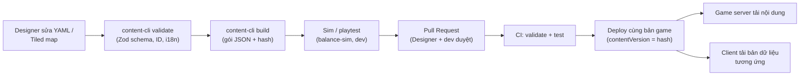
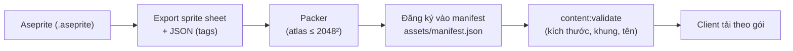

# Workflow: Pipeline nội dung (Content Pipeline)

> **Trạng thái:** Draft v0.1 · **Liên quan:** [development-workflow](development-workflow.md) · [database §8](../architecture/database-schema.md) · [art-audio](../game-design/12-art-audio-direction.md)

Mục tiêu: **Designer thêm/sửa nội dung bằng file dữ liệu** (không sửa mã), được **kiểm chứng tự động**, và đồng bộ lên game theo phiên bản.

## 1. Tổng quan



## 2. Cấu trúc thư mục

```text
packages/content/
├─ schema/                 # Zod schema cho từng loại (nguồn chân lý)
├─ maps/
│   ├─ m001_school.yaml    # metadata + spawns + portals + npcs
│   └─ m001_school.tmj     # Tiled (JSON) – đồ họa và collision
├─ monsters/               # mob001.yaml ...
├─ bosses/
├─ npcs/
├─ items/
│   ├─ weapons/ armor/ consumables/ materials/ gems/ quest/ cosmetic/
├─ skills/                 # theo hệ: fire.yaml, water.yaml...
├─ talents/
├─ quests/
│   ├─ main/ side/ daily/ weekly/ faction/ guild/ event/
├─ dialogues/
├─ drops/                  # bảng rơi
├─ shops/
├─ events/
├─ factions/
├─ recipes/
├─ achievements/
├─ balance/                # hệ số, bảng EXP, chi phí
└─ i18n/
    ├─ vi/*.json
    └─ en/*.json
```

### 2.1 Trạng thái (bậc B2)

**Đã có:**
- `packages/content` chứa `monsters/`, `bosses/`, `events/`, `items/`, `classes/` (`origins.yaml`, `novice.yaml`, `fire.yaml`, `water.yaml`), `quests/`, `shops/`, `drops/`, `i18n/vi.yaml`.
- `schema/index.ts` (Zod) và `src/index.ts`: bộ nạp và kiểm chứng mà game server dùng khi khởi động.

**Những điểm khác cây thư mục ở §2:**
- YAML hiện do `tools/art-proto/build.py` sinh ra từ cùng nguồn với bản chơi thử. Muốn sửa số liệu thì sửa ở đó rồi dựng lại (`python3 tools/art-proto/build.py art/prototype content`). Khi có `content-cli`, YAML sẽ thành nguồn sửa tay.
- Map (`.tmj` và `.yaml`) vẫn ở `art/prototype/maps`, do bộ dựng map tạo ra. Chúng chuyển vào `packages/content/maps` cùng với bộ dựng đó. Game server đọc qua `MAP_DIR`.
- `i18n` là một file `vi.yaml` lồng nhau. Khóa phẳng là đường dẫn có dấu chấm, ví dụ `mob.mob001.name`.
- Tên vật phẩm thử dùng dạng `potion_hp`, chưa theo định dạng `ITMxxxxx`.

## 3. Định dạng dữ liệu (ví dụ)

> Các trường có hậu tố `Key` là khóa i18n, **không** chứa văn bản.

### 3.1 Map

```yaml
# maps/m002_flower_meadow.yaml
id: M002
nameKey: map.m002.name
type: FIELD                  # TOWN | FIELD | DUNGEON | RAID | PVP | HALL
region: R01
levelRange: [1, 4]
tmj: m002_flower_meadow.tmj
bgm: audio/bgm/r01_flower_meadow
pk: PEACE                    # PEACE | OPTIONAL | FORCED
zoneCap: 30
size: { widthTiles: 80, heightTiles: 20 }
portals:
  - { id: P01, x: 64,   y: 480, to: M001, toX: 2400, toY: 480 }
  - { id: P02, x: 2496, y: 480, to: M003, toX: 96,   toY: 480 }
npcs:
  - { id: NPC003, x: 1200, y: 480 }          # Lam Nhi
spawns:
  - { mob: MOB001, x: 600,  y: 480, radius: 200, count: 6, respawnSec: 8 }
  - { mob: MOB002, x: 1500, y: 480, radius: 250, count: 6, respawnSec: 10 }
bossSpawns: []                # điểm boss theo giờ: { boss, x, y, event } (maps §5.2)
skyZones: []
safeZones: []
```

### 3.2 Quái

```yaml
# monsters/mob001.yaml
id: MOB001
nameKey: mob.mob001.name
level: [1, 2]
element: PLANT
kind: NORMAL                 # NORMAL | ELITE | MINIBOSS | BOSS
sprite: monsters/mob001
size: { w: 48, h: 40 }
ai:
  type: PASSIVE              # PASSIVE | AGGRESSIVE | PACK
  aggroRange: 0
  leash: 600
  moveSpeed: 40
skills: [ MOBSKL_TACKLE ]
drops: DROP_R01_BASIC
exp: formula                 # dùng công thức mặc định: 8L + 10
```

### 3.3 Vật phẩm

```yaml
# items/weapons/itm01101.yaml
id: ITM01101
type: WEAPON
nameKey: item.itm01101.name
descKey: item.itm01101.desc
rarity: UNCOMMON
levelReq: 10
class: FIRE
weaponType: SWORD
baseStats: { atk: 50 }
bind: BOE
sellPrice: 120
icon: icons/weapon/sword_01
sprite: weapons/sword_01
```

### 3.4 Kỹ năng

```yaml
# skills/fire.yaml
- id: SKL_FIRE_1
  nameKey: skill.fire.1.name
  class: FIRE
  unlockLevel: 10
  kind: PROJECTILE
  range: LONG
  mpCost: 10
  cooldownSec: 3
  mult: 1.20
  scale: { perLevelMult: 0.08, perLevelMp: 0.05, perLevelCd: -0.02 }
  effects:
    - { status: BURN, durationSec: 3, tickMult: 0.0667 }   # 20% ATK tổng / 3s
  vfx: vfx/fire/fireball
  sfx: audio/sfx/fire_cast_01
  maxLevel: 7
```

### 3.5 Nhiệm vụ

Xem mẫu ở [quests §11](../game-design/06-quests-and-missions.md). Nhiều bước:

```yaml
id: Q_MAIN_20
type: MAIN
chapter: 2
levelMin: 20
prerequisites: [ Q_MAIN_19 ]
giver: NPC046
steps:
  - id: S1
    objectives: [ { type: TALK, target: NPC007 } ]
  - id: S2
    objectives: [ { type: TALK, target: NPC008 } ]
  - id: S3
    choice:                    # lựa chọn một phe
      options:
        - { id: HOUSE_HEAVEN, nameKey: ..., sets: { faction: HOUSE_HEAVEN } }   # Viện Càn
        - { id: HOUSE_FIRE,   nameKey: ..., sets: { faction: HOUSE_FIRE } }     # Viện Ly
rewards: { exp: 6000, soft: 2000 }
```

### 3.6 Bảng rơi

Bảng đang dùng ở bậc B2 (`packages/content/drops/drop_r01_basic.yaml`, số liệu theo [combat §6, §2.1.1](../game-design/04-combat-and-progression.md)):

```yaml
id: DROP_R01_BASIC
soft: { chance: 0.9, perLevel: 4, spread: 0.2 }     # Quan = 4L (±20%) × hệ số Quan của loại quái
entries:
  - { chance: 0.25, item: dong_luyen_1 }             # nguyên liệu
  - { chance: 0.08, pick: { potion_hp: 0.6, potion_mp: 0.4 } }   # tiêu hao: một lần gieo, rồi chọn món
gear:
  items: [ s1_weapon, s1_hat, s1_armor, s1_boots ]   # bộ S1, lấy cấp của quái
  levelBand: [1, 9]
  chance: { common: 0.06, good: 0.02, rare: 0.003, epic: 0.0003 }
tiers:                                               # Tinh anh, Thủ lĩnh: chắc có Quan, 2 lượt gieo
  elite: { softChance: 1, rolls: 2, gear: { common: 0.06, good: 0.10, rare: 0.015, epic: 0.0015 } }
  leader: { softChance: 1, rolls: 2, gear: { common: 0.06, good: 0.25, rare: 0.05, epic: 0.005 }, guaranteed: dong_luyen_2 }
```

Bảo đảm (pity) Sử Thi của boss đến cùng boss online.

### 3.7 NPC và hội thoại

```yaml
# npcs/npc002.yaml
id: NPC002
nameKey: npc.npc002.name
map: M001
x: 640
y: 480
sprite: npc/npc002
portrait: ui/portrait/npc002
menu:
  - { id: QUEST, label: dlg.common.quest }
  - { id: TALK,  label: dlg.npc002.talk,  dialogue: DLG_NPC002_TALK }
  - { id: RENAME, label: dlg.npc002.rename, requires: { currency: PREMIUM, amount: 50 } }
```

### 3.8 Cửa hàng

```yaml
# shops/shop_theo.yaml
id: SHOP_THEO
npc: NPC041
buy:
  - { item: ITM04001, price: 20 }
  - { item: ITM04002, price: 80 }
sellRate: 0.25
buyback: { minutes: 30 }
```

### 3.9 Sự kiện

```yaml
# events/boss_wild_plains.yaml
id: EVT_BOSS_030
kind: WORLD_BOSS
boss: BOSS030
schedule: { times: ["12:00", "20:00"], tz: "Asia/Ho_Chi_Minh" }
announceBeforeMin: 5
maps: [ M009, M010, M011 ]
zones: RANDOM_ONE            # RANDOM_ONE | ALL (sự kiện)
despawnAfterMin: 30
rewardMaxLevelGap: 10        # cao hơn boss quá 10 cấp: không nhận vật phẩm
```

## 4. Quy tắc kiểm chứng (validator)

| Mã | Quy tắc |
|----|---------|
| V001 | Mọi file khớp schema Zod của loại tương ứng |
| V002 | ID duy nhất toàn cục theo loại; định dạng `Mxxx`, `MOBxxx`, `ITMxxxxx`… |
| V003 | Mọi tham chiếu ID (portal, spawn, drop, quest, NPC, item) phải tồn tại |
| V004 | Mọi `*Key` phải có chuỗi trong `vi`; cảnh báo nếu thiếu `en` |
| V005 | Portal hai chiều: map đích có portal quay lại (cảnh báo nếu không) |
| V006 | Map Field có ≥ 2 loại quái và ≥ 1 NPC nhiệm vụ gần cổng |
| V007 | Nhiệm vụ không có vòng lặp tiền đề; mọi chuỗi chính nối liền Lv1 → Lv100 |
| V008 | Cấp quái trong `levelRange` map; spawn không đặt trong tile đặc |
| V009 | Chỉ số vật phẩm nằm trong dải theo công thức ([items §4](../game-design/07-items-and-equipment.md)) sai lệch ≤ 25% |
| V010 | Kỹ năng đúng vị trí mở (Lv10/20/30/40/55/70/85) và có đủ 7 kỹ năng mỗi hệ |
| V011 | Asset (sprite, icon, audio) tồn tại, đúng kích thước, trong giới hạn dung lượng |
| V012 | Tiled: đủ lớp bắt buộc (`ground`, `collision`, `objects`), không có tile ngoài tileset |
| V013 | Bảng rơi: tổng xác suất hợp lý, không có vật phẩm cấp quá cao so với cấp quái |
| V014 | Quest reward hợp lý theo cấp (cảnh báo nếu > 2× chuẩn) |
| V016 | **Đi tới được:** từ điểm xuất hiện, với nhảy cao 3 ô, sang ngang 3 ô khi leo bậc, rơi lệch tối đa 5 ô, đi thang và nền một chiều, phải tới được mọi cổng, NPC, điểm sinh quái và `boss_spawn` ([maps §1.1](../game-design/05-world-maps-monsters.md)) |
| V015 | i18n, hội thoại và tên file asset **không chứa từ trong danh sách cấm** (tên riêng của tác phẩm khác). Danh sách lưu ngoài gói nội dung phát hành; quy trình ở [reskin-spec §10](../product/reskin-spec.md#10-kiểm-tra-rò-rỉ-tên-ip) (nội bộ) |

Lệnh:

```bash
pnpm content:validate          # chạy tất cả quy tắc
pnpm content:validate maps     # chỉ một loại
pnpm content:build             # tạo gói JSON + contentVersion (hash)
```

Bậc B2:
- `pnpm content:validate` chạy V001 (schema), V002 (trùng ID), V003 (tham chiếu) và V004 (khóa i18n) trên các loại server đang dùng: quái, vật phẩm, kỹ năng, bảng rơi, map.
- Cổng dẫn tới map chưa dựng (M004 → M005) chỉ là cảnh báo.
- Chưa lọc theo loại; `content:build` đến ở bậc B3.
- V016 chạy trong bộ dựng map; `pnpm map:check` kiểm tra điểm xuất hiện và điểm sinh quái có nền.

## 5. Pipeline bản đồ (Tiled)

### 5.1 Lớp bắt buộc trong `.tmj`

| Lớp (layer) | Loại | Mô tả |
|-------------|------|-------|
| `bg_far`, `bg_mid`, `bg_near` | Image/Tile | Parallax |
| `ground` | Tile | Hiển thị mặt đất |
| `decor` | Tile | Trang trí |
| `collision` | Tile | **Quy ước tile:** `1` đặc, `2` nền một chiều, `3` thang, `4` gai/nguy hiểm |
| `objects` | Object | Điểm sinh, cổng, NPC, vùng đặc biệt |
| `fg` | Tile | Tiền cảnh |

### 5.2 Đối tượng trong `objects`

| Type | Thuộc tính |
|------|------------|
| `spawn_player` | `default: bool` |
| `portal` | `id` |
| `npc` | `id` |
| `mob_spawn` | `mob, count, radius, respawnSec` |
| `zone_safe` | Vùng an toàn |
| `zone_sky` | Vùng bay Chổi Vàng |
| `zone_trigger` | `event` (cutscene, boss phase) |
| `boss_spawn` | `boss`, `event`: điểm boss theo giờ có thể xuất hiện ([maps §5.2](../game-design/05-world-maps-monsters.md)) |

Quy trình: vẽ trong Tiled → xuất `.tmj` → `pnpm map:check` (kiểm tra lớp, kích thước, tile) → liên kết với `maps/*.yaml`.

## 6. Pipeline art (Aseprite → atlas)



| Bước | Quy tắc |
|------|---------|
| Đặt tên | `snake_case`, theo [art §10](../game-design/12-art-audio-direction.md) |
| Tag hoạt ảnh | `idle`, `walk`, `run`, `jump`, `attack_1..3`, `cast`, `hurt`, `die` |
| Anchor | Điểm neo trên mỗi khung cho paper-doll |
| Dung lượng | Theo [art §8](../game-design/12-art-audio-direction.md) |
| Nguồn | File `.aseprite` lưu trong `design/`, bản export trong `assets/` |

## 7. i18n

- Khóa theo `domain.sub.key` (xem [glossary §4](../glossary.md)).
- `vi` là **nguồn**; `en` dịch sau. Thiếu `en` chỉ cảnh báo, thiếu `vi` là lỗi.
- Không đặt nhiều câu trong một khóa nếu có thể tách.
- Placeholder dùng `{name}`, `{count}`; kiểm tra số lượng placeholder khớp giữa `vi` và `en`.
- Tên hiển thị (nhân vật, địa danh, kỹ năng, tiền tệ) **chỉ ở i18n**, không nằm trong ID, tên file hay mã nguồn, để đổi tên rẻ (xem [legal §1.2](../product/legal-and-compliance.md)). Mọi chuỗi i18n mới phải qua V015.

## 8. Quy trình thêm nội dung (checklist)

### 8.1 Thêm một con quái

- [ ] Tạo `monsters/mobNNN.yaml` (cấp, hệ, AI, drop)
- [ ] Tạo bảng rơi nếu cần (`drops/`)
- [ ] Thêm sprite + hoạt ảnh (`assets/monsters/mobNNN`), đăng ký manifest
- [ ] Thêm tên vào `i18n/vi/mobs.json` (+ `en`)
- [ ] Đặt vào `spawns[]` của map
- [ ] Chạy `pnpm content:validate monsters maps`
- [ ] Chạy `balance-sim` kiểm tra TTK và EXP/giờ
- [ ] Playtest, mở PR

### 8.2 Thêm một map

- [ ] Vẽ map Tiled theo quy ước lớp
- [ ] Tạo `maps/mNNN.yaml`, điền portal hai chiều
- [ ] Thêm NPC, spawn, zone đặc biệt
- [ ] Nhạc nền, nền parallax, bảng màu vùng
- [ ] i18n tên map
- [ ] `pnpm map:check` và `pnpm content:validate`
- [ ] Playtest đi hết map, kiểm tra hố/kẹt
- [ ] Cập nhật [world-maps-monsters](../game-design/05-world-maps-monsters.md)

### 8.3 Thêm một nhiệm vụ

- [ ] Tạo `quests/<loại>/q_xxx.yaml` (tiền đề, mục tiêu, thưởng)
- [ ] Viết hội thoại (`dialogues/`) + i18n
- [ ] Kiểm tra thưởng theo cấp (V014)
- [ ] Chạy thử chuỗi nhiệm vụ từ đầu bằng lệnh GM `quest.set`
- [ ] Cập nhật bảng ở [quests](../game-design/06-quests-and-missions.md)

### 8.4 Thêm vật phẩm / trang bị

- [ ] Tạo YAML đúng loại và dải ID
- [ ] Chỉ số theo công thức (V009)
- [ ] Icon + sprite (nếu hiển thị)
- [ ] i18n tên, mô tả
- [ ] Nguồn có được (drop/shop/quest/craft)
- [ ] Cập nhật [items](../game-design/07-items-and-equipment.md) nếu thêm bậc/quy tắc

### 8.5 Thêm kỹ năng / hệ phép

- [ ] Khai báo trong `skills/<hệ>.yaml` (đủ 7 kỹ năng)
- [ ] VFX + SFX
- [ ] Hoạt ảnh cast cho nhân vật
- [ ] Thiết lập khắc hệ ở `balance/elements.yaml`
- [ ] Mô phỏng cân bằng đối với các hệ khác
- [ ] Cập nhật [classes](../game-design/03-origins-classes-skills.md)

### 8.6 Thêm sự kiện

- [ ] `events/<id>.yaml` + quest/drop liên quan
- [ ] Banner, thông báo, i18n
- [ ] Lịch (múi giờ `Asia/Ho_Chi_Minh`)
- [ ] Kịch bản bật/tắt khẩn (feature flag)
- [ ] Kiểm tra trên staging với giả lập thời gian

## 9. Phiên bản & triển khai nội dung

| Khái niệm | Mô tả |
|-----------|-------|
| `contentVersion` | Hash SHA-256 rút gọn của gói nội dung; gửi khi handshake |
| Tương thích | Dữ liệu động tham chiếu ID tĩnh → **không xóa ID đang được tham chiếu**; chuyển sang `deprecated: true` |
| Di chuyển ID | Nếu bắt buộc đổi ID, kèm migration DB và kịch bản chuyển |
| Hot reload (dev) | `pnpm dev` theo dõi file, áp dụng lại **không cần khởi động lại** |
| Production | Gói nội dung đi cùng bản game server; không sửa nội dung nóng, trừ `game_config` |

## 10. Cân bằng nội dung

| Công cụ | Mục đích |
|---------|----------|
| `tools/balance-sim ttk` | Thời gian hạ quái theo hệ/cấp/trang bị chuẩn, **gồm kiểm tra solo cho mọi hệ** ([combat §11](../game-design/04-combat-and-progression.md)); CI báo lỗi nếu hệ nào vượt ngưỡng |
| `tools/balance-sim exp` | Số quái/giờ cần lên cấp, so với mục tiêu |
| `tools/balance-sim economy` | Faucet/sink, lạm phát theo tuần |
| `tools/balance-sim enhance` | Chi phí kỳ vọng để đạt +N |
| Báo cáo | Xuất Markdown vào `reports/` và đính kèm PR |

## 11. Phân quyền chỉnh sửa

| Khu vực | Ai chỉnh |
|---------|----------|
| `packages/content/**` | Designer (PR có dev duyệt) |
| `packages/content/schema/**` | Dev (thay đổi cần Designer biết) |
| `packages/content/balance/**` | Designer + dev |
| `assets/**` | Artist |
| `packages/content/i18n/**` | Designer, biên dịch viên |
