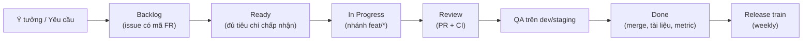
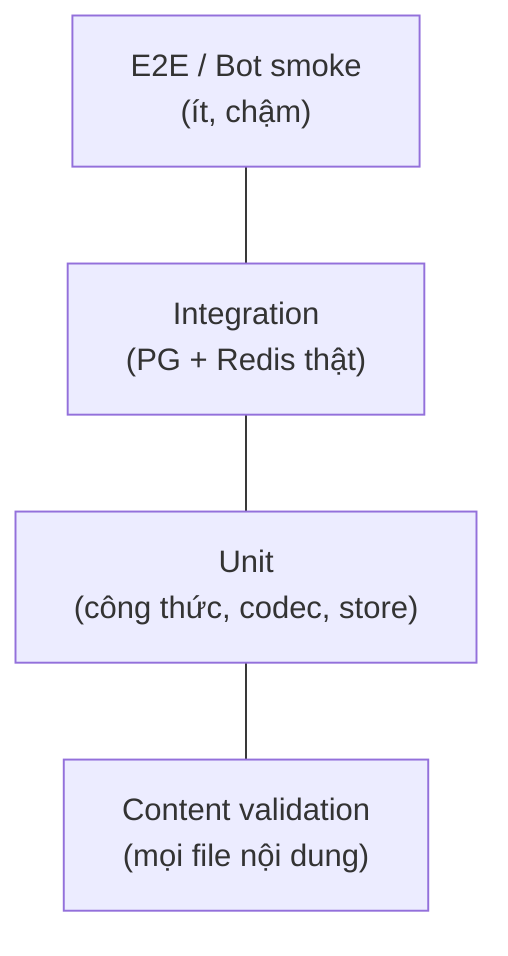
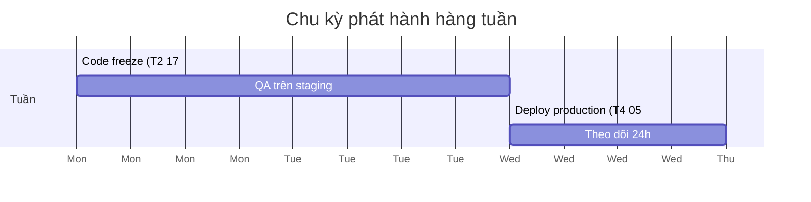
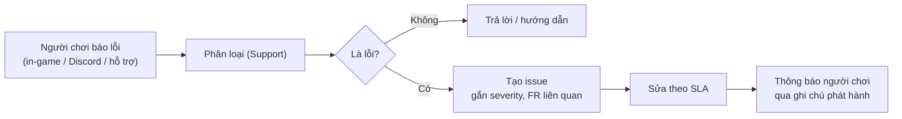

# Workflow: Phát triển, Kiểm thử & Phát hành

> **Trạng thái:** Draft v0.1 · **Liên quan:** [infrastructure](../architecture/infrastructure-devops.md) · [content-pipeline](content-pipeline.md) · [roadmap](../product/roadmap.md)

## 1. Nguyên tắc

1. **Tài liệu là một phần của code.** Đổi cơ chế → cập nhật tài liệu cùng PR.
2. **Nhánh ngắn, merge thường xuyên** (trunk-based).
3. **Mọi thứ qua CI.** Không merge khi CI đỏ.
4. **Dữ liệu nội dung có schema** và được kiểm chứng tự động.
5. **Thay đổi liên quan tiền/vật phẩm/thanh toán** cần 2 người duyệt.

## 2. Quy trình tổng thể



| Cột bảng | Điều kiện vào |
|----------|----------------|
| **Backlog** | Có mô tả, liên kết FR |
| **Ready** | Có tiêu chí chấp nhận, ước lượng, không bị chặn (Definition of Ready) |
| **In Progress** | Có người nhận, có nhánh |
| **Review** | PR mở, CI xanh |
| **QA** | Đã deploy lên dev/staging, có kịch bản test |
| **Done** | Đạt Definition of Done (xem §8) |

## 3. Git

### 3.1 Nhánh

| Nhánh | Mục đích | Quy tắc |
|-------|----------|---------|
| `main` | Luôn ổn định, có thể deploy lên dev | Bảo vệ: PR + CI + review bắt buộc |
| `feat/<fr-id>-<mô-tả>` | Tính năng | Sống ≤ 3 ngày; ví dụ `feat/fr-cmb-02-damage-formula` |
| `fix/<issue>-<mô-tả>` | Sửa lỗi | |
| `content/<chủ-đề>` | Chỉ nội dung (map, quái, nhiệm vụ) | Được review bởi Designer |
| `docs/<chủ-đề>` | Chỉ tài liệu | |
| `hotfix/<mô-tả>` | Sửa nóng production | Từ tag đang chạy, merge ngược vào `main` |
| `rc-*` | Tag ứng viên phát hành | Tự động deploy staging |

### 3.2 Commit (Conventional Commits)

```text
<type>(<scope>): <mô tả ngắn>

[nội dung]

[footer: Refs FR-XXX-NN, BREAKING CHANGE: ...]
```

| `type` | Dùng khi |
|--------|----------|
| `feat` | Tính năng mới |
| `fix` | Sửa lỗi |
| `content` | Dữ liệu nội dung |
| `balance` | Chỉnh số liệu cân bằng |
| `docs` | Tài liệu |
| `refactor`, `perf`, `test`, `chore`, `ci`, `build` | Như thông lệ |

`scope`: `client`, `server`, `api`, `db`, `shared`, `content`, `admin`, `infra`, `docs`.

Ví dụ: `feat(server): thêm kiểm tra tầm đánh trong C_USE_SKILL (FR-CMB-01)`.

### 3.3 Pull Request

- Tiêu đề theo Conventional Commits; mô tả theo mẫu:

```markdown
## Mục đích
## Thay đổi chính
## Liên kết (FR / issue / tài liệu)
## Cách kiểm thử
## Ảnh hưởng (DB migration? giao thức? nội dung? cân bằng?)
## Checklist
- [ ] CI xanh
- [ ] Đã cập nhật tài liệu
- [ ] Đã thêm/sửa test
- [ ] Không có bí mật trong code
- [ ] (Nếu ảnh hưởng tiền/vật phẩm) Có test đồng thời và đã được 2 người duyệt
```

- PR ≤ **400 dòng thay đổi** (trừ dữ liệu sinh tự động); PR lớn chia nhỏ.
- Tự review trước khi mở; phản hồi review trong **1 ngày làm việc**.

## 4. Review

| Loại thay đổi | Người duyệt |
|----------------|-------------|
| Client UI | 1 dev client |
| Server logic | 1 dev server |
| Công thức / cân bằng | 1 dev + **Designer** |
| Nội dung | **Designer** + 1 dev (validator) |
| DB migration | 1 dev server + người phụ trách DB |
| Thanh toán, tiền tệ, vật phẩm | **2 dev**, trong đó 1 người phụ trách bảo mật |
| Hạ tầng | DevOps |

### 4.1 Danh sách kiểm tra review

- [ ] Logic đúng và có test; cạnh biên đã xử lý
- [ ] Không tin dữ liệu từ client (validate)
- [ ] Giao dịch DB đúng thứ tự khóa, có `idemKey`, có sổ cái
- [ ] Không tạo hot path chậm trong tick
- [ ] Không rò rỉ thông tin nhạy cảm vào log
- [ ] Tương thích ngược giao thức/DB (hoặc có kế hoạch)
- [ ] i18n: không hard-code chuỗi
- [ ] Tài liệu và changelog đã cập nhật

## 5. Kiểm thử

### 5.1 Kim tự tháp kiểm thử



| Loại | Công cụ | Nội dung |
|------|---------|----------|
| Unit | Vitest | Công thức sát thương, EXP, cường hóa, drop, codec, quest engine |
| Property-based | fast-check | Công thức không âm, không tràn; ledger cân bằng |
| Integration | Vitest + Testcontainers | Giao dịch, migration, repository, đồng thời (race) |
| Content | `content-cli validate` | Schema, ID tham chiếu, i18n, giới hạn dung lượng |
| E2E | Playwright | Đăng nhập → vào game → đánh → nhận NV |
| Bot/Load | `bot-client`, k6 | 50 → 5.000 CCU |
| Balance sim | `balance-sim` | TTK, thời gian lên cấp, kinh tế |
| Bảo mật | Fuzz, pentest | Gói sai, lặp lệnh, race |

### 5.2 Nhãn test

Test đặt tên có mã yêu cầu, ví dụ: `it('FR-ITM-04: pity tăng 5% sau thất bại', ...)` để truy vết.

### 5.3 Mức độ lỗi (severity)

| Mức | Mô tả | SLA sửa |
|-----|-------|---------|
| **P0** | Mất dữ liệu, dupe, mất tiền, sập server | Ngay, hotfix |
| **P1** | Tính năng chính hỏng, chặn tiến trình | ≤ 24 giờ |
| **P2** | Lỗi đáng kể có cách tránh | Trong sprint |
| **P3** | Lỗi nhỏ, thẩm mỹ | Backlog |

### 5.4 Playtest

| Loại | Tần suất | Mục tiêu |
|------|----------|----------|
| Dev playtest | Hằng tuần | Cảm giác chơi, lỗi nhanh |
| Playtest nội bộ | Mỗi 2 tuần (có form phản hồi) | Cân bằng, UX |
| Beta kín | Từ Phase 3 | KPI, tải, kinh tế thật |

## 6. Phát hành

### 6.1 Phiên bản

- **SemVer** cho bản build: `MAJOR.MINOR.PATCH`. `MINOR` = tính năng, `PATCH` = sửa lỗi, `MAJOR` = phá vỡ giao thức/DB.
- `protocolVersion` và `contentVersion` độc lập (xem [network §11](../architecture/network-protocol.md)).
- Changelog tự sinh từ Conventional Commits và chỉnh tay cho **ghi chú cho người chơi**.

### 6.2 Release train



| Bước | Thời điểm | Hành động |
|------|-----------|-----------|
| Code freeze | T2 17:00 | Tag `rc-X.Y.Z` |
| QA | T2–T3 | Kiểm thử hồi quy, load smoke |
| Go/No-go | T3 17:00 | Producer + Tech Lead + QA |
| Deploy | T4 05:00 | Bảo trì, thông báo trước ≥ 24h |
| Theo dõi | T4–T5 | Dashboard, sẵn sàng rollback |

### 6.3 Hotfix

1. Nhánh `hotfix/*` từ tag production.
2. Sửa tối thiểu, thêm test hồi quy.
3. Review nhanh (1 người + Tech Lead nếu liên quan tài sản).
4. Tag `vX.Y.Z+1`, deploy qua staging nhanh (smoke).
5. Merge ngược vào `main`; viết postmortem nếu SEV1/SEV2.

### 6.4 Feature flag

Tính năng chưa sẵn sàng hoặc rủi ro bật qua `game_config` (xem [server §12](../architecture/server-design.md)), tắt khẩn trong vài giây không cần deploy.

## 7. Quản lý tài liệu & quyết định

| Quy tắc | Chi tiết |
|---------|----------|
| Nơi lưu | `docs/` trong repo |
| Cập nhật | Đổi cơ chế/giao thức/DB → cập nhật `docs/*` trong cùng PR |
| ADR | Quyết định kiến trúc quan trọng → `docs/architecture/adr/NNN-title.md` (Bối cảnh, Quyết định, Hệ quả, Trạng thái) |
| Số liệu cân bằng | Chỉ sửa trong `docs/game-design/*` và `packages/content`, kèm báo cáo mô phỏng |
| Changelog tài liệu | Ghi ở đầu file khi thay đổi lớn |

### 7.1 Mẫu ADR

```markdown
# ADR-NNN: <Tiêu đề>
- Trạng thái: Đề xuất | Chấp nhận | Thay thế bởi ADR-XXX
- Ngày: YYYY-MM-DD
## Bối cảnh
## Quyết định
## Phương án đã cân nhắc
## Hệ quả (tốt/xấu)
```

## 8. Definition of Done

Một mục chỉ **Done** khi:

- [ ] Mã đã merge vào `main` qua PR, CI xanh
- [ ] Có test (unit/integration) tương ứng, mã FR trong tên test
- [ ] Tài liệu liên quan đã cập nhật
- [ ] Số liệu/metric/log cần thiết đã thêm
- [ ] QA đã xác nhận trên dev/staging
- [ ] Không còn lỗi P0/P1 liên quan
- [ ] Nội dung (nếu có) qua validator và playtest
- [ ] Phản hồi từ Designer/Producer (nếu là tính năng người chơi thấy)

## 9. Nhịp làm việc

| Hoạt động | Tần suất | Nội dung |
|-----------|----------|----------|
| Sprint | 2 tuần | Kế hoạch, demo, retrospective |
| Standup | Hằng ngày (15 phút, không đồng bộ được) | Tiến độ, chặn |
| Backlog grooming | Hằng tuần | Làm rõ, ước lượng |
| Balance review | Hằng tuần (khi có live) | Dữ liệu kinh tế, TTK, báo cáo |
| Postmortem | Sau SEV1/SEV2 | Không đổ lỗi, có hành động |
| Retrospective | Mỗi sprint | Cải tiến quy trình |

## 10. Quản lý lỗi & phản hồi người chơi



## 11. Cân bằng (balance) thay đổi như thế nào

1. Đề xuất thay đổi (issue loại `balance`) kèm lý do và dữ liệu.
2. Chạy `balance-sim` trước/sau, đính kèm báo cáo.
3. PR sửa `packages/content` hoặc công thức, **Designer duyệt**.
4. Deploy lên staging, playtest.
5. Triển khai lên production vào bản cập nhật hằng tuần (không hotfix trừ khi sự cố kinh tế).
6. Theo dõi chỉ số 7 ngày; hoàn tác nếu vượt ngưỡng.

## 12. Công cụ

| Mục đích | Công cụ |
|----------|---------|
| Quản lý mã | GitHub |
| Theo dõi công việc | GitHub Projects (hoặc Linear) |
| CI/CD | GitHub Actions |
| Giao tiếp | Discord/Slack, kênh riêng cho release, incident |
| Tài liệu | Repo (`docs/`) |
| Thiết kế art | Aseprite, Tiled, Figma (UI) |
| Giám sát | Grafana, Sentry |
