# Workflow: Hành trình người chơi & Luồng chức năng

> **Trạng thái:** Draft v0.1 · **Liên quan:** [use cases](../usecases/use-cases-player.md) · [quests](../game-design/06-quests-and-missions.md) · [combat](../game-design/04-combat-and-progression.md)

## 1. Tổng quan hành trình

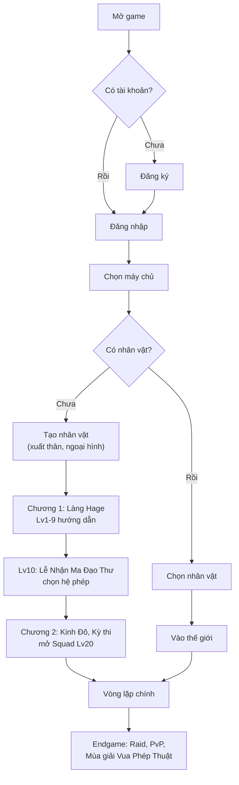

## 2. Hành trình theo giai đoạn (cấp độ)

| Giai đoạn | Cấp | Mục tiêu người chơi | Tính năng mở | Cảm xúc chủ đạo |
|-----------|-----|---------------------|--------------|-----------------|
| **Tân thủ** | 1–9 | Học điều khiển, đánh quái, nhận đồ | Đòn thường, Tụ Mana Chấn, nhiệm vụ | Tò mò, ấm áp |
| **Thức tỉnh** | 10 | Chọn hệ phép | Kỹ năng hệ, Ma Đạo Thư | Phấn khích |
| **Khám phá** | 10–24 | Vào Kinh Đô, vượt kỳ thi | Chợ, Cường hóa, Cổng, Auto Hunt (Lv20), Squad (Lv20) | Hoài bão |
| **Kết nối** | 25–39 | Gia nhập Đội, Bò Đen, Mana Skin | Squire (Lv25), nhóm, Hầm Ngục DG02–03 | Thuộc về |
| **Thử thách** | 40–59 | Hầm ngục, chiến tranh | Khảm ngọc, Chiến Trường, Squad War | Hồi hộp |
| **Tinh thông** | 60–89 | Tinh Linh, Spade, raid | Linh Thạch Sao, Raid, Phản Ma | Làm chủ |
| **Huyền thoại** | 90–100 | Cõi Quỷ, Lucifero | Spirit Dive đầy đủ, Mùa Giải | Vinh quang |

## 3. 10 phút đầu tiên

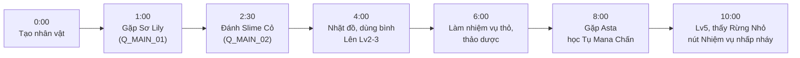

Mục tiêu thiết kế: người chơi **đạt Lv5 trong 10 phút**, **hiểu vòng lặp (nhận NV → đánh → trả)**, **không bị chặn bởi giao diện**.

## 4. Một phiên chơi điển hình (30–60 phút)

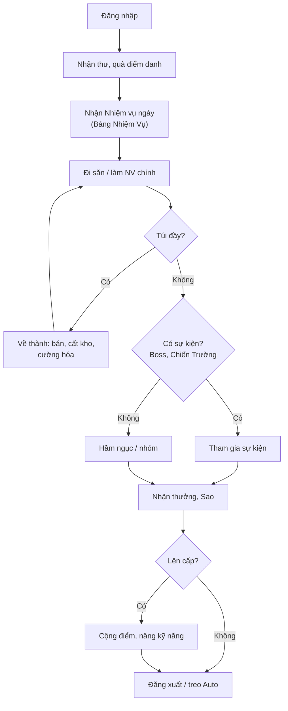

### 4.1 Nhịp ngày – tuần – mùa

| Chu kỳ | Hoạt động chính |
|--------|-----------------|
| **Hằng ngày** | Điểm danh, 10 nhiệm vụ ngày, boss thế giới, Chiến Trường, hầm ngục, Squad |
| **Hằng tuần** | Raid, Squad War (T7), Săn Linh Thạch Sao (T7), nhiệm vụ tuần |
| **Hằng tháng** | Lễ Trao Sao, đua bảng xếp hạng |
| **Mùa (3 tháng)** | Đấu Trường mùa, Battle Pass, phần thưởng độc quyền |

## 5. Luồng chức năng chi tiết

### 5.1 Nhiệm vụ

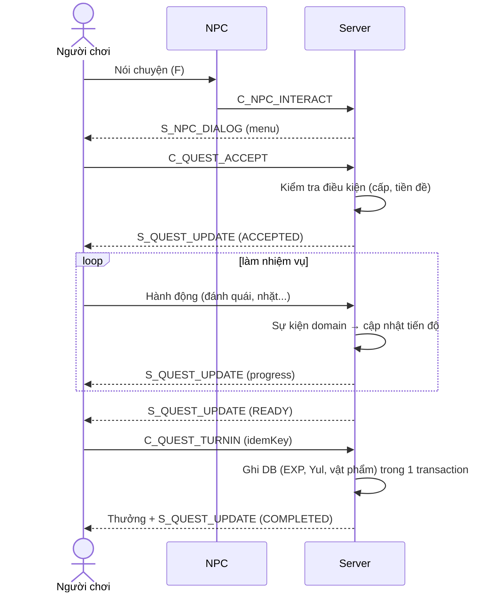

### 5.2 Chiến đấu (một lượt)

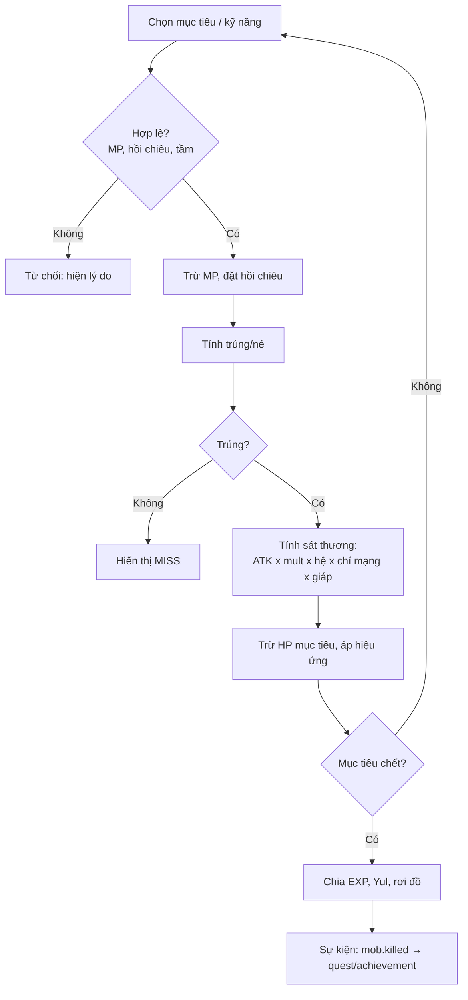

### 5.3 Chết & hồi sinh

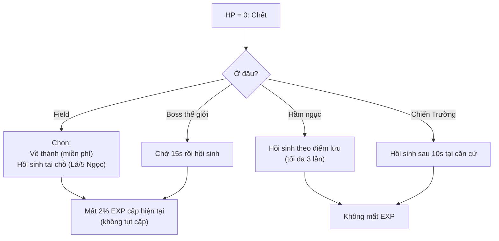

### 5.4 Cường hóa

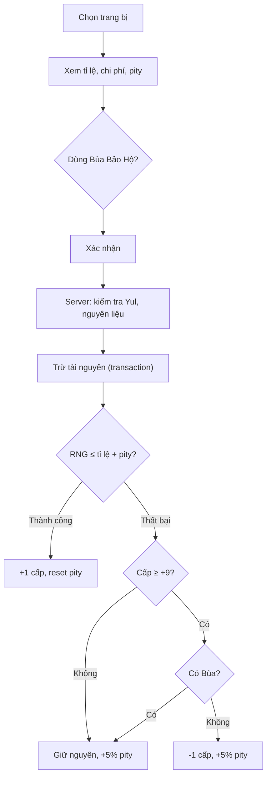

### 5.5 Giao dịch trực tiếp

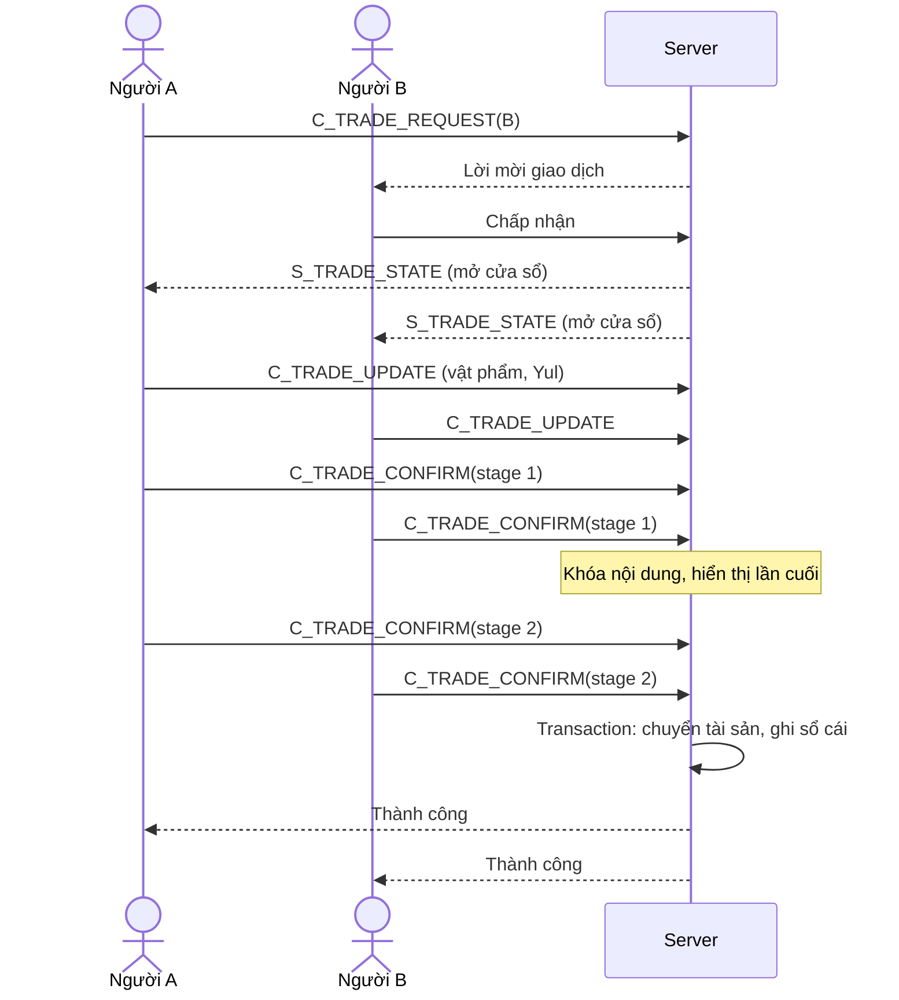

### 5.6 Chợ Ký Gửi

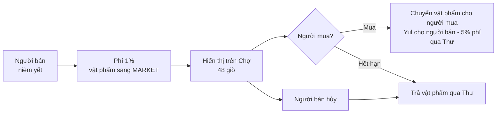

### 5.7 Nạp Ngọc Mana

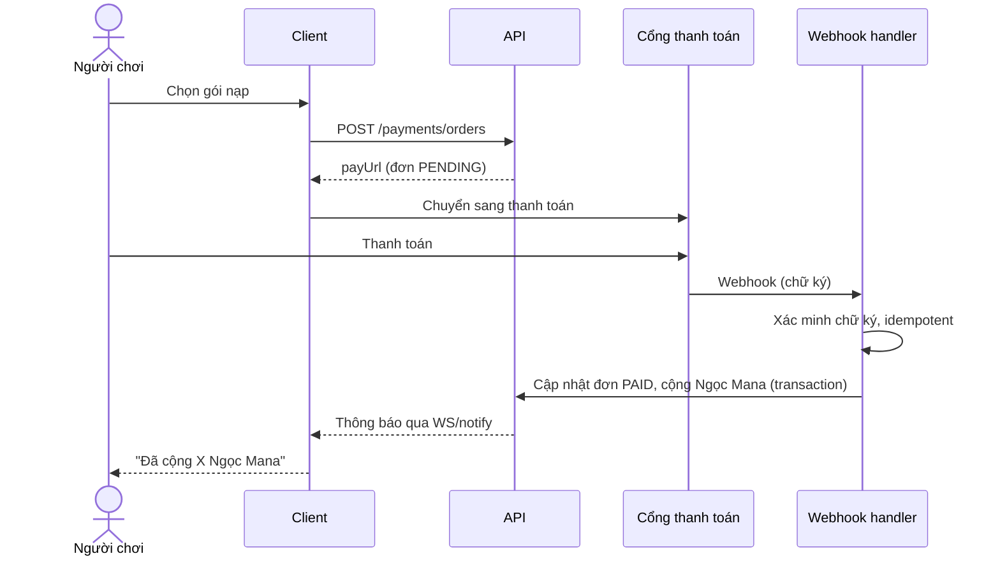

### 5.8 Săn 7 Linh Thạch Sao

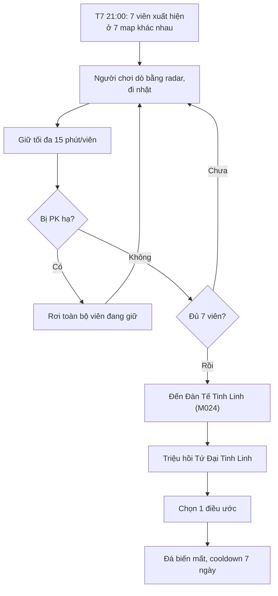

### 5.9 Gia nhập Squad

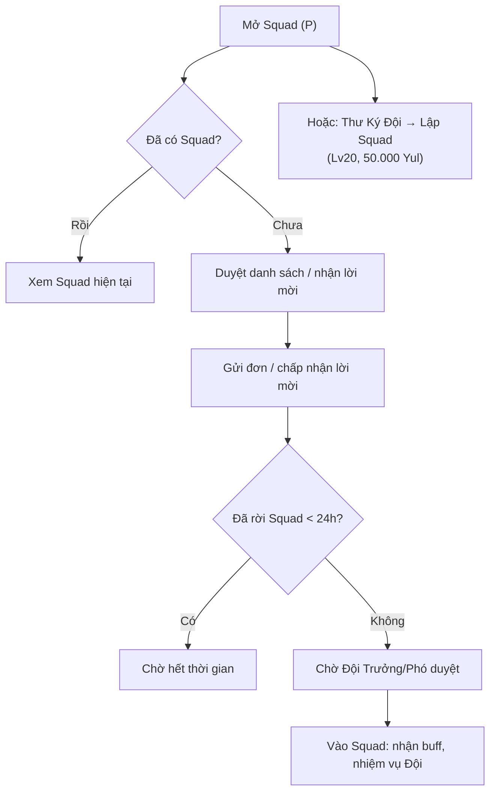

### 5.10 Hầm ngục

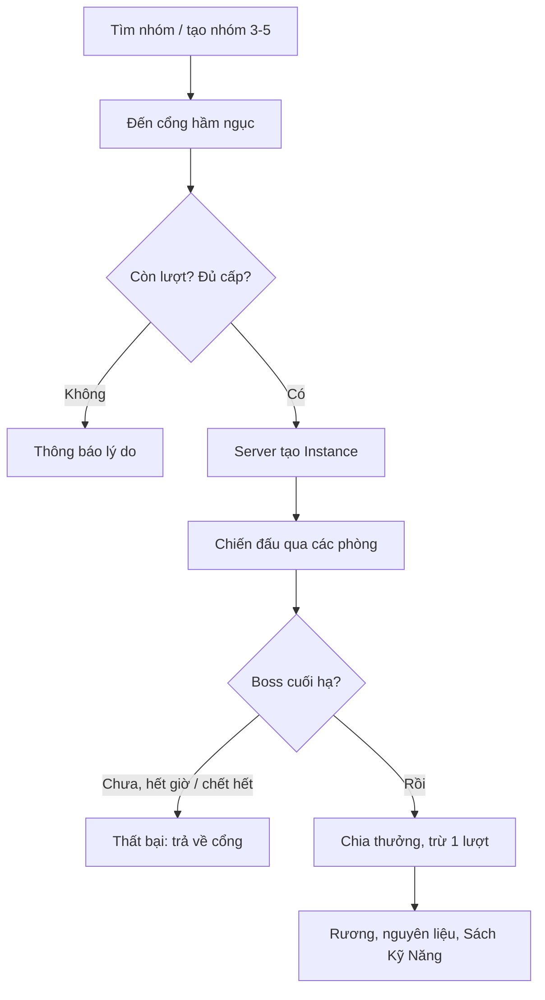

## 6. Các tình huống biên (edge cases)

| Tình huống | Hành vi mong đợi |
|-----------|-------------------|
| Mất kết nối khi đang cường hóa | Lệnh đã nhận thì hoàn tất; kết quả hiển thị khi đăng nhập lại (mail/ghi log) |
| Túi đồ đầy khi nhặt/nhận thưởng | Vật phẩm gửi qua **Thư** (tối đa 30 ngày) |
| Hai người cùng nhặt một vật phẩm | Server chọn người đến trước (theo tick), người kia nhận thông báo |
| Mất kết nối trong Hầm ngục | Giữ chỗ 5 phút; thoát = bị tính là bỏ |
| Server bảo trì khi đang boss | Thông báo trước; boss reset; thưởng theo log |
| Đăng nhập trên thiết bị khác | Phiên cũ bị đá, thiết bị mới vào |
| Tên nhân vật trùng | Báo lỗi và gợi ý tên thay thế |
| Spam chat | Mute tự động 5 phút |
| Chết khi đang mang Linh Thạch | Viên rơi nếu bị PK hạ; nếu do quái thì giữ |

## 7. Điểm rơi rủi ro bỏ cuộc (churn) và biện pháp

| Thời điểm | Rủi ro | Biện pháp |
|-----------|--------|-----------|
| Lv1–5 | Không hiểu cơ chế | Chỉ dẫn bong bóng, tăng tốc EXP |
| Lv10 | Chọn hệ sai | Cho **đổi miễn phí 24 giờ**, gợi ý theo vai trò |
| Lv20–30 | Cày chán | Nhiệm vụ ngày + Squad + Auto Hunt |
| Lv40–50 | Tường sức mạnh | Cường hóa có pity, Hầm Ngục, nhiệm vụ tuần |
| Lv60+ | Thiếu mục tiêu | Raid, Chiến Trường, Mùa Giải, Sao |
| Endgame | Hết nội dung | Mùa mới mỗi 3 tháng |
