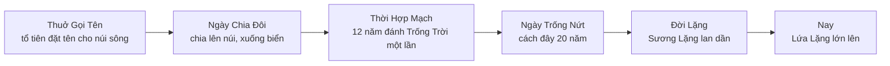
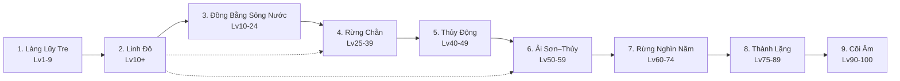

# Thế giới & Lịch sử

> **Trạng thái:** Draft v0.1, chờ duyệt · **Liên quan:** [01 tiền đề](01-premise-and-pillars.md) · [03 hệ thống Linh](03-magic-linh-system.md) · [04 phe và nhân vật](04-factions-and-characters.md) · [05 cốt truyện](05-main-story.md)

## 1. Vũ trụ quan

Địa Linh vận hành bằng năm khái niệm:

| Khái niệm | Nghĩa | Ghi chú thiết kế |
|-----------|-------|-------------------|
| **Linh** | Hồn của một nơi hay một vật: núi, sông, cây, đá, loài vật | Không phải thần, không thờ như thần. Là **bạn** của người |
| **Khí** | Hơi sức của sinh vật; người dùng Khí để gọi và nhờ Linh | Chỉ số **Khí** trong game (thay mana) |
| **Tiếng** | Âm thanh gọi được Linh: trống, sáo, giọng hát, tiếng dùi | Nền của mọi phép thuật |
| **Tên** | Cái tên gắn Linh với người và vùng đất | Nền của hệ thống **Danh** và Sổ Tên |
| **Nhịp** | Nhịp điệu chung giữ muôn Linh hòa với nhau | Do **Trống Trời** giữ |

Nguyên tắc: **Linh không chết, Linh chỉ im lặng hoặc bị lãng quên.** Một Linh bị quên lâu ngày sẽ **hóa mốc**: biến chất thành **Dị Loại**, thứ chúng ta đánh trong game. Vì vậy, đánh Dị Loại là *giúp Linh thoát cơn mê*, không phải giết thần.

## 2. Lịch sử

### 2.1 Thuở Gọi Tên
Tổ tiên đi đến đâu thì đặt tên cho đến đó: *Núi Bạc, Sông Lụa, Gò Mối, Đầm Sen*. Tên được người ta lặp đi lặp lại, và một ngày nào đó, nơi ấy **đáp lại**. Đó là Linh đầu tiên. Từ đó có tục **gọi tên** khi đi ngang một nơi lạ.

### 2.2 Ngày Chia Đôi
Truyền rằng ngày xưa, **một người từ biển** và **một người từ núi** gặp nhau, thương nhau, rồi vì đất rộng người đông mà **chia hai ngả**: một nửa theo biển, một nửa theo núi; **một số người ở lại giữa chừng**, trên đồng bằng. Ba nhánh ấy là ba **Mạch** (xem [§4](#4-ba-mạch-cội-nguồn)). Truyện này được kể bằng nhiều giọng, tùy làng; **không có bản nào là bản gốc**.

### 2.3 Thời Hợp Mạch
Để nhớ rằng ba nhánh có chung một giàn, cứ **mười hai năm** ba Mạch cử người về **Núi Thiêng**, cùng đánh **Trống Trời**. Tiếng trống ấy "lên dây" cho muôn Linh. Người đánh trống gọi là **Người Gõ**, mỗi Mạch một người, ba người gõ **cùng một nhịp**.

### 2.4 Ngày Trống Nứt
Hai mươi năm trước, giữa lễ thứ mười tám, **trống nứt**. Tiếng trống vỡ, nhịp rối. Người ta tìm thủ phạm và chỉ thấy lời đổ lỗi: Mạch Rồng bảo Mạch Tiên làm, Mạch Tiên bảo Mạch Đất, Mạch Đất bảo ba người gõ trống. **Sự thật được giấu** (xem Chương 4, 7).

### 2.5 Đời Lặng
Sau ngày ấy, **Sương Lặng** xuất hiện ở những nơi cũ: trống làng không kêu, cây đa thôi xào xạc, người ta quên dần tên cái giếng đầu làng. Ít người **thức tỉnh Linh** hơn. Những đứa sinh sau ngày ấy là **Lứa Lặng**. Người chơi thuộc lứa này.

### 2.6 Sương Lặng trong game

| Hiệu ứng | Mô tả |
|----------|-------|
| **Âm thanh nhỏ dần** | Ở vùng nặng, BGM và SFX giảm; chỉ còn tiếng nền |
| **Hồi Khí chậm** | Trong Sương Lặng nặng, hồi Khí −30% (có vật phẩm kháng) |
| **Chữ mờ** | Ở Chương 7–8, một phần chữ nhật ký nhiệm vụ mờ đi: *người chơi "quên" thật*, dùng Sổ Tên để nhớ lại |
| **Dị Loại** | Quái xuất hiện nhiều hơn |

## 3. Trống Trời

- Một chiếc **trống đồng khổng lồ**, mặt trống chạm hình mặt trời, chim, thuyền, người nhảy múa.
- Đặt trên **Đài Trống** ở Núi Thiêng.
- Khi nứt, trống tách làm **hai nửa**: nửa trên vẫn ở Núi Thiêng, **nửa dưới rơi xuống Cõi Âm**.
- Muốn trống vang lại cần **ghép đủ hai nửa** và **ba Người Gõ** đứng cùng một nhịp. Đó là mục tiêu cuối game.

## 4. Ba Mạch (Cội Nguồn)

Ba Mạch là **mạch nguồn huyền tích**, mọi người đều có thể thuộc một Mạch, **không** đại diện dân tộc nào. Người chơi chọn Mạch khi tạo nhân vật (xem [03 §6](03-magic-linh-system.md)).

| Mạch | Gốc tích | Sở trường | Thường sống ở | Câu nói quen |
|------|----------|-----------|---------------|--------------|
| **Mạch Đất** | Những người ở lại giữa chừng | Bền chí, trồng trọt, nghề thủ công | Đồng bằng, làng | "Còn nhà là còn đường về." |
| **Mạch Rồng** | Người đi theo biển | Khí dồi dào, giỏi sông nước và phép nước | Sông biển, vịnh, đò | "Nước chảy thì đá cũng mòn." |
| **Mạch Tiên** | Người đi theo núi | Hồi phục tốt, giỏi cây cỏ và tiếng gió | Núi, rừng, thung | "Đi cao mới thấy đất rộng." |

Ba Mạch có hôn nhân và pha trộn từ lâu; Mạch chỉ là **di sản**, không phân biệt đẳng cấp.

## 5. Địa lý: chín vùng

Chín vùng xếp theo cấp độ, gồm 31 bản đồ. Tên từng bản đồ được đặt ở bước viết nội dung (Bước 2), theo bảng vùng dưới đây.

| # | Vùng | Cấp | Cảnh quan | Không khí | Nơi nổi bật | Họ Dị Loại chính |
|---|------|-----|-----------|-----------|-------------|------------------|
| 1 | **Làng Lũy Tre** | 1–9 | Lũy tre bao quanh, sân đình, cây đa, giếng, ao sen, đồng mạ | Ấm, yên, hơi buồn vì trống làng im | Sân đình, ao, gò hang dơi | Ếch ương, chuột đồng, ốc bươu, rắn nước, ma trơi |
| 2 | **Linh Đô** | 10+ | Kinh đô: cổng thành, phố cổ ba mươi sáu phố, hồ sen, Linh Quán | Đông vui, tất bật, có phần giả tạo | Linh Quán, chợ phố cổ, sới võ hồ sen | (Thành an toàn) |
| 3 | **Đồng Bằng Sông Nước** | 10–24 | Cánh đồng, rạch lục bình, chợ nổi, mỏ đồng cũ | Rộng, ẩm, mùi phù sa | Bến đò ngã ba, mỏ đồng | Cò ma, cá sấu, rắn, ma da, tượng đồng |
| 4 | **Rừng Chằn** | 25–39 | Rừng già, sương mù, gốc đa khổng lồ | Rậm, thì thầm, lạc lối | Dịch trạm rừng, hang rễ đa | Chằn tinh, hồ ly, nấm độc, nhện, vượn ma |
| 5 | **Thủy Động** | 40–49 | Vịnh đá vôi, hang động ngập nước | Xanh thẫm, vọng âm | Bến vịnh đá, động thủy sâu | Cua, mực, sứa, thuồng luồng |
| 6 | **Ải Sơn–Thủy** | 50–59 | Ruộng bậc thang cao, ải giữa núi và sông | Căng thẳng, hai phe đối đầu | Đồn ải giữa, bãi chiến | Quân hai tộc, tượng kết trận |
| 7 | **Rừng Nghìn Năm** | 60–74 | Rừng cổ, thung cây đa, hang đàn Linh | Thiêng, già, bồi hồi | Thung cây đa cổ, động Linh cổ | Linh cổ hóa mốc, voi, hổ, trăn |
| 8 | **Thành Lặng** | 75–89 | Thành phố bỏ hoang, phố không ai nhớ tên | Trống rỗng, lạnh | Phố Quên, Thành Lặng | Người Lặng, Bóng Quên, tượng đá |
| 9 | **Cõi Âm** | 90–100 | Bến sông, đồng không tên, đài trống vỡ | Nặng nề, nhưng không ghê rợn | Bến Sông Quên, Đài Trống Vỡ | Ma đói, âm binh, bóng không tên |

> **Ghi chú:** Cõi Âm là **nơi ký ức và những người bị quên đi về**, không phải "địa ngục". Tông chủ đạo là **buồn, bao dung**, không kinh dị.

## 6. Đời sống thường ngày

### 6.1 Nơi chốn trung tâm
- **Đình làng:** nhà chung, nơi họp việc làng, đặt trống làng, làm Lễ Khai Linh.
- **Cây đa, bến nước, sân đình:** nơi gặp gỡ, tin tức, truyện kể.
- **Chợ:** nơi buôn bán, trao đổi, và là nơi **Bài Chòi** diễn ra.
- **Bến đò:** nối làng với làng, và là nơi vận chuyển nhanh (dịch chuyển trong game).
- **Linh Quán:** học viện và cơ quan quản lý Linh Sĩ.

### 6.2 Nghề nghiệp tiêu biểu (làm nền cho NPC)
Nông dân, lái đò, thợ rèn, thợ đúc đồng, thợ dệt, lang thuốc Nam, người làm bánh, phu trạm (đưa thư), thầy đồ, thợ săn, người hô Bài Chòi.

### 6.3 Tiền tệ
- **Quan** (soft): đơn vị tiền xu thường dùng.
- **Nén Bạc** (cao cấp): thỏi bạc, chỉ dùng cho việc lớn (đổi Phái, mở rộng, vật phẩm tiện ích).

### 6.4 Lịch lễ hội (cho sự kiện trong game)

| Lễ hội | Thời điểm | Nội dung game |
|--------|-----------|---------------|
| **Hội Xuân** | Đầu năm âm lịch | Lì xì Quan, bánh chưng bánh tét, quái Tết |
| **Hội Thả Diều** | Mùa xuân/hè | Thi bay diều, phần thưởng Diều Bay |
| **Hội Đua Thuyền** | Mùa hè | Đua thuyền theo Trại, thưởng thuyền thẩm mỹ |
| **Đêm Rằm Tháng Bảy** | Rằm tháng bảy âm lịch | Sự kiện thế giới: người sống mang lễ **cúng** cho những người bị quên, đối đầu với Ma Đói; tông **trang nghiêm, thương cảm** |
| **Hội Đèn Trung Thu** | Rằm tháng tám | Rước đèn, múa lân, chơi trò |
| **Hội Thử Linh** | Mùa thi hằng năm | Thi đấu của Sĩ Tử ở Linh Đô (cũng là Chương 2) |
| **Lễ Xướng Danh** | Cuối tháng/mùa | Tôn vinh bảng xếp hạng Danh (**Bảng Vàng**) |

## 7. Sinh vật

| Nhóm | Mô tả | Quy tắc |
|------|-------|---------|
| **Linh** | Hồn của nơi chốn | Bạn của người; **không đánh được** |
| **Linh Thú** | Linh nhỏ có hình dạng loài vật (cá chép, cò, chuồn chuồn, ếch…) | Đi theo người chơi làm thú cưng |
| **Linh Chủ** | Bảy Linh lớn, bảo trợ bảy Phái (xem [03](03-magic-linh-system.md)) | Không là boss, chỉ là nhân vật huyền thoại |
| **Dị Loại** | Linh hoặc loài vật bị lãng quên lâu, hóa mốc, mất hình | **Quái** trong game |
| **Ma** | Hồn người đã mất nhưng không ai nhớ (ma đói, bóng không tên) | Chỉ xuất hiện ở Cõi Âm và sự kiện Rằm Tháng Bảy; **có cách hóa giải** |
| **Người Lặng** | Thành viên Vong Nguyên Hội bị Sương Lặng thấm | Là **người**; thường có lựa chọn thuyết phục hay đánh |

## 8. Phong cách hình ảnh

### 8.1 Bảng màu chủ đạo
Gợi từ tranh dân gian và vật liệu truyền thống (màu sắc là **ý tưởng chung**, vẽ lại hoàn toàn bằng thiết kế gốc):

| Màu | Gợi ý | Dùng cho |
|-----|-------|----------|
| Đỏ son | Sơn mài, tranh dân gian | Nút chính, lễ hội, Hỏa |
| Vàng nghệ | Đồng cũ, nắng | Điểm nhấn, UI |
| Xanh lá mạ | Ruộng, tre | Vùng làng, Mộc |
| Xanh chàm | Nhuộm chàm, sông | Thủy, đêm |
| Nâu đất | Đất, nhà gỗ | Thổ, nền |
| Đen than | Mực, bóng | Âm, chữ |
| Trắng vỏ sò | Mặt trống, sương | Sương Lặng, Dương |

### 8.2 Chất liệu và họa tiết
Đồng patin xanh, gỗ, tre, lụa, gốm, sơn mài; họa tiết **sóng, mây, chim, thuyền, mặt trời nhiều tia** (là mô-típ chung, **không sao chép nguyên mẫu** một hiện vật cụ thể); chữ viết tay, ô cửa gỗ, mái ngói, mái rạ.

### 8.3 Trang phục (gợi ý nhóm)
Áo nâu, áo bà ba, áo tứ thân, áo dài cách tân, khăn, nón lá, nón quai thao (dạng cách điệu), khố, gấu váy. **Không** tái tạo nguyên trang phục của một dân tộc cụ thể khi chưa tham vấn.

### 8.4 Kiến trúc
Nhà rạ, nhà ngói, đình làng, cổng làng, cầu ao, mái đình cong, nhà sàn (cách điệu chung), cầu khỉ, bến đò, chợ nổi. **Không** dùng nguyên mẫu công trình lịch sử cụ thể (nhà vua, đền thờ có thật).

### 8.5 Khác biệt cần giữ
Mỗi vùng có **ánh sáng và nhịp nhạc** riêng; **Sương Lặng** có màu xám trắng, mờ dần, giảm âm thanh. Đây là dấu ấn hình ảnh của game.
