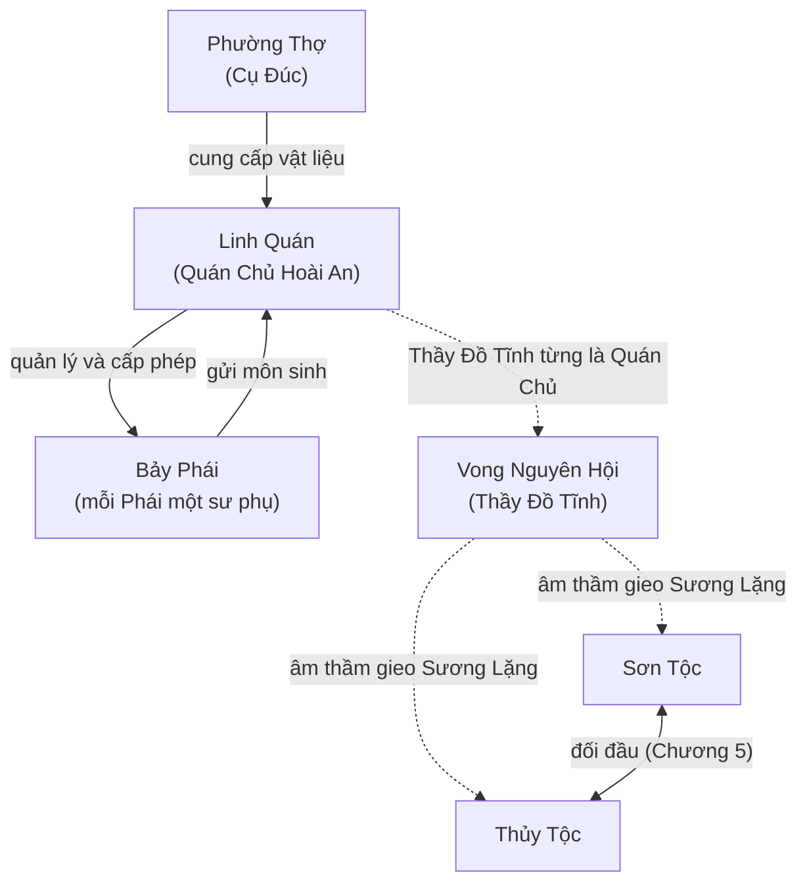

# Phe phái & Nhân vật

> **Trạng thái:** Draft v0.1, chờ duyệt · **Liên quan:** [02 thế giới](02-world-and-history.md) · [03 hệ thống Linh](03-magic-linh-system.md) · [05 cốt truyện](05-main-story.md)
> Mọi nhân vật dưới đây là **hư cấu, do dự án sáng tạo**. Không có nhân vật nào lấy từ người thật, nhân vật được thờ phụng hay tác phẩm khác (xem [rào chắn](01-premise-and-pillars.md#8-rào-chắn-văn-hóa-và-nội-dung)).

## 1. Phe phái

Chín phe cho **Danh Vọng Phái**, thêm một tổ chức phản diện và hai tộc trong Chương 5.

| Phe | Loại | Vai trò | Biểu tượng gợi ý | Cửa hàng phe bán |
|-----|------|---------|------------------|------------------|
| **Hỏa Phái** | Phái | Thợ pháo, thợ rèn | Chim lửa | Vũ khí Hỏa, bình tăng ATK |
| **Thủy Phái** | Phái | Lái đò, ngư dân | Sóng, rồng nước | Vật phẩm hồi Khí, thuyền thẩm mỹ |
| **Phong Phái** | Phái | Phu trạm, thả diều | Cánh chim Lạc | Giày, Diều Bay |
| **Lôi Phái** | Phái | Đánh trống, võ sĩ | Dùi trống | Găng, vật phẩm tốc đánh |
| **Thổ Phái** | Phái | Nông dân, thợ xây | Kỳ lân, bàn tay | Khiên, giáp |
| **Mộc Phái** | Phái | Lang thuốc, người trồng cây | Lá đa | Thuốc Nam, thảo dược |
| **Âm Phái** | Phái | **Giữ Tên** người mất | Rùa đen, quyển sổ | Vật phẩm kháng Lặng, Sổ Tên (trang trí) |
| **Linh Quán** | Cơ quan | Học viện và quản lý Linh Sĩ | Chiếc trống nhỏ | Trang bị cao cấp, trang phục Linh Sĩ |
| **Phường Thợ** | Hội nghề | Thợ đúc, dệt, chế tác | Cái đe, thoi dệt | Vật liệu, công thức chế tạo |
| **Vong Nguyên Hội** | Phản diện | Muốn "quên cội nguồn để hết đau" | Chiếc trống úp | (Không có cửa hàng) |
| **Sơn Tộc / Thủy Tộc** | Hai phe trong Chương 5 | Hai bên đối đầu, sau hòa giải | Núi / sóng | Huy hiệu Chiến trường |

**Trại** (bang hội do người chơi lập) **khác** với phe: người chơi vừa là thành viên Trại, vừa có Danh Vọng ở các Phái.

### 1.1 Quan hệ giữa các phe

## 2. Ba người bạn cùng làng

Ba người bạn lớn lên cùng người chơi ở Làng Lũy Tre. **Không** có lời hứa "thành người mạnh nhất"; họ chỉ là ba đứa trẻ Lứa Lặng muốn biết vì sao làng im, và mỗi người sẽ chọn một cách để tìm hiểu.

### Bống
| | |
|--|--|
| **Tuổi, vai** | 15, con gái người lái đò |
| **Ngoại hình** | Nhỏ người, tóc buộc bằng sợi dây gai, đôi chân luôn có bùn |
| **Tính cách** | Nhanh miệng, nóng tính, tốt bụng, hay cãi nhưng luôn là người đầu tiên chạy tới giúp |
| **Mong muốn** | Được **nhìn thấy biển** một lần |
| **Phái** | Phong Phái |
| **Gốc** | Mẹ thuộc **Mạch Rồng**, cha thuộc Mạch Đất |
| **Vòng cung** | Ở Chương 5 theo **Thủy Tộc**; sau đó là người **hòa giải** bằng cách làm hết sức để người khác nghe nhau |
| **Chức năng game** | Bạn đồng hành nhiệm vụ lời hứa **"Chuyện Ba Đứa"** |

### Đen
| | |
|--|--|
| **Tuổi, vai** | 15, con trai nhà nông ở chân đồi |
| **Ngoại hình** | Vạm vỡ, da ngăm, ít nói, hay cầm theo cái cuốc |
| **Tính cách** | Chậm, chắc, trọng lời hứa, nói ít nhưng nói là làm |
| **Mong muốn** | Giữ cho **cánh đồng của cha** khỏi bị mất |
| **Phái** | Thổ Phái |
| **Gốc** | Nội thuộc **Mạch Tiên** |
| **Vòng cung** | Ở Chương 5 theo **Sơn Tộc**; đối đầu Bống; cuối cùng nhận ra lỗi của việc cứng đầu |
| **Chức năng game** | Bạn đồng hành; mở **Thổ Phái** nhiệm vụ phụ |

### Sen
| | |
|--|--|
| **Tuổi, vai** | 14, học trò của **Cô Hạnh** |
| **Ngoại hình** | Gầy, mắt to, luôn mang một ống sáo tre cũ |
| **Tính cách** | Nhút nhát, tinh tế, nhớ rất lâu mọi chuyện; không thích nói nhưng nghe rất giỏi |
| **Mong muốn** | **Ghi lại** tên và chuyện của những người trong làng |
| **Phái** | Mộc Phái |
| **Gốc** | Mạch Đất; mồ côi từ nhỏ, cha mẹ mất trong đợt Sương Lặng đầu tiên kéo qua làng |
| **Vòng cung** | Người **giữ ba người lại với nhau**; ở Chương 8 là **giọng gọi tên** trong Lễ Gọi Tên |
| **Chức năng game** | Giữ **Sổ Tên** của người chơi (hướng dẫn hệ thống) |

> Ba bạn là **NPC**; người chơi có thể chọn Phái giống một trong ba mà không ảnh hưởng cốt truyện.

## 3. Người dẫn dắt ở làng và dọc đường

### Cô Hạnh
- **Vai:** cô giáo làng và người giữ trống làng, khoảng 50 tuổi. Từng là **Người Gõ** thuở trẻ.
- **Ngoại hình:** áo nâu cũ, nón lá, đi hơi khập khiễng, cầm gậy tre.
- **Tính cách:** hiền, bướng, thương học trò, ít khi kể chuyện cũ.
- **Bí mật:** là **Người Gõ của Mạch Đất** trong lễ thứ mười tám. Cô gõ theo **nhịp bị đổi** do Quán Chủ lúc đó chỉ thị, và nghĩ mình gây ra vụ nứt trống.
- **Vòng cung:** từ mặc cảm tới dám đứng lại **gõ trống thêm một lần** ở cuối game.
- **Chức năng:** NPC tân thủ, người khai **Lễ Khai Linh**, hướng dẫn chính tuyến Chương 1–2.

### Ông Từ
- **Vai:** người giữ đình làng, khoảng 70 tuổi.
- **Ngoại hình:** gầy, râu thưa, một tai nghễnh ngãng, luôn lầm bầm với cây đa.
- **Tính cách:** hài hước, hay quên tên người nhưng nhớ tên cây, tên con vật.
- **Chức năng:** làm lễ, **kho ký ức** của làng; quản lý **cây đa** (điểm lưu, dịch chuyển nhanh trong làng).

### Ông Sáu Gáo
- **Vai:** lái đò ở **Bến Đò Ngã Ba**, khoảng 65 tuổi, cha của Bống.
- **Ngoại hình:** da rám nắng, nón lá rách, chiếc gáo múc nước luôn bên hông.
- **Tính cách:** vui, hay kể chuyện *"hồi đó tôi chở…"*, nhưng giữ **bí mật** về một **chuyến đò đặc biệt** từng đưa người xuống **Sông Quên**.
- **Chức năng:** **dịch chuyển** giữa các bến; ở Chương 8 chèo đò xuống **Cõi Âm**.

### Quán Chủ Hoài An
- **Vai:** người đứng đầu **Linh Quán**, khoảng 60 tuổi.
- **Ngoại hình:** nghiêm, áo dài đen, tóc búi, chiếc trống nhỏ đeo bên hông.
- **Tính cách:** thực tế, mỏi mệt, tin vào trật tự; giấu rằng **Linh Quán đã không còn đủ sức giữ Hợp Mạch**.
- **Quan hệ:** kế nhiệm **Thầy Đồ Tĩnh**, vẫn kính trọng ông.
- **Chức năng:** nhiệm vụ chính cấp cao, **Lễ Xướng Danh**, ban danh hiệu **Người Giữ Nhịp**.

### Thầy Đồ Tĩnh
- **Vai:** thầy đồ ở **thư viện Linh Quán**, khoảng 70 tuổi, **cố Quán Chủ**.
- **Ngoại hình:** gầy, râu bạc, kính tre, giọng nhỏ, luôn có sách.
- **Tính cách:** nhẹ nhàng, **bao dung**, kiên nhẫn dạy người chơi, nhiều người yêu quý.
- **Sự thật:** là **thủ lĩnh Vong Nguyên Hội**. Đã chỉ thị **đổi nhịp** để "đặt lại" các Linh và xóa mối thù cũ, nhưng làm **nứt trống**. Từ đó ông tin chỉ có **quên hẳn nguồn gốc** mới chấm dứt đau khổ.
- **Động cơ:** chân thành thương người, **sai ở chỗ coi ký ức là gánh nặng**.
- **Vòng cung:** cố vấn thân thiết (Chương 2–3) → nghi ngờ (Chương 4–5) → đối đầu (Chương 7) → **hóa giải hoặc bị phong lặng** (lựa chọn của người chơi).
- **Chức năng:** NPC phe Linh Quán đầu game, rồi phản diện trung tâm.

### Bà Nỏ
- **Vai:** thợ làm nỏ cuối cùng, hơn 80 tuổi, sống ở **ải**.
- **Ngoại hình:** nhỏ bé, mắt sáng, đôi tay đầy sẹo, có chiếc nỏ cũ treo trên vách.
- **Tính cách:** cộc, nghiêm, nói ít, nhưng ngầm thương người trẻ.
- **Chức năng:** NPC mở **Nỏ Phái** (hệ ẩn), cung cấp **Chuỗi Năm Mũi Tên**.

## 4. Bảy sư phụ Phái

Mỗi sư phụ vừa **dạy kỹ năng của Phái** vừa là **người đứng đầu phe** của Phái ấy.

| Phái | Sư phụ | Vai/tuổi | Ngoại hình | Tính cách | Dấu riêng |
|------|--------|----------|------------|-----------|-----------|
| **Hỏa** | **Chị Diễm** | 35, cựu thợ pháo | Tóc cháy xém ở đuôi, tạp dề da | Nóng, dễ gắt, nhưng tay nghề tuyệt | *"Lửa là để sưởi trước, để đốt sau."* |
| **Thủy** | **Bác Tư Chài** | 60, ngư dân | Da sạm, nón cũ, tay chai | Chậm, ít nói, mắt xa xăm | Mất **người em** (Chài Năm, Người Gõ Mạch Rồng) trong vụ nứt trống |
| **Phong** | **Cô Én** | 28, phu trạm | Nhỏ, nhanh, giày vải mòn | Lanh lợi, bồn chồn, nói nhanh | Nhớ mọi con đường, quên hết sinh nhật |
| **Lôi** | **Anh Ba Dùi** | 45, nhạc công trống | Vạm vỡ, râu quai nón, dùi trống cài thắt lưng | Ồn ào, hào sảng, cười to | Đếm nhịp mọi thứ, kể cả khi ăn cơm |
| **Thổ** | **Bà Bảy Đất** | 55, nông dân | Cao to, tay như gốc cây | Điềm tĩnh, cứng đầu, hay cho đồ ăn | Chưa bao giờ nhờ ai khiêng đồ |
| **Mộc** | **Thầy Sáo Trúc** | 40, lang thuốc | Áo vải, ống sáo trúc, túi thuốc | Dịu dàng, hay nói bằng ví von | Trồng một vườn thuốc trên mái nhà |
| **Âm** | **Cụ Hái** | 80, người giữ sổ tên | Tóc bạc, mặc đen, ôm cuốn sổ dày | Trầm, thương người, hay đọc tên người đã khuất | Thuộc **mọi cái tên** ghi trong sổ |

## 5. NPC dịch vụ tiêu biểu

| Nhân vật | Vai | Chức năng | Điểm nhận diện |
|----------|-----|-----------|----------------|
| **Ông Lý** | Lý trưởng làng Lũy Tre | Bảng tin làng, nhiệm vụ tân thủ | Luôn than thuế |
| **Bà Hai Bánh** | Bán bánh, xôi, chè | **Thức ăn buff** | Mỗi món có một câu chuyện |
| **Lang Tám** | Lang thuốc Nam | Thảo dược, giải độc | Nghĩ mình bị bệnh mỗi tuần |
| **Chị Hô** | Người hô **Bài Chòi** | Vòng quay may mắn (Bài Chòi) | Hô bằng thơ lục bát |
| **Bác Phu Trạm** | Đưa thư | **Thư tín**, bưu kiện | Chiếc xe đạp cũ |
| **Võ Sư Ba Đài** | Chủ sới võ | **Đấu trường** (PvP) | Khen thật lòng cả người thua |
| **Cụ Đúc** | Chủ Phường Thợ | Phe Phường Thợ, nhiệm vụ nghề | Giữ khuôn đúc trống |
| **Anh Đúc Hai** | Thợ đúc | **Chế tạo**, tháo ngọc | Hát khi đúc |
| **Thợ Rèn Tư** | Thợ rèn | **Cường hóa** | Đánh giá đồ qua tiếng búa |
| **Bà Thủ Kho** | Giữ kho | **Kho đồ**, mở rộng túi | Nhớ chính xác mọi món |
| **Chú Thợ Bẫy** | Thợ săn | Bán vật phẩm chiến đấu | Rất sợ chuột |
| **Cai Hang** | Dẫn đường hầm ngục | Nhiệm vụ hầm ngục | Đếm số người vào ra |
| **Cai Trạm** | Quản dịch trạm rừng | Nhiệm vụ ngày của Dịch Trạm | Chưa từng ngủ quá bốn tiếng |
| **Bà Tư Võ** | Võ sư | Dạy **Giáp Khí** | Dạy bằng cách bắt học trò đứng yên cả buổi |
| **Cô Ký Trại** | Thư ký | Lập, giải tán **Trại** | Chữ đẹp như in |
| **Người Dắt Đệ Tử** | Thầy dẫn đồ | **Khế ước Đệ Tử** | Nghiêm với trò, mềm với thầy |
| **Bác Bãi Thả** | Chủ bãi diều và chuồng trâu | **Phương tiện** (Diều, Trâu) | Nói chuyện với trâu |
| **Lính Lệ** | Lính canh | Hồi sinh miễn phí, dịch chuyển về thành | Than đứng gác mệt |
| **Cụ Đa** | Người chăm cây đa cổ | Chuỗi **Hòa Nhịp** (mở Hợp Linh) | Nói chuyện với cây |

## 6. Phản diện

### Vong Nguyên Hội
- **Tín điều:** *"Quên nguồn để hết đau."* Tin rằng mọi chia rẽ, thù hận đều xuất phát từ **nhớ** nguồn gốc.
- **Phương pháp:** chôn **Hũ Quên** ở các nơi để gieo **Sương Lặng**; đánh cắp **tên** và **tiếng**; chuẩn bị **Lễ Quên** ở **Đài Trống**.
- **Thành viên (Người Lặng):** những người từng mất mát lớn và muốn quên. **Nhiều người có thể thuyết phục.** Họ là **người**, không phải quái.

### Tam Tĩnh (ba cánh tay của Thầy Đồ Tĩnh)
Ba cựu sư phụ của ba Phái, mỗi người **mất một người thân** vì Linh.

| Tên | Cựu thuộc | Mất mát | Vai trò trong Lễ Quên |
|-----|-----------|---------|------------------------|
| **Tĩnh Cốt** | Thổ Phái | Mất cả gia đình trong **trận sạt núi** | Giữ **thân** (sức mạnh) |
| **Tĩnh Tâm** | Âm Phái | Quá nhiều tên người mất phải ghi mà không nhớ hết | Giữ **tâm** (ký ức) |
| **Tĩnh Thanh** | Mộc Phái | **Mai**, Người Gõ của Mạch Tiên, mất tích sau vụ nứt trống | Giữ **tiếng** |

> **Ghi chú:** **Mai** và **Tĩnh Thanh** là **cùng một người**; Mai bỏ tên cũ sau Ngày Trống Nứt, gia nhập Vong Nguyên Hội. Đây là cú **lật** của Chương 7.

### Vô Danh (The Nameless)
- Là **tổng hợp** của những **Linh và người bị quên** rơi xuống Cõi Âm khi trống nứt, tụ lại thành một sinh thể.
- **Không có ác ý**: chỉ **đói tên**, và nuốt mọi cái tên nó chạm tới.
- Cách kết thúc: **gọi tên** từng phần của nó (Chương 8), chứ không đơn thuần đánh bại.

## 7. Ba Người Gõ (cốt lõi bí ẩn)

| Mạch | Người Gõ | Số phận |
|------|----------|---------|
| **Mạch Đất** | **Hạnh** (nay là Cô Hạnh) | Còn sống, mang mặc cảm |
| **Mạch Rồng** | **Chài Năm** | Mất mạng trong vụ nứt trống; em trai là Bác Tư Chài |
| **Mạch Tiên** | **Mai** | Biến mất, về sau là **Tĩnh Thanh** |

Ở cuối game, ba người (hoặc ba **người kế nhiệm** nếu có ai không thể trở lại) **cùng gõ** một nhịp để vá trống.

## 8. Quy tắc sử dụng nhân vật

- Mỗi NPC có **một chức năng game rõ** và **một nét riêng** dễ nhớ.
- Tên, tuổi, quan hệ có thể điều chỉnh khi duyệt; **không đổi** vai trò cốt truyện đã nêu.
- Không đặt tên nhân vật theo người thật; tránh tên gắn với danh nhân và nhân vật thờ phụng.
- Nhân vật phụ vùng sông nước có thể mang **giọng Nam Bộ nhẹ**, không dùng làm trò cười.
