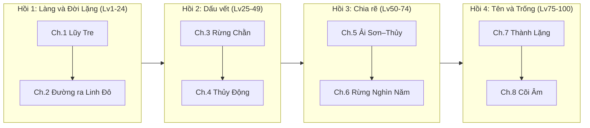

# Cốt truyện chính: Tám chương

> **Trạng thái:** Draft v0.1, chờ duyệt · **Liên quan:** [01 tiền đề](01-premise-and-pillars.md) · [02 thế giới](02-world-and-history.md) · [04 nhân vật](04-factions-and-characters.md)
> Mọi chương **hoàn thành được một mình**. Raid có **Chế độ Cốt Truyện** một người ([maps §6.1](../game-design/05-world-maps-monsters.md)). Câu chuyện **không bám** cấu trúc của tác phẩm nào khác.

## 1. Câu hỏi trung tâm

Bốn câu hỏi dẫn người chơi đi suốt tám chương:

1. **Ai làm nứt trống?** (Chương 4, 7)
2. **Vì sao?** (Chương 7)
3. **Sương Lặng từ đâu mà ra, và Vô Danh là gì?** (Chương 6, 8)
4. **Làm sao để trống vang lại?** (Chương 8)

## 2. Bốn hồi

| Chương | Tên | Cấp | Vùng | Chủ đề | Boss chính |
|--------|-----|-----|------|--------|------------|
| 1 | **Lũy Tre** | 1–9 | Làng Lũy Tre | Trống làng im; lớn lên | Ma Trơi Mẹ |
| 2 | **Đường Ra Linh Đô** | 10–24 | Linh Đô, Đồng Bằng Sông Nước | Khai Linh, Hội Thử Linh, kẻ trộm tiếng | Kẻ Trộm Tiếng |
| 3 | **Rừng Chằn** | 25–39 | Rừng Chằn | Sương Lặng không tự nhiên; Đêm Rằm | Đa Mốc; Cai Vong Nguyên (sự kiện) |
| 4 | **Thủy Động** | 40–49 | Thủy Động | Trống nứt có chủ ý | Thuồng Luồng Chúa |
| 5 | **Ải Sơn–Thủy** | 50–59 | Ải Sơn–Thủy | Chia rẽ, hòa giải | Tướng Quân Ải |
| 6 | **Rừng Nghìn Năm** | 60–74 | Rừng Nghìn Năm | Cái Tên giữ Linh | Linh Cổ Hóa Mốc |
| 7 | **Thành Lặng** | 75–89 | Thành Lặng | Quên để hết đau? | Tam Tĩnh; Thầy Đồ Tĩnh |
| 8 | **Cõi Âm** | 90–100 | Cõi Âm | Gọi tên và vá trống | Tiếng Vọng Quên; Vô Danh |

## 3. Chi tiết từng chương

### Chương 1: Lũy Tre (Lv 1–9)

**Tóm tắt.** Ba năm nay trống làng không kêu. Cô Hạnh bảo trẻ con làng đừng sợ, nhưng chính cô là người sợ nhất. Người chơi cùng Bống, Đen, Sen chuẩn bị cho Lễ Khai Linh.

**Nhịp truyện (hướng dẫn).**
1. Sáng ở sân đình: **Cô Hạnh** giao việc, học di chuyển và trò chuyện.
2. Ra **Cánh Đồng Mạ** đánh ếch ương, nhặt đồ, học dùng bình **Thuốc Nam**.
3. **Lũy Tre & Bờ Ao**: giúp dân làng, làm quen **nhóm** với Bống, Đen.
4. **Gò Hang Dơi**: tìm nguồn tiếng động lạ, gặp **Ma Trơi Mẹ**.
5. Đêm trước lễ, **Ông Từ** kể truyện **Ngày Chia Đôi**; Sen tặng người chơi một ống sáo tre nhỏ.
6. **Lễ Khai Linh** (Lv10, chuyển sang Chương 2): người chơi nghe **bảy tiếng vọng**.

**Lựa chọn / hóa giải.** Ma Trơi Mẹ có thể bị đánh tan **hoặc** được **dẫn về** chỗ cũ bằng cách thổi sáo (kết quả nhẹ, ảnh hưởng thoại về sau).
**Sổ Tên:** *Chị Cả Làng* (người đã bỏ làng đi và không ai nhớ tên).
**Thưởng chính:** Áo nâu làng, **Linh Vật Tre** (Chương 2).

### Chương 2: Đường Ra Linh Đô (Lv 10–24)

**Tóm tắt.** Vì bảy tiếng vọng quá lạ, Cô Hạnh gửi người chơi tới **Linh Quán** ở Linh Đô. Trên đường, người chơi qua **đồng bằng sông nước** bằng đò của **Ông Sáu Gáo**, rồi tham gia **Hội Thử Linh**.

**Nhịp truyện.**
1. Từ Làng ra bến: **Bống** đi cùng tới bến đò, tạm biệt.
2. Đi qua **Cánh Đồng Cò Bay**, **Rạch Lục Bình**; nghe kể về **chợ nổi** bị mất tiếng rao.
3. Tới **Linh Đô**; gặp **Thầy Đồ Tĩnh** ở thư viện (thân thiện, giúp tra cứu).
4. **Hội Thử Linh** (ba vòng): **Cuộc Rước** (hộ tống đoàn rước), **Sới Võ** (đấu giám khảo), **Đêm Trống** (canh trống lễ hội).
5. Ở vòng ba, **Kẻ Trộm Tiếng** xuất hiện, cướp tiếng trống lễ hội. Người chơi đuổi theo tới **Mỏ Đồng Cũ**.
6. Hạ Kẻ Trộm Tiếng, thấy trên người hắn **chiếc trống úp**: biểu tượng của **Vong Nguyên Hội** (lần đầu).
7. **Chọn Trại**: nhiều Trại mời; người chơi gia nhập hoặc lập Trại mới (Lv20).

**Lựa chọn.** Gia nhập Trại nào chỉ ảnh hưởng **Danh Vọng Phái** ban đầu, không khóa nội dung.
**Boss:** Lợn Lòi Chúa (12), Tượng Đồng Mỏ (22), **Kẻ Trộm Tiếng (24)**, Bóng Giám Khảo (instance).
**Sổ Tên:** *Người Rao Chợ Nổi*, *Thợ Đúc Cũ*.

### Chương 3: Rừng Chằn (Lv 25–39)

**Tóm tắt.** Những đoàn xe lạc trong **Rừng Chằn**. **Dịch Trạm Rừng** nhờ Linh Sĩ tìm đường. Người chơi phát hiện **Sương Lặng không tự nhiên**: có người chôn **Hũ Quên** khắp rừng.

**Nhịp truyện.**
1. **Dịch Trạm Rừng**: gặp **Cai Trạm**, **Bác Phu Trạm** và mạng lưới đưa thư.
2. Học **Giáp Khí** từ **Bà Tư Võ**.
3. **Rừng Sương Lặng**: tìm và **đào lên các Hũ Quên** (nhiệm vụ lặp lại tạo điểm tiến độ).
4. **Hang Rễ Đa**: hạ **Đa Mốc**, cây đa nhiều năm không ai nhớ tên.
5. **Sự kiện thế giới: Đêm Rằm.** Vong Nguyên Hội tấn công Linh Đô để **trộm lễ vật** và cái tên người mất. Người chơi **bảo vệ lễ cúng**; thủ lĩnh sự kiện là **Cai Vong Nguyên**.
6. Gặp **Mai** thoáng qua trong rừng, một người đàn bà gõ sáo trong sương (chưa biết là ai).

**Hóa giải.** Đa Mốc có thể được **gọi lại tên** (nếu người chơi đã nhặt đủ ba Mảnh Tên ở rừng), nếu không thì đánh bại.
**Sổ Tên:** *Cây Đa Đầu Rừng*, *Người Chôn Hũ* (một Người Lặng muốn quên).

### Chương 4: Thủy Động (Lv 40–49)

**Tóm tắt.** Một cái **hang ngầm** nổi lên sau cơn bão, chứa **Kho Sử của Mạch Rồng**. Người chơi cùng **Bác Tư Chài** xuống hang tìm manh mối về vụ nứt trống.

**Nhịp truyện.**
1. **Bến Vịnh Đá**: cùng Thủy Phái chuẩn bị; kể về **Chài Năm**, em trai Bác Tư Chài.
2. **Động Thủy Ngoài**: giải các **cổng nước** (cơ chế dưới nước).
3. **Động Thủy Sâu** (hầm ngục): tìm **Cuộn Nhịp**, bản ghi lễ Hợp Mạch thứ mười tám.
4. **Cú lật 1:** cuộn ghi rõ **nhịp bị đổi cố ý** ở lễ thứ mười tám, *không phải tai nạn*. Chữ ký bị xóa, nhưng còn **dấu ấn Linh Quán**.
5. Hạ **Thuồng Luồng Chúa**, nhận **Đồng Cổ Thủy Động** (vật liệu quan trọng).
6. Quán Chủ Hoài An không thừa nhận khi được hỏi, nhưng **tránh ánh mắt**.

**Mốc Linh Vật.** Lv50 mở chuỗi **Đúc Lại Tiếng** (nâng lên **Linh Vật Đồng**), cùng **Cụ Đúc** và Phường Thợ.
**Sổ Tên:** *Người Em Chài Năm*, *Thủy Thủ Đò Cuối*.

### Chương 5: Ải Sơn–Thủy (Lv 50–59)

> *"Bầu ơi thương lấy bí cùng, tuy rằng khác giống nhưng chung một giàn."*

**Tóm tắt.** Một trận **sạt ruộng bậc thang** và một trận **nước dâng** xảy ra cùng tuần. **Sơn Tộc** đổ lỗi cho **Thủy Tộc** và ngược lại. Giữa họ, các **tướng lĩnh** muốn đánh. Người chơi bước vào **ải** ở giữa hai bên. Bống và Đen đứng hai phía.

**Nhịp truyện.**
1. **Ruộng Bậc Thang Cao**: hộ tống dân sơ tán; thấy **Hũ Quên** ở các nơi đứt gãy.
2. **Đồn Ải Giữa**: tìm chứng cứ rằng **cả hai thiên tai bị gây ra**, không phải thủ đoạn của tộc nào.
3. **Chiến Trường Sơn–Thủy** (PvP): người chơi chọn một phe để **diễn tập** (xem §5). Về mặt truyện, đây là cuộc **thử lực** khiến hai bên phải nhìn nhau.
4. **Bống vs Đen:** hai người **đối đầu**, Sen khóc. Người chơi phải **giữ cả hai lại**.
5. **Tướng Quân Ải:** bị cho uống **sương lặng** nên không nhớ vì sao mình đánh. Người chơi **giải thoát** hoặc đánh bại.
6. **Lễ Chụm:** người chơi trình **chứng cứ**; hai tộc ký **hòa ước**; **Hội Đấu Sơn–Thủy** trở thành tục giao hữu.

**Lựa chọn.** *Bắt* hoặc *tha* Tướng Quân Ải (ảnh hưởng thoại và vài nhiệm vụ phụ).
**Sổ Tên:** *Người Gác Ải Đầu Tiên*, *Cô Gái Hai Mạch*.

### Chương 6: Rừng Nghìn Năm (Lv 60–74)

**Tóm tắt.** Các **Linh Cổ** trong rừng điên cuồng vì Sương Lặng. Để hiểu vì sao, người chơi vào **Ký Ức Rừng Cổ** (flashback) và chứng kiến **cuộc gọi tên đầu tiên**: tổ tiên đã **đặt tên** cho từng nơi, và **cái tên giữ Linh lại**.

**Nhịp truyện.**
1. **Cổng Rừng Nghìn Năm**: Dị Loại tấn công, vì Linh Cổ không còn nhận ra người.
2. **Thung Cây Đa Cổ** (thị trấn): gặp **Cụ Đa**, người nói chuyện được với cây.
3. **Ký Ức Rừng Cổ:** thấy tổ tiên gọi tên Linh Chủ; **cú lật 2:** Linh Chủ **không phải thần** mà là **bạn** được tổ tiên đặt tên.
4. **Động Linh Cổ** (hầm ngục): đối đầu **Linh Cổ Hóa Mốc**, một Linh đã quên tên mình.
5. Người chơi mở **Bảy Mảnh Vọng** (sự kiện tuần): những mảnh **dư âm** của tiếng trống nứt vương khắp Địa Linh.
6. **Bà Nỏ** xuất hiện ở ải, đề nghị chỉ đường cho ai tìm được **5 Mảnh Nỏ**.
7. Bắt đầu chuỗi **Hòa Nhịp** để mở **Hợp Linh**.

**Hóa giải.** Linh Cổ Hóa Mốc có thể được **gọi lại bằng tên thật** (nếu đã thu thập các **Mảnh Tên** từ Ký Ức) hoặc đánh bại.
**Sổ Tên:** *Người Đặt Tên Đầu Tiên*, *Linh Cổ Không Tên*.

### Chương 7: Thành Lặng (Lv 75–89)

**Tóm tắt.** Manh mối đưa người chơi tới **Thành Lặng**, một thành phố bỏ hoang nơi **không ai nhớ tên đường phố**. Tại đây là **trụ sở của Vong Nguyên Hội**. Người chơi biết ai là thủ lĩnh.

**Nhịp truyện.**
1. **Bãi Hoang Sương Lặng**: nhật ký nhiệm vụ **mờ dần** (hiệu ứng "quên"); dùng **Sổ Tên** để nhớ lại.
2. **Phố Quên**: gặp **Người Lặng**, mỗi người một nỗi đau. Có thể **thuyết phục** nhiều người.
3. **Thành Lặng** (Raid 10 người; có Chế độ Cốt Truyện một người): hạ **Tam Tĩnh**.
4. **Cú lật 3:** **Tĩnh Thanh** chính là **Mai**, Người Gõ Mạch Tiên đã biến mất.
5. **Thầy Đồ Tĩnh** hiện ra. Ông kể động cơ: **ông** đã ra lệnh đổi nhịp ở lễ thứ mười tám, tin rằng sẽ "đặt lại" mọi thù hận; trống nứt là **sai lầm** và ông quyết **hoàn tất** bằng **Lễ Quên**.
6. Ông bỏ trốn xuống **Cõi Âm**, nơi nửa dưới Trống Trời đang nằm.

**Lựa chọn / hóa giải.** Đánh bại **hoặc** nói chuyện để **làm ông dao động** (cần đủ **Sổ Tên** liên quan đến ông và Cô Hạnh).
**Mốc hệ ẩn.** Hoàn tất Chương 7 và 5 Mảnh Nỏ mở **Thần Nỏ**.
**Sổ Tên:** *Mai Của Mạch Tiên*, *Người Quét Phố Cuối*.

### Chương 8: Cõi Âm (Lv 90–100)

**Tóm tắt.** Người chơi theo **Ông Sáu Gáo** xuống **Sông Quên**. Cõi Âm là nơi **những người bị quên** về ở, đang bị **Vô Danh** nuốt dần. Để vá trống, phải **ghép hai nửa** và **ba Người Gõ** cùng gõ.

**Nhịp truyện.**
1. **Bến Sông Quên:** Ông Sáu Gáo kể **chuyến đò bí mật** ông từng chở; đưa người chơi qua sông.
2. **Đồng Vô Danh:** hàng nghìn **bóng không tên**; người chơi **gọi tên** những người họ đã ghi trong **Sổ Tên** để các bóng yên lòng.
3. Gặp **Ma Đói Chúa**: một người mẹ chờ con đã mất; có thể **hóa giải** bằng đúng tên.
4. **Tiếng Vọng Quên:** hình bóng đầu tiên của sự lãng quên; hạ hoặc **gọi hết các tên**.
5. **Đài Trống Vỡ** (Raid 15 người, Chế độ Cốt Truyện một người): **Lễ Gọi Tên**.
   - **Pha 1:** Vô Danh nuốt tên (giao diện **mất chữ**).
   - **Pha 2:** Sen **đọc tên**, người chơi giữ nhịp trong lúc dị loại tấn công.
   - **Pha 3:** **Ghép hai nửa trống**; Hạnh, Tĩnh Thanh/Mai, Bác Tư Chài (thay Chài Năm) **cùng gõ**.
   - **Pha 4:** **Nhịp cuối** do người chơi quyết định (bấm đúng nhịp theo âm hưởng Phái).
6. **Kết thúc:** tiếng trống vang. **Sương Lặng tan.** Cây đa xào xạc, trống làng kêu.

**Kết cục (khác nhau tùy lựa chọn).**

| Biến | Kết cục |
|------|---------|
| **Thầy Đồ Tĩnh** hóa giải hay bị phong | Ông **được gọi tên** và đứng cạnh Cô Hạnh ở lễ cuối, hoặc **vĩnh viễn lặng** |
| Số **Tên trong Sổ Tên** | Càng nhiều, càng nhiều NPC **trở về** trong lễ kết |
| Hòa ước **Sơn–Thủy** | Nếu giữ trọn, hai tộc cùng dự lễ |
| Bống, Đen, Sen | Các lựa chọn Chương 5 quyết định ba người đứng ở đâu |

**Phần thưởng.** Danh hiệu **Người Giữ Nhịp** (Lv100), trao tại **Lễ Xướng Danh** do **Quán Chủ Hoài An**. Mở **Mùa Giải Người Giữ Nhịp** (endgame).

**Móc cho Mùa 2.** Tiếng trống vang xa hơn dự tính: những vùng đất khác của Địa Linh bắt đầu **đáp lại**, và có những Linh chưa ai biết tên.

## 4. Hệ thống **Sổ Tên** xuyên suốt

| Thành phần | Mô tả |
|------------|-------|
| **Tên Người Đã Quên** | Họ nhiệm vụ phụ (khoảng 150), mỗi nhiệm vụ giúp **một người, một Linh hoặc một vật** được nhớ lại |
| **Mảnh Tên** | Vật phẩm nhỏ nhặt được ở vùng đất; ghép đủ để **gọi lại tên thật** của Linh trong Chương 3 và 6 |
| **Sổ Tên** | Quyển sổ cá nhân ghi lại mọi cái tên; có bộ sưu tập, thành tích (**Danh**) |
| **Ảnh hưởng** | Kết cục Chương 7, 8; trang phục; danh hiệu |
| **Solo** | Hoàn toàn chơi một mình được |

## 5. Họ nhiệm vụ phụ

| Họ | Nội dung | Mở từ |
|----|----------|-------|
| **Tên Người Đã Quên** | Giúp nhớ lại một con người, một Linh, một vật | Lv5 |
| **Chuyện Ba Đứa** | Chuỗi bạn đồng hành Bống, Đen, Sen | Lv1 |
| **Chuyện Làng** | Việc nhỏ ở các thị trấn, giàu chất đời | Lv5 |
| **Việc Dịch Trạm** | Đưa thư, tìm đường, giao hàng | Lv25 |
| **Hội Trại** | Nhiệm vụ gia nhập và danh vọng các Phái | Lv20 |
| **Kỳ Thi Danh** | Thử thách dài hạn, nhận **Danh** | Lv10 |

## 6. Sự kiện và câu chuyện liên quan

| Sự kiện | Gốc truyện |
|---------|-----------|
| **Hội Thử Linh** | Chương 2; lặp lại hằng năm |
| **Đêm Rằm Tháng Bảy** | Chương 3; tông trang nghiêm, giúp những người bị quên |
| **Hội Đấu Sơn–Thủy** | Chương 5; tục giao hữu sau hòa ước (PvP quy mô lớn) |
| **Hội Trại** | Trại đấu Trại (đua thuyền, thi diều) |
| **Bảy Mảnh Vọng** | Chương 6; gom đủ bảy mảnh để đánh **Lễ Đánh Trống**, triệu **Tứ Linh** ban **Ân Huệ** (xem [events](../game-design/09-social-squad-pvp-events.md)) |
| **Hội Xuân, Thả Diều, Đua Thuyền, Đèn Trung Thu** | Theo lịch [02 §6.4](02-world-and-history.md) |

## 7. Quy tắc viết truyện

- Mỗi chương có **một cú lật** (hoặc một tiết lộ) và **một khoảnh khắc yên tĩnh**.
- Ưu tiên **hóa giải**: ít nhất **ba boss** có cách giải quyết không dùng vũ lực.
- Phản diện **chân thành**, có lý do để người chơi **hiểu** (không phải ác vì ác).
- Tránh "người được chọn": người chơi mạnh lên nhờ **việc làm và lựa chọn**, không nhờ huyết thống đặc biệt.
- **Giữ chủ đề Nhớ nguồn** xuyên suốt: mỗi chương có ít nhất một nhiệm vụ Sổ Tên.
